# 📚 IBM数据工程专业证书 课程11：《使用Spark和Hadoop进行大数据介绍》｜课程介绍

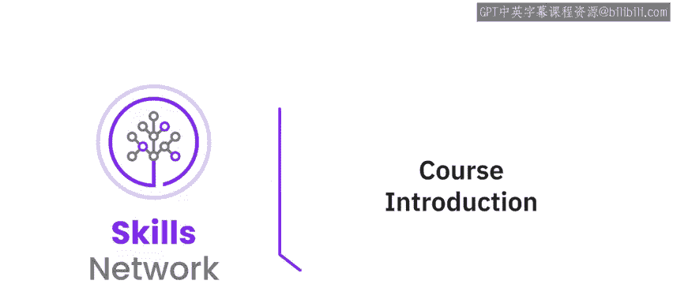

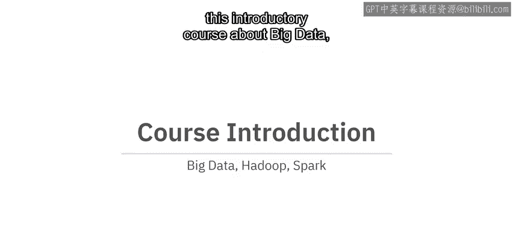

欢迎来到这门关于大数据、Hadoop和Spark的入门课程。

在本节课中，我们将要学习这门课程的整体介绍，包括课程目标、适用人群、讲师信息以及七个模块的核心内容概述。

## 🎯 课程概述与目标

本课程面向任何寻求数据工程或数据架构师角色，并希望发展大数据领域基础知识和技能的学习者。

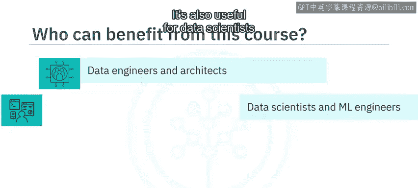

对于希望利用Hadoop和Spark等技术的数据科学家和机器学习工程师，本课程同样有用。

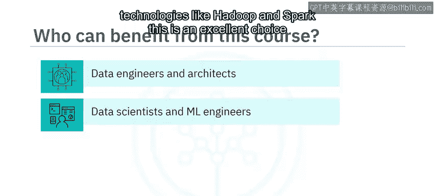

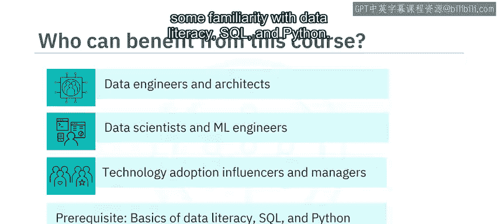

对于技术采纳影响者以及管理业务中生成或使用大数据的技术部分的人员，本课程也是一个绝佳选择。

为了在本课程中取得成功，建议学习者对数据素养、SQL和Python有一定了解。

完成这个包含七个模块、信息丰富的课程后，你将能够：
*   识别大数据并解释其特征。
*   理解Apache Hadoop生态系统如何融入大数据技术栈。
*   使用Apache Spark从大数据中获取洞察。

## 👨‍🏫 讲师介绍

本课程的讲师是Romeo Kienzler、Aije Egwaikhide和Rav Ahuja。

*   **Romeo Kienzler**是IBM Research的高级软件工程师和产品主管，是一位充满热情的讲师，拥有超过20年的软件工程、数据库管理和信息集成经验。
*   **Aije Egwaikhide**是一位高级数据科学家，在创建端到端的机器学习和统计解决方案以优化运营方面拥有经验。
*   **Rav Ahuja**是IBM的全球项目总监，负责IBM Skills Network的增长战略、课程创建和合作伙伴项目。

## 📖 课程模块详解

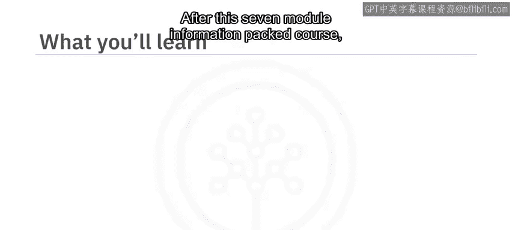

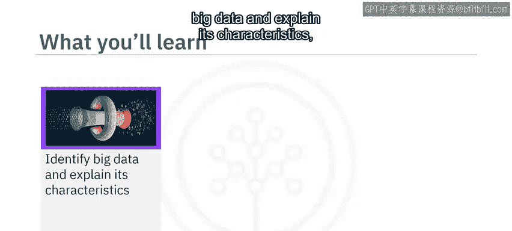

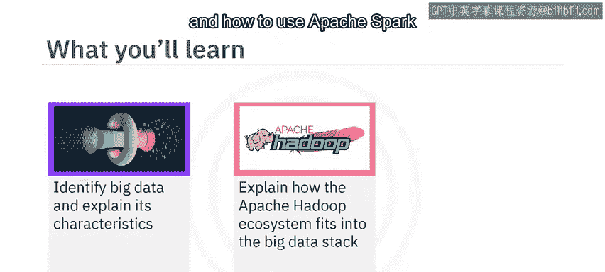

现在，让我们看看你将从七个模块中学到什么。

### 模块一：大数据基础

第一个模块讨论大数据的基础知识。

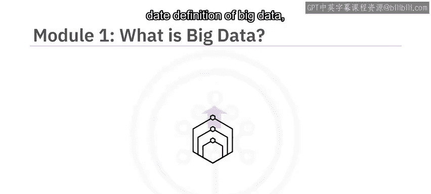

以下是本模块的核心学习内容：
*   学习大数据的最新定义，以及影响日常个人任务和商业交易的大数据用例。
*   学习大数据如何利用并行处理、扩展和数据并行性。
*   探索常用的大数据工具。

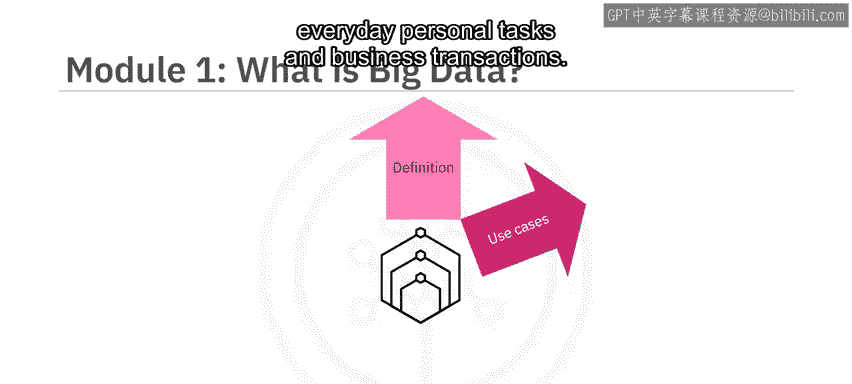

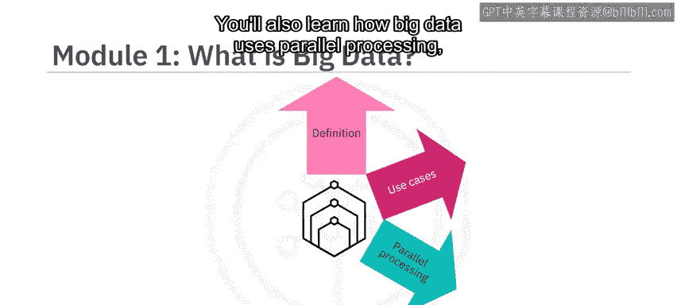

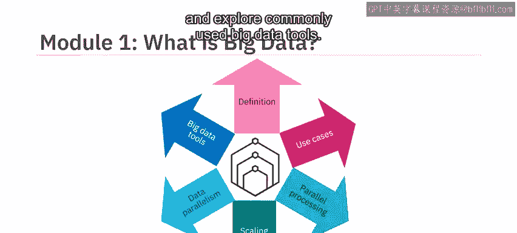

### 模块二：Apache Hadoop架构与生态系统

第二个模块将向你介绍Apache Hadoop的架构和生态系统。

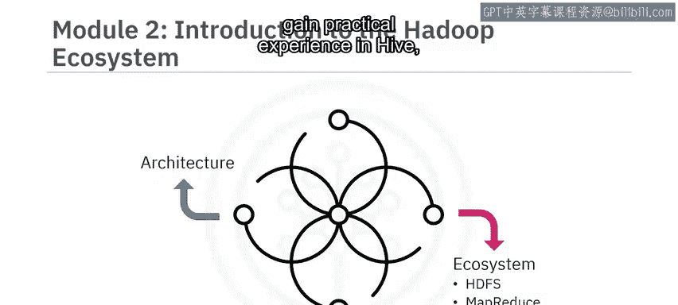

以下是本模块的核心学习内容：
*   Hadoop生态系统包含Hadoop分布式文件系统（**HDFS**）、**MapReduce**、**Hive**和**HBase**。
*   你还将有机会在Hive、Hadoop集群和MapReduce方面获得实践经验。

### 模块三：Apache Spark平台

在第三个模块中，你将专注于流行的Apache Spark平台。

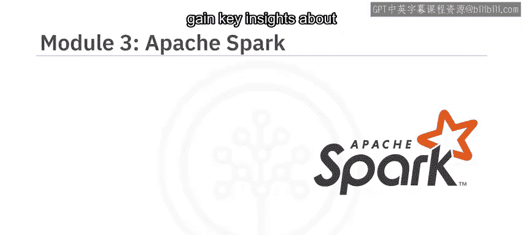

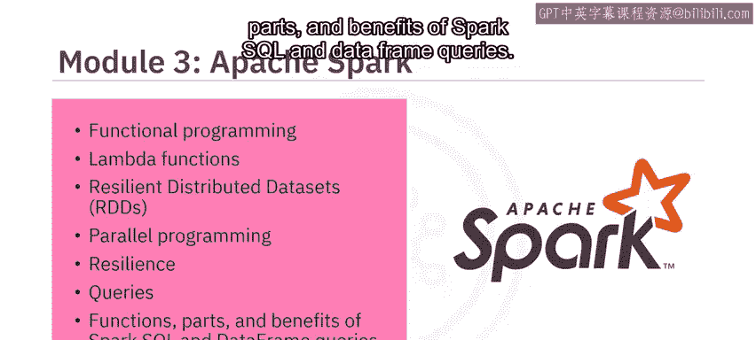

以下是本模块的核心学习内容：
*   获得关于函数式编程和Lambda函数的关键见解。
*   探索弹性分布式数据集（**RDDs**）。
*   学习Apache Spark中的并行编程和弹性。
*   在本模块中，你还将使用查询，并了解Spark SQL和数据框查询的功能、部件和优势。

### 模块四：数据框与Spark SQL

接下来，模块四讨论数据框和Spark SQL。

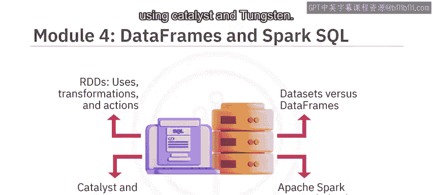

以下是本模块的核心学习内容：
*   学习RDDs及其在Apache Spark中的用途，以及RDD的转换和操作。
*   比较数据集与Spark最新的数据抽象——数据框的使用。
*   探索Apache Spark SQL优化，并了解Spark SQL和内存优化如何从使用Catalyst和Tungsten中受益。

### 模块五：开发与运行时环境选项

模块五将带你了解开发和运行时环境选项。

以下是本模块的核心学习内容：
*   探索Spark如何处理应用程序提交的请求。
*   能够识别Apache集群管理器、其组件和优势，并知道如何连接到每个集群管理器。
*   本模块还将解释如何使用Spark的统一接口`spark-submit`及其选项和依赖项。
*   学习设置Apache Spark配置，并进行动手实验，在IBM Cloud和Kubernetes上使用Apache Spark。

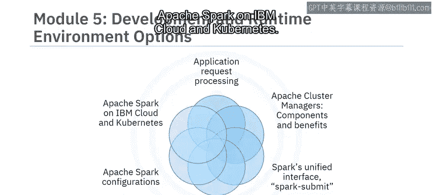

### 模块六：Apache Spark用户界面与监控

在第六个模块中，你将学习连接到Apache Spark用户界面（UI）Web服务器，并使用相同的UI Web服务器来管理应用程序进程。

以下是本模块的核心学习内容：
*   学习使用应用程序UI调试Apache Spark应用程序问题，并定位相关的日志文件。
*   本模块还将帮助你发现并获得关于Spark如何管理内存和处理器资源的实践知识。

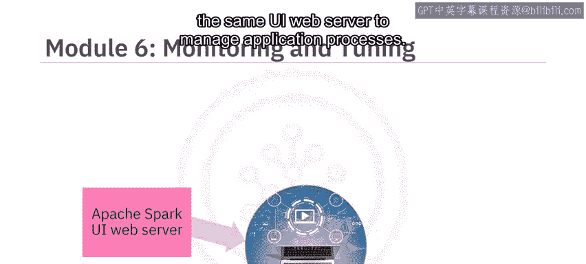

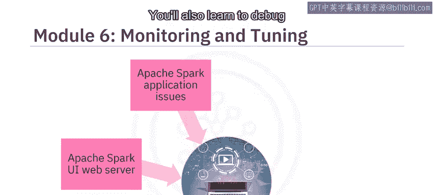

### 模块七：综合实践与评估

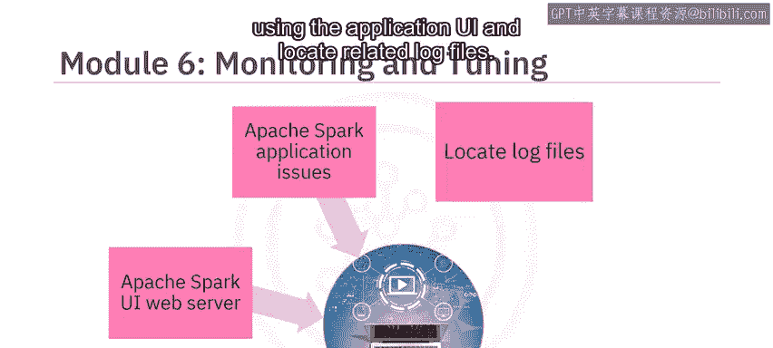

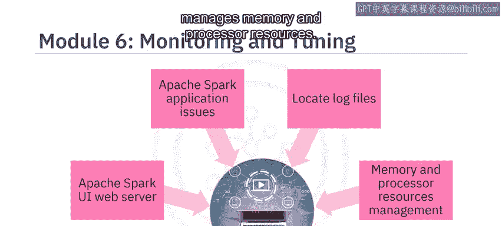

模块七是最后一个模块，你将在此巩固所学。

以下是本模块的核心学习内容：
*   进行一个实践实验，对RDDs和数据框应用各种转换和操作。
*   进一步应用你的知识完成一个最终实验，在其中创建一个数据框。
*   最后，你将根据课程所学进行评估。

## 💡 学习建议

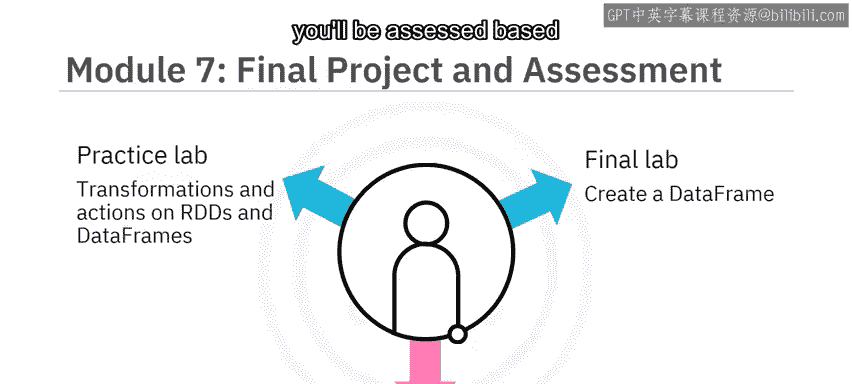

**通过实践来巩固知识**：为了巩固你的课程知识，你将在学习模块中 strategically 放置的动手实验中完成活动并获得实践经验。

**从课程中获得最大收益**：
*   观看所有视频并尝试所有测验。
*   完成动手实验以练习新技能并创建你可共享的作品集。
*   使用讨论论坛与同伴联系和协作，或向课程工作人员寻求帮助。

祝贺你踏上这段激动人心的旅程的下一步。

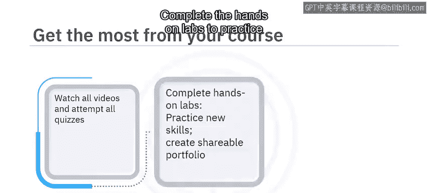
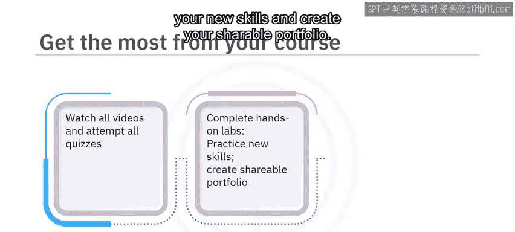
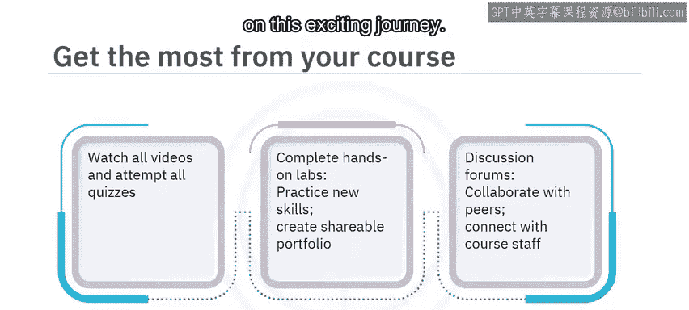

## 🎓 总结

本节课中，我们一起学习了《使用Spark和Hadoop进行大数据介绍》这门课程的概览。我们了解了课程的目标是帮助学习者掌握大数据、Hadoop生态系统和Apache Spark的核心概念与技能。课程面向数据工程师、数据科学家及相关技术人员，要求具备一定的数据素养、SQL和Python基础。我们认识了三位经验丰富的讲师，并详细预览了涵盖从大数据基础、Hadoop架构、Spark核心、数据框与SQL、环境配置、监控调试到综合实践的七个模块内容。最后，我们明确了通过观看视频、完成测验、动手实验和参与讨论来最大化学习效果的建议。现在，你已经为开启大数据学习之旅做好了准备。