# IBM数据工程专业证书 课程11：《使用Spark和Hadoop进行大数据介绍》｜ P20：弹性分布式数据集在并行编程和Spark中的作用 🚀

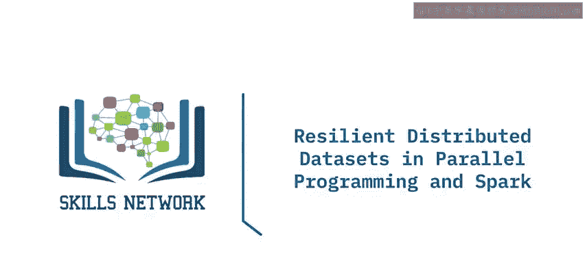

在本节课中，我们将要学习Spark的核心数据抽象——弹性分布式数据集。我们将了解它的定义、工作原理，以及如何通过转换和操作来处理数据。

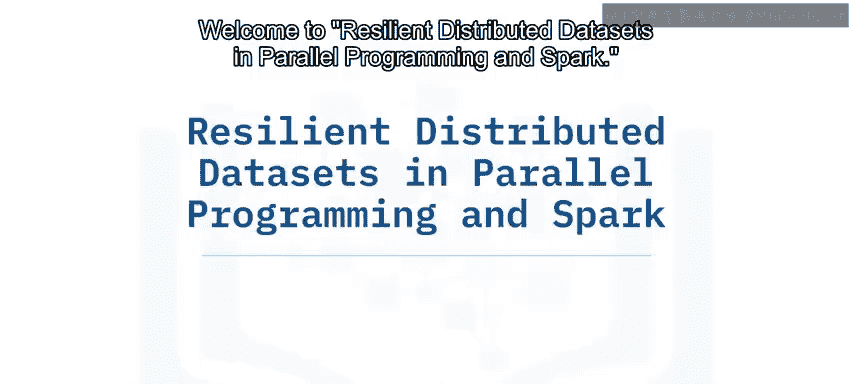

## 概述

弹性分布式数据集是Spark进行大规模数据处理的基础。理解RDD及其相关操作，是掌握Spark编程的关键第一步。

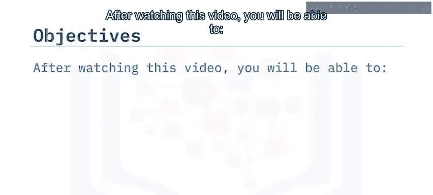

## 什么是弹性分布式数据集？

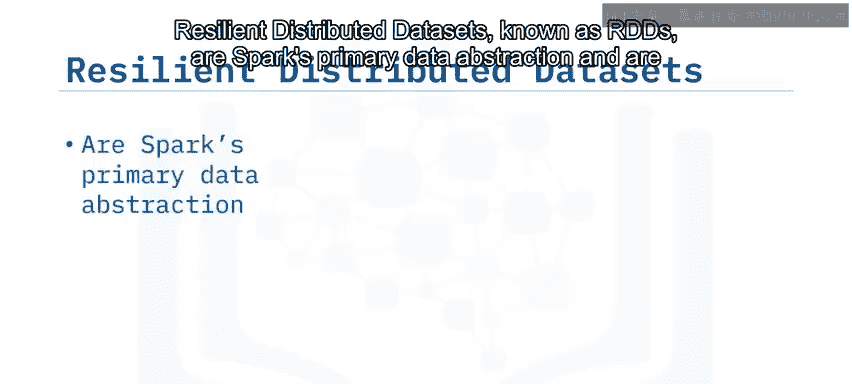

弹性分布式数据集，通常被称为RDDs，是Spark的主要数据抽象。它们被**分区**存储在整个集群的各个节点上。

这种分布式的特性使得Spark能够并行处理海量数据。

## RDD转换：惰性计算的核心

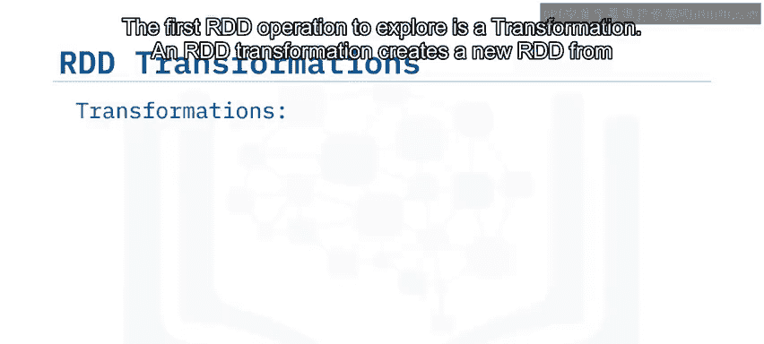

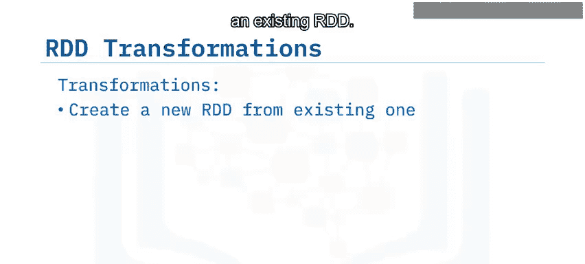

上一节我们介绍了RDD的基本概念，本节中我们来看看如何操作RDD。首先要探索的是RDD转换。

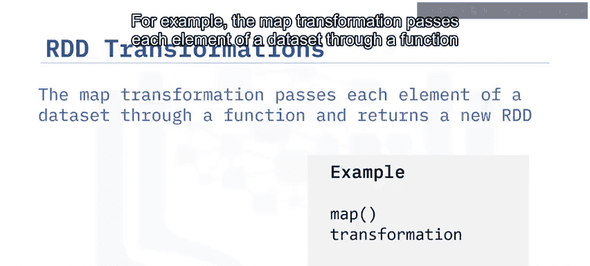

RDD转换会从一个已有的RDD创建一个新的RDD。在Spark中，转换被认为是**惰性**的，因为Spark不会立即计算转换的结果。相反，结果只有在被操作评估时才会被计算。

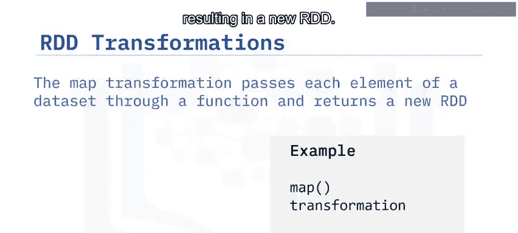

这种惰性求值机制允许Spark进行高效的优化。

## RDD操作：触发计算的行动

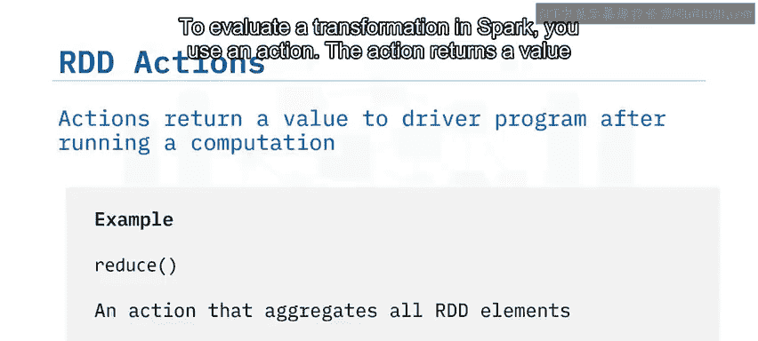

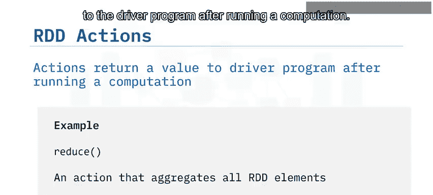

要评估Spark中的一个转换，你需要使用一个操作。

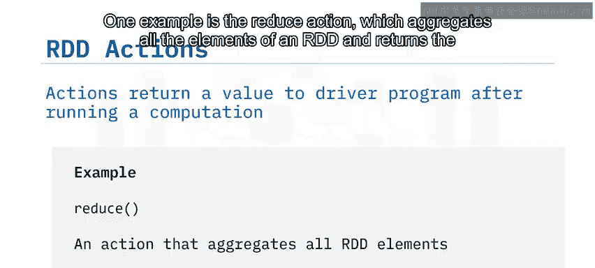

操作在运行计算后，会返回一个值给驱动程序。一个例子是`reduce`操作，它聚合RDD的所有元素并将结果返回给驱动程序。

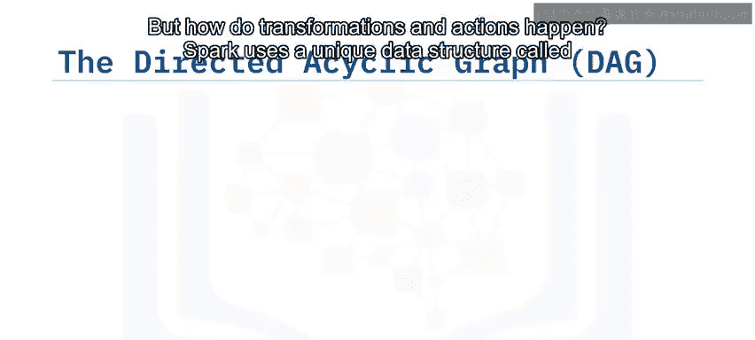

操作是触发实际计算的“开关”。

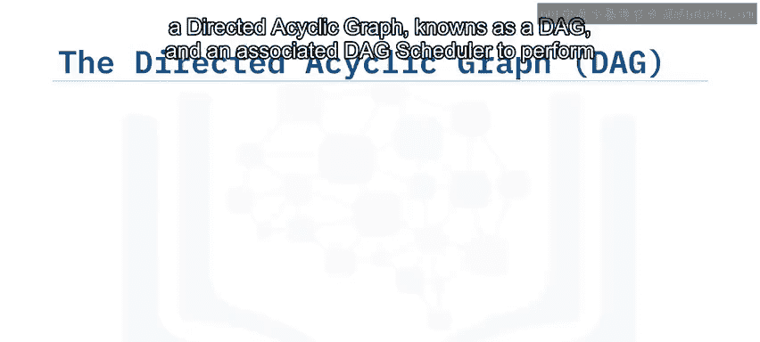

## 幕后功臣：有向无环图

但是转换和操作是如何发生的呢？Spark使用一种称为有向无环图的独特数据结构以及相关的DAG调度器来执行RDD操作。

可以把DAG看作一个由边和顶点组成的图形结构。“无环”意味着新的边只能从已有的顶点产生。通常，顶点代表RDDs，边代表转换或操作。

DAG调度器应用这个图形结构来运行使用RDD执行转换过程的任务。

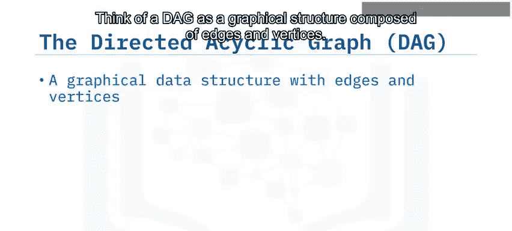

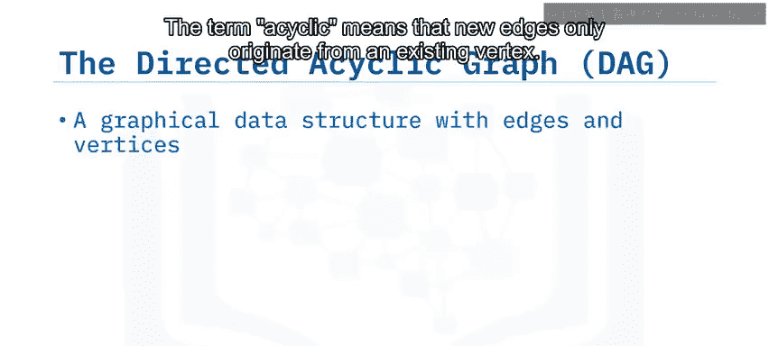

那么为什么Spark要使用DAGs呢？DAGs有助于实现**容错**。当一个节点宕机时，Spark会复制DAG并恢复该节点。

## DAG工作流程详解

让我们更详细地看看这个过程。

1.  首先，Spark在创建RDD时创建DAG。
2.  接着，Spark启用DAG调度器来执行转换，并更新DAG。
3.  此时，DAG指向新的RDD。转换RDD的指针被返回给Spark驱动程序。
4.  如果存在一个操作，调用该操作的驱动程序只有在Spark完成该操作后才会评估DAG。

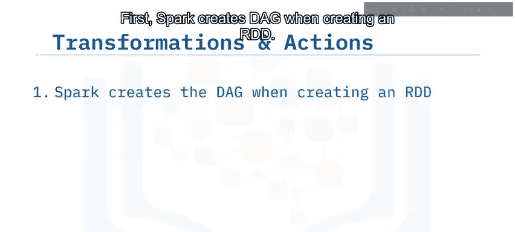

这个过程确保了计算的正确性和可恢复性。

## 常见的RDD转换与操作

以下是RDD中一些常用的转换和操作示例。

我们已经提到了`map`，它是一个基本操作，能够表达数据科学中所需的所有转换。

一些更常见的高级转换，利用`map`和`reduce`，包括：
*   **`filter`**：基于一个函数过滤数据集的元素。
*   **`distinct`**：找出数据中不同元素的数量。

此外，`flatMap`转换与`map`转换类似，但可以将每个输入项映射到零个或多个输出项。它的函数应该返回一个序列，而不是单个项。

接下来，常用的操作包括：
*   **`reduce`**：使用函数聚合数据集元素。
*   **`take`**：返回包含前n个元素的数组。
*   **`collect`**：将数据集的所有元素作为数组返回。
*   **`takeOrdered`**：返回按升序或按可选函数参数指定的顺序排列的元素。

你可以在Spark官网上找到关于转换和操作的更多细节。

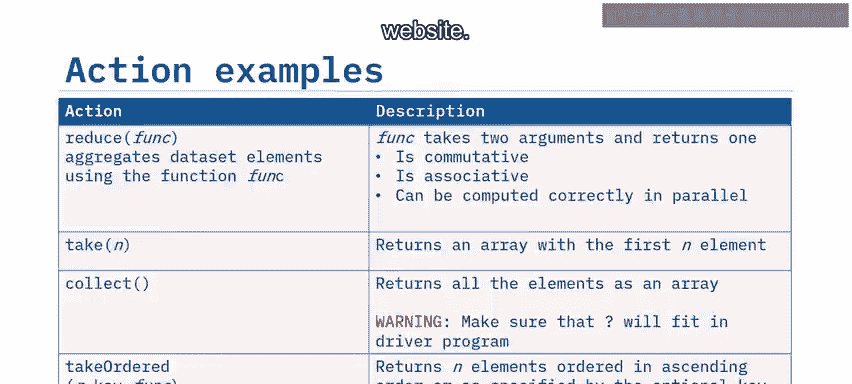

## 一个完整的示例

转换只是一个操作的映射。你需要操作来将计算出的值获取到驱动程序。

这个示例考虑一个函数 `F(x) = x - 1`。

你将使用`map`转换将此函数作为转换应用于一个数据集。每个任务通过对原始分区中的每个条目E调用`F(E)`来创建一个新分区。

然后，`collect`操作将所有分区中的条目收集到驱动程序中，驱动程序接收结果。

这个过程清晰地展示了从转换定义到通过操作获取结果的完整链路。

## 总结

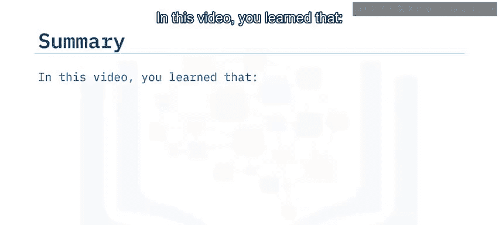

本节课中我们一起学习了：
*   RDDs是Spark的主要数据抽象，在集群节点间分区存储。
*   Spark使用DAGs来实现容错。当节点宕机时，Spark会复制DAG并恢复节点。
*   转换保持现有RDD不变，并根据转换函数创建新的RDD。
*   转换进行惰性求值，这意味着它们只有在驱动程序函数调用一个操作时才会被评估。

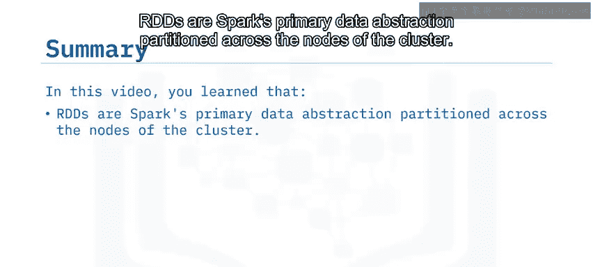

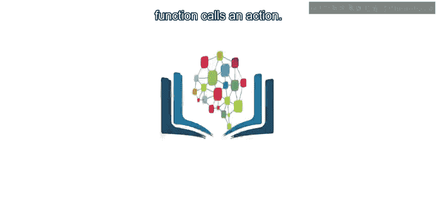

掌握RDD是构建高效Spark应用程序的基石。