# IBM数据工程专业证书 课程11：《使用Spark和Hadoop进行大数据介绍》｜ P21：数据帧与数据集 🧩


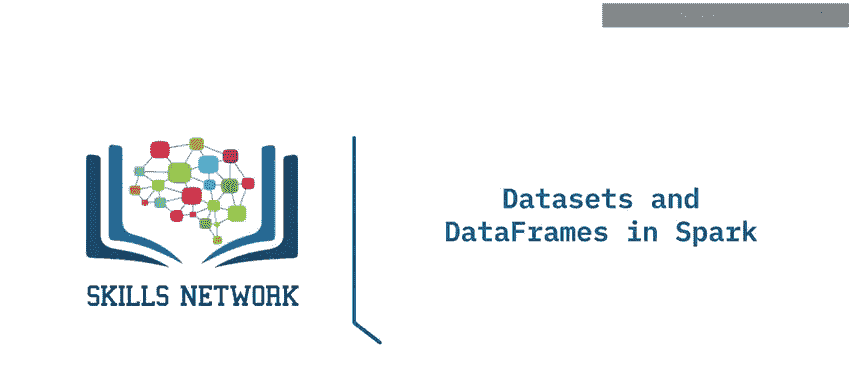

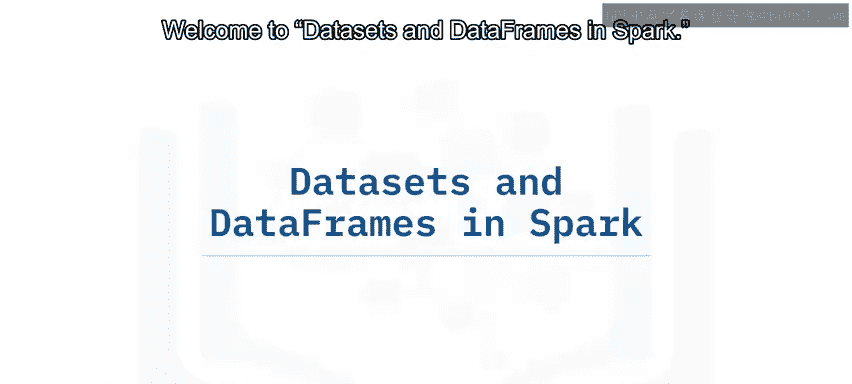

在本节课中，我们将学习Apache Spark中的数据集概念。我们将了解数据集的特点、优势、创建方法，并比较数据集与数据帧之间的区别。

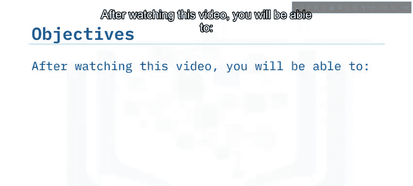

---

## 数据集的特点与优势

数据集是Spark中最新的数据抽象，与RDD和数据帧类似。数据集提供API来访问分布式数据集合。数据集是强类型的Java虚拟机对象集合。强类型意味着数据集是类型化的，其数据类型在创建时即被明确指定。

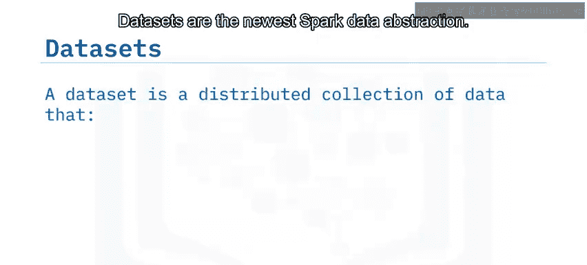

数据集结合了RDD和数据帧的优点：
*   它具备RDD的优点，例如支持Lambda函数和类型安全。
*   它具备SparkSQL的SQL优化能力。

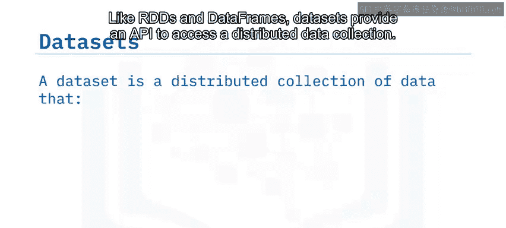

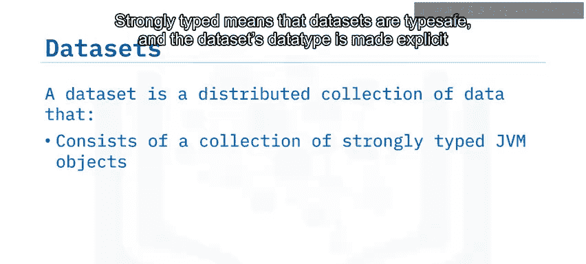

以下是数据集的四个主要特性：
1.  **不可变性**：与RDD一样，数据集是不可变的，不能被删除或丢失。
2.  **编码器**：数据集包含一个编码器，可将类型化的JVM对象转换为表格表示形式。
3.  **数据帧API的扩展**：从概念上讲，一个由通用无类型行组成的JVM对象数据集，可被视为数据帧的列。
4.  **语言支持**：由于数据集是强类型的，目前仅支持静态类型语言Scala和Java。动态类型语言如Python和R不支持数据集API。

与使用数据帧和RDD相比，数据集提供了一些独特的优势：
*   **编译时类型安全**：由于数据集是静态类型的，Spark可以在生产应用程序部署前检测语法和语义错误，从而节省大量开发和运维成本与时间。
*   **更快的计算速度**：数据集的计算速度比RDD更快，尤其是在聚合查询方面。
*   **查询优化**：数据集支持由Catalyst和Tungsten启用的额外查询优化。
*   **改进的内存使用和缓存**：Spark能理解数据集的数据结构，并优化其在内存中的布局。
*   **高级聚合操作**：数据集API还提供了方便的高级聚合操作函数，例如`sum`、`average`、`join`和`groupBy`。

---

## 创建数据集的三种方法

上一节我们介绍了数据集的概念和优势，本节中我们来看看如何在Spark中创建数据集。

以下是三种创建数据集的方法：

**方法一：从序列创建**
此示例使用Scala的`toDS`函数从序列创建数据集。
```scala
val ds = Seq(1, 2, 3).toDS()
```

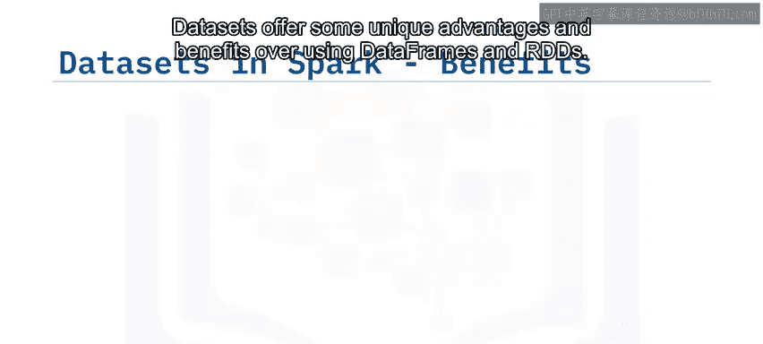

**方法二：从文本文件创建**
此示例演示如何从文本文件创建数据集。请注意其中显式的模式声明。在此示例中，我们将原始字符串数据类型应用于显式模式声明。
```scala
val ds = spark.read.textFile("path/to/file.txt")
```

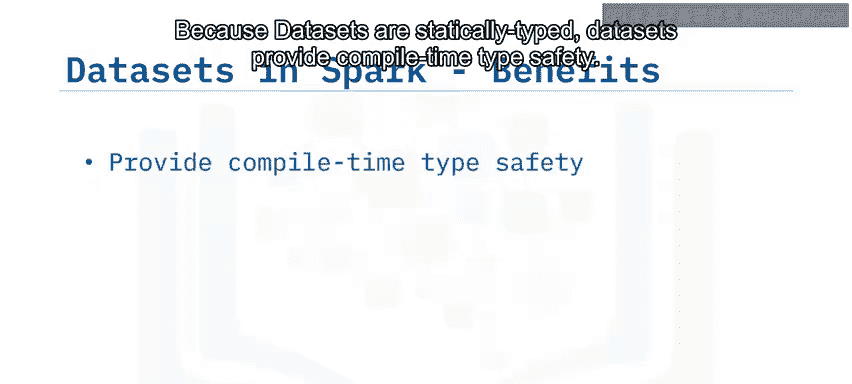

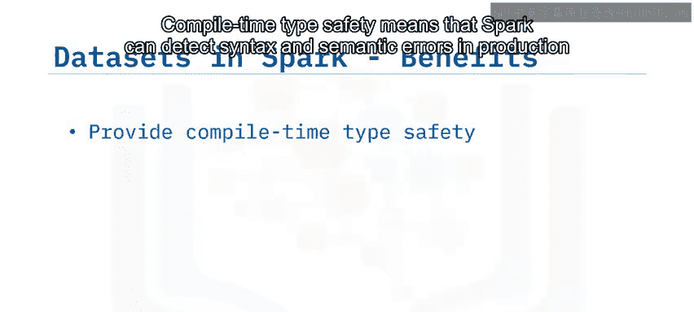

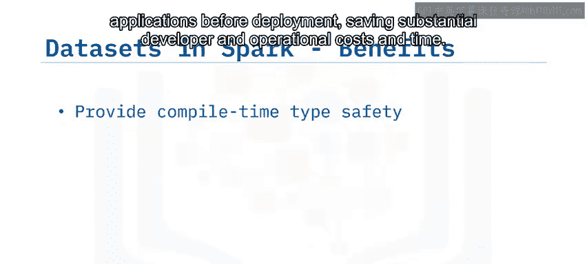

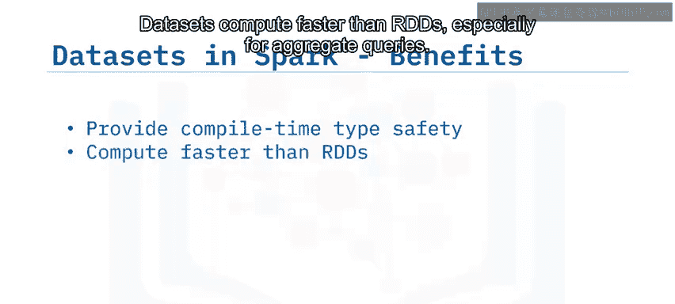

**方法三：从JSON文件创建**
此示例使用JSON文件创建数据集。在最后一个示例中，我们使用了一个名为`Customer`的自定义类，该类包含`name`和`id`字段。
```scala
case class Customer(name: String, id: Long)
val ds = spark.read.json("path/to/file.json").as[Customer]
```

---

## 数据集与数据帧的比较

了解了如何创建数据集后，我们来比较一下数据集和数据帧。

数据集融合了其前身数据帧和RDD的优点。以下是它们的主要区别：

*   **类型系统**：数据集是**强类型**的。数据帧是**非类型化**的。
*   **API支持**：数据集可以使用统一的Java和Scala API。数据帧则使用Java、Scala、Python和R编写的API。数据帧API是否统一取决于API版本。
*   **架构基础**：数据集是Spark的最新成员，构建在**数据帧**之上。相比之下，较早引入的数据帧则构建在**RDD**之上。

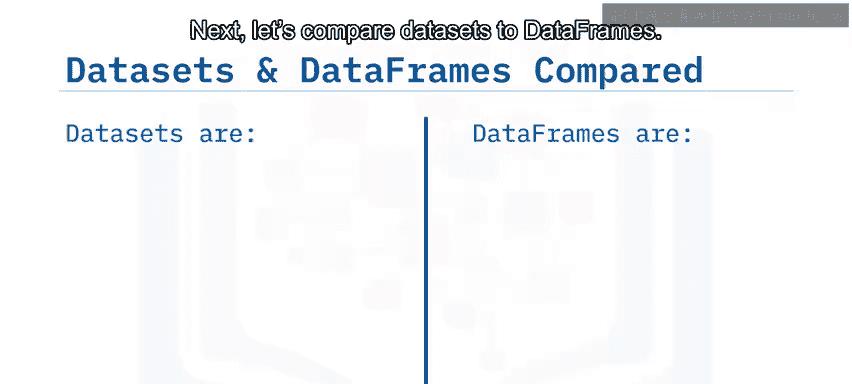

---

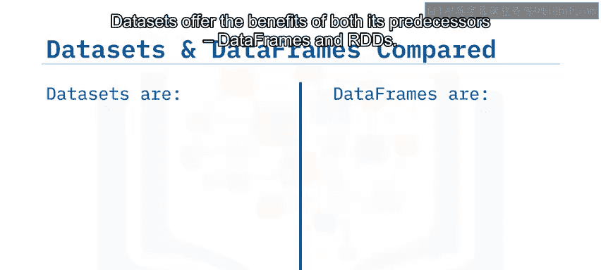

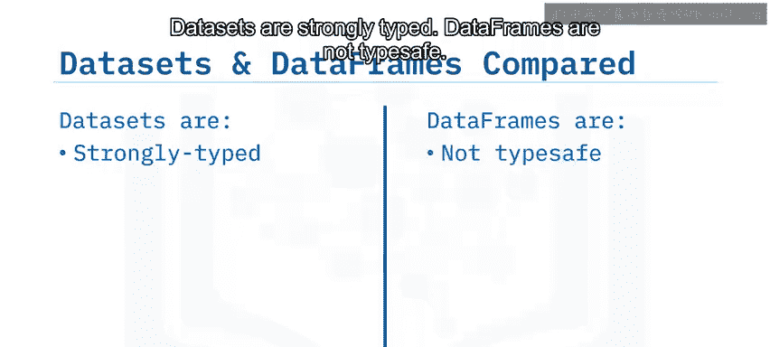

## 总结

本节课中我们一起学习了Spark中的数据集。

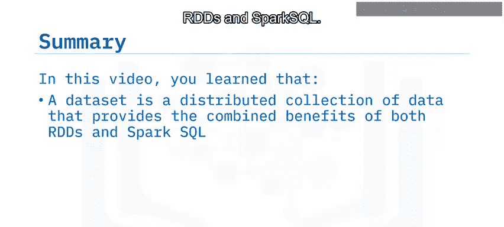

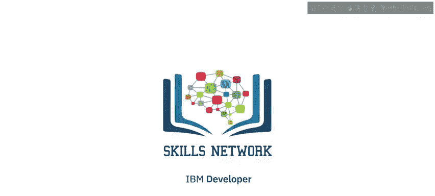

我们了解到，数据集是一个分布式数据集合，它结合了RDD和SparkSQL的优点。数据集由强类型的JVM对象组成，利用了数据帧的类型安全能力，并扩展了面向对象的API能力。数据集可与Scala和Java API协同工作。