# IBM数据工程专业证书 课程11：《使用Spark和Hadoop进行大数据介绍》｜P23：使用DataFrame进行ETL 🛠️


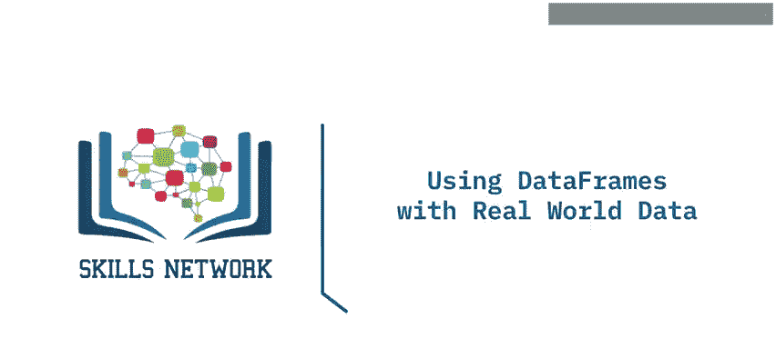

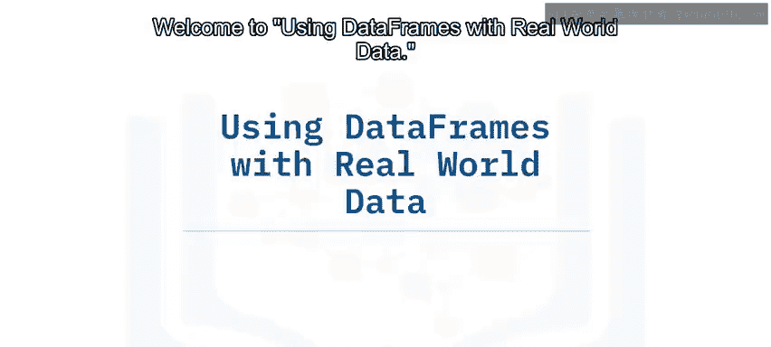

在本节课中，我们将学习如何在实际数据上使用Spark DataFrame进行基本操作，包括读取、分析、转换、加载和写入数据，这些步骤通常被称为ETL（提取、转换、加载）过程。

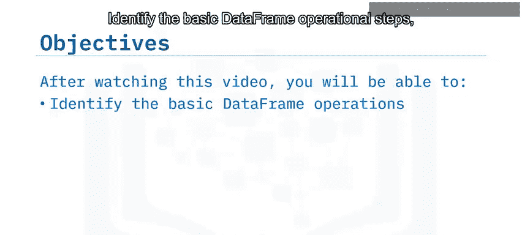

## 概述：DataFrame的基本操作步骤

DataFrame的基本操作步骤包括：读取、分析、转换、加载和写入。

首先，Spark读取数据并将其加载到DataFrame中。接下来，您可以分析数据集，从简单的任务开始，例如检查列、数据类型、行数，并可选地进行聚合统计、趋势分析等操作。如果需要，您可以通过过滤数据以定位特定值、根据特定条件排序数据，或通过将此数据与另一个数据连接来转换数据。然后，您可以将转换后的数据加载回数据库或文件系统，并将数据写回磁盘。这个过程通常也被称为ETL（提取、转换、加载）。ETL是任何数据处理管道中的关键过程，因为第一步使数据仓库能够访问数据，供机器学习模型、下游应用程序或其他服务使用。

## ETL与ELT

让我们谈谈另一个标准过程：ELT（提取、加载和转换）。这个过程是随着大数据处理而出现的。在ELT中，所有数据都驻留在数据湖中。数据湖是一个巨大的原始数据池，其数据用途尚未预先定义。当存在数据湖时，每个项目会根据需要形成单独的转换任务，这与ETL和数据仓库中预先考虑所有必要的转换需求和使用场景形成对比。组织通常混合使用ETL和ELT。

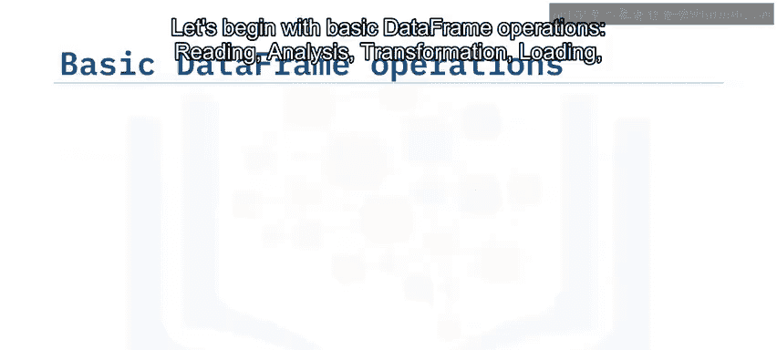

## 深入探讨每个基本操作

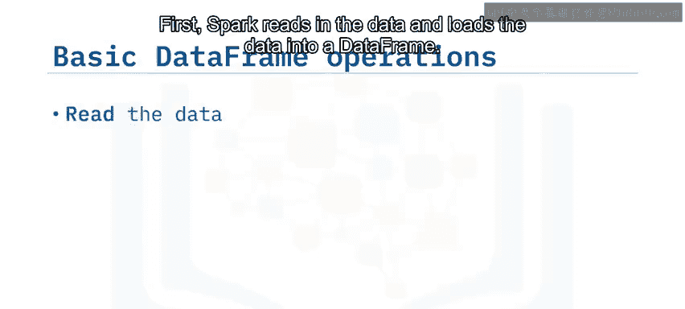

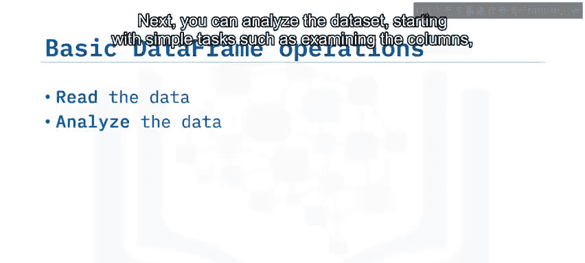

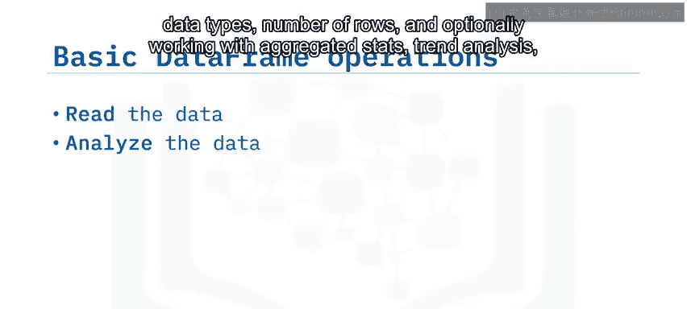

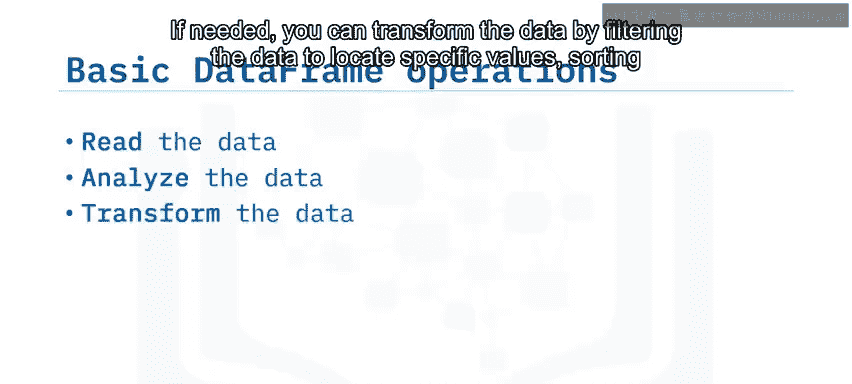

上一节我们介绍了DataFrame的基本操作流程，本节中我们来看看每个步骤的具体实现。

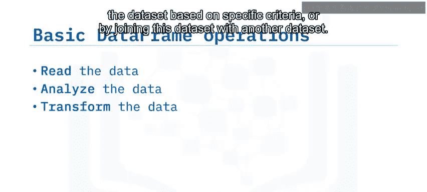

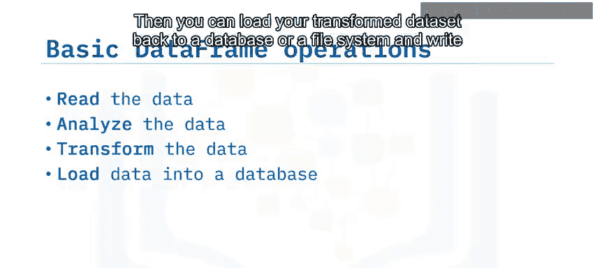

### 读取数据

读取数据时，您可以直接将数据加载到DataFrame中，或从现有DataFrame创建新的Spark DataFrame。

以下代码示例展示了如何在Python中将数据集加载到pandas DataFrame，然后将相同数据加载到Spark DataFrame对象中。

```python
# 示例：加载数据到pandas DataFrame，然后转换为Spark DataFrame
import pandas as pd
from pyspark.sql import SparkSession

# 创建Spark会话
spark = SparkSession.builder.appName("example").getOrCreate()

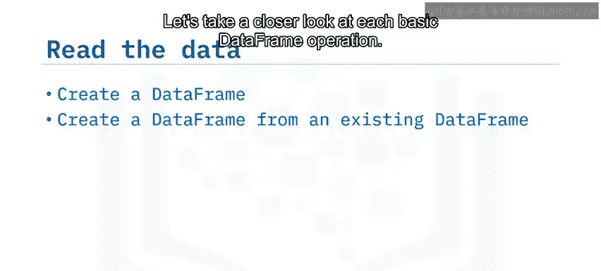

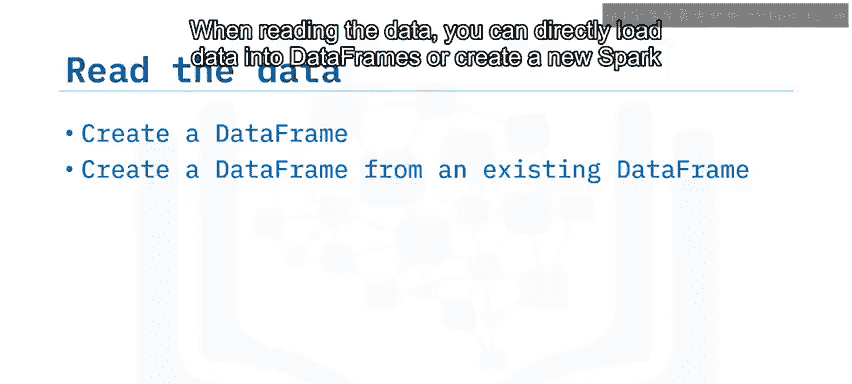

# 加载到pandas DataFrame
pandas_df = pd.read_csv('car_data.csv')

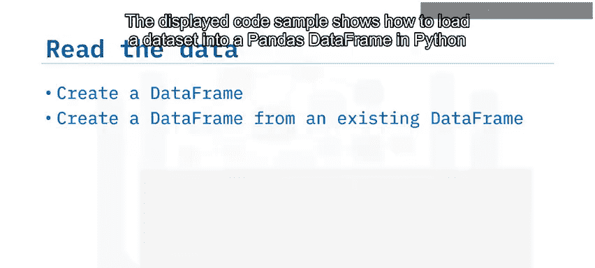

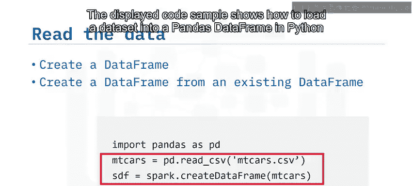

# 转换为Spark DataFrame
spark_df = spark.createDataFrame(pandas_df)
```

### 分析数据

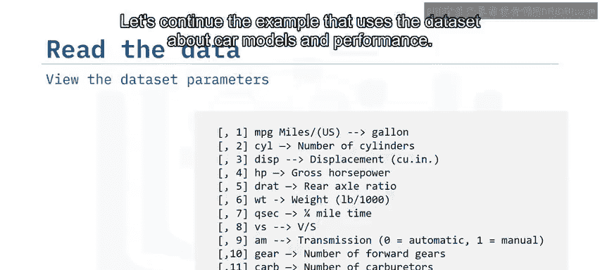

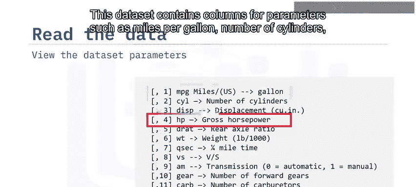

继续使用关于汽车型号和性能的数据集示例。该数据集包含诸如每加仑英里数、气缸数、马力等汽车相关参数的列。

以下是查看数据集前几行的方法。

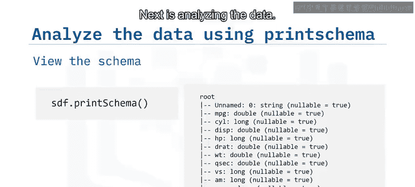

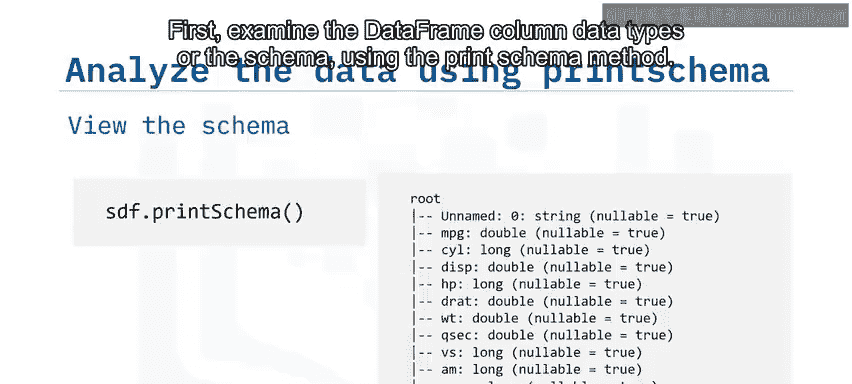

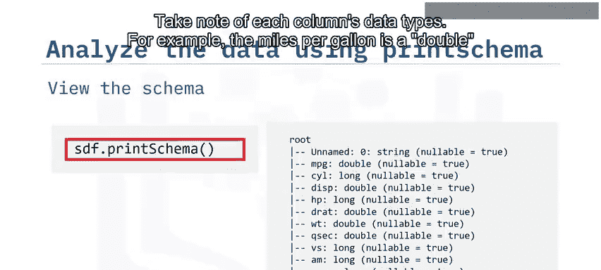

```python
# 查看数据集的前几行
spark_df.show(5)
```

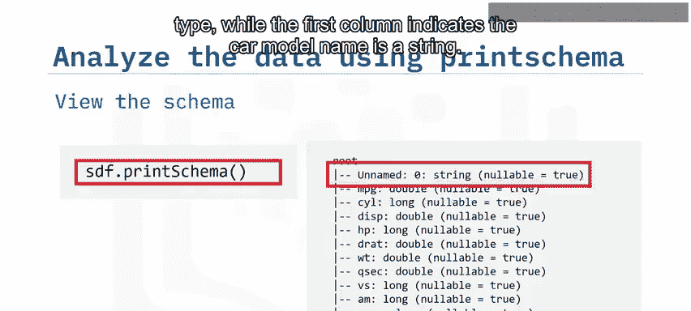

接下来是分析数据。首先，使用`printSchema`方法检查DataFrame的列数据类型或模式。注意每列的数据类型，例如，每加仑英里数是double类型，而第一列表示汽车型号名称是string类型。

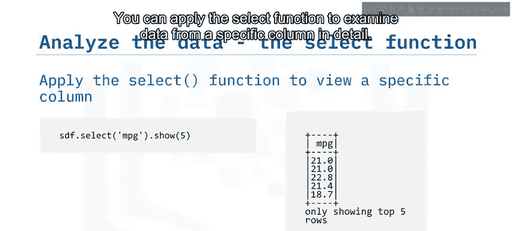

```python
# 打印DataFrame的模式（schema）
spark_df.printSchema()
```

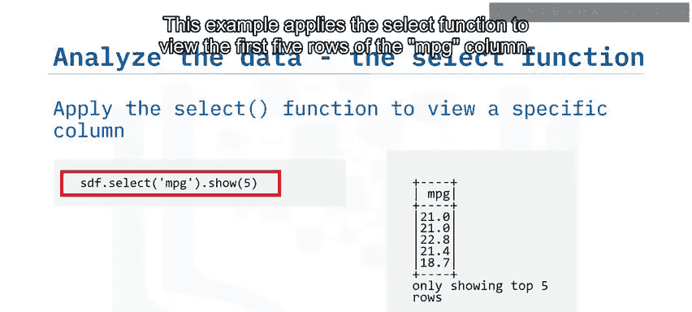

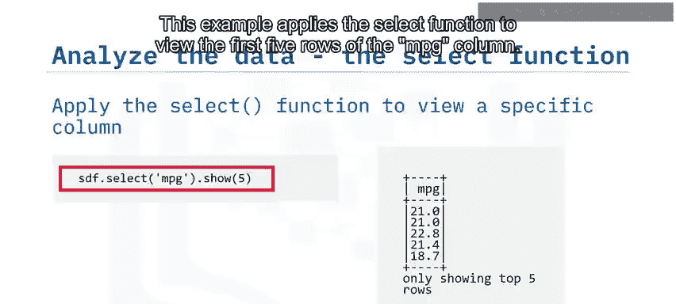

您还可以使用`show`函数检查指定数量的DataFrame行。

您可以应用`select`函数来详细检查特定列的数据。此示例应用`select`函数查看MPG列的前五行。

```python
# 选择并查看特定列的数据
spark_df.select("MPG").show(5)
```

### 转换数据

分析数据集后，下一步是规划任何需要的数据集转换。转换的目标是仅保留相关数据。转换技术可以包括过滤数据、与其他数据源连接或执行列操作。

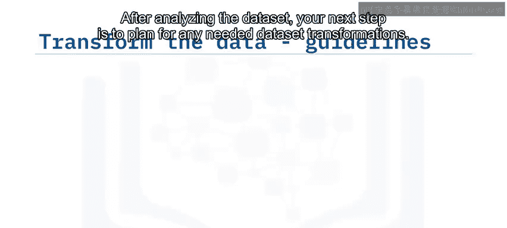

列操作或动作，例如将每列乘以特定数字，或将数据从一种单位转换为另一种单位，例如将每加仑英里数转换为每升公里数。

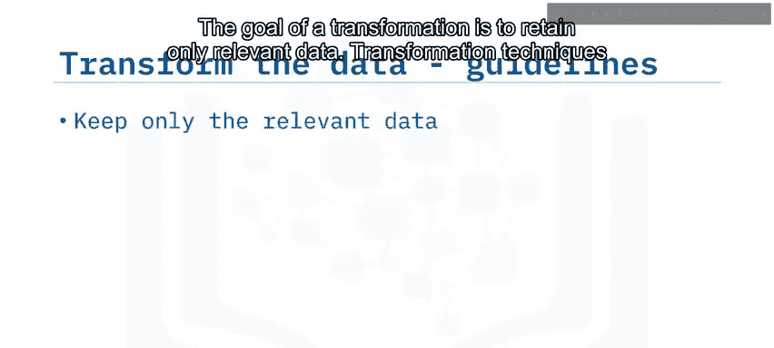

另一种常见的转换技术是分组或聚合数据。有时，下游应用程序可能需要聚合数据，例如不需要显示每笔交易但需要显示季度总销售额和收入数字的季度销售报告。许多转换或特定领域的数据增强过程，所需的工作量可能因领域和数据而异。例如，涉及多种不同测量的科学数据集可能需要更多的列操作和单位转换，而财务数据可能需要更多的聚合和平均任务。

以下是对MT Cars数据集进行转换的一些简单示例。

`filter`函数有助于定位数据中的特定条件。在这种情况下，任务是过滤每加仑英里数（MPG）小于18英里的汽车数据。

```python
# 过滤数据：MPG小于18的汽车
filtered_df = spark_df.filter(spark_df["MPG"] < 18)
filtered_df.show()
```

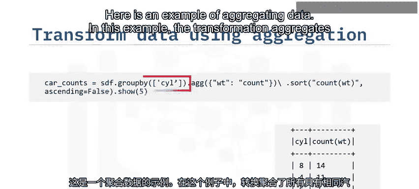

以下是聚合数据的示例。在此示例中，转换聚合了具有相同气缸数的所有记录（如`cyl`列所示），计算具有指定气缸数的车辆数量，并对数据进行排序，以升序列出每个气缸类别的单位数量。我们可以看到有14辆汽车具有8缸发动机，11辆汽车具有4缸发动机。

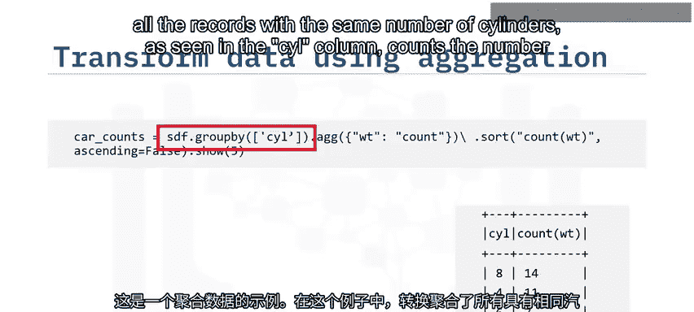

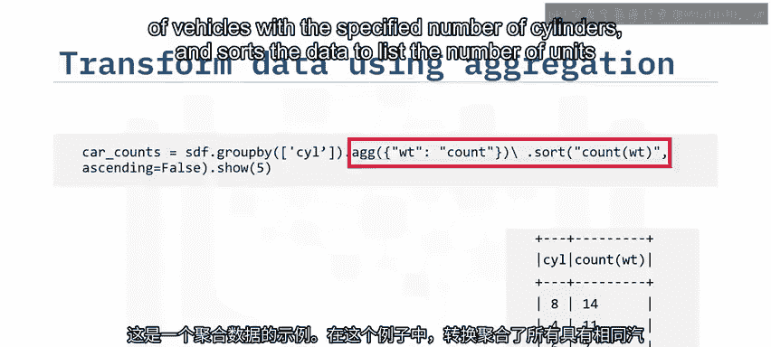

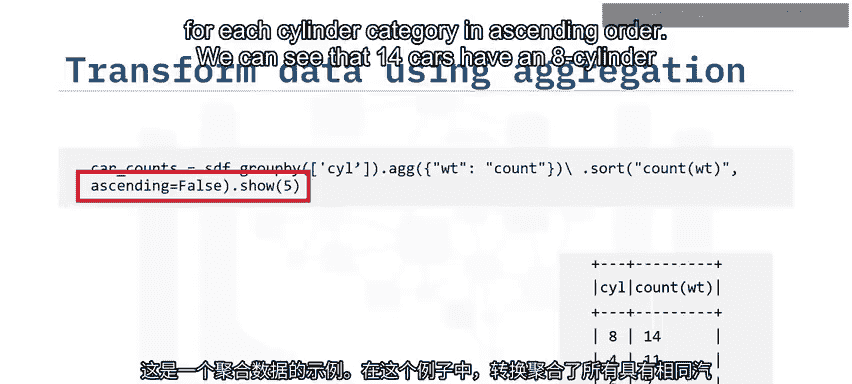

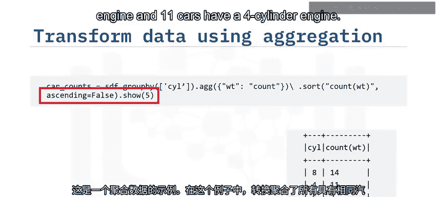

```python
# 聚合数据：按气缸数分组并计数
aggregated_df = spark_df.groupBy("cyl").count().orderBy("cyl")
aggregated_df.show()
```

### 加载和写入数据

ETL管道的最后一步是将数据导出到磁盘或加载到另一个数据库中。与读取和提取数据一样，您可以将数据作为JSON文件写入磁盘，或将数据保存到另一个数据库（如Postgres数据库）中。您还可以使用API将数据导出到另一个数据库，例如Postgres数据库。

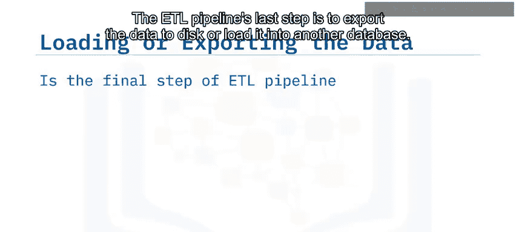

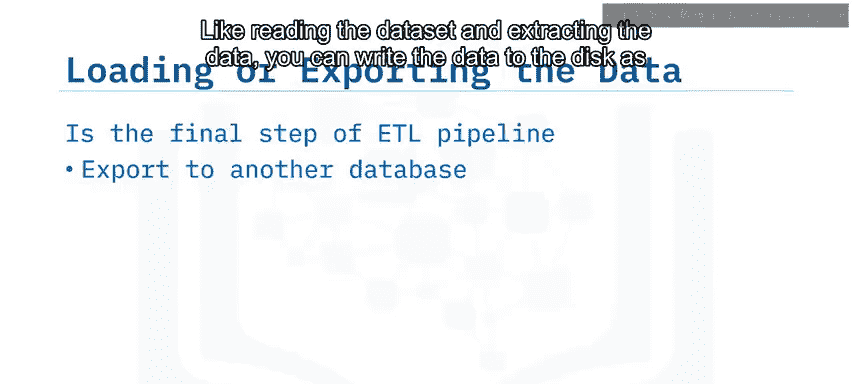

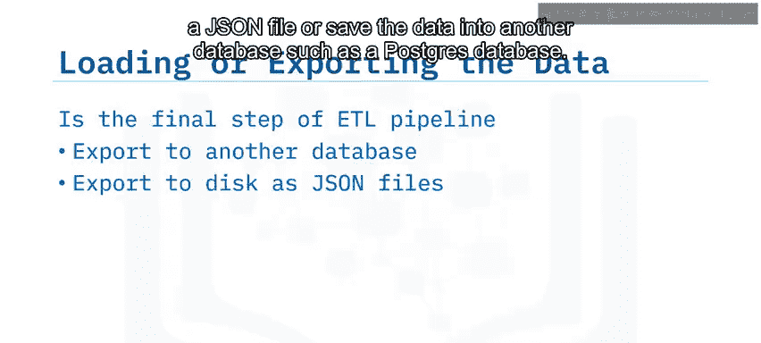

```python
# 将DataFrame写入JSON文件
spark_df.write.json("output/car_data.json")

# 将DataFrame写入Postgres数据库（示例，需配置JDBC）
# spark_df.write \
#     .format("jdbc") \
#     .option("url", "jdbc:postgresql://localhost/mydatabase") \
#     .option("dbtable", "car_table") \
#     .option("user", "username") \
#     .option("password", "password") \
#     .save()
```

## 总结

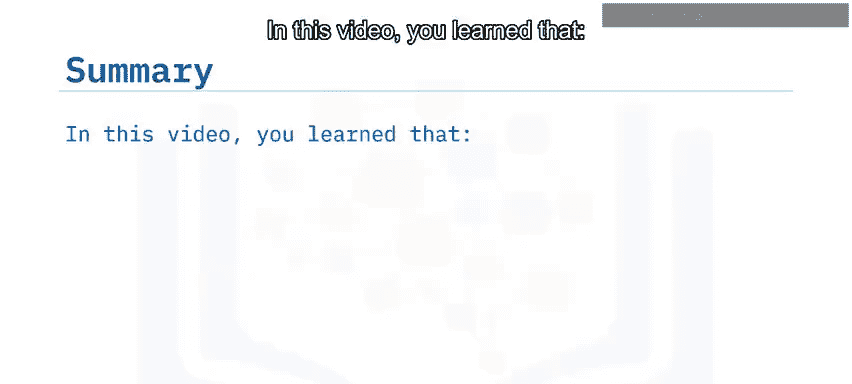

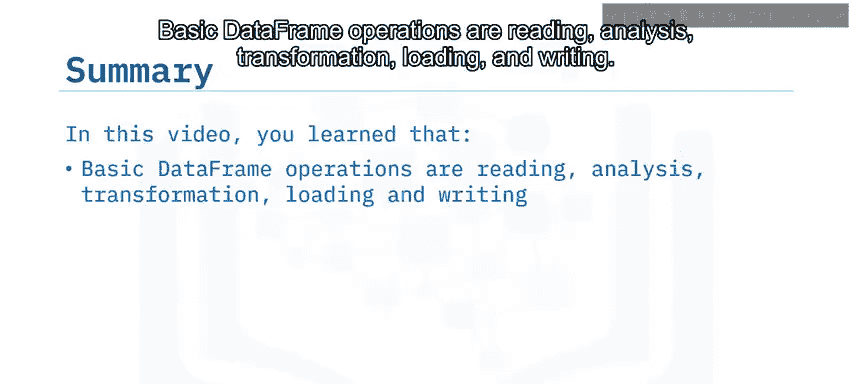


本节课中我们一起学习了DataFrame的基本操作：读取、分析、转换、加载和写入。您可以在Python中使用pandas DataFrame加载数据。您可以使用`printSchema`、`select`函数或`show`函数进行数据分析。对于转换任务，仅保留相关数据，并应用诸如过滤、连接、列操作、分组和聚合以及其他函数。