# IBM数据工程专业证书 课程11：《使用Spark和Hadoop进行大数据介绍》｜ P24：SparkSQL的实际使用 🚀


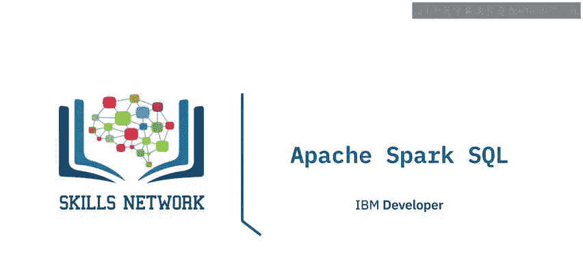


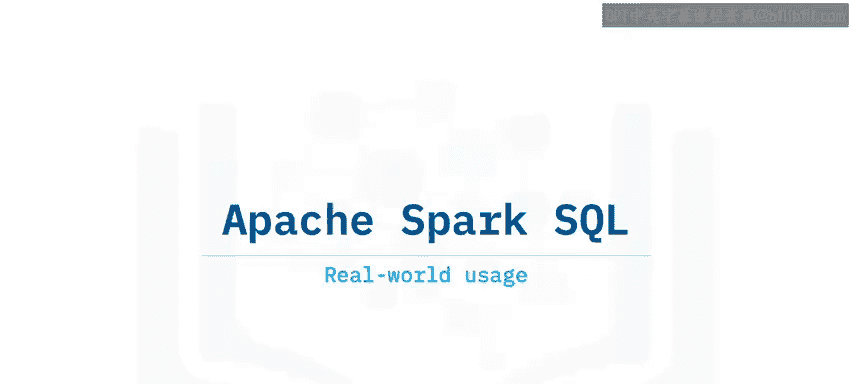


欢迎来到Apache Spark SQL。

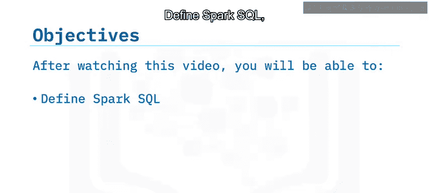


在本节课中，我们将要学习Spark SQL的核心概念和实际应用。具体来说，我们将能够定义Spark SQL，在Spark SQL中创建表视图，解释如何使用SparkSQL进行数据聚合，并阐述SparkSQL支持的各种数据源。

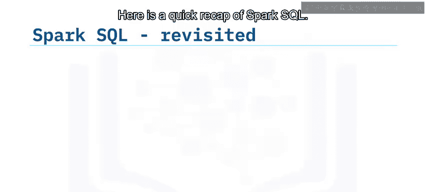

## 概述 📋

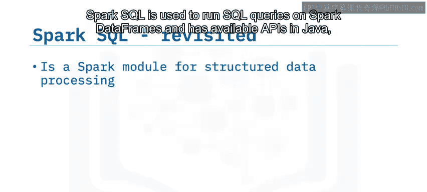

SparkSQL是Spark中用于结构化数据处理的模块。它允许用户在Spark数据帧上运行SQL查询，并提供了Java、Scala、Python和R语言的API。

## 创建表视图 🗂️

在Spark SQL中运行SQL查询的第一步是创建一个表视图。表视图是一个用于运行SQL查询的临时表。

Spark SQL支持临时表视图和全局临时表视图。临时视图具有局部作用域，这意味着该视图仅存在于当前Spark会话的当前节点上。而全局临时视图则存在于整个Spark应用程序中，可以在不同的Spark会话之间共享。

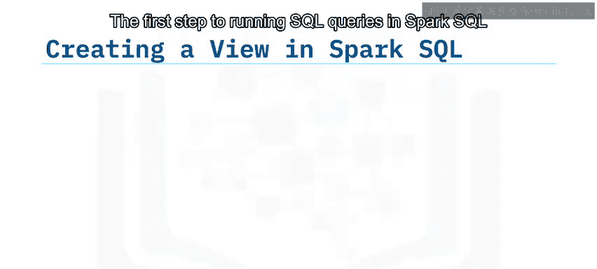

以下是创建这两种视图的方法。

### 创建临时视图

以下是一个使用PySpark在Python中创建临时视图的示例。首先从JSON文件创建数据帧，然后创建一个名为`people`的临时视图，之后就可以使用这个视图来运行SQL查询。

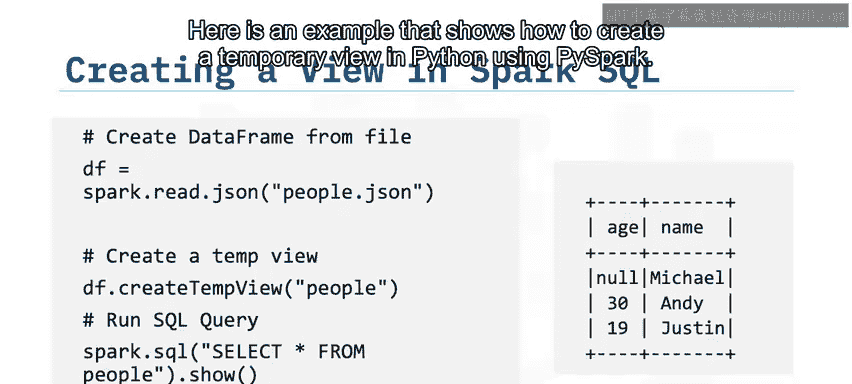

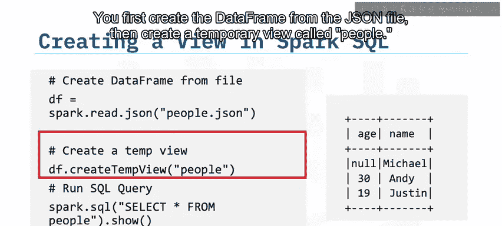

```python
# 从JSON文件创建数据帧
df = spark.read.json("people.json")
# 创建名为‘people’的临时视图
df.createOrReplaceTempView("people")
# 运行SQL查询
result = spark.sql("SELECT * FROM people")
result.show()
```

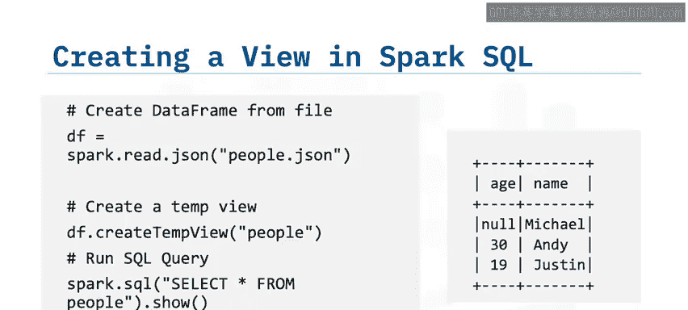

### 创建全局临时视图

创建全局临时视图的语法与临时视图类似，但需要在函数名前加上`global_`前缀，并在视图名前加上`global_temp.`前缀。

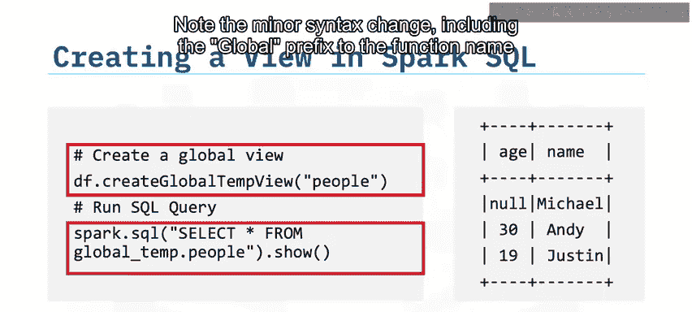

```python
# 创建名为‘people’的全局临时视图
df.createOrReplaceGlobalTempView("people")
# 运行SQL查询时需指定全局临时数据库
result = spark.sql("SELECT * FROM global_temp.people")
result.show()
```

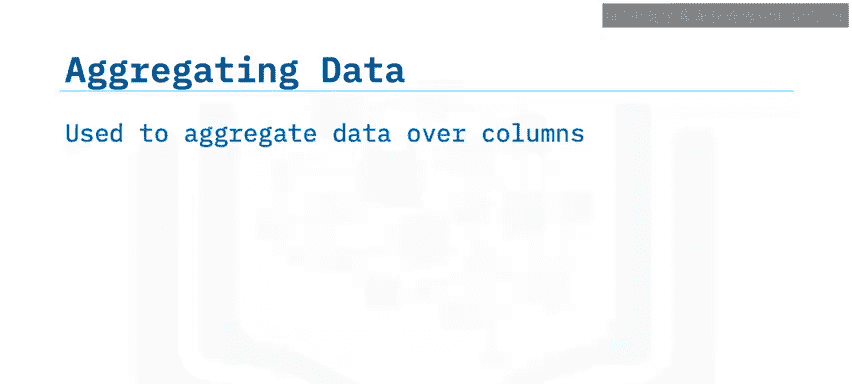

## 数据聚合 📊

聚合是Spark SQL中一个标准的处理过程，通常用于展示分组统计信息。数据帧内置了常用的聚合函数，如`count`、`average`、`max`等。你也可以通过SQL查询和表视图以编程方式执行聚合。

上一节我们介绍了如何创建表视图，本节中我们来看看如何使用它们进行数据聚合。

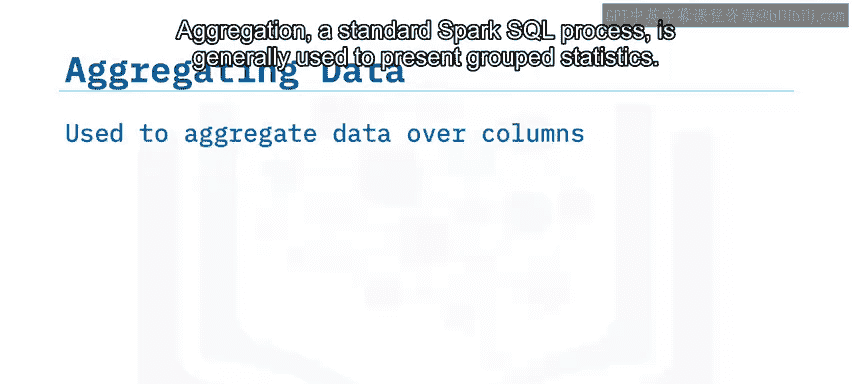

以下是使用两种方法进行数据聚合的步骤。

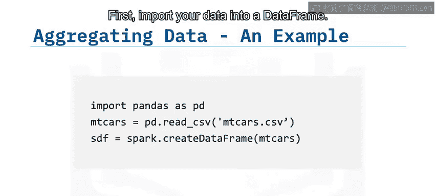

首先，将数据导入数据帧。此示例使用Python的pandas读取CSV文件并创建数据帧。

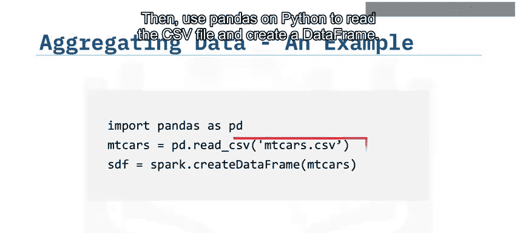

```python
import pandas as pd
# 使用pandas读取CSV文件
pandas_df = pd.read_csv('cars.csv')
# 将pandas数据帧转换为Spark数据帧
df = spark.createDataFrame(pandas_df)
```

你可以应用`select`函数来详细检查特定列的数据。以下示例应用`select`函数查看`MPG`列的前五行。

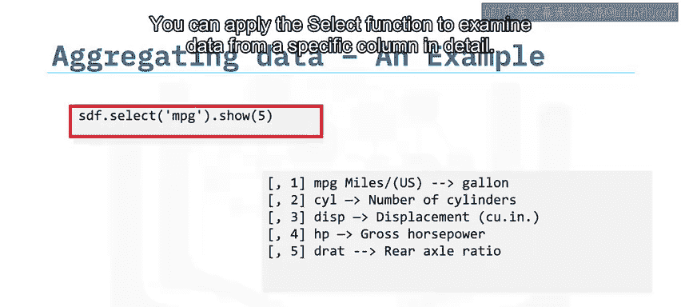

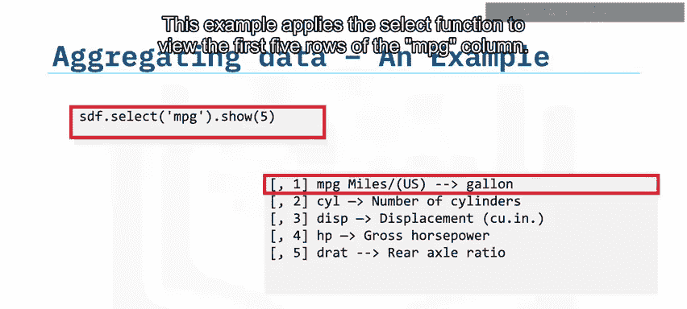

```python
df.select("MPG").show(5)
```

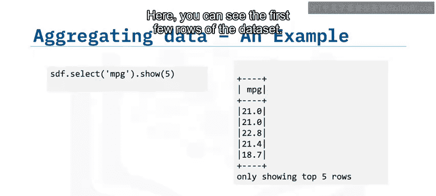

在这个例子中，我们按汽车的气缸数进行聚合和分组。你可以使用两种方法执行此操作。

第一种方法是使用数据帧的内置函数。这在其他课程中已经介绍过。

第二种方法是为数据帧创建一个临时视图。在这个例子中，你将临时视图命名为`cars`。然后运行一个SQL查询，按`cylinders`分组并按降序查看数据。虽然使用了不同的工具和函数，但两种方法产生的结果相同。

以下是使用SQL查询进行聚合的示例：

```python
# 为数据帧创建临时视图
df.createOrReplaceTempView("cars")
# 运行SQL查询进行分组和聚合
result = spark.sql("""
    SELECT cylinders, COUNT(*) as count
    FROM cars
    GROUP BY cylinders
    ORDER BY count DESC
""")
result.show()
```

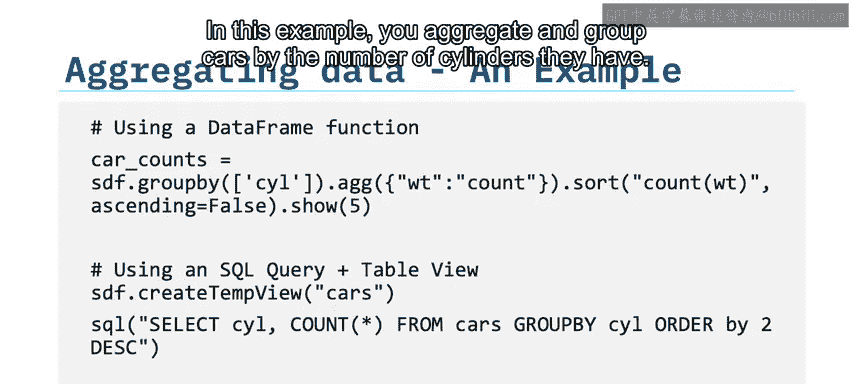

## 支持的数据源 💾

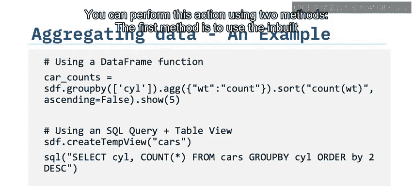

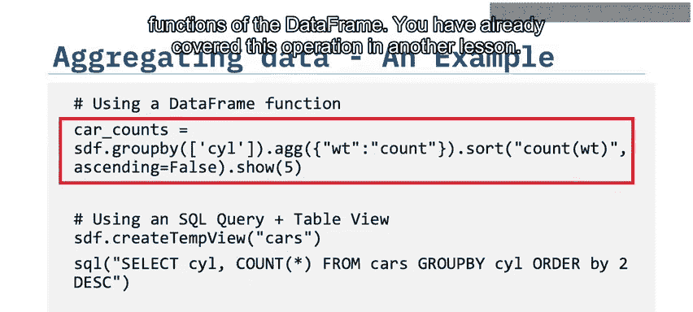

接下来，让我们看看SparkSQL支持的一些数据源。

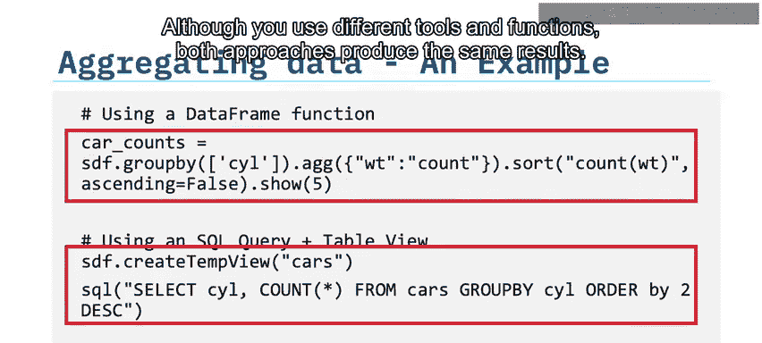

Parquet是一种列式存储格式，受到许多数据处理系统的支持。SparkSQL支持从Parquet文件读取和写入数据，并且会保留数据模式。

同样，SparkSQL可以通过推断模式来加载和写入JSON数据集。

SparkSQL还支持读取和写入存储在Hive中的数据。

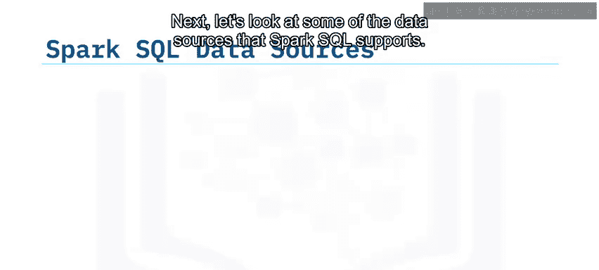

以下是支持的格式：
*   **Parquet文件**：高效的列式存储格式。
*   **JSON数据集**：灵活的半结构化数据格式。
*   **Hive表**：与Hadoop生态系统中的Hive数据仓库集成。

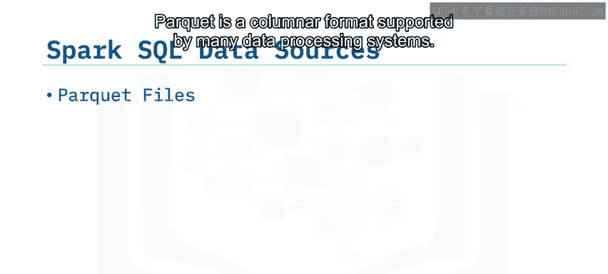

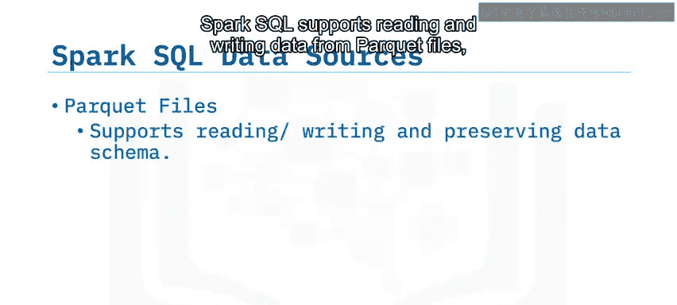

## 总结 🎯

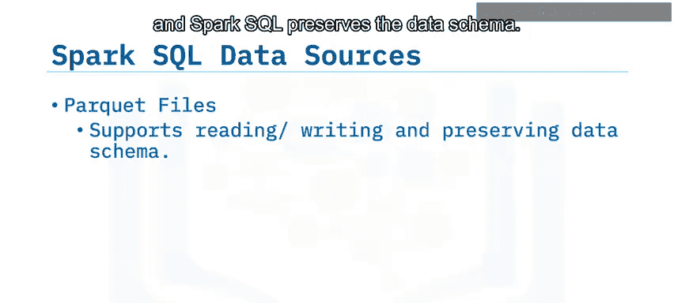

本节课中我们一起学习了Spark SQL的核心功能。

我们了解到，SparkSQL是用于结构化数据处理的Spark模块，可以在Spark数据帧上运行SQL查询，并支持Java、Scala、Python和R语言。

SparkSQL支持临时视图和全局临时视图。


你可以使用数据帧函数或SQL查询加表视图的方式进行数据聚合。


SparkSQL支持多种数据源，包括Parquet文件、JSON数据集和Hive表。