# IBM数据工程专业证书 课程11：《使用Spark和Hadoop进行大数据介绍》｜P25：Apache Spark架构 🏗️

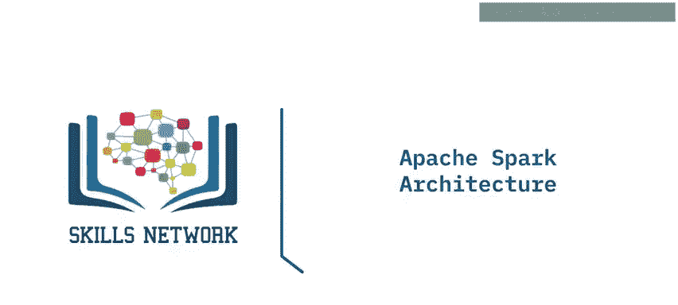

在本节课中，我们将要学习Apache Spark的核心架构。我们将了解Spark应用中的主要进程、作业与任务的关系、数据分区的概念，以及数据洗牌（Shuffle）的发生时机和影响。最后，我们还会探讨驱动程序的两种集群部署模式。

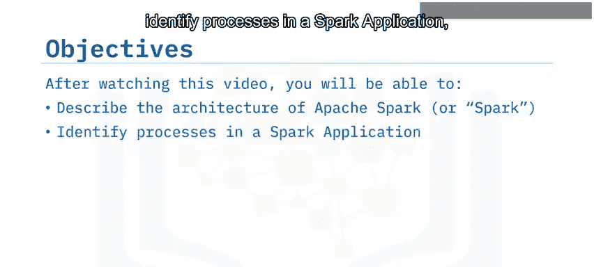

## Spark应用的主要进程

一个Spark应用包含两个主要进程：**驱动程序**和**执行器**。

*   **驱动程序**：每个应用对应一个驱动程序进程。它负责运行用户编写的应用代码，创建工作任务并将其发送到集群。驱动程序可以运行在集群节点上，也可以作为客户端运行在集群之外的机器上。
*   **执行器**：执行器是运行在集群工作节点上的进程，它通过多线程并发地执行任务。执行器之间相互独立，一个集群中可以有多个执行器，每个节点上也可以配置一个或多个执行器。

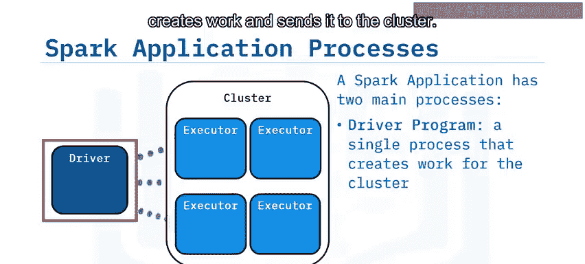

## Spark上下文与数据抽象

Spark上下文是应用的入口点，必须在驱动程序启动应用时创建，并且需要在创建任何数据帧或RDD之前完成。

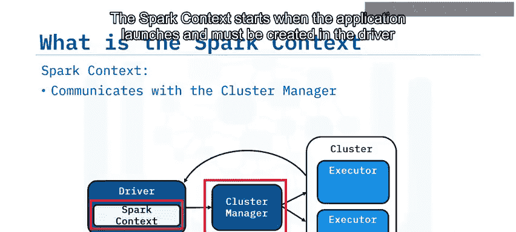

*   在驱动程序下创建的所有数据帧或RDD都与这个Spark上下文绑定。
*   只要这些数据抽象存在，Spark上下文就必须保持活动状态。

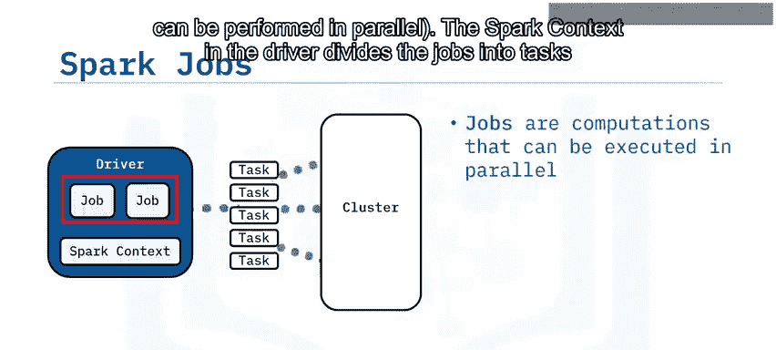

## 作业、任务与分区

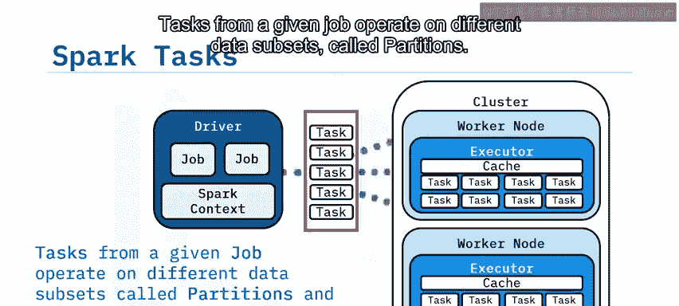

驱动程序根据用户代码创建被称为**作业**的计算单元。Spark上下文会将作业进一步划分为**任务**，以便在集群上执行。

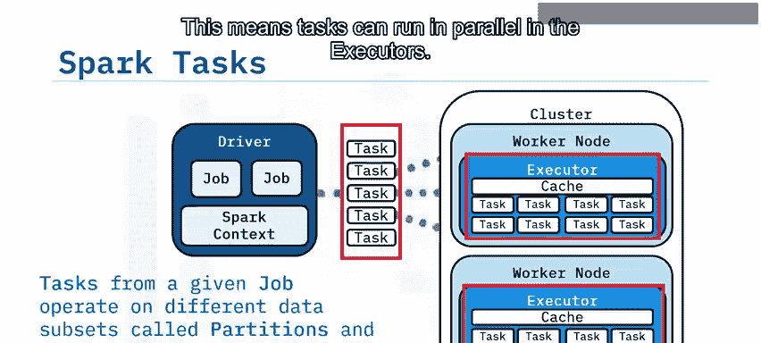

*   来自同一作业的任务操作不同的数据子集，这些子集称为**分区**。
*   这种设计使得任务可以在不同的执行器中并行运行。

## 执行器与并行度

Spark工作节点是执行任务的集群节点。一个Spark执行器会使用本地资源（如内存和计算核心）的一部分。

*   每个可用的核心运行一个任务。
*   每个执行器根据驱动程序的指示管理其数据缓存。
*   通常，增加执行器数量和可用核心数可以提高集群的并行处理能力。任务在独立的线程中运行，直到所有核心都被占用。
*   任务完成后，执行器会将结果放入新的RDD分区，或将其传回驱动程序。
*   理想情况下，应将使用的核心数限制在每个节点的总可用核心数内。例如，一个八核节点可以配置一个使用八个核心的执行器进程。

## 阶段与数据洗牌

Spark作业中的**阶段**代表了一组执行器可以在当前数据分区上完成的任务集合。

*   当一个任务需要访问其他数据分区时，Spark必须执行**洗牌**操作。洗牌操作标志着阶段之间的边界。
*   后续阶段中的任务必须等待前一个阶段完成才能开始执行，从而形成了阶段间的依赖关系。

**洗牌操作代价高昂**，因为它需要数据序列化、磁盘I/O和网络I/O。这是因为洗牌使得任务能够访问当前分区之外的其他数据集分区。

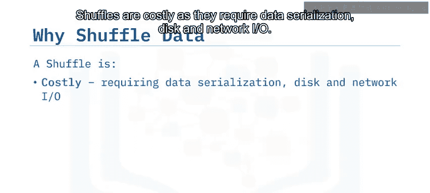

一个典型的例子是按给定键进行`groupBy`操作，这需要扫描每个分区以查找匹配的记录。当Spark执行洗牌时，它会在整个集群中重新分布数据。

## 阶段与洗牌示例

以下示例展示了被一次洗牌操作分隔开的两个阶段。

*   **阶段1**：对具有两个分区（分区1：A，分区2：B）的数据集A应用`map`转换操作，生成数据集B。
*   **洗牌操作**：下一个操作（如`groupByKey`）需要洗牌，因为相同键的值可能存在于任何其他分区中。为了将相同键的值分组在一起，任务必须扫描每个分区以挑选出匹配的记录。
*   **阶段2**：转换结果被放入阶段2。这里的结果具有相同数量的分区，但这取决于具体操作。
*   **最终动作**：最终结果通过一个**动作**（如`collect`）发送回驱动程序。

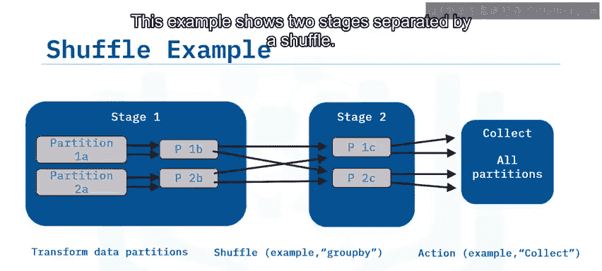

**注意**：不建议对大型数据集执行`collect`操作将数据拉取到驱动程序，因为这很容易耗尽驱动程序进程的内存。如果数据集很大，应在收集之前先应用归约操作。

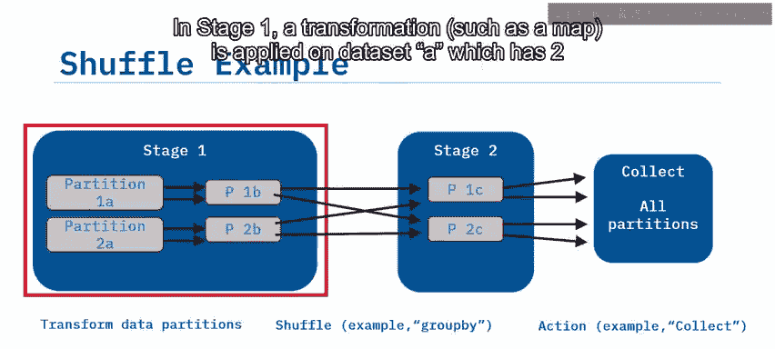

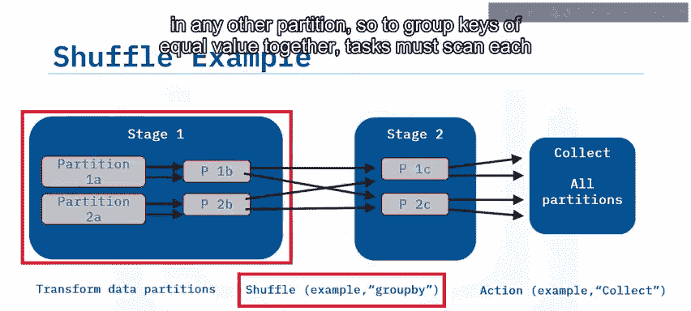

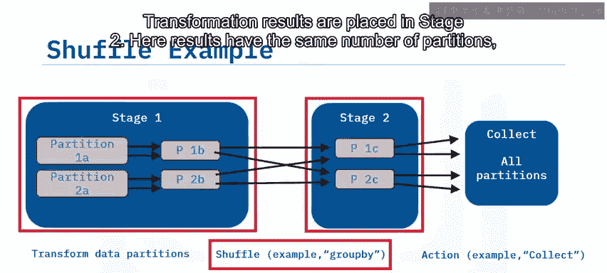

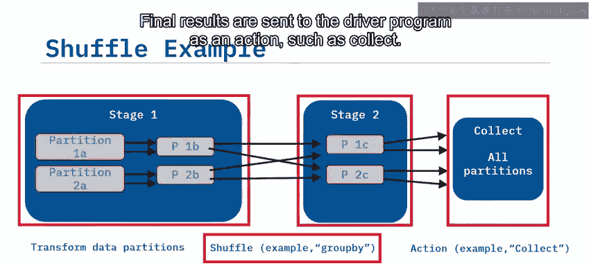

## 架构回顾

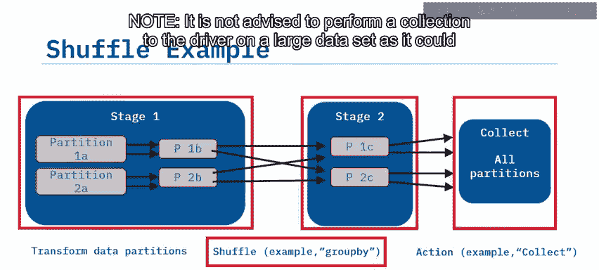

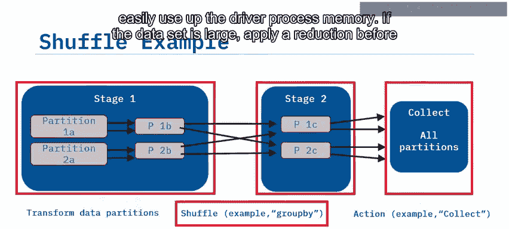

让我们回顾一下Spark架构的要点。

*   它由**驱动程序**和**执行器**进程组成。
*   集群包含**集群管理器**和**工作节点**。
*   **Spark上下文**负责向集群调度任务，而**集群管理器**负责管理集群资源。

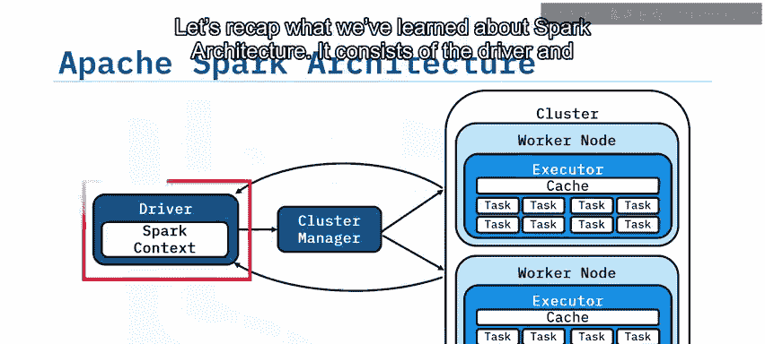

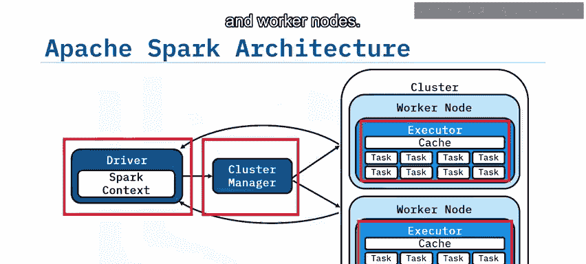

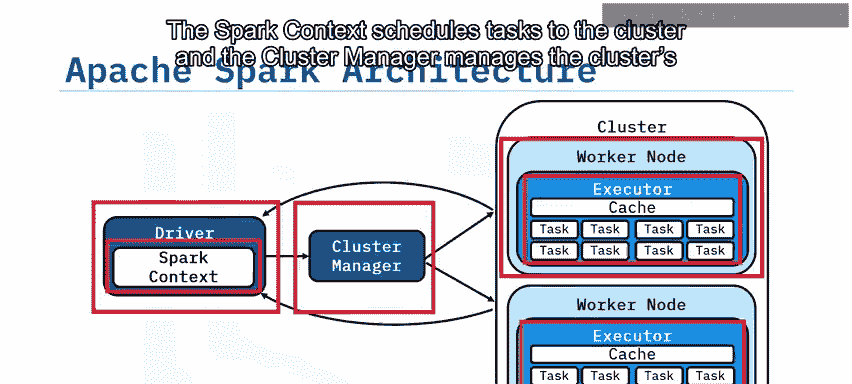

## 驱动程序部署模式

驱动程序可以运行在两种模式下：**客户端模式**或**集群模式**。

*   **客户端模式**：应用提交者（例如用户机器的终端）在集群外部启动驱动程序。
*   **集群模式**：驱动程序程序被发送到集群内部的一个可用工作节点上运行。

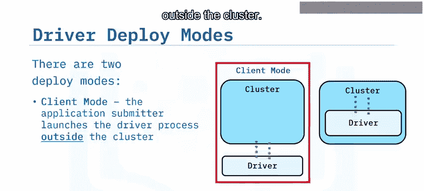

无论处于客户端模式还是集群模式，驱动程序在运行时都必须能够与集群通信。

## 总结

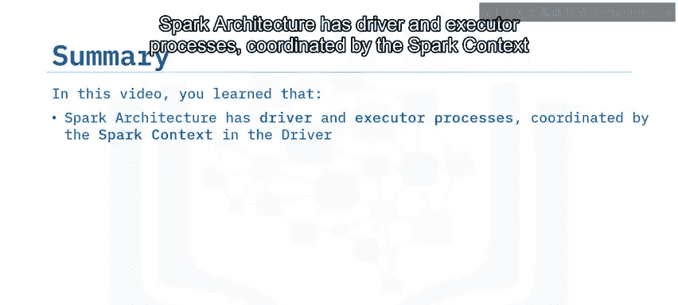

本节课中我们一起学习了Apache Spark的核心架构。

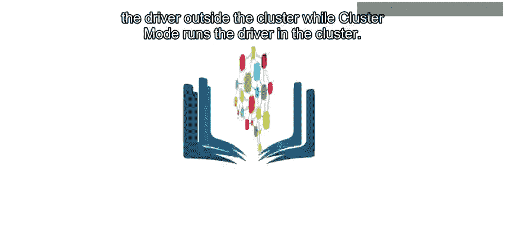

*   Spark架构由驱动程序和执行器进程组成，由驱动程序中的Spark上下文进行协调。
*   驱动程序创建作业并将其拆分为任务，这些任务可以在执行器中并行运行。
*   **阶段**是由**数据洗牌**分隔开的一组任务集合。
*   **洗牌操作代价高昂**，因为它需要数据序列化、磁盘I/O和网络I/O。
*   驱动程序可以运行在**客户端模式**或**集群模式**下。客户端模式将驱动程序连接在集群外部，而集群模式则在集群内部运行驱动程序。