# IBM数据工程专业证书 课程11：《使用Spark和Hadoop进行大数据介绍》｜ P26：Apache Spark集群模式概述 🚀

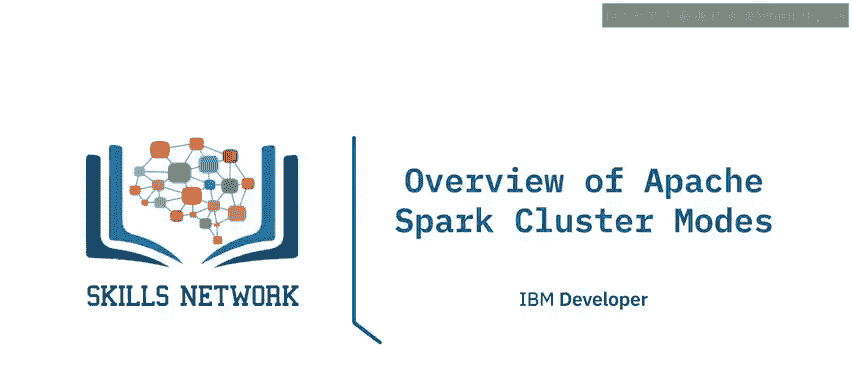

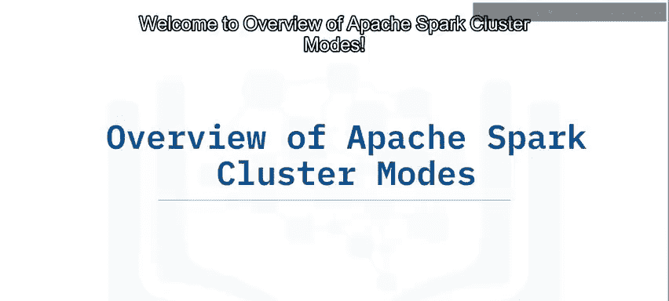

在本节课中，我们将要学习Apache Spark的不同集群运行模式。我们将了解每种模式的核心组件、优势以及如何配置和连接它们。掌握这些知识将帮助你根据实际需求选择最合适的Spark部署方式。

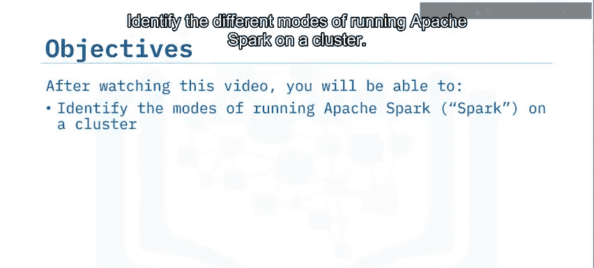

## Spark集群管理器概述

上一节我们介绍了Spark的基本架构，本节中我们来看看Spark如何与集群管理器协作。

Spark集群管理器负责与集群通信，为运行应用程序获取资源。它作为一个服务运行在应用程序外部，并在应用程序运行时抽象化集群类型。

其工作流程如下：
1.  Spark上下文（SparkContext）创建任务，并告知集群管理器需要哪些资源。
2.  集群管理器预留执行器（Executor）的核心和内存资源。
3.  资源预留完成后，任务被传输到执行器进程中运行。

Spark内置支持多种集群管理器。

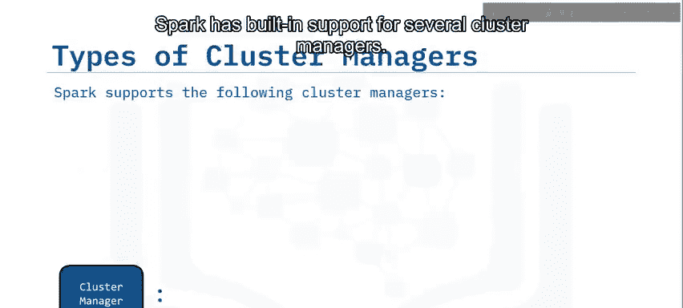

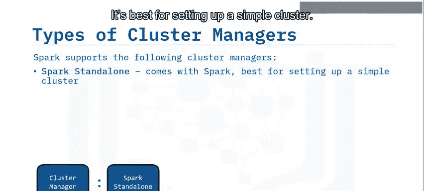

以下是Spark支持的几种主要集群管理器：
*   **Standalone集群管理器**：随Spark安装包提供，最适合搭建简单的集群。
*   **Apache Hadoop YARN**：来自Hadoop项目的集群管理器。
*   **Apache Mesos**：一个通用的集群管理器，Spark可以在其上运行并获得额外优势。
*   **Kubernetes**：一个用于运行容器化应用程序的开源系统。

## Spark Standalone 模式

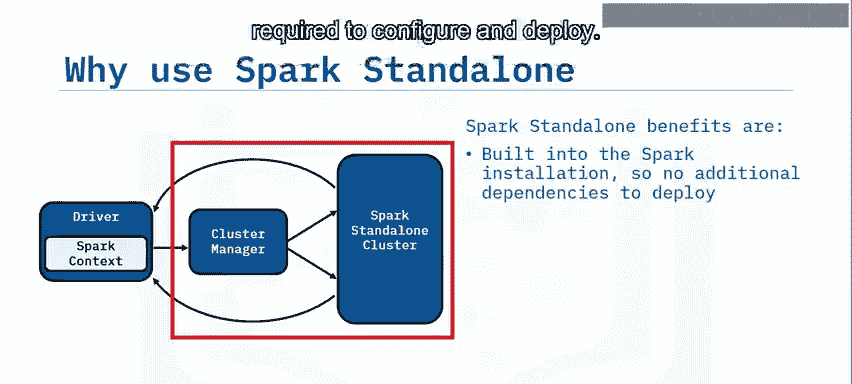

现在，让我们深入了解第一种模式：Spark Standalone。

Spark Standalone模式随Spark安装包一起提供，因此配置和部署无需额外的依赖。它是专门为运行Spark而设计的，通常是启动集群并运行应用程序最快的方式。

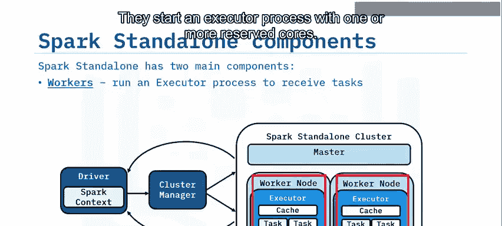

一个Spark Standalone集群有两个主要组件：工作节点（Workers）和主节点（Master）。
*   **工作节点**运行在集群节点上，它们启动一个包含一个或多个预留核心的执行器进程。
*   **主节点**可以运行在任何集群节点上，但必须保证至少有一个可用。它负责将工作节点连接到集群，并通过心跳轮询跟踪它们的状态。需要注意的是，如果主节点与工作节点部署在同一台机器上，不要为该工作节点预留该节点的全部核心和内存。

要手动设置一个Spark Standalone集群，请遵循以下步骤：
1.  启动主节点。主节点会被分配一个包含主机名和端口号的URL。
2.  主节点启动后，你可以使用该主节点URL，在任何节点上启动工作节点，工作节点会与主节点进行双向通信。
3.  主节点和工作节点都运行后，你可以通过将主节点URL作为参数指定给Spark应用程序，从而在集群上启动该应用程序。

要查看更多配置选项，请参考Spark官网（spark.apache.org）上的Apache Spark文档。

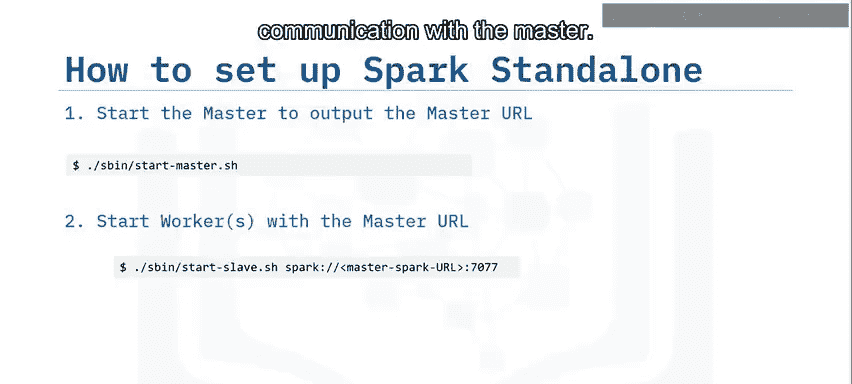

## Apache Hadoop YARN 模式

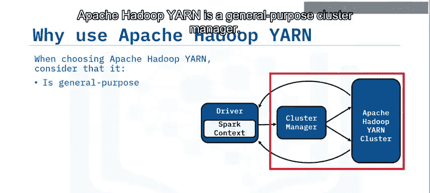

接下来，我们看看在现有Hadoop生态系统中常用的YARN模式。

Apache Hadoop YARN是一个通用的集群管理器，在大数据生态系统中非常流行，并支持Spark之外的许多其他框架。YARN集群有自己独立的依赖设置和配置要求，因此部署它比Spark Standalone更复杂。

要在现有的YARN集群上运行Spark，请使用`--master`选项并指定关键字`yarn`。当Spark识别到集群管理器类型是YARN时，它会查找标准的Hadoop配置文件来决定如何连接YARN集群。除此之外，Spark不需要其他配置。

## Apache Mesos 与 Kubernetes 模式

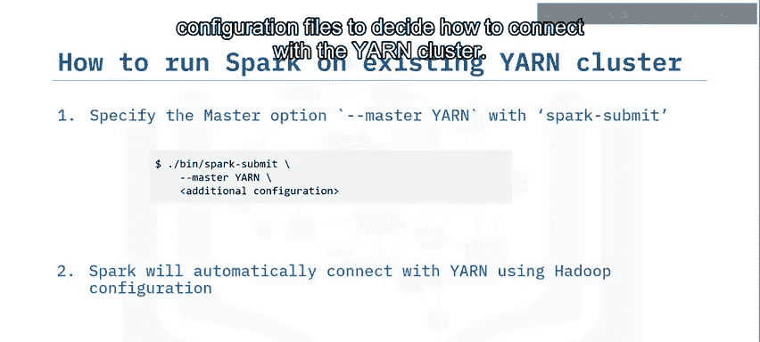

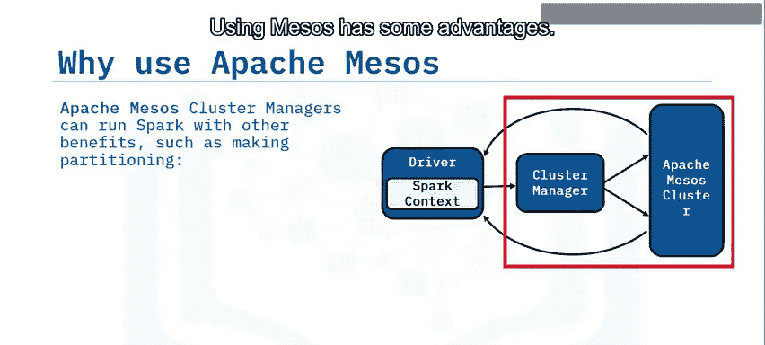

除了YARN，Spark还支持其他通用的集群管理器。

Apache Mesos是另一个Spark支持的通用集群管理器。使用Mesos有一些优势：它可以在Spark和其他大数据框架之间提供动态分区，以及在多个Spark实例之间提供可扩展的分区。然而，在Apache Mesos上运行Spark可能需要一些额外的设置，具体取决于你的配置要求。更多详细信息可在Spark官网（链接如图所示）上找到。

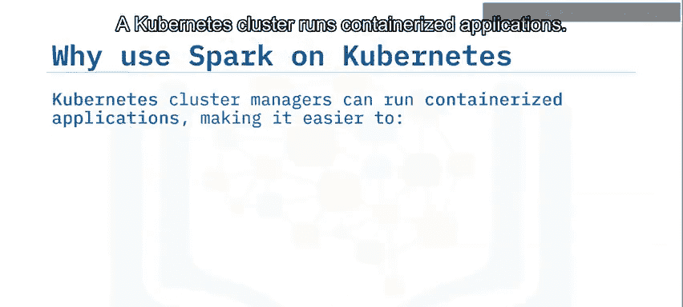

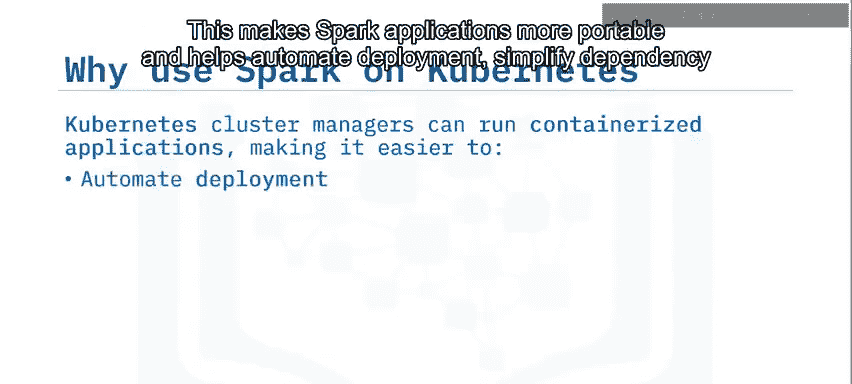

Kubernetes集群运行容器化的应用程序。这使得Spark应用程序更具可移植性，有助于自动化部署、简化依赖管理以及按需扩展集群。Spark使用内置的原生Kubernetes调度器。

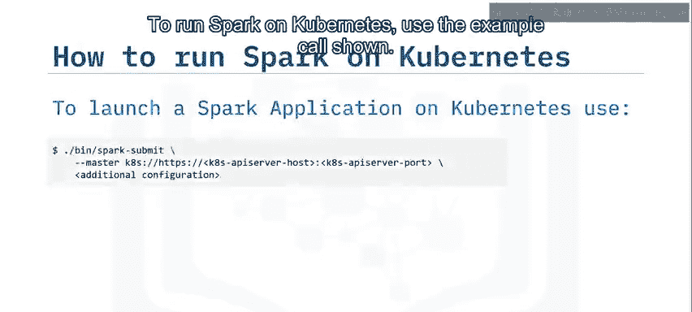

要在Kubernetes上运行Spark，请使用示例中所示的调用命令。

## 本地模式

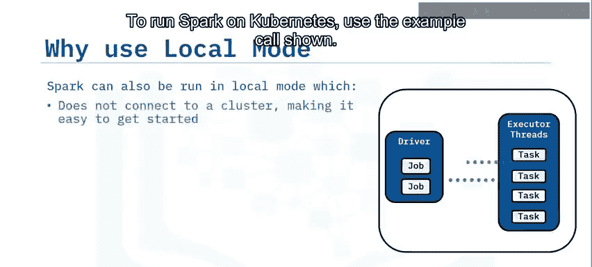

最后，我们来看一种特殊的运行模式，它不依赖于集群。

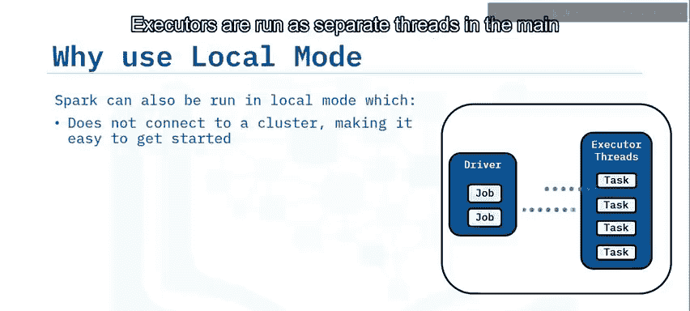

本地模式将Spark应用程序作为单个进程在本地机器上运行。执行器作为独立的线程运行在触发`spark-submit`的主进程中。本地模式不连接任何集群，也不需要基本Spark安装之外的配置。

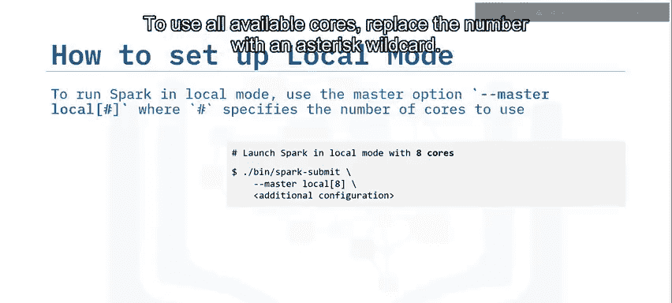

本地模式可以在笔记本电脑上运行，这对于测试或调试Spark应用程序非常有用。例如，可以在集群上运行应用程序之前，先用一个小的数据子集测试以验证正确性。然而，受限于单进程，本地模式并非为最优性能而设计。

要在本地模式下运行，请使用`--master`选项并指定关键字`local`，后面跟一个数字，表示Spark应用程序可以为执行器使用多少个核心。要使用所有可用核心，请将数字替换为星号通配符（`*`）。请注意，并非所有针对集群的配置在本地模式下都有效。

## 总结

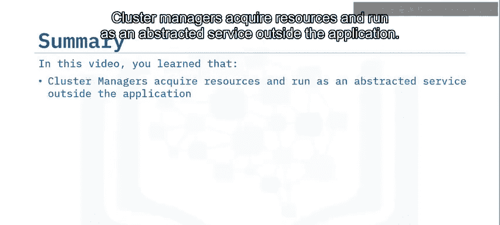

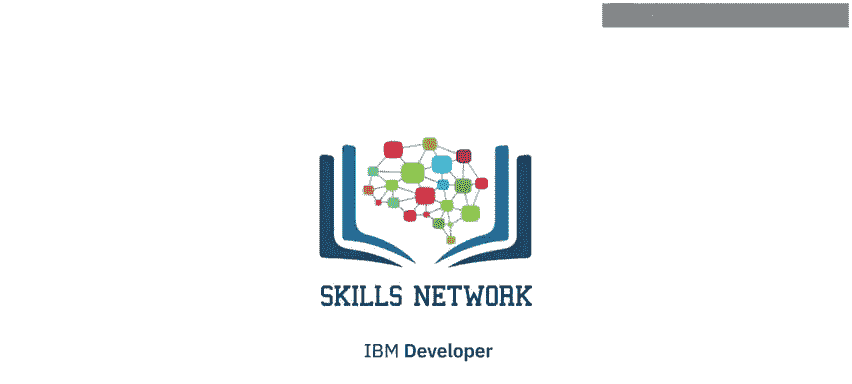

本节课中我们一起学习了以下内容：
*   集群管理器负责获取资源，并作为抽象化的服务运行在应用程序外部。
*   Spark可以在Spark Standalone、Apache Hadoop YARN、Apache Mesos或Kubernetes集群管理器上运行，每种模式都有特定的设置要求。
*   选择集群管理器取决于你的数据生态系统以及配置简易性、可移植性、部署或数据分区需求等因素。
*   Spark可以在本地模式下运行，这对于测试或调试应用程序非常有用。