# IBM数据工程专业证书 课程11：《使用Spark和Hadoop进行大数据介绍》｜ P27：如何运行Apache Spark应用程序 🚀


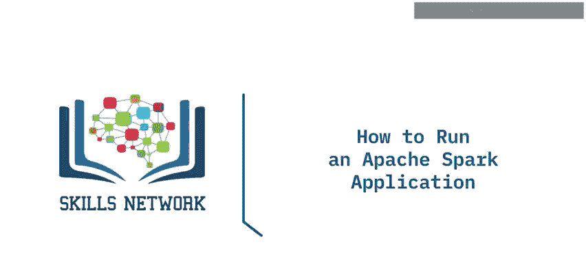

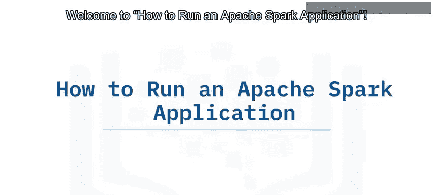

在本节课中，我们将要学习如何提交和运行一个Apache Spark应用程序。我们将重点介绍Spark的统一提交接口 `spark-submit`，了解其核心选项，并探讨如何管理应用程序的依赖。最后，我们还会了解使用Spark Shell进行交互式开发的便利性。

## 概述：Spark的统一提交接口

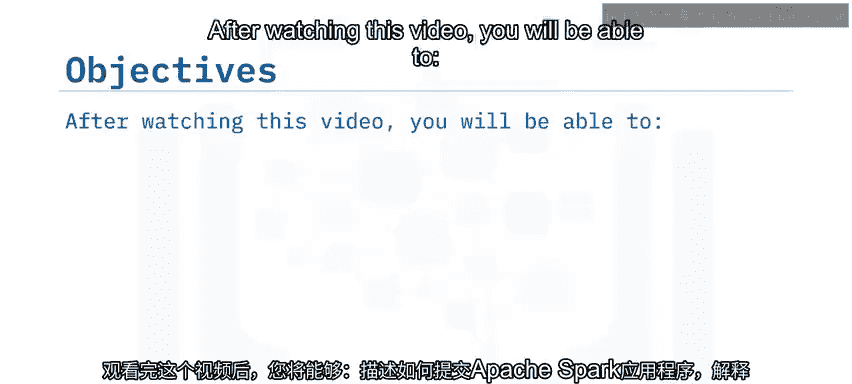

Spark提供了一个统一的接口来提交应用程序，即位于 `bin` 目录下的 `spark-submit` 脚本。

`spark-submit` 可以用于所有支持的集群类型，并接受许多用于应用程序或集群的配置选项。统一接口意味着，您只需更改一个参数，就可以从本地模式切换到集群模式运行Spark。

无论应用程序使用何种语言，`spark-submit` 的工作方式都相同。例如，一个集群可以通过传入所需的文件，同时运行Python和Java应用程序。

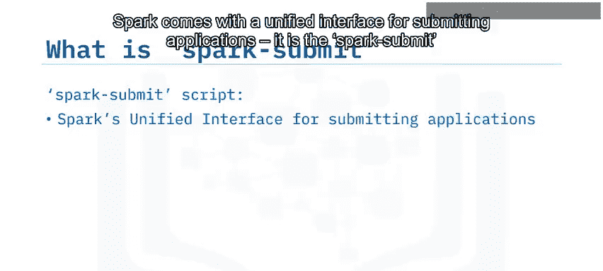

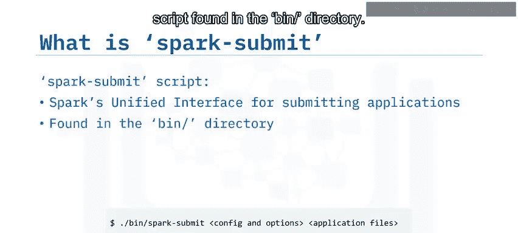

## `spark-submit` 的工作流程与核心选项

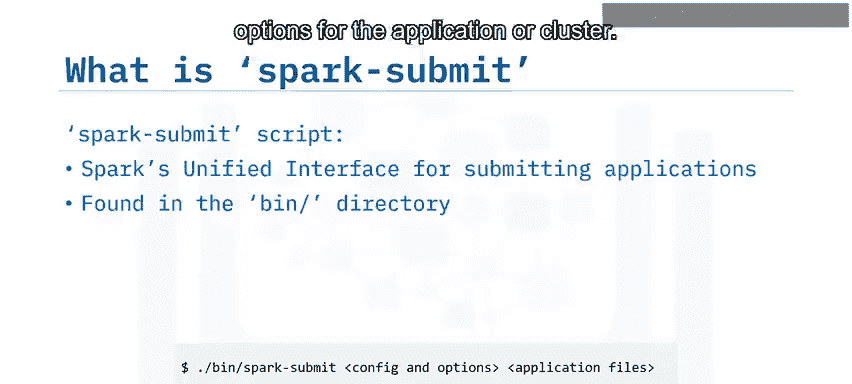

上一节我们介绍了 `spark-submit` 的基本概念，本节中我们来看看它的具体工作流程和关键配置选项。

`spark-submit` 脚本首先会解析任何命令行参数或选项。接着，它会读取在 `spark-defaults.conf` 文件中指定的任何额外配置。然后，`--master` 参数会告诉应用程序如何连接到集群或在本地运行。任何应用程序文件，包括JAR包或Python文件，都必须被指定，以便启动驱动程序并将文件分发到集群中运行。

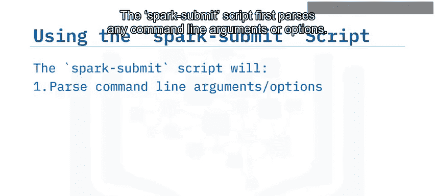

以下是 `spark-submit` 的一些核心选项：

*   **`--master`**：此选项是必需的，用于指定Spark要连接的集群管理器（如 `yarn`, `spark://host:port`, `local[*]`）。
*   **`--class`**：对于用Java或Scala编写并打包在JAR文件中的应用程序，必须指定程序入口点的完整类名。
*   **`--deploy-mode`**：设置驱动程序的部署模式，是作为客户端运行还是在集群中运行。
*   **`--executor-memory`, `--executor-cores` 等**：用于设置执行器资源，例如预留内存或CPU核心数。
*   **`--conf`**：用于在命令行上指定额外的Spark配置，格式为 `--conf key=value`。

对于Java或Scala应用程序，参数中需要包含应用程序JAR包的路径；对于Python应用程序，则是Python脚本的路径。之后可以传递可选的、应用程序特定的参数，这些参数会自动传入。

您可以使用 `--py-files` 参数添加 `.py`、`.egg` 或 `.zip` 文件。这些文件将被分发到集群，并在Python环境中可用。

让我们看两个 `spark-submit` 的例子。

第一个例子启动一个用Scala编写并打包在JAR中的Spark Pi程序：
```bash
./bin/spark-submit \
  --master yarn \
  --class org.apache.spark.examples.SparkPi \
  examples/jars/spark-examples_2.12-3.5.0.jar \
  1000
```
其中，`yarn` 是集群管理器，`1000` 是传递给应用程序的参数，表示在集群中计算Pi时采样的次数。

第二个例子启动一个Spark Pi的Python版本：
```bash
./bin/spark-submit \
  --master spark://host:7077 \
  examples/src/main/python/pi.py
```
其中，`spark://host:7077` 是一个Spark独立集群，我们只需传入Python脚本的路径。

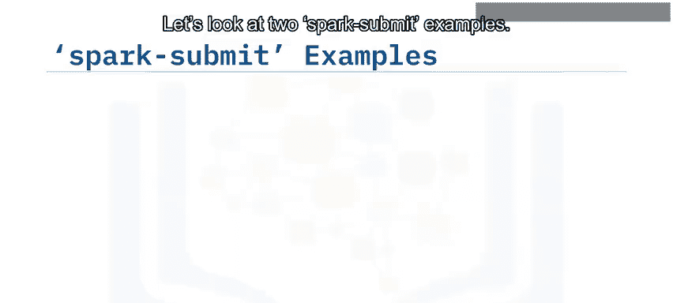

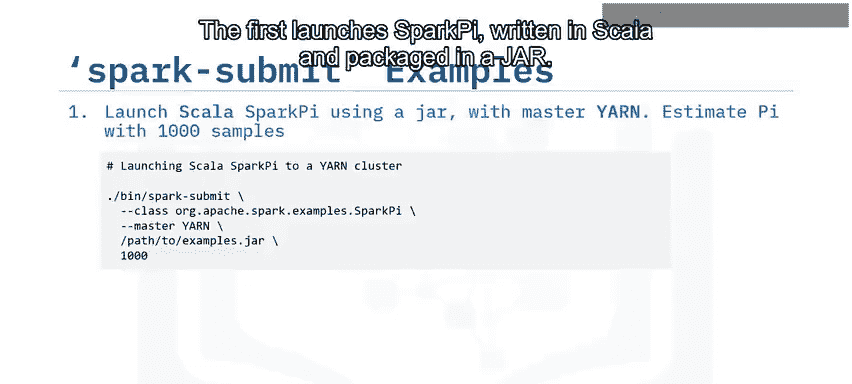

## 管理应用程序依赖

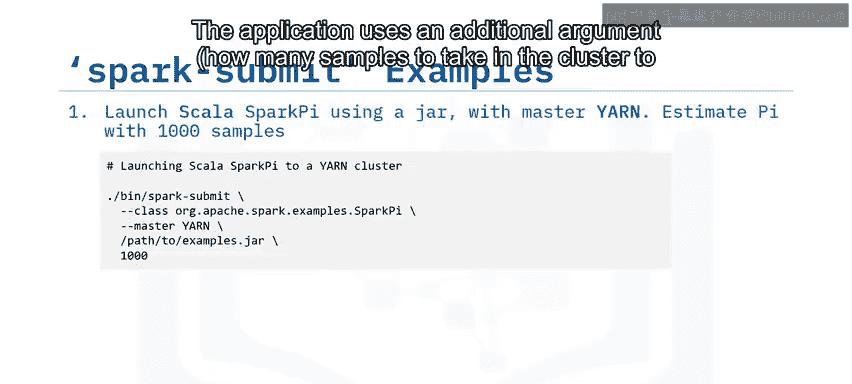

了解了如何提交应用程序后，我们还需要确保应用程序的所有依赖都能在集群中正确加载。本节中我们来看看如何管理这些外部依赖。

为了管理Spark依赖，应用程序项目或库必须能够被驱动程序和集群执行器进程访问。

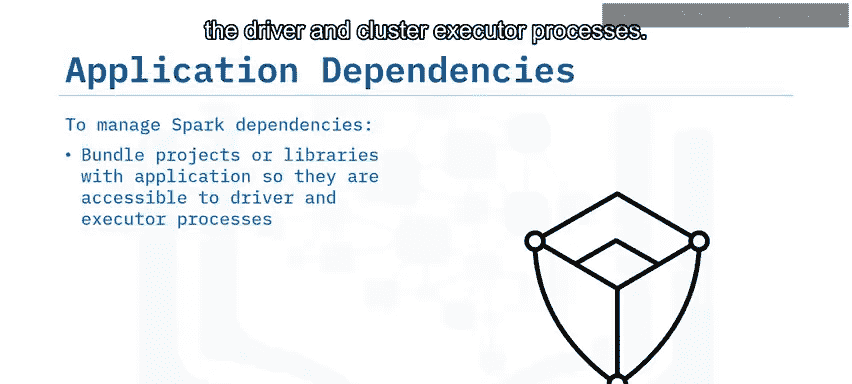

对于基于Java或Scala的应用程序，最佳实践是创建一个 **Uber JAR**。这是一个包含所有依赖（包括传递依赖）的单一JAR文件，使得应用程序在整个集群中都具有可移植性。

对于Python应用程序，需要确保两点：
1.  集群节点能够访问所需依赖的相同版本。
2.  使用相同的Python版本。

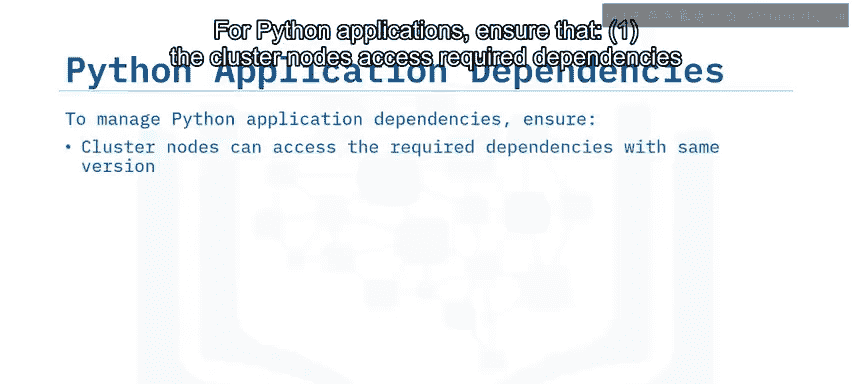

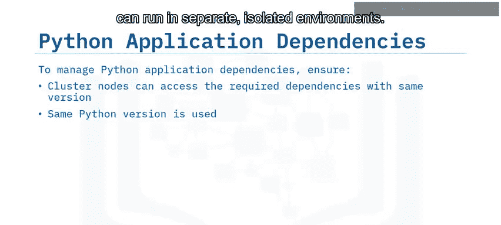

解决Python依赖的方案可能涉及创建虚拟环境，以便应用程序可以在独立的隔离环境中运行。Python依赖可以通过 `spark-submit` 脚本的 `--py-files` 参数包含进来，该参数接受 `.py`、`.zip` 或 `.egg` 文件。

## 使用Spark Shell进行交互式开发

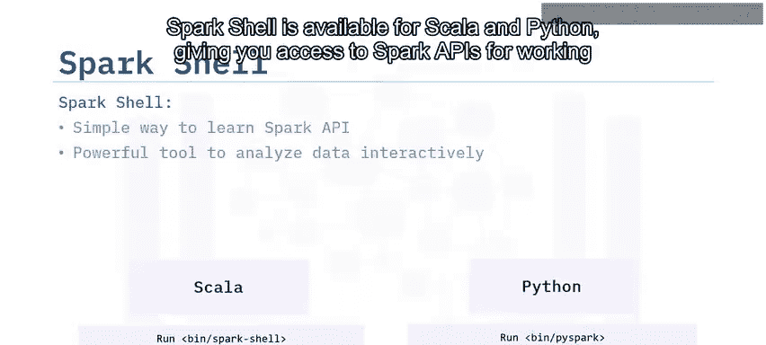

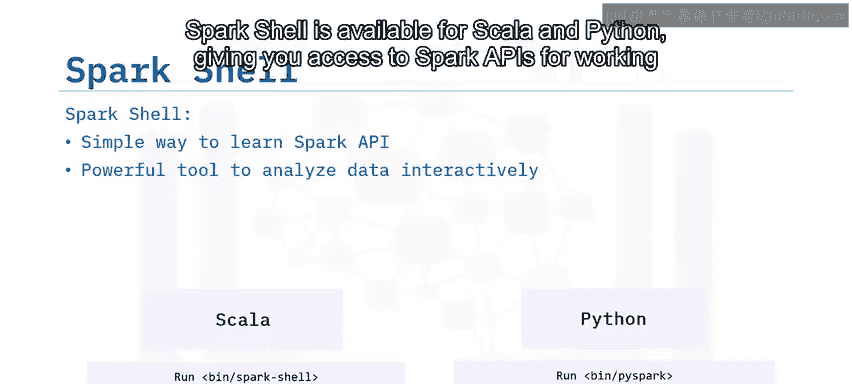

除了通过 `spark-submit` 提交完整的应用程序，Spark还提供了交互式Shell，可以简化数据探索和原型开发的过程。

Spark Shell 可用于 Scala 和 Python，它让您能够访问 Spark API 来处理数据，就像运行 Spark 作业一样。Spark Shell 可以在本地模式或集群模式下使用，并支持所有可用选项。

当 Spark Shell 启动时，环境会自动初始化 `SparkContext` 和 `SparkSession` 变量。这意味着您可以立即开始处理数据。在 Shell 中输入的表达式会在驱动程序中求值。对 Shell 中数据框执行一个操作，会生成 Spark 作业，这些作业被发送到集群并调度为任务执行。

以下示例展示了 Spark Scala Shell 在本地模式下启动：
```
...
Spark context Web UI available at http://host:4040
Spark context available as 'sc' (master = local[*], app id = ...).
Spark session available as 'spark'.
...
```
打印信息包括：Spark的Web UI地址、已初始化的Spark上下文变量 `sc` 和Spark会话变量 `spark` 的名称，以及JDK和Scala等重要库的版本信息。

以下示例展示了在 Scala Shell 中运行代码：
```scala
val df = spark.range(0, 10)
val transformedDf = df.withColumn(“mod”, col(“id”) % 2)
transformedDf.show(4)
```
第一行创建了一个从0到9的整数分布式范围数据框。第二行转换数据框，添加一个计算模2的新列。第三行是一个操作，打印出结果数据框的前四条记录。

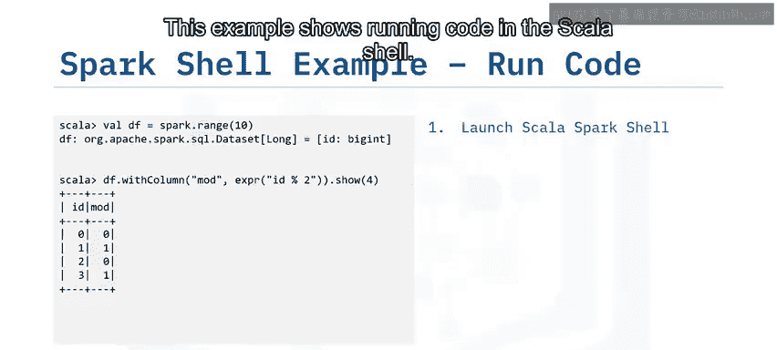

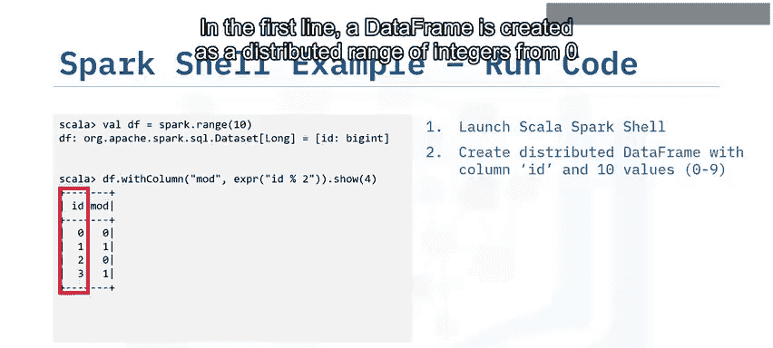

## 总结

本节课中我们一起学习了如何运行Apache Spark应用程序。

我们了解到 `spark-submit` 是一个统一的接口，用于提交Spark应用程序，无论集群管理器或应用程序语言是什么。必需的选项包括告诉Spark连接到哪个集群管理器。其他选项可以设置驱动程序部署模式或执行器资源。

为了管理依赖，应用程序项目或库必须能让驱动程序和执行器进程访问，例如通过为Java或Scala创建Uber JAR。


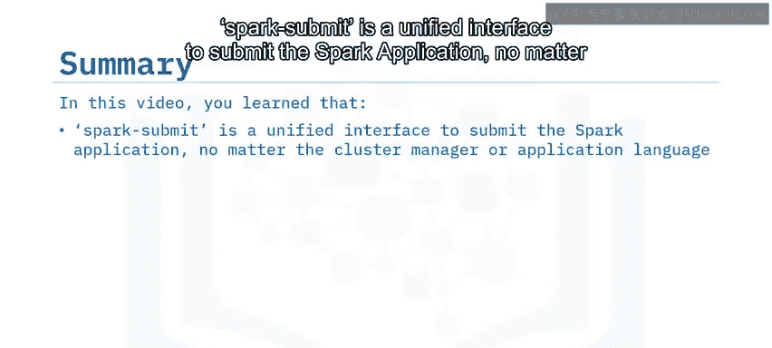


最后，Spark Shell 通过自动初始化 `SparkContext` 和 `SparkSession` 变量并提供Spark API访问，简化了数据处理工作。