# IBM数据工程专业证书 课程11：《使用Spark和Hadoop进行大数据介绍》｜ 第28课：在IBM云上使用Apache Spark 🚀

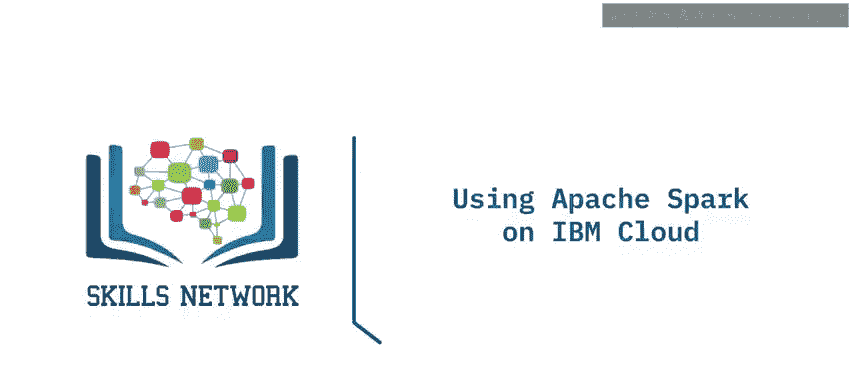

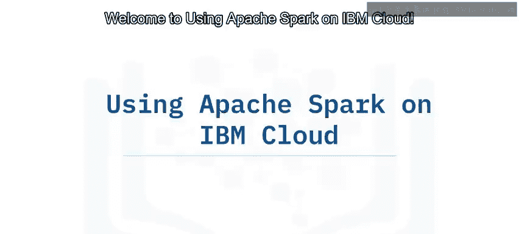

在本节课中，我们将学习在IBM云上运行Apache Spark的优势，并了解Spark如何与IBM的AIOps解决方案、IBM Watson以及IBM分析引擎协同工作。

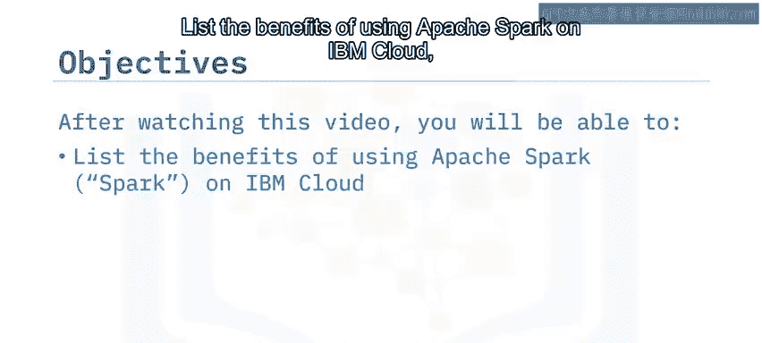

## 概述

Apache Spark可以在本地集群或云上运行。然而，在本地集群中配置节点以确保其可见性和正确通信可能较为困难。在云上运行Spark可以利用预先存在的默认配置来简化部署流程，这使得按需扩展集群、增加节点和提升计算能力变得非常容易。不同的云服务提供商支持在各种集群管理器上运行Spark。在IBM云上运行Spark能带来额外的好处，包括企业级安全性，并能与现有的IBM大数据解决方案（如AIOps、IBM Watson和IBM分析引擎）无缝集成。

## 在IBM云上运行Spark的优势

上一节我们介绍了云上运行Spark的通用便利性，本节中我们来看看选择IBM云的具体优势。

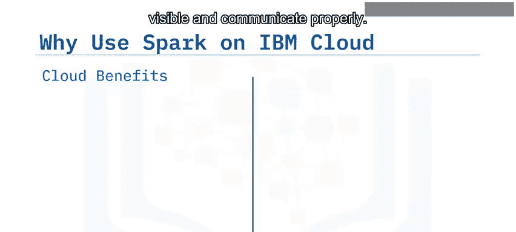

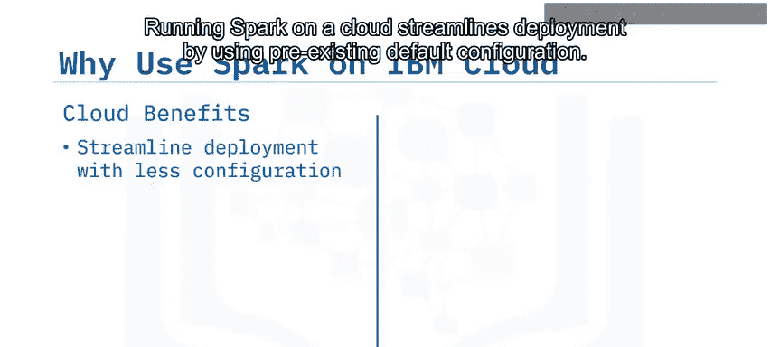

在IBM云上运行Apache Spark主要提供以下两大核心益处：
*   **企业级安全性**：IBM云为Spark作业提供了符合企业标准的安全保障。
*   **与IBM大数据生态集成**：可以轻松接入IBM为AIOps、IBM Watson和IBM分析引擎提供的大数据解决方案。

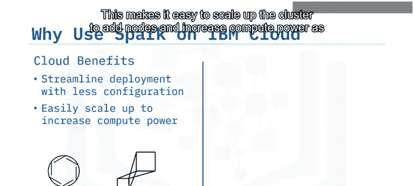

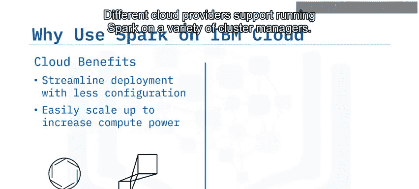

## AIOps与Spark

AIOps意为应用人工智能（AI）来自动化或增强IT运维。它帮助您收集、汇总并处理海量的运维数据。

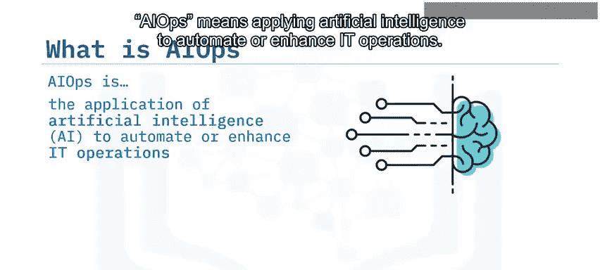

Spark特别适合大数据分析，是处理大量基础设施数据并应用机器学习来预测或识别运营问题的理想工具。

IBM Cloud Pak for Watson AIOps等解决方案集成了Spark，可以跨您的运维工具链关联数据，从而实时提供洞察或识别问题。

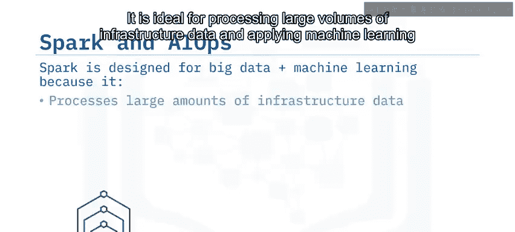

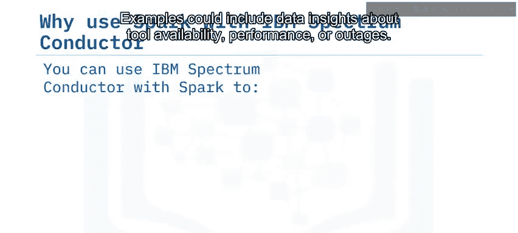

以下是AIOps借助Spark能够实现的主要功能：
*   在大型或复杂的基础设施系统中识别事件和模式。
*   快速诊断问题的根本原因，以便自动报告或修复。

## IBM Spectrum Conductor

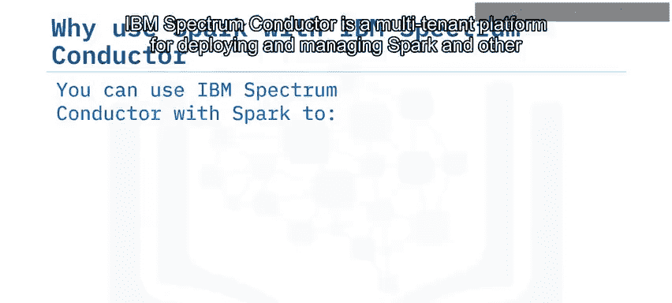

IBM Spectrum Conductor是一个多租户平台，用于在共享资源的集群上部署和管理Spark及其他框架。

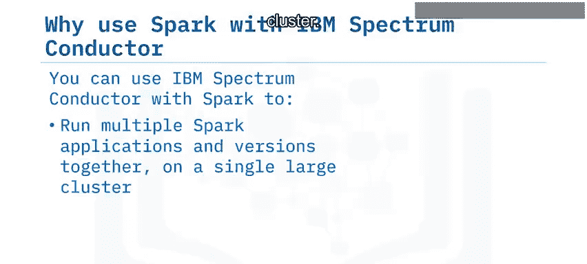

这使得多个Spark应用和版本可以在单个大型集群上同时运行。集群资源可以动态划分，避免了停机时间。此外，IBM Spectrum Conductor也为Spark提供了企业级安全性。

## IBM Watson与IBM分析引擎

IBM Watson通过提供服务、支持和完整的工作流，帮助创建可用于生产环境的AI和机器学习平台。

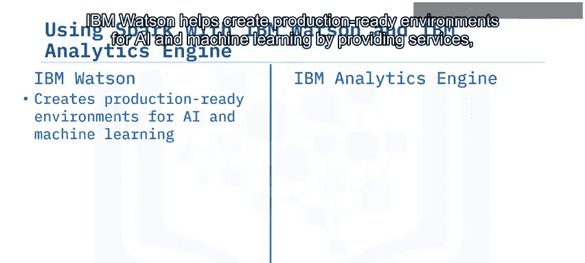

减少设置和维护时间，使您能专注于训练Spark以增强其机器学习能力。

IBM分析引擎与Spark协同工作，提供了一个灵活、可扩展的分析解决方案。它使用Apache Hadoop集群框架，通过将数据存储在对象存储（如IBM Cloud Object Storage）中来分离存储和计算。

这意味着您只需要在需要时运行计算节点，实现了存储与计算的解耦，其核心模式可概括为：
`计算资源按需分配，数据持久化存储在对象存储中。`

## 总结

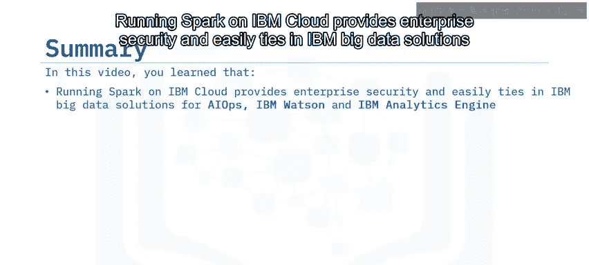

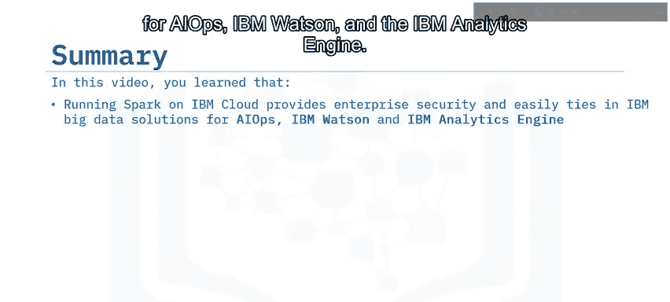

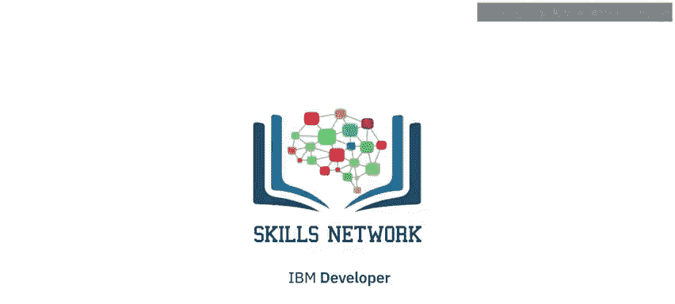

本节课中，我们一起学习了在IBM云上运行Spark的诸多好处。我们了解到，这不仅能提供企业级安全，还能轻松集成IBM的AIOps、IBM Watson和IBM分析引擎等大数据解决方案。具体来说：
*   AIOps工具（如IBM Watson AIOps）利用AI自动化IT运维，而Spark的大数据处理能力与机器学习结合，能很好地帮助识别事件、模式并解决问题。
*   IBM Spectrum Conductor能在单一集群上动态管理和部署Spark资源，并提供企业级安全。
*   IBM Watson通过创建生产就绪的AI环境，帮助您聚焦于Spark的机器学习能力。
*   IBM分析引擎通过分离存储和计算，与Spark的数据处理能力相结合，构建了一个可扩展的分析解决方案。