# IBM数据工程专业证书 课程11：《使用Spark和Hadoop进行大数据介绍》｜ 第29课：设置Apache Spark配置 ⚙️


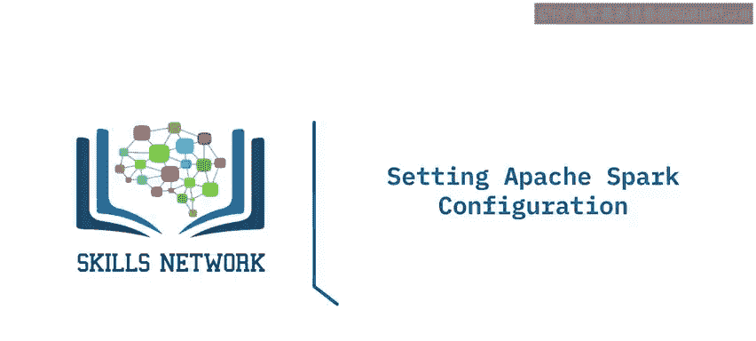

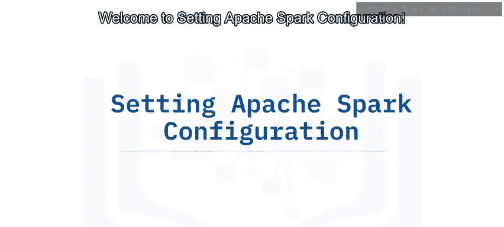

在本节课中，我们将要学习如何配置Apache Spark应用程序。我们将了解三种主要的配置方法，并解释每种方法的用途和常见选项。我们还将学习静态配置与动态配置的区别，以及何时使用它们。

## 概述

Apache Spark应用程序的行为可以通过多种方式进行配置，以适应不同的运行环境和需求。理解这些配置方法及其优先级，对于高效地管理和调优Spark作业至关重要。

## 配置类型

你可以使用三种不同的方法来配置Spark应用程序：属性、环境变量和日志配置。

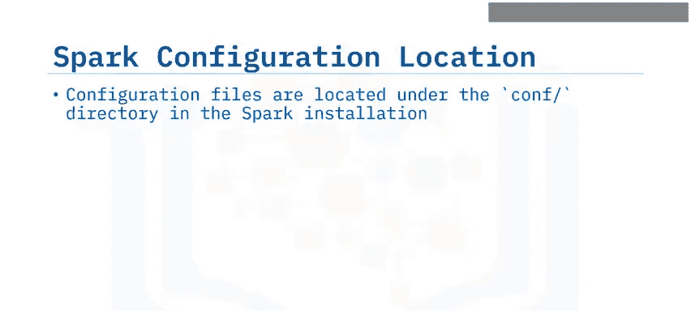

*   **Spark属性**：用于调整和控制大多数应用程序行为，包括在驱动程序中设置属性并与集群共享。
*   **环境变量**：在每台机器上加载，因此如果集群节点之间的硬件或已安装软件不同，可以基于每台机器进行调整。
*   **日志配置**：由log4j的默认文件控制，它决定了在应用程序执行期间，哪些级别的消息（如信息或错误）被记录到文件或输出到驱动程序。

## 配置文件位置

Spark配置文件默认位于安装目录下的 `conf/` 目录中。安装后默认不存在这些文件，但Spark为每种配置类型提供了一个模板文件。

以下是模板文件的名称：
*   `spark-defaults.conf.template`
*   `spark-env.sh.template`
*   `log4j.properties.template`

你可以通过移除 `.template` 扩展名来创建相应的配置文件。模板文件内部包含常见设置的示例配置，你可以通过取消注释来启用它们。

## 设置Spark属性的方法

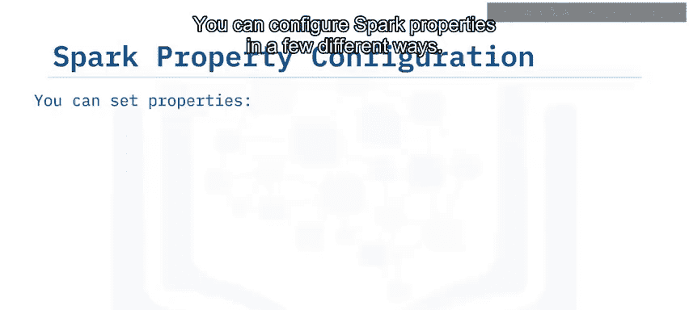

你可以在驱动程序程序中通过几种不同的方式配置Spark属性。

以下是主要的配置方式：
1.  **编程方式设置**：在创建Spark会话时，或在创建后通过 `SparkConf` 对象设置，然后将该对象传递给会话。
2.  **配置文件**：在 `conf/spark-defaults.conf` 文件中设置。
3.  **提交应用程序时设置**：使用 `spark-submit` 启动应用程序时，通过提供的选项（如 `--master`）或使用 `--conf` 选项附带键值对来设置。

## 配置优先级

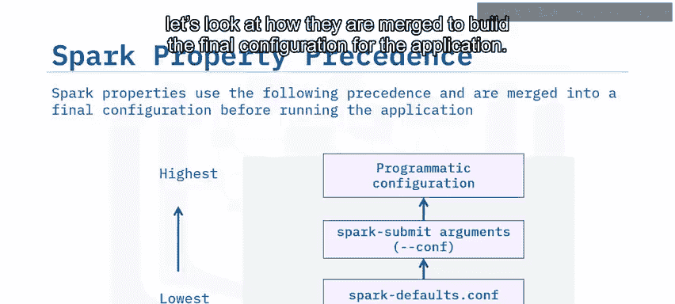

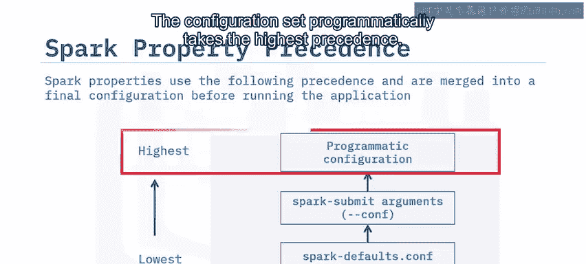

因为Spark属性可以通过不同方式设置，所以让我们看看它们是如何合并以构建应用程序的最终配置的。

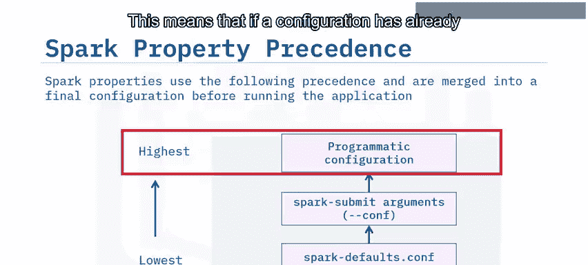

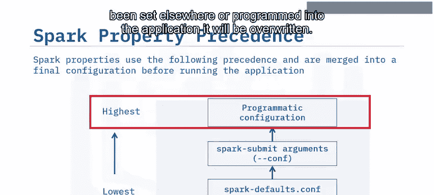

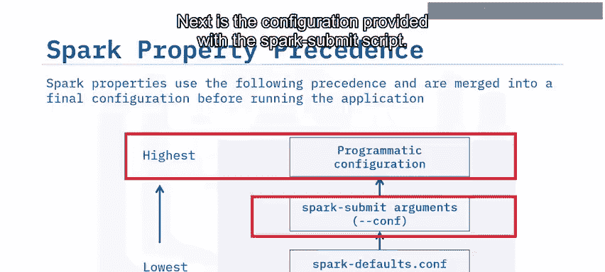

配置的合并遵循以下优先级顺序：
1.  **最高优先级**：通过编程方式设置的配置。这意味着如果配置已在其他地方设置或已编程到应用程序中，它将被覆盖。
2.  **次高优先级**：通过Spark提交脚本（`spark-submit`）提供的配置。
3.  **最低优先级**：在 `spark-defaults.conf` 文件中设置的任何配置。

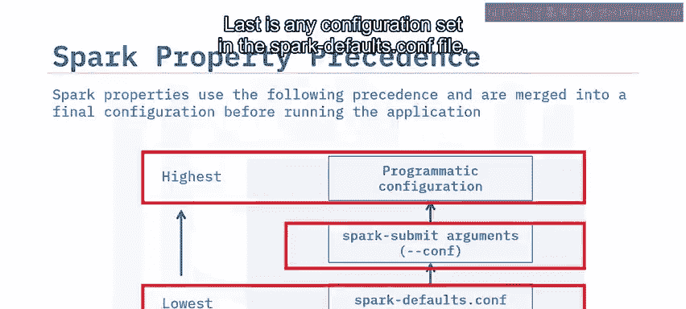

## 静态配置

静态配置指的是以编程方式写入应用程序本身的设置。这些设置通常不会更改，因为修改它们需要更改应用程序本身。

静态配置适用于在应用程序运行之间不太可能被更改或调整的内容，例如应用程序名称或仅与应用程序相关的其他属性。

例如，你不会对依赖于集群类型或可用资源需求的配置使用静态配置。

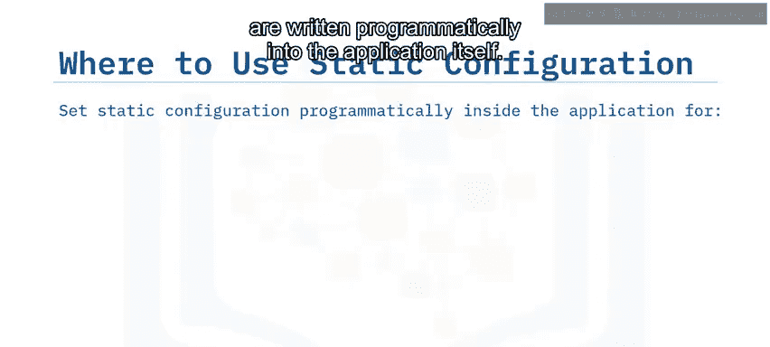

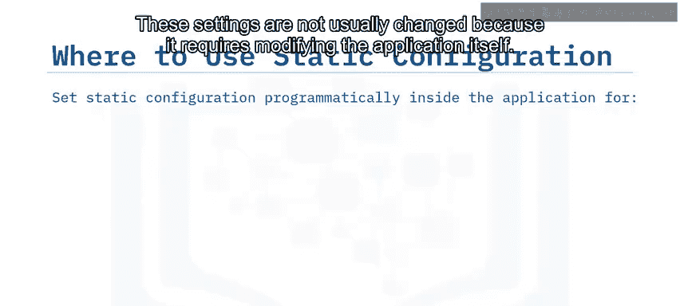

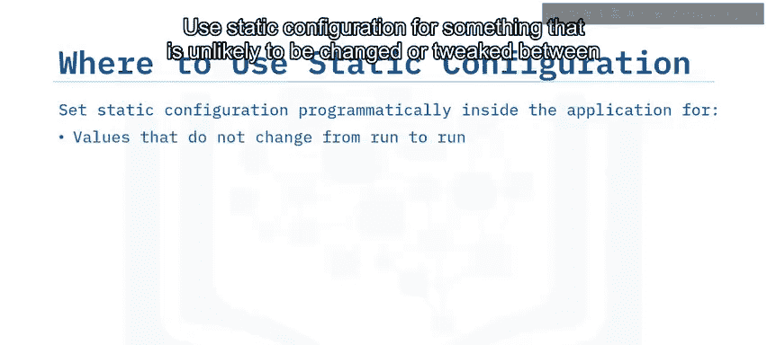

以下是一个设置静态配置的代码示例：
```scala
val spark = SparkSession.builder()
  .appName("My Spark Application") // 静态设置应用名称
  .config("spark.driver.maxResultSize", "2g") // 静态设置驱动程序最大结果大小为2GB
  .getOrCreate()
```

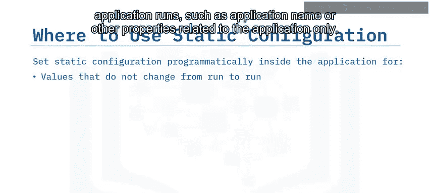

## 动态配置

动态配置有助于避免在应用程序本身中硬编码特定值。这通常用于诸如主节点位置之类的配置，以便通过简单地更改主节点位置，就可以在集群上启动应用程序。

其他示例包括动态设置每个执行器使用多少核心或保留多少内存，以便可以根据运行应用程序的集群进行适当调优。

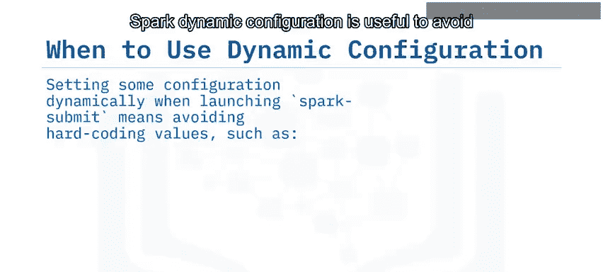

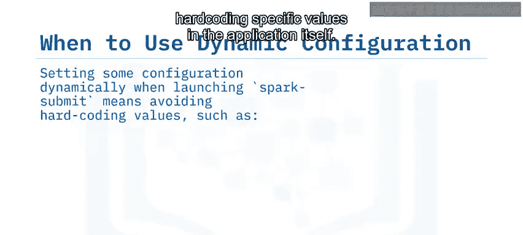

## 环境变量配置

Spark环境变量从文件 `conf/spark-env.sh` 中加载。当Spark进程启动时，它们从集群中的每台机器上加载。由于每台机器的加载方式可能不同，这有助于基于每台机器配置特定设置。

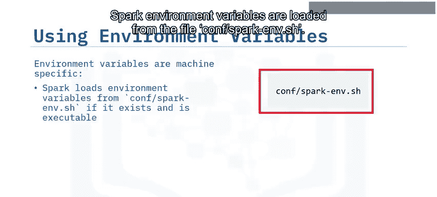

一个常见的用法是通过设置 `PYSPARK_PYTHON` 环境变量，来确保集群中的每台机器使用相同的Python可执行文件。

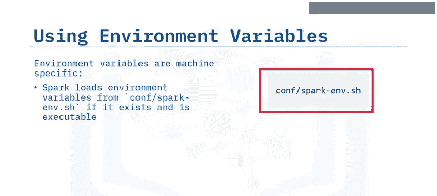

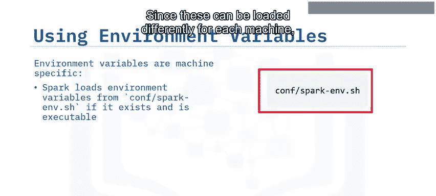

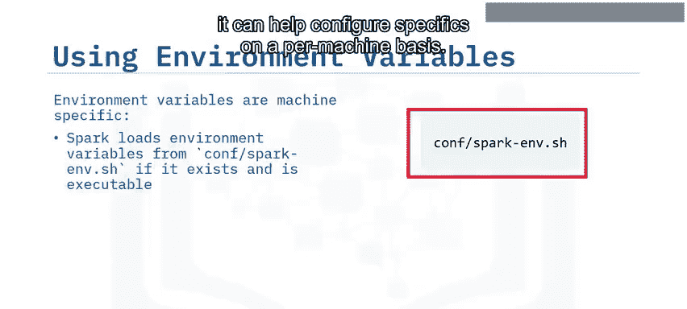

## 日志配置

Spark日志记录使用Log4j进行控制，其配置通过 `conf/log4j.properties` 文件读取。在这里，你可以调整日志级别，以确定哪些消息（如调试、信息或错误）显示在Spark日志中。

Log4j允许配置日志发送到哪里，并调整Spark或第三方库的特定组件的日志级别。

## 总结


本节课中，我们一起学习了如何设置Spark配置。

你了解到可以使用属性来控制应用程序行为，使用环境变量来基于每台机器调整设置，或使用日志属性来控制日志输出。

Spark属性配置遵循优先级顺序，最高的是以编程方式设置的配置，其次是Spark提交配置，最后是在 `spark-defaults.conf` 文件中设置的配置。

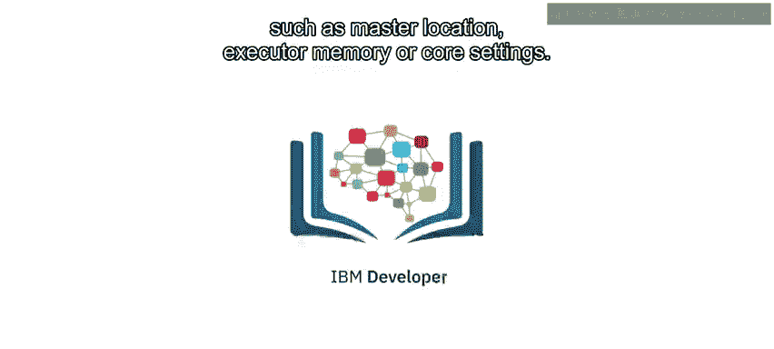

静态配置应用于运行间不变的值，或与应用程序相关的属性（如应用程序名称）。动态配置应用于部署时需要更改或调整的值，例如主节点位置、执行器内存或核心设置。