# IBM数据工程专业证书 课程12：《使用Spark进行数据工程和机器学习》｜ 第2部分：Apache Spark上的GraphFrames 🕸️


在本节课中，我们将要学习Apache Spark上的GraphFrames。我们将了解图论的基本概念，定义GraphFrames，并探索适合使用GraphFrames进行分析的数据类型。

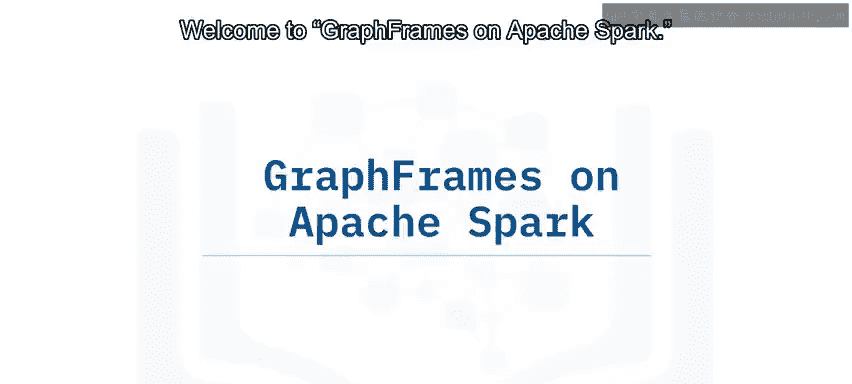

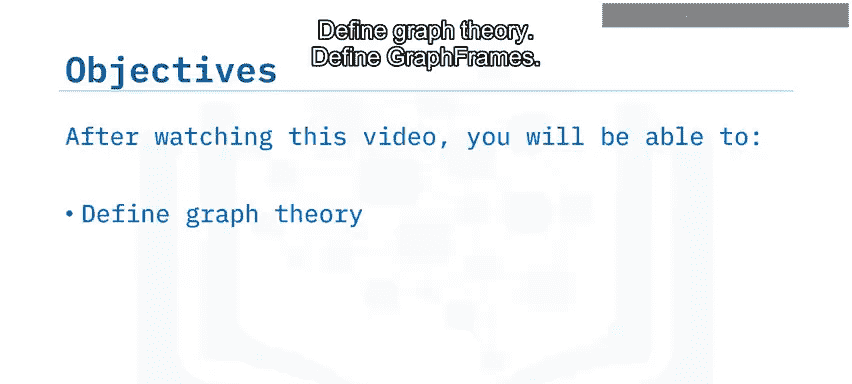

## 图论简介 📊

图论是研究对象之间关系建模的数学分支。图是一种结构，它包含一组顶点以及连接这些顶点的成对边。

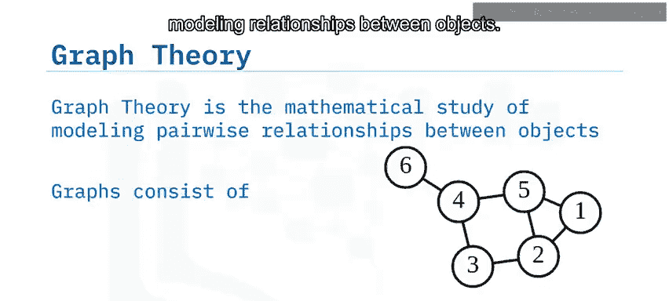

图可以分为有向图和无向图。

### 有向图

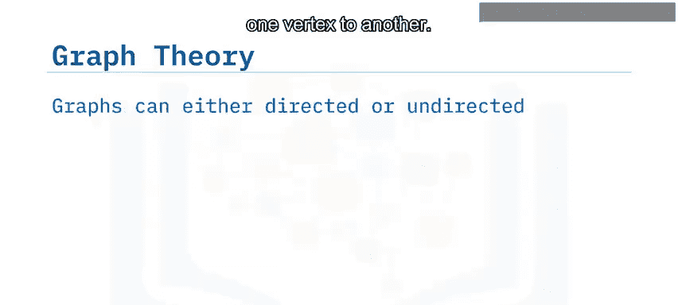

有向图的边在两个顶点之间具有单一方向，表示单向关系，通常用带箭头的线表示。

以下是适用有向图分析的例子：
*   制造优化
*   项目调度
*   火车和航线分析
*   交通路线推荐

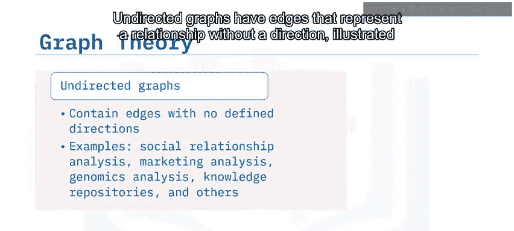

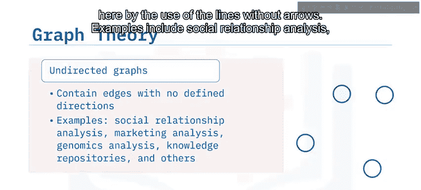

### 无向图

无向图的边表示没有方向的关系，通常用不带箭头的线表示。

以下是适用无向图分析的例子：
*   社交关系分析
*   市场营销分析
*   基因组学分析
*   知识库构建

## 什么是GraphFrames？ 🔧

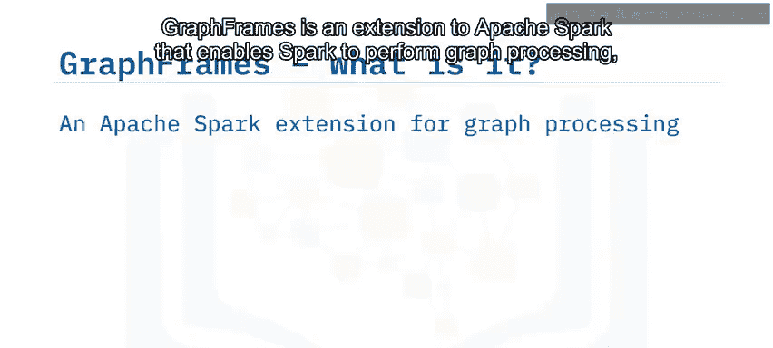

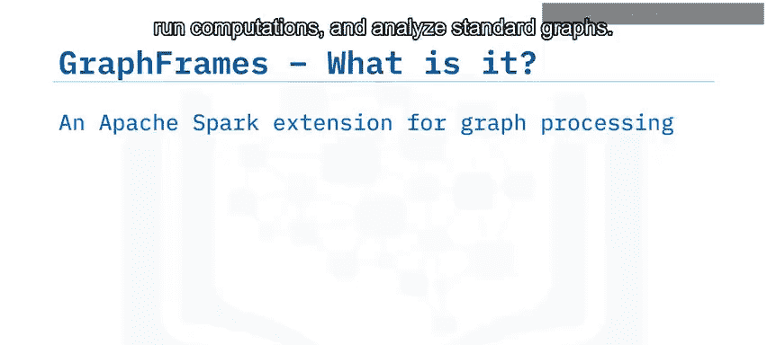

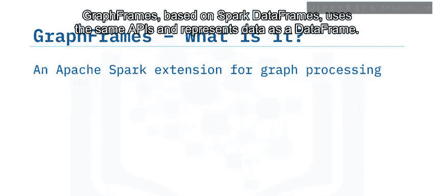

上一节我们介绍了图论的基本概念，本节中我们来看看GraphFrames的具体定义。

GraphFrames是Apache Spark的一个扩展，它使Spark能够执行图处理、运行计算并分析标准图。GraphFrames基于Spark DataFrame，使用相同的API，并将数据表示为DataFrame。使用DataFrame是GraphFrames与基于RDD的GraphX之间的主要区别。GraphFrames包含标准的基于图的算法，能够覆盖大多数用例。GraphFrames目前不包含在Spark的默认安装中，必须作为单独的包下载。

## 下载与使用GraphFrames 📦

了解了GraphFrames是什么之后，我们来看看如何获取和使用它。

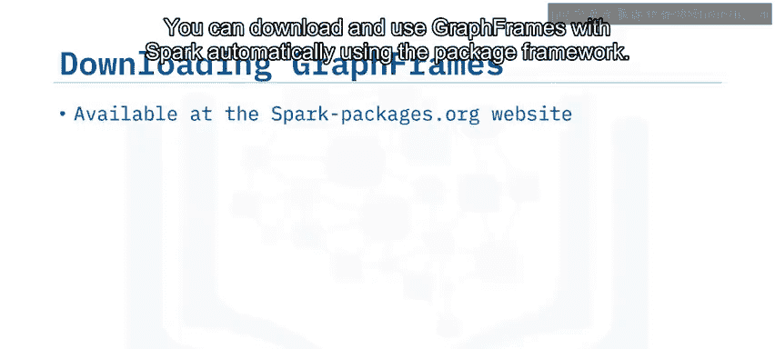

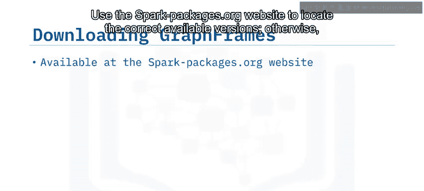

你可以使用Spark的包管理框架自动下载和使用GraphFrames。使用 `spark-packages.org` 网站来查找正确的可用版本，否则在提交Spark应用时，该包可能无法使用。


在使用 `spark-submit` 提交Spark应用程序时，需要包含参数 `--packages`，后跟包的组织名和版本。

**代码示例：**
```bash
spark-submit --packages graphframes:graphframes:0.8.1-spark3.0-s_2.12 my_app.py
```
请记住为你的Spark版本选择正确的标识符。上述示例将下载并使用适用于Spark 3.0和Scala 2.12的GraphFrames 0.8.1版本。

## GraphFrames的核心功能 ⚙️

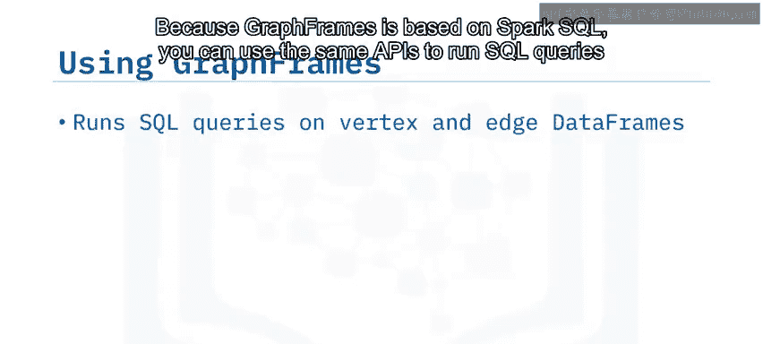

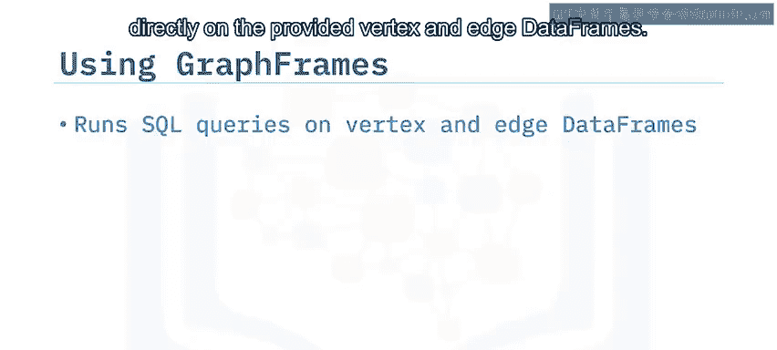

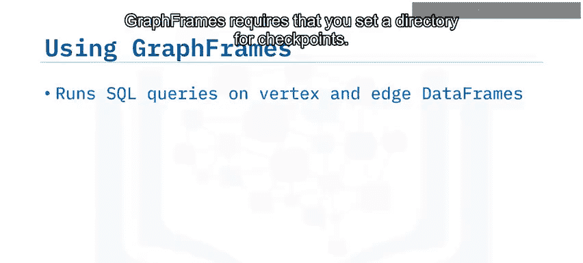

成功配置GraphFrames后，让我们深入了解它的核心功能。

因为GraphFrames基于SparkSQL，所以你可以使用相同的API直接在提供的顶点和边DataFrame上运行SQL查询。GraphFrames要求你设置一个检查点目录。

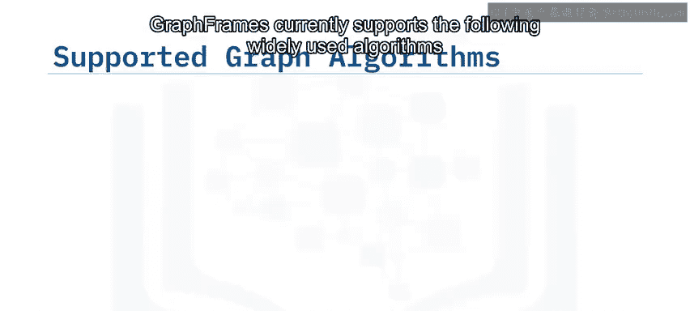

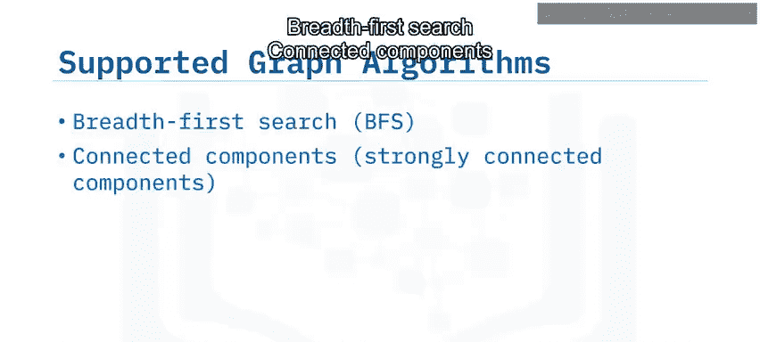

GraphFrames支持**模体查找**。模体查找是指搜索重复出现的结构模式或子图。GraphFrames通过 `find` 方法支持模体查找，该方法使用领域特定语言来指定关于边和顶点的搜索查询。

## 内置图算法 🧮

除了数据查询，GraphFrames还内置了多种强大的图算法，可以直接应用。

以下是GraphFrames目前支持的几种广泛使用的算法：
*   **广度优先搜索**
*   **连通分量**
*   **标签传播算法**
*   **PageRank**
*   **最短路径**
*   **三角形计数**

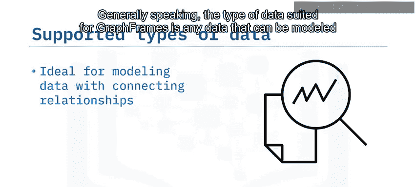

一个著名的日常算法应用是**PageRank**。根据维基百科记载，PageRank最初由谷歌开发，是用于衡量网页重要性并为其搜索引擎对网页进行排名的算法。如果你对谷歌目前如何返回搜索结果感兴趣，谷歌搜索博客页面提供了非技术性但有趣的算法描述。

## 适合GraphFrames的数据类型 💡

我们已经了解了GraphFrames的功能和算法，那么什么样的数据适合用它来分析呢？

一般来说，任何可以建模为连接关系的数据都适合使用GraphFrames。你可以使用GraphFrames来计算关系的强度和方向。

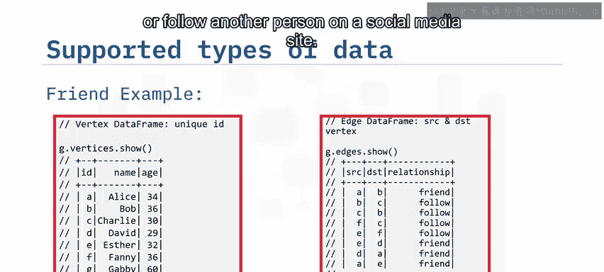

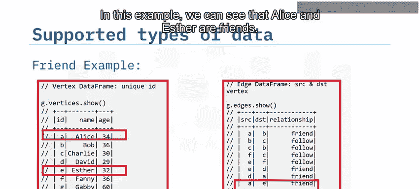

在这个例子中，图以人为顶点，人与人之间的关系由一条边表示，边的属性表明他们是否是朋友或在社交媒体上关注了另一个人。我们可以看到，Alice和Esther是朋友。

GraphFrames从这些数据中生成两个DataFrame：一个用于列出人员的顶点DataFrame，另一个用于显示人员之间关系的边DataFrame。你可以使用SparkSQL单独查询这些DataFrame，也可以使用GraphFrames提供的任何算法。

## 总结 📝

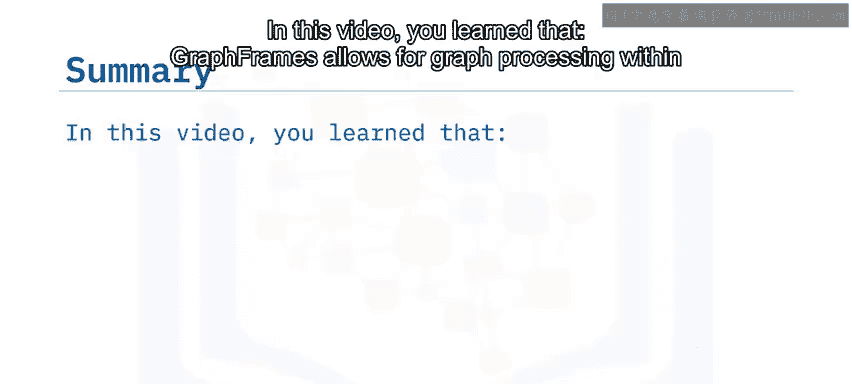

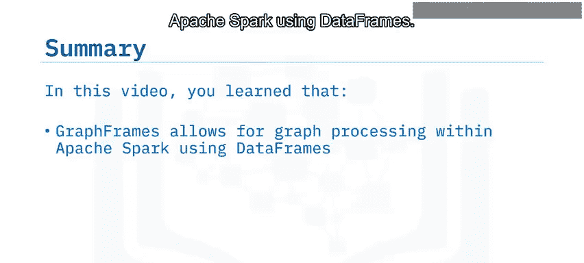


本节课中我们一起学习了GraphFrames。我们了解到GraphFrames允许在Apache Spark中使用DataFrame进行图处理。GraphFrames为图顶点和边各提供一个DataFrame，可与Spark SQL结合进行分析。GraphFrames附带流行的内置图算法，可与边和顶点DataFrame一起使用。