# IBM数据工程专业证书 课程11：《使用Spark和Hadoop进行大数据介绍》｜P30：在Kubernetes上运行Spark 🚀


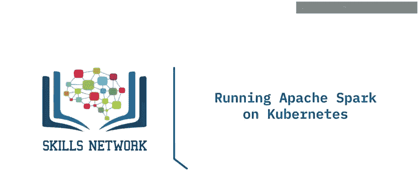


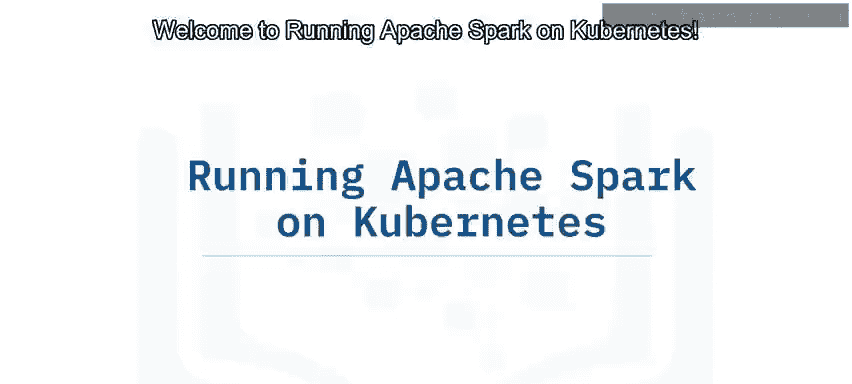


在本节课中，我们将学习如何在Kubernetes上运行Apache Spark。我们将了解Kubernetes的用途、本地与云端部署的区别，以及提交Spark应用到Kubernetes集群的具体方法。

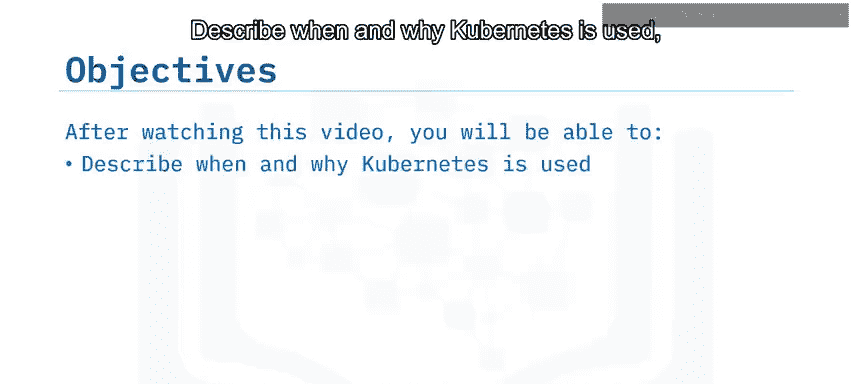


观看本节视频后，你将能够描述Kubernetes的使用场景和原因，说明本地运行与云端托管Kubernetes的区别，并解释如何在Kubernetes上运行Apache Spark。

## 什么是Kubernetes？📦


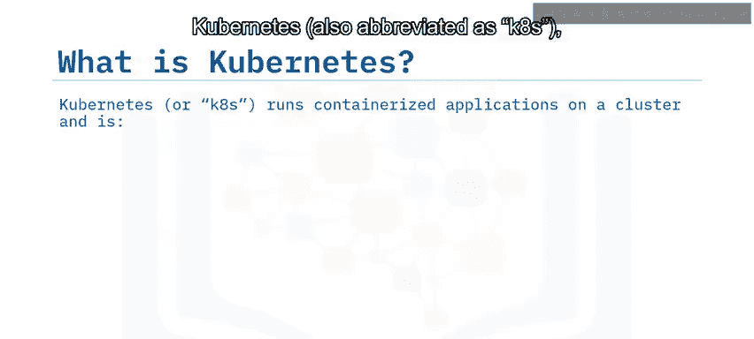

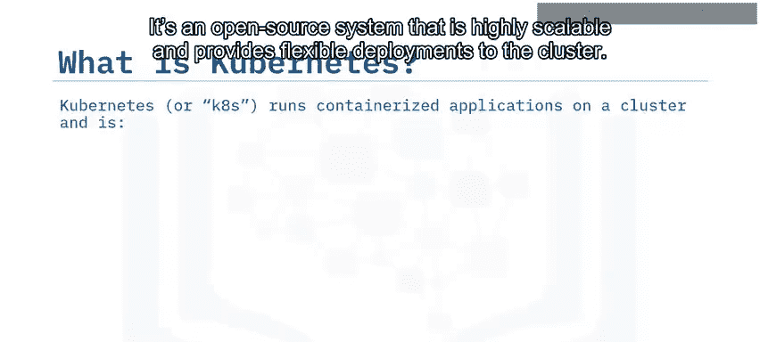

Kubernetes，常缩写为**K8S**，是一个流行的框架，用于在集群上运行容器化应用。它是一个开源系统，具有高度可扩展性，并为集群提供灵活的部署方式。Kubernetes具有可移植性，这意味着无论是在云端还是本地部署，其运行方式都保持一致。

## 为何使用Kubernetes？✨

上一节我们介绍了Kubernetes的基本概念，本节中我们来看看它的主要用途和优势。


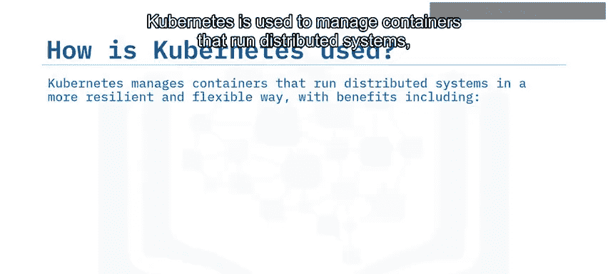

Kubernetes用于以更灵活、更具弹性的方式管理运行分布式系统（如Spark）的容器。它在集群资源使用方式上提供了灵活性，并且在应用出错或节点故障时更具弹性。

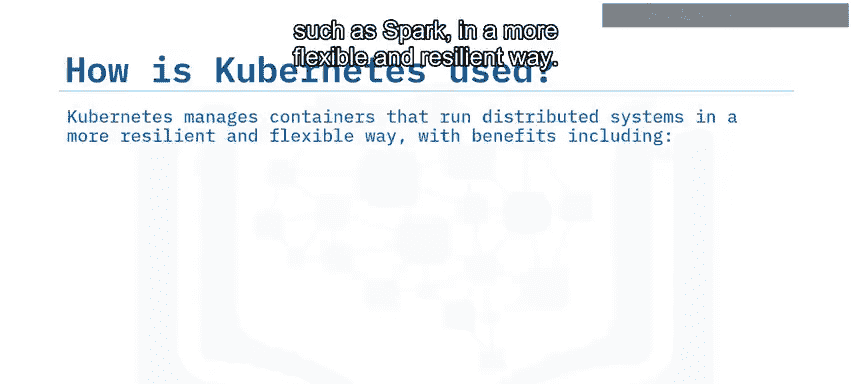

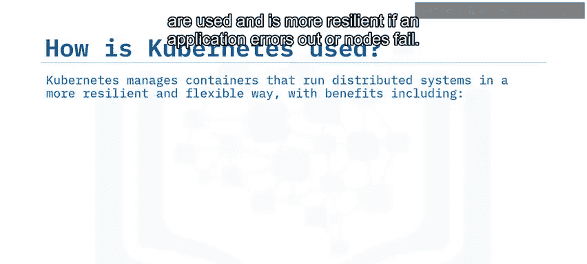

以下是Kubernetes的主要优势：
*   **网络服务发现与集群负载均衡**：自动管理服务间的通信和流量分配。
*   **系统自动扩缩容**：根据负载自动增加或减少集群中的系统实例。
*   **简化集群管理，最大化运行时间**：使集群更易于管理，确保高可用性。
*   **协调存储资源**：更有效地利用可用的存储资源。

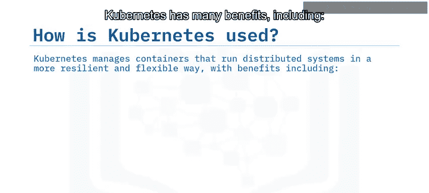

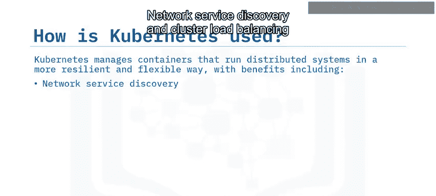

## 本地运行Kubernetes 🖥️

了解了Kubernetes的优势后，我们来看看如何搭建环境。Kubernetes不仅可以在集群上运行，也支持在单台机器上本地托管。


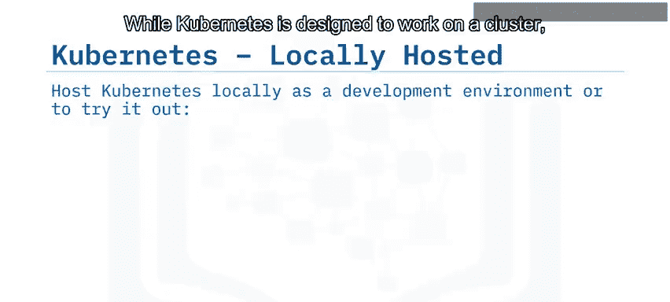

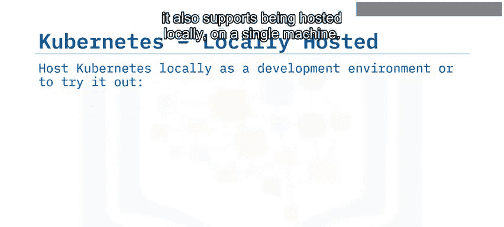


你可以使用诸如 **Minikube** 等工具来设置一个本地托管的Kubernetes集群。这通常用作开发环境，使你能够先在本地应用更改并进行测试，然后再部署到云端的生产集群。容器化意味着应用在本地和集群上的运行方式相同，因此你可以更快、更容易地发现和解决问题。

## 云端托管Kubernetes ☁️

上一节介绍了本地开发环境，对于生产环境，在云端运行Kubernetes集群是更好的选择，因为它提供了便捷的部署和灵活性。


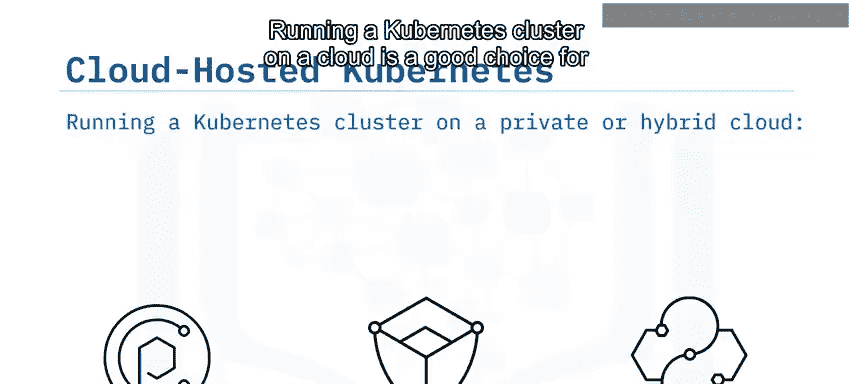

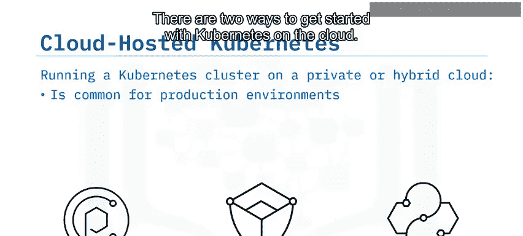


在云端启动Kubernetes主要有两种方式：
1.  使用现有工具引导集群，并配置好必要的组件。
2.  使用经过认证的Kubernetes提供商提供的交钥匙方案，以加速Kubernetes集群的搭建。

## 在Kubernetes上运行Spark ⚡

现在我们已经了解了Kubernetes的部署方式，本节将重点介绍如何在其上运行Spark。


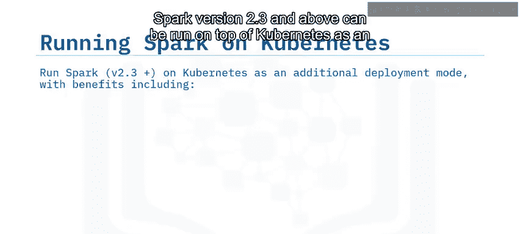


Spark 2.3及以上版本可以作为替代部署模式运行在Kubernetes之上。在Kubernetes上提交Spark应用带来了一些非常实用的好处：
*   **容器化使Spark应用更具可移植性**：它使得管理依赖项和在集群中设置所需环境变得更加容易。
*   **容器化支持更好的资源共享**：多个并发运行的Spark应用可以轻松共享可用资源，并彼此隔离运行。

## 提交Spark应用到Kubernetes集群 📤

要将Spark应用提交到Kubernetes集群，需要遵循特定的步骤和配置。


提交应用时，需要将 `--master` 选项设置为Kubernetes API服务器的URL和端口。例如：
```bash
spark-submit --master k8s://https://<k8s-apiserver-host>:<port> ...
```
Spark会创建一个驱动（Driver），该驱动进而创建执行器（Executors）。驱动和执行器都运行在Kubernetes的Pod中。一个Pod是一组紧密耦合、共享资源的容器。

应用可以以客户端（client）模式或集群（cluster）模式部署。然而，对于客户端模式，需要考虑一些额外事项：
*   执行器必须能够与驱动程序通信和连接。
*   需要使用驱动Pod的名称来设置 `spark.kubernetes.driver.pod.name` 配置项。这将确保在应用完成时，执行器Pod会随驱动Pod一起被清理。

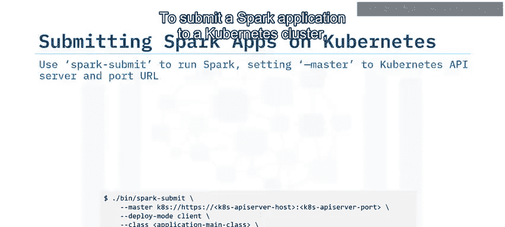

## 总结 📝

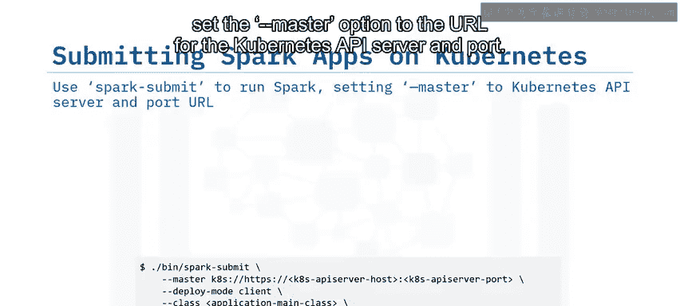

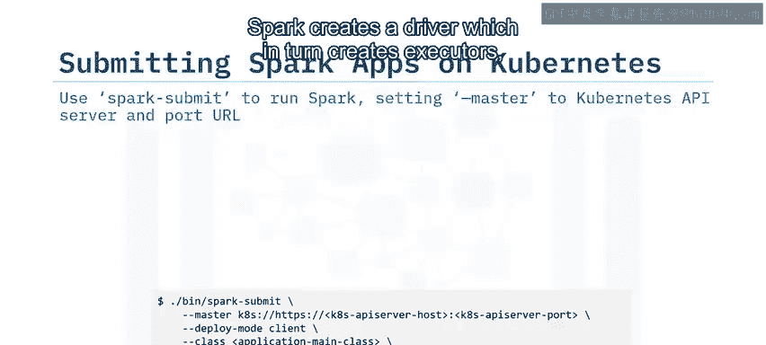

本节课中我们一起学习了在Kubernetes上运行Apache Spark的核心知识。


我们了解到，Kubernetes在集群上运行容器化应用，以更灵活、更具弹性的方式管理Spark等分布式系统。Kubernetes可以在本地运行，作为部署到云端集群前的测试环境；也可以在私有云或混合云上托管，通过现有工具引导集群或使用认证提供商的交钥匙方案进行设置。虽然Spark可以在客户端或集群模式下启动，但在客户端模式下，需要确保执行器能够连接到驱动，并配置Pod清理设置。


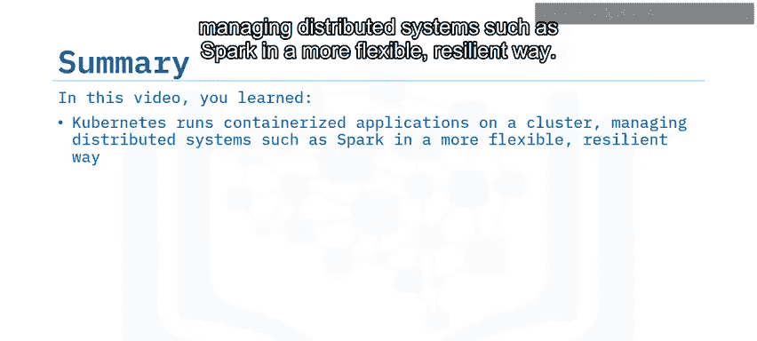


