# IBM数据工程专业证书 课程11：《使用Spark和Hadoop进行大数据介绍》｜第33课：调试Apache Spark应用程序问题 🔧

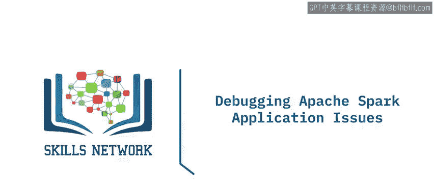

在本节课中，我们将学习如何识别和调试Apache Spark应用程序在集群上运行时可能遇到的常见问题。我们将了解应用程序失败的主要原因，并学习如何通过用户界面和日志文件来定位问题。

在集群上运行Spark应用程序是一个涉及多个组件的复杂过程，因此应用程序可能因多种原因而失败。

集群上应用程序失败的常见原因包括：
*   **用户代码**问题。
*   **系统和应用程序配置**问题。
*   **应用程序依赖项**缺失或版本不正确。
*   **资源分配不当**。
*   集群节点间的**网络通信**问题。

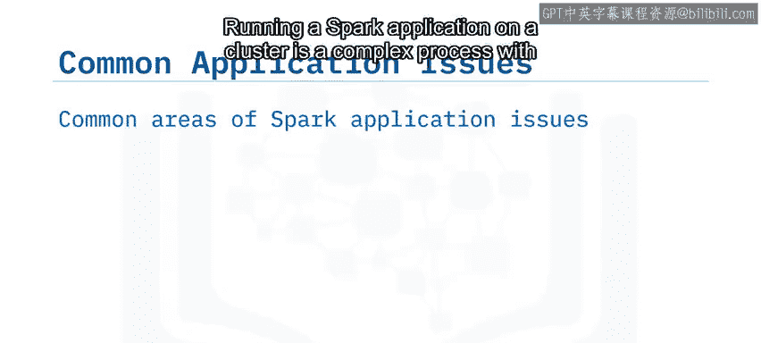

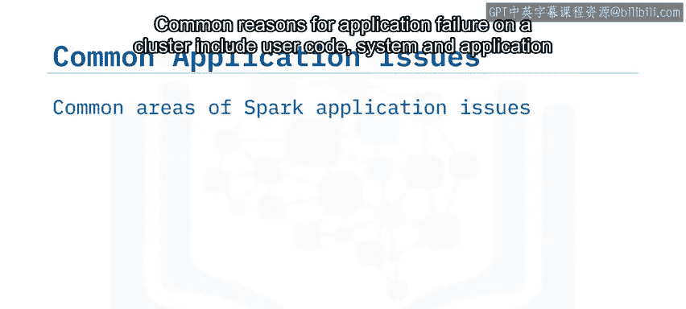

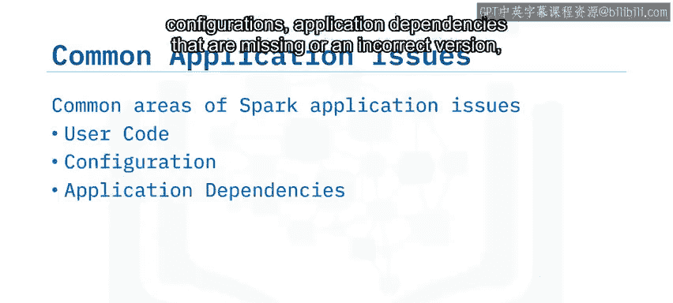

上一节我们概述了应用程序失败的常见原因，本节中我们首先来详细看看“用户代码”这一部分。

## 用户代码问题

用户代码由两部分组成：在**驱动程序进程**中运行的**驱动程序**，以及被序列化并在**执行器进程**中并行运行的**函数和变量**。驱动程序和执行器进程都运行传递给`spark-submit`脚本的应用程序用户代码。

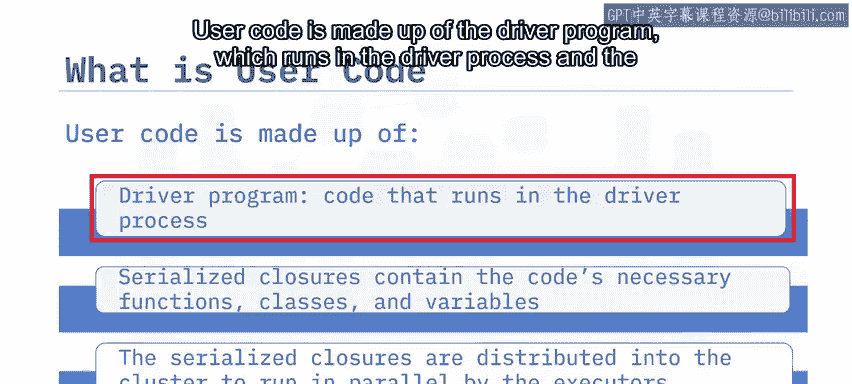

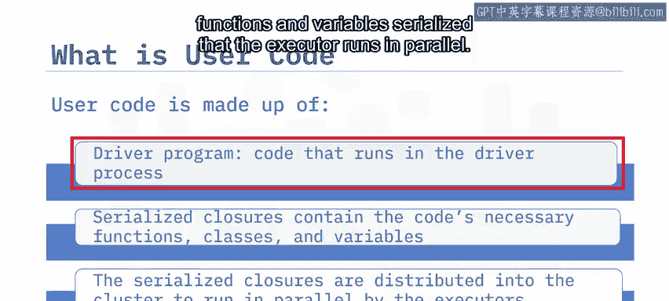

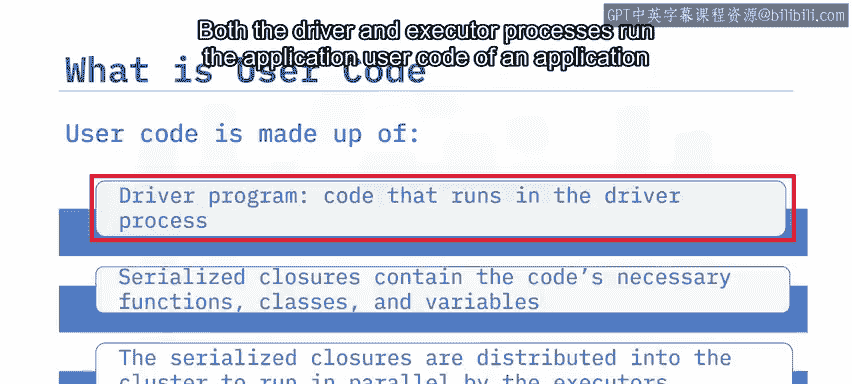

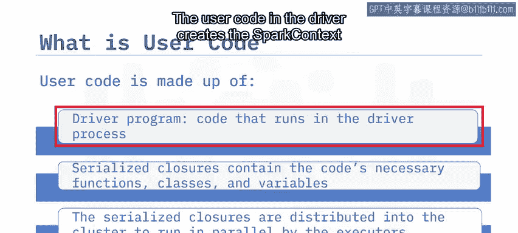

驱动程序中的用户代码创建**SparkContext**，并基于对DataFrame的操作创建作业。这些DataFrame操作会变成序列化的闭包，发送到整个集群，并在执行器进程中作为任务运行。序列化的闭包包含运行每个任务所需的函数、类和变量。

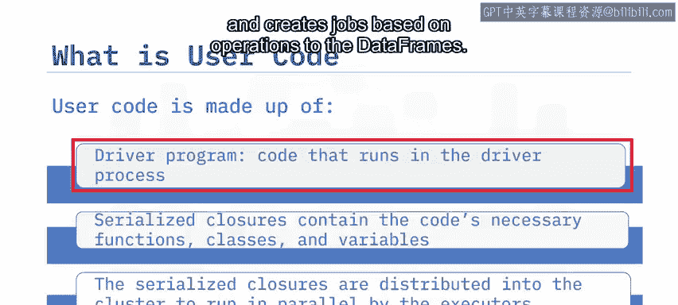

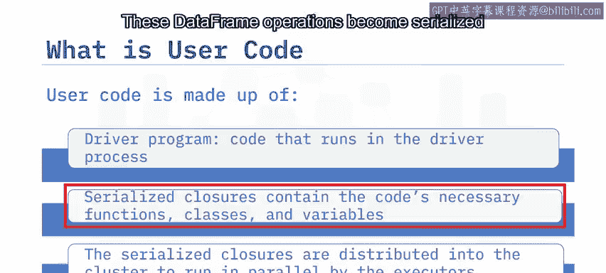

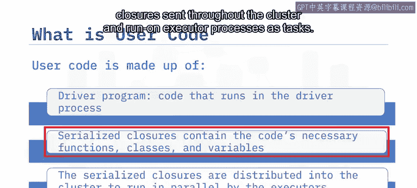

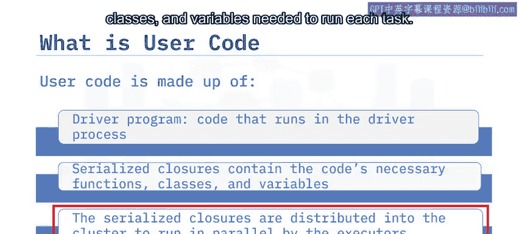

Spark通常在发生语法、序列化、数据验证和其他用户错误时立即终止。Spark将任务错误报告给驱动程序，并立即取消相关的执行器任务，从而终止应用程序。

例如，闭包在序列化之前会被清理，这能立即发现大多数问题，并确保闭包可以被序列化并在远程执行。被序列化为闭包的用户代码可能在另一个执行器进程上运行后才报错。这些错误可能源于运行时计算、网络通信问题或意外的数据问题。

如果任务因错误而失败，Spark可以尝试重试运行该任务一定次数。如果所有运行任务的尝试都失败，Spark会向驱动程序报告错误，应用程序随之终止。应用程序失败的原因通常可以在驱动程序事件日志中找到。

了解了用户代码问题后，接下来我们看看另一个常见原因：应用程序依赖项。

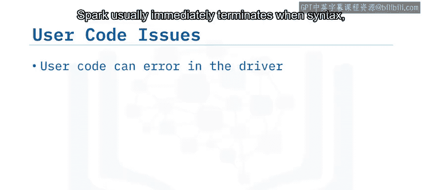

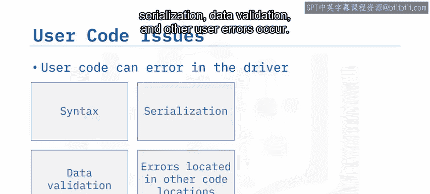

## 应用程序依赖项问题

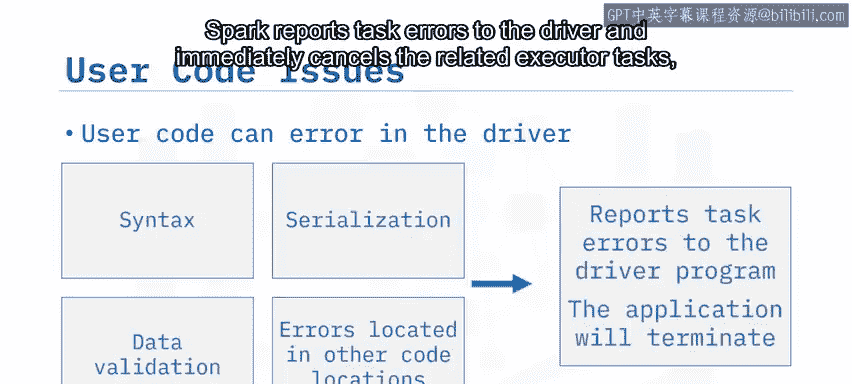

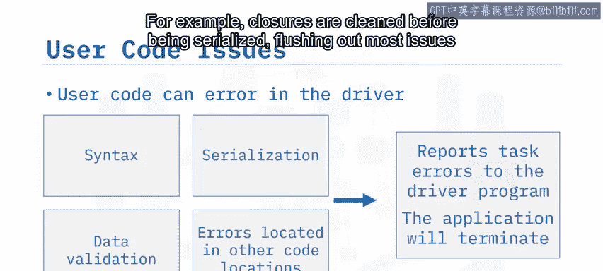

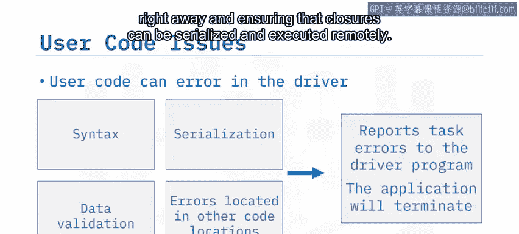

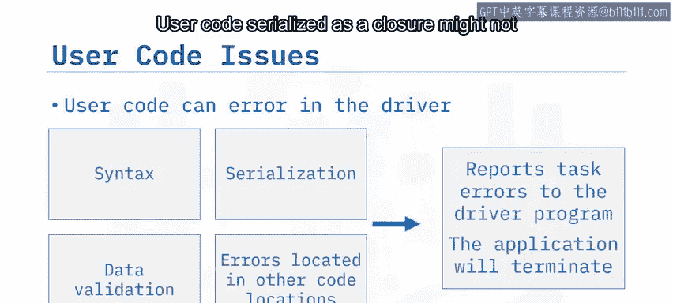

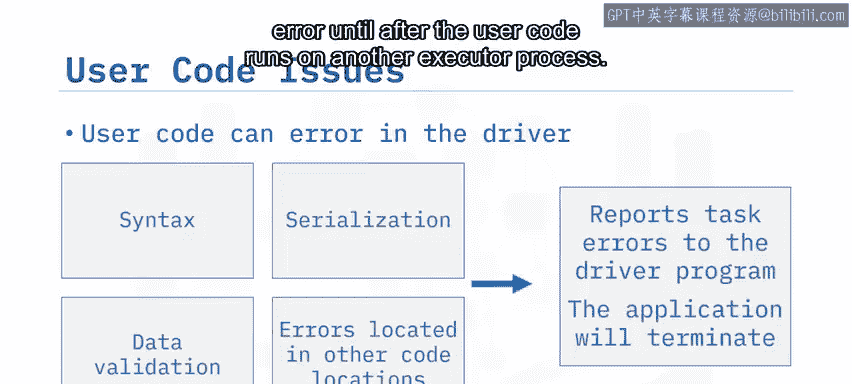

一个Spark应用程序可能有许多依赖项，包括应用程序文件（如Python脚本文件、Java `.jar`文件，甚至所需的数据文件）。应用程序还依赖于所使用的库及其依赖项。这些依赖项必须在集群的所有节点上都可用。

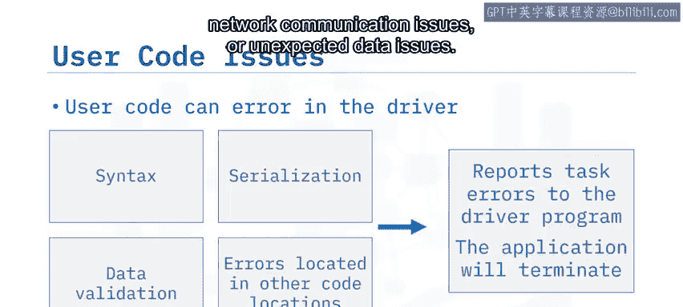

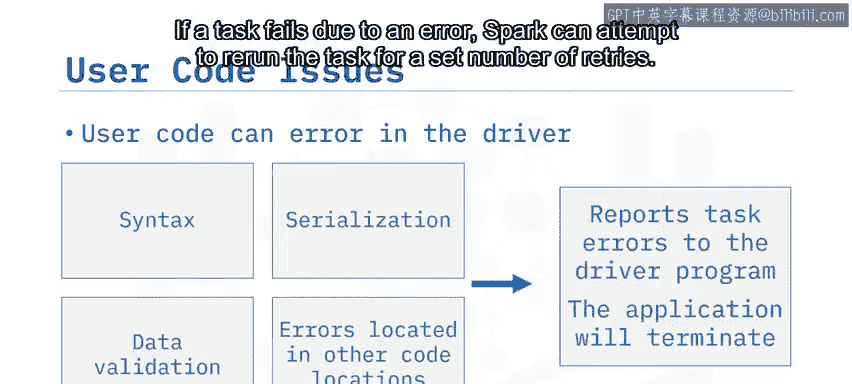

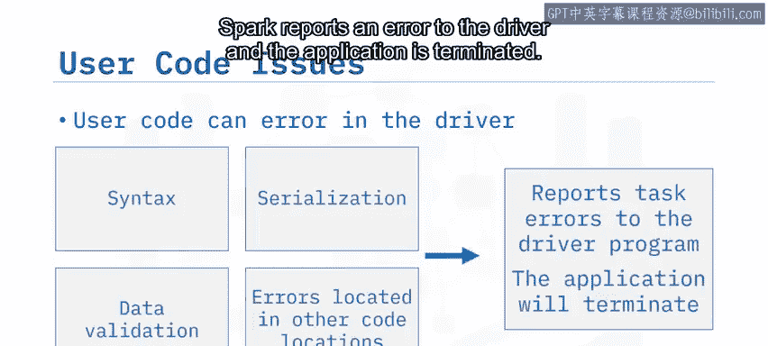

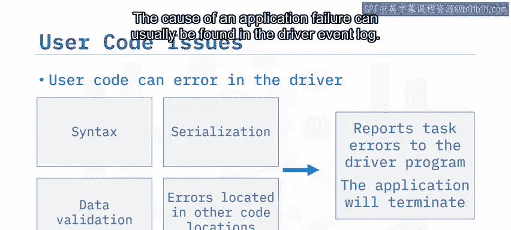

可以通过预安装，或者在`spark-submit`脚本中与应用程序捆绑提供依赖项，或作为附加参数来确保依赖项可用。

例如，如果执行器进程的Python环境中未安装某个Python库，任务将会出错。更隐蔽的错误是，如果库在执行器上安装了不同版本，可能会导致API不同或产生意外结果。

识别此类问题的最佳方法是检查事件日志中的堆栈跟踪错误，这些错误会指出应用程序加载了哪些库。

除了依赖项，资源分配不当也是导致应用程序失败的关键因素。

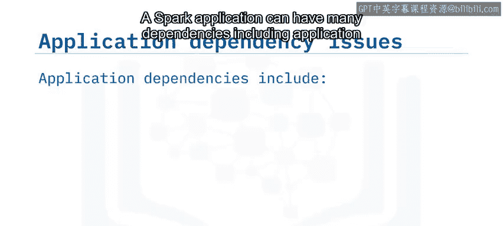

## 资源分配问题

诸如CPU核心和内存等应用程序资源也可能成为问题。如果一个任务在调度队列中，而可用工作节点没有足够的可用资源来运行该任务，就会发生问题。当一个工作节点完成一个任务时，其使用的CPU和内存会被释放，从而允许调度另一个任务。

然而，如果应用程序请求的资源永远无法变得可用，任务可能永远无法运行，最终导致超时。同样，如果执行器运行的任务耗时过长且永不完成，那么它们的资源也永远不会释放，这也会导致后续任务无法运行，从而产生超时错误。

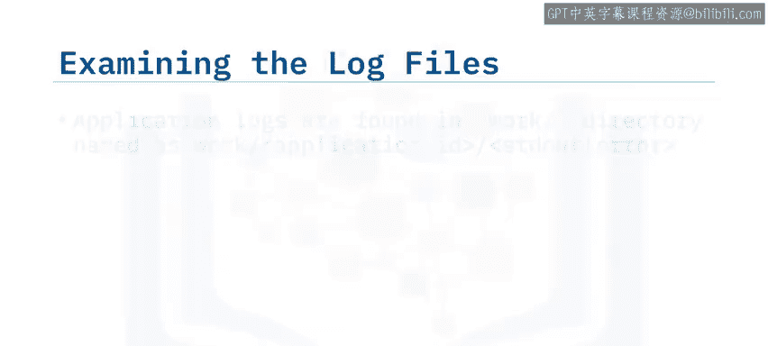

在查看UI或事件日志时，你可以很容易地访问到这些错误信息。

要深入分析问题，除了用户界面，查看日志文件至关重要。

## 查看日志文件

虽然应用程序UI提供了大量信息，但查看日志文件可以提供更多细节，从而更深入地了解应用程序失败的可能原因。

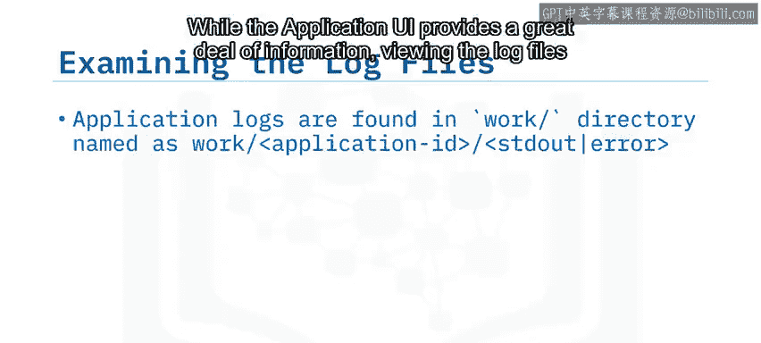

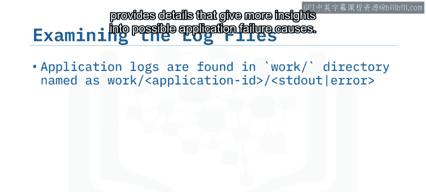

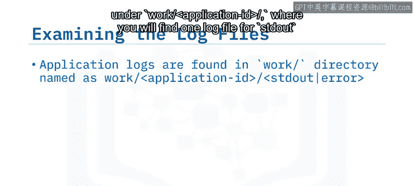

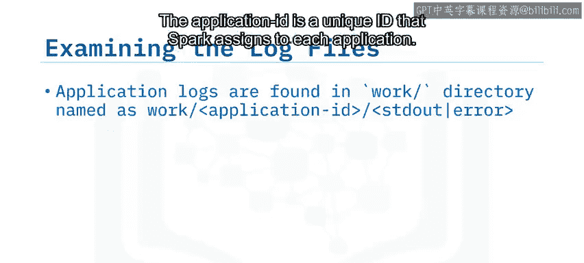

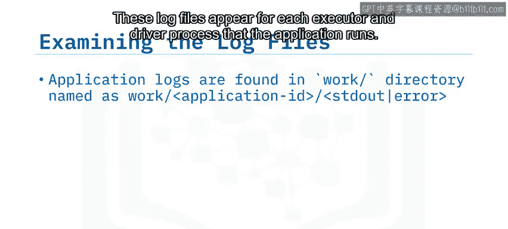

你可以在Spark安装目录下的 `work/[application_id]` 目录中找到应用程序日志文件。在那里，你会找到一个标准输出（stdout）日志文件和一个标准错误（stderr）日志文件。应用程序ID是Spark分配给每个应用程序的唯一ID。

应用程序运行的每个执行器和驱动程序进程都会生成这些日志文件。此外，如果你运行的是Spark独立集群，主节点（master）和工作节点（worker）都会将日志文件输出到它们运行所在的Spark安装目录下的 `logs/` 目录中。

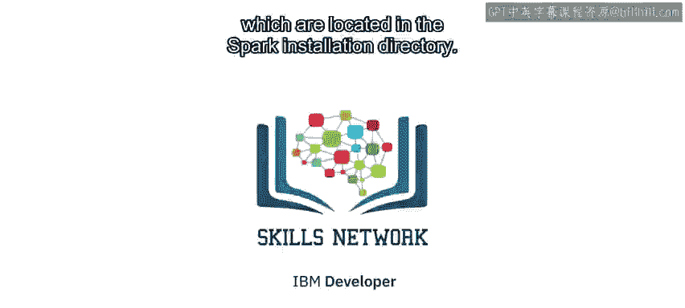

本节课中我们一起学习了调试Apache Spark应用程序问题的核心知识。我们了解到，集群上应用程序失败的常见原因包括用户代码、系统配置、缺失的依赖项、不当的资源分配和网络通信问题。应用程序日志文件通常能显示故障的完整细节，这些日志文件位于Spark安装目录中。掌握这些调试方法，将帮助你更有效地定位和解决Spark应用程序运行中的问题。