# IBM数据工程专业证书 课程11：《使用Spark和Hadoop进行大数据介绍》｜ 第34课：了解Spark内存资源 🧠


在本节课中，我们将要学习Apache Spark中的内存管理。我们将探讨如何为驱动程序和执行器设置内存参数，理解Spark的内存管理机制，以及数据持久化（缓存）如何提升应用性能。

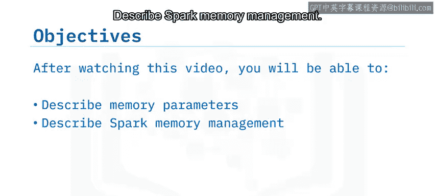

## 内存管理概述

当运行Spark应用时，驱动程序和执行器进程会启动，并带有一个内存上限。这个上限使得Spark应用可以在不占用集群全部可用内存的情况下运行。然而，这个限制也要求内存上限必须设置得足够高，以完成必要的任务。当进程在请求的内存范围内完成时，应用运行效果最佳。如果驱动程序和执行器进程超出了内存需求，可能导致性能下降，数据溢出到磁盘，甚至出现内存不足的错误。


## 执行器与驱动程序的内存考量

上一节我们介绍了内存管理的基本概念，本节中我们来看看执行器和驱动程序各自的内存使用考量。

以下是执行器和驱动程序内存设置的关键点：


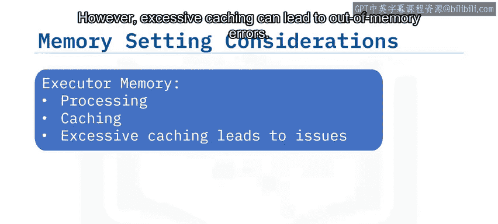

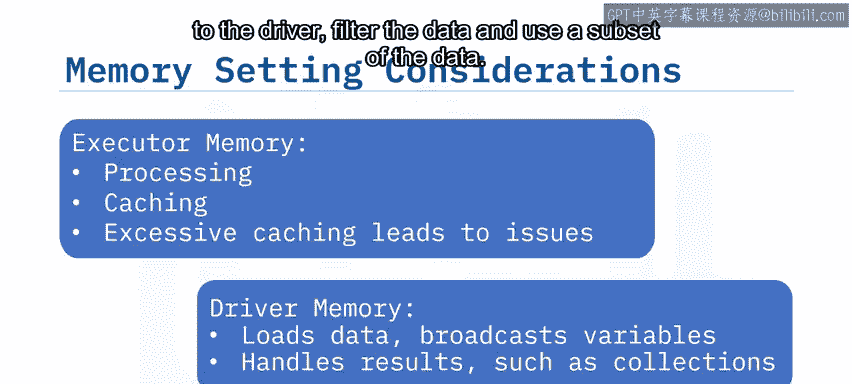

*   **执行器内存**：执行器内存用于数据处理，如果启用了缓存，还会使用额外的内存。然而，过度的缓存可能导致内存不足错误。
*   **驱动程序内存**：作为操作结果的数据收集（`collect`）将在驱动程序中进行。驱动程序内存负责加载数据、广播变量以及处理诸如集合之类的结果。因为大型数据集很容易超出驱动程序的内存容量，所以在向驱动程序收集数据时，应过滤数据并使用数据子集。

## Spark统一内存管理

了解了基本的内存用途后，我们来深入看看Spark内部如何管理这些内存。

在Spark中，执行器内存和存储（缓存）内存共享一个统一的区域，即Java堆空间中标记为 **M** 的区域。当没有使用执行器内存时，存储可以获取所有可用内存，反之亦然。必要时，执行器内存可以驱逐存储内存，但仅限于存储内存使用量降至某个阈值以下。换句话说，**R** 描述了 **M** 内的一个子区域，其中缓存的块永远不会被驱逐。由于实现的复杂性，存储不允许驱逐执行器内存。

这种设计确保了以下几个优点：
1.  不使用缓存的应用可以将整个空间用于执行器内存，避免了不必要的磁盘溢出。
2.  使用缓存的应用可以保留一个最小的存储空间（标记为 **R** 的区域），使其数据块免于被驱逐。
3.  这种方法为各种工作负载提供了合理的开箱即用性能，无需用户了解内存在内部是如何划分的。

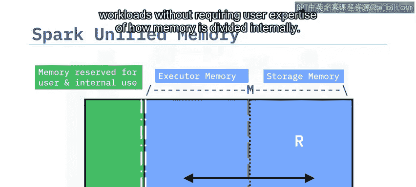

## Spark数据持久化

理解了内存管理机制后，我们来看看如何利用它来提升性能，即通过数据持久化。

Spark中的数据持久化或缓存，意味着能够存储中间计算结果以供重用。通过在内存、磁盘或两者中设置持久化，在计算出中间数据以生成新的DataFrame之后，如果数据被缓存在内存中，那么对该DataFrame的任何其他操作都可以重用相同的数据，而不是从源重新加载数据并重新计算所有先前的操作。这种能力对于加速机器学习工作负载至关重要，因为在训练模型时通常需要对同一数据集进行多次迭代。


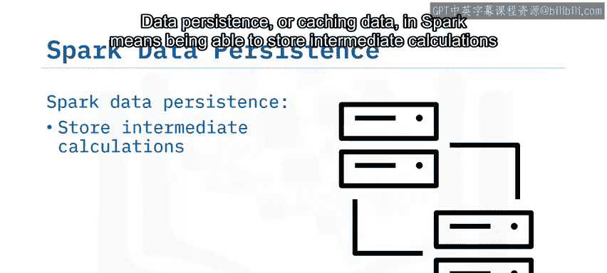

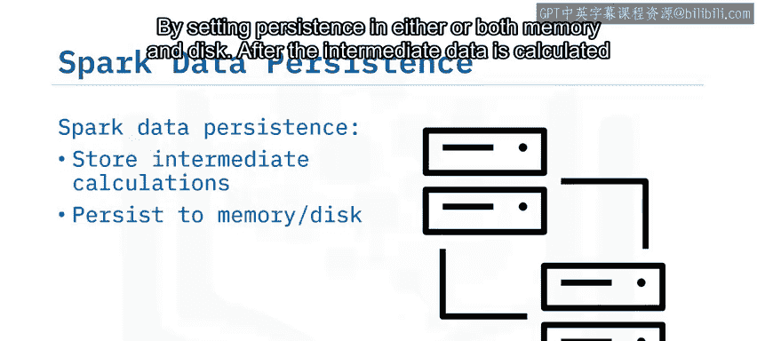

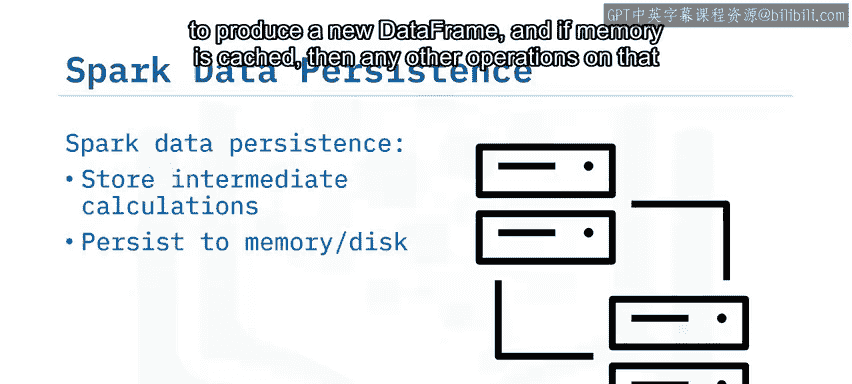

以下是一个使用PySpark进行数据缓存的代码示例：

```python
# 创建一个包含随机值特征列的DataFrame
df = spark.range(0, 10).selectExpr("rand() as features")
# 调用cache方法标记此DataFrame以缓存在内存中
df.cache()
# 触发一个行动操作（如count）来实际计算并缓存数据
df.count()
# 后续操作将使用缓存的值，节省计算时间
df.show()
```

这段示例PySpark代码创建了一个DataFrame，其`features`列由随机值组成。创建DataFrame后，调用`cache`方法将随机值标记为缓存在内存中。在这里缓存DataFrame意味着应用只需要生成一次随机特征。此时，随机值尚未生成。缓存是惰性执行的，在计算值之后进行。在这个例子中，对DataFrame调用了`count`行动操作，这生成了随后存储在内存中的值。后续的DataFrame调用可以使用缓存的值，如果重新创建DataFrame的成本很高，这可以节省大量的计算时间。如果这个DataFrame没有被缓存，那么每次对DataFrame执行行动操作时都会生成不同的随机特征，因为每次都会调用`rand()`函数。

## 配置执行器内存

知道了缓存的好处，我们还需要知道如何为执行器配置足够的内存来支持这些操作。

有几种方法可以为集群中的执行器设置内存，例如在属性文件中设置值。然而，更常见的做法是在向集群提交应用时指定内存配置。您可以定制内存，使每个应用都有足够的内存来有效运行，但又不占用执行器中所有可用的内存。

以下是在提交应用时设置执行器内存的示例命令：

```bash
spark-submit --master spark://master:7077 --executor-memory 10g my_app.py
```

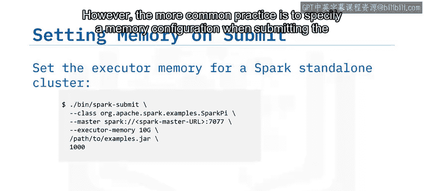

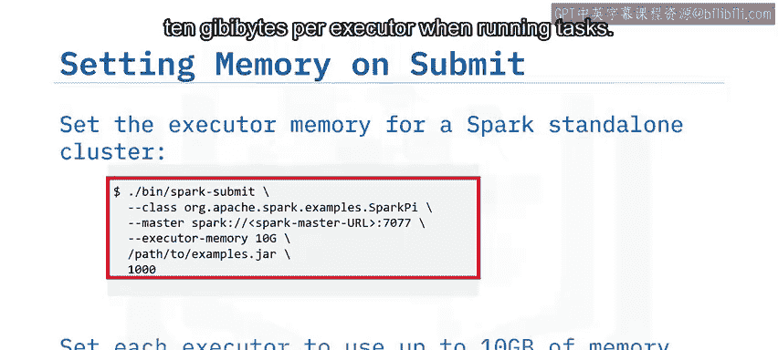

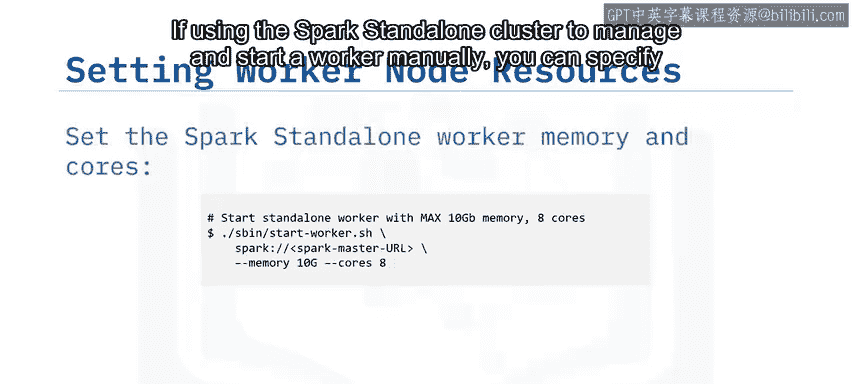

这个示例将应用配置为在Spark独立集群上运行，并在运行任务时为每个执行器预留10GB内存。

如果使用Spark独立集群并手动启动工作节点，您可以指定应用可以使用的总内存和CPU核心数。这些规格决定了工作节点启动执行器时可用的资源。避免分配超过物理机器可用资源的资源。例如，如果机器有一个8核CPU，而工作节点以16核启动，则可能同时运行过多线程，导致性能下降。您可以定制内存，使每个应用都有足够的内存来有效运行，但又不占用执行器中所有可用的内存。默认配置是使用所有可用内存减去1GB，以及所有可用的核心。

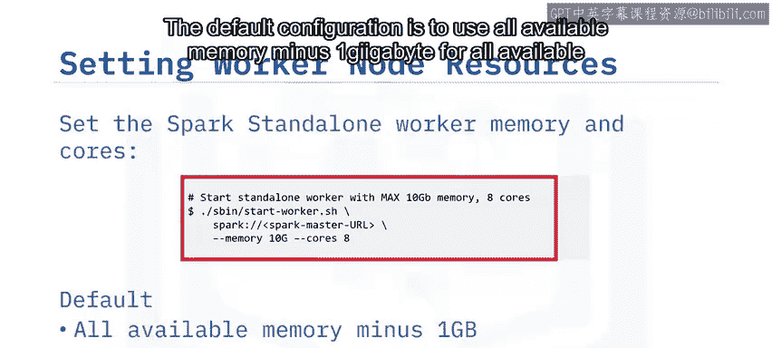

## 总结


本节课中我们一起学习了Spark内存管理的核心知识。我们了解到Spark为执行器和驱动程序进程提供了可配置的内存。执行器内存和存储内存共享一个可以根据需要调整的区域。缓存数据有助于提高应用程序性能。合理配置这些内存参数是优化Spark应用、避免内存错误和提升执行效率的关键。