# IBM数据工程专业证书 课程11：《使用Spark和Hadoop进行大数据介绍》｜ 第35课：理解处理器资源 💻


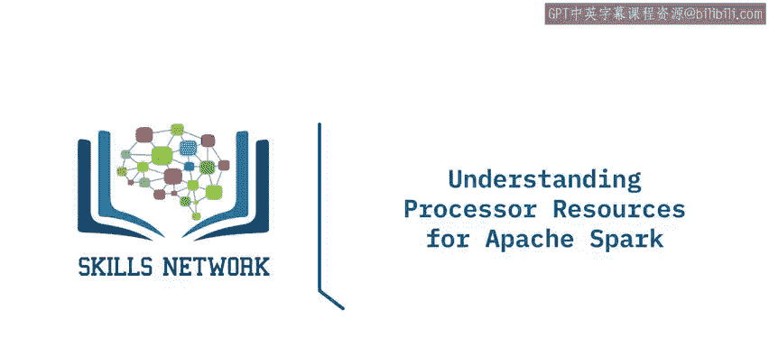

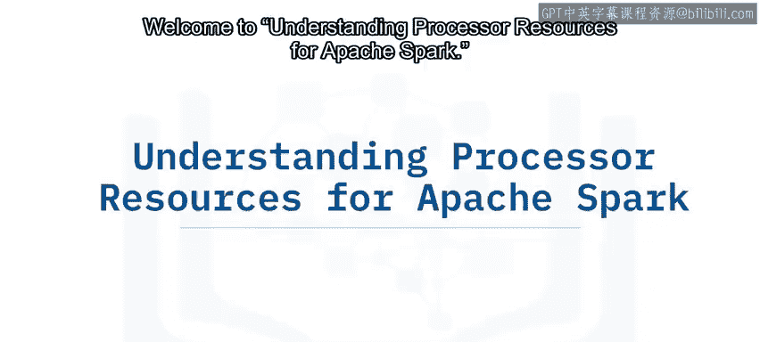

在本节课中，我们将要学习Apache Spark如何利用处理器核心（CPU Cores）这一关键资源。我们将了解Spark如何为应用程序分配核心，以及如何通过配置来优化核心的使用，从而影响任务的并行执行效率。


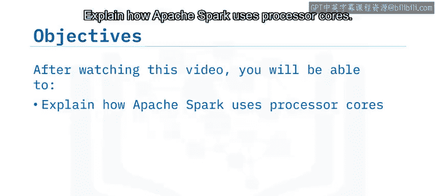

## 处理器核心在Spark中的角色

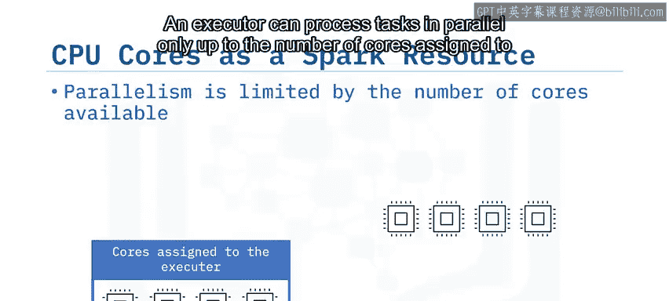

上一节我们介绍了内存资源的管理，本节中我们来看看处理器核心。与内存类似，CPU核心是分配给驱动程序（Driver）和执行器（Executor）进程的一种资源。

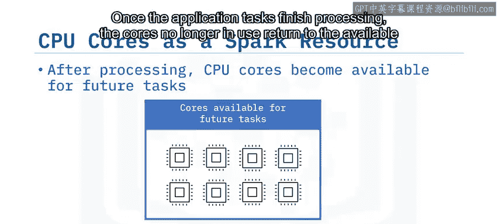

一个执行器能够并行处理任务的数量，受限于分配给该应用程序的核心数量。核心的计算公式可以简单表示为：
**并行任务数 ≤ 分配给执行器的核心数**

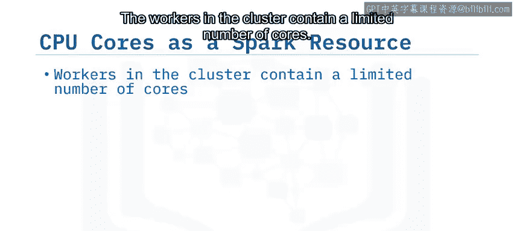

一旦应用程序的任务处理完成，不再使用的核心会返回到可用资源池中，供其他任务使用。

## 核心资源的调度与等待

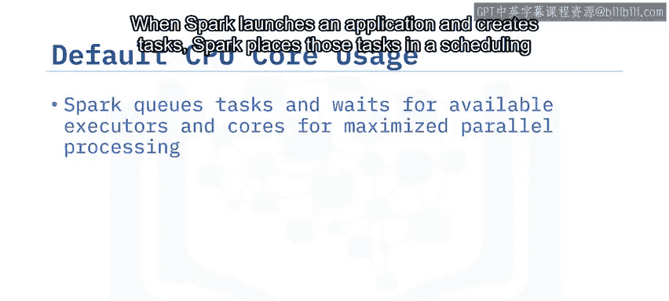

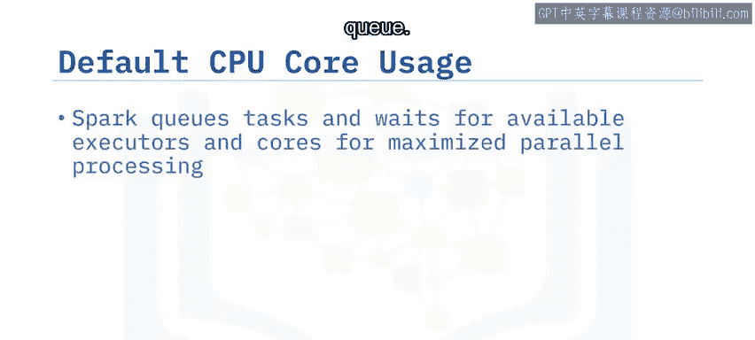

集群中的工作节点（Workers）包含有限数量的核心。如果一个应用程序申请不到可用的核心，它必须等待当前正在运行的任务完成，释放出核心资源。

当Spark启动一个应用程序并创建任务时，它会将这些任务放入一个调度队列中。Spark会将任务分配给任何有可用核心的执行器。默认行为是，每个准备就绪的任务都会被调度到有可用核心的执行器上，以最大化并行度。任何剩余的任务将不得不在队列中等待，直到有更多核心可用。

如果你为核心数量提供了特定的设置（例如配置每个执行器使用多少核心），应用程序将覆盖上述默认行为。

## 配置核心资源的方法

以下是配置执行器核心资源的几种主要方式：

**1. 配置每个执行器的核心数**
在提交应用程序时，使用参数 `--executor-cores`，后跟应用程序任务在单个执行器上运行所需的具体核心数。
```bash
spark-submit --executor-cores 4 ...
```
如果执行器没有所需数量的可用核心，任务将不会启动，直到指定数量的核心空闲或另一个执行器可用。

**2. 配置应用程序的总核心数**
使用参数 `--total-executor-cores`，后跟一个数字，表示整个集群中用于该应用程序的核心总数（而非每个执行器）。
```bash
spark-submit --total-executor-cores 16 ...
```
只要执行器有空闲核心，任务就会被调度给它，直到使用的核心总数达到指定值。

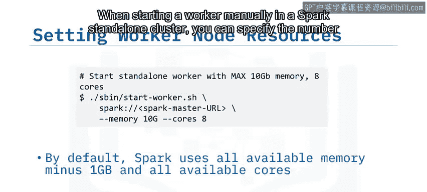

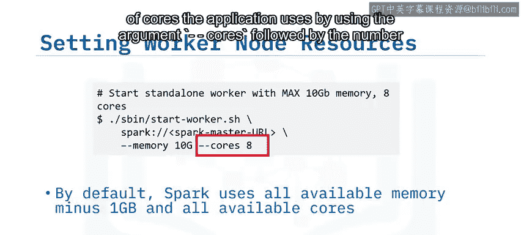

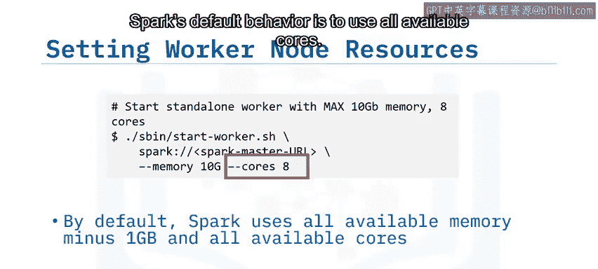

**3. 在Standalone集群中配置Worker**
在Spark独立（Standalone）集群中手动启动Worker时，可以使用参数 `-c` 或 `--cores` 来指定该Worker可提供给应用程序使用的核心总数。
```bash
./start-slave.sh -c 4 ...
```
Spark的默认行为是使用所有可用核心。常见的做法是每个节点启动一个Worker，在默认行为下，这允许Worker创建一个执行器进程，其线程数恰好等于可用于运行任务的可用核心数。

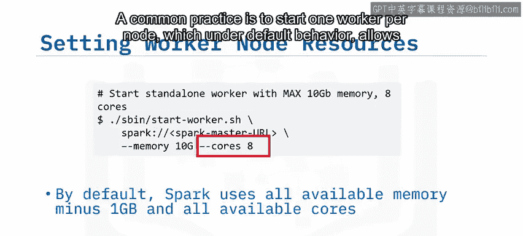

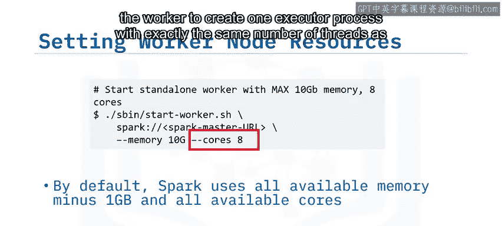

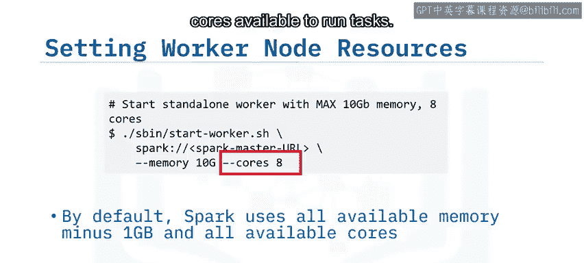

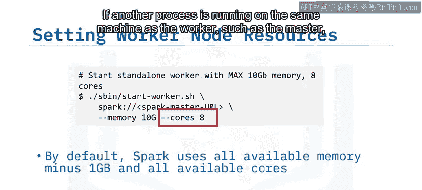

如果另一个进程（如Master）与Worker运行在同一台机器上，一个好的做法是应用这些设置来减少Worker可用的核心数。指定CPU核心总数可以为Master进程保留处理时间，从而避免基本操作被阻塞或超时。

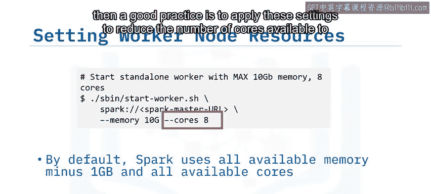

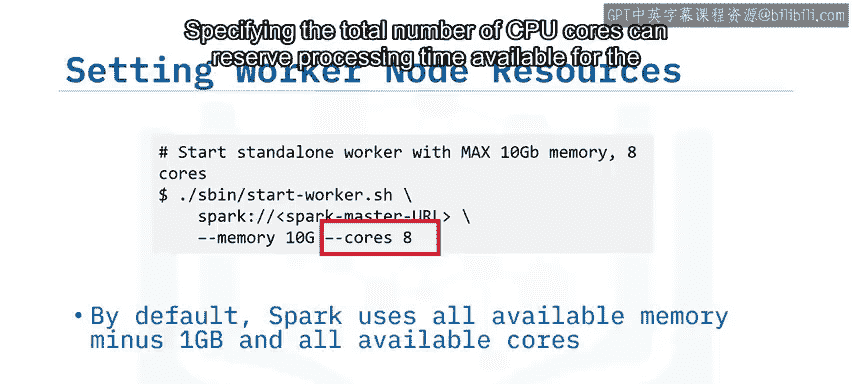

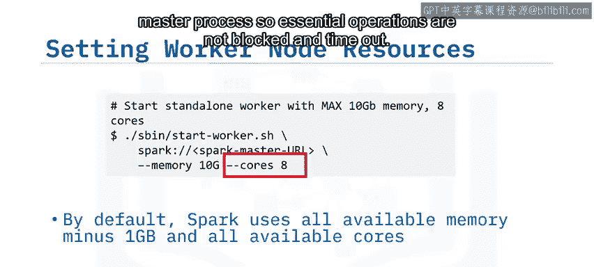

## 核心资源调度示例分析

让我们看一个使用小型独立集群的示例，该集群有一个工作节点和六个核心。这个示例将两个相同的应用程序提交到同一集群，时间上有所重叠。

第一个应用程序提交到集群，并请求每个执行器使用四个核心。此时执行器空闲，有六个核心可用。然后，该应用程序的前四个任务被调度到该执行器并开始运行。执行器上还剩余两个可用核心。

当第一个应用程序正在运行时，第二个应用程序被提交。第二个应用程序也请求从执行器获得四个核心。由于属于第一个应用程序的任务仍在运行并占用着四个核心，目前只有两个核心可用。因此，第二个应用程序必须等待，直到执行器至少有四个核心可用。一旦第一个应用程序中的任意两个任务完成，四个核心变得可用，第二个应用程序就可以开始了。

如果你启动第二个应用程序时只请求两个核心来运行两个任务，情况会如何？使用这种方案，你可以提交第二个应用程序，并且两个任务可以立即启动。然而，由于一次只运行两个任务，第二个应用程序可能需要更长的时间才能完成。

最大化Spark应用程序性能可能是应用程序工作负载配置和集群资源之间的微妙平衡，需要对应用程序和集群进行仔细的调优。

## 课程总结

本节课中我们一起学习了Spark处理器核心资源的管理。我们了解到，在应用程序处理期间，Spark会将CPU核心分配给驱动程序和执行器进程。执行器并行处理任务的能力取决于可用或由应用程序分配的核心数量。


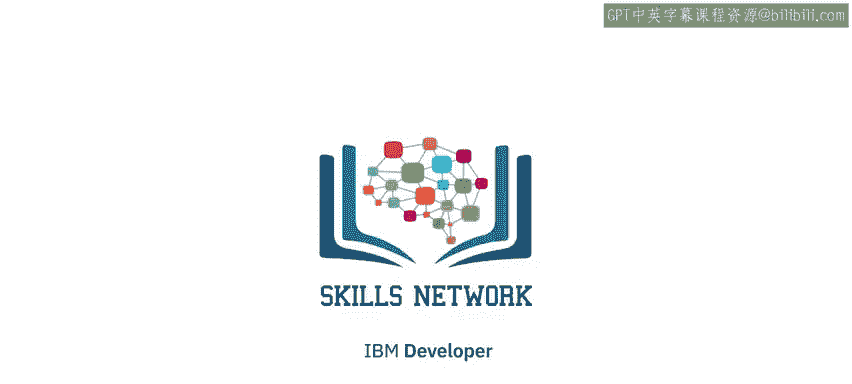

我们还学习了如何通过提交参数（`--executor-cores`, `--total-executor-cores`）或在Standalone集群中配置Worker（`-c`）来管理核心资源。合理的核心配置对于优化任务并行度、减少等待时间以及平衡集群整体负载至关重要。