# IBM数据工程专业证书 课程12：《使用Spark进行数据工程和机器学习》｜machine-learning-using-spark｜ - P3：ETL工作负载 🚀


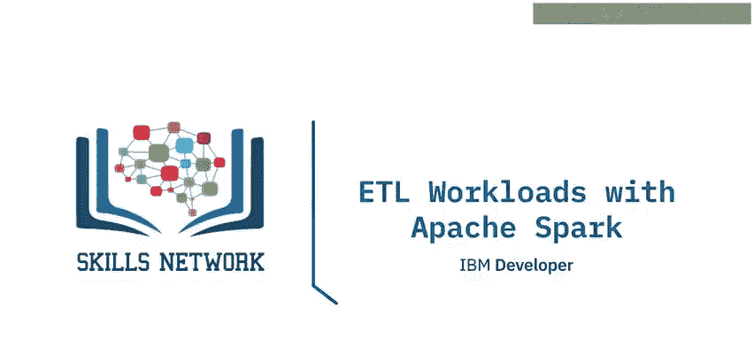


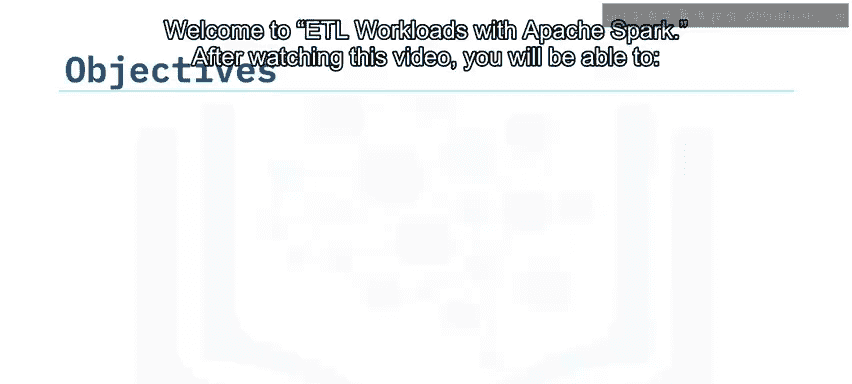


欢迎来到《使用Apache Spark进行ETL工作负载》。


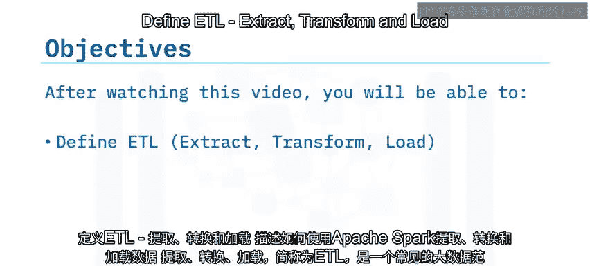

在本节课中，我们将要学习ETL（提取、转换、加载）的定义，并描述如何使用Apache Spark来执行数据的提取、转换和加载操作。

观看本视频后，你将能够定义ETL，并描述如何使用Apache Spark来提取、转换和加载数据。

## 什么是ETL？ 🔄


提取、转换、加载，简称**ETL**，是一种常见的大数据范式。

ETL描述了将数据从源移动到另一个具有不同数据格式或结构的目标的过程。

*   **提取**步骤从源获取数据，并将数据读入应用程序。
*   在**转换**步骤中，你清理数据并将其转换为适合目标的格式。
*   最后的**加载**步骤获取转换后的数据，并将其加载到数据仓库、数据库或其他数据存储中，以便根据需要进行进一步的转换和分析。

## Apache Spark在ETL中的优势 ⚡

Apache Spark直接集成了标准的大数据生态系统，支持原生HDFS和Parquet等文件格式以及其他数据源。

Spark的另一个好处是，你可以使用SparkSQL框架在提取后轻松地清理和转换数据。并且，Spark可以轻松扩展以处理从小型到大型的ETL工作负载，因此你可以在数据量增长时使用相同的应用程序。

## 使用Spark进行数据提取 📥

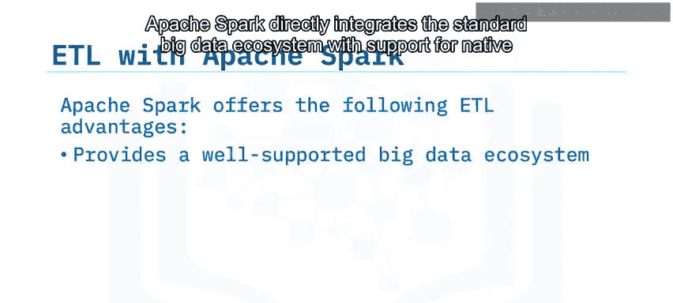

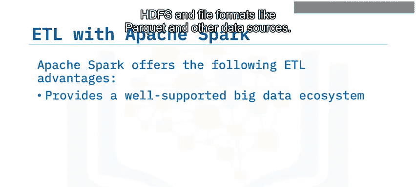


在提取步骤中，Spark支持从Parquet、Apache ORC、Hive和JDBC等数据源提取HDFS数据。

数据可以来自多个数据源，例如一个Parquet数据集和一个Hive表。除了对许多最流行的数据源提供内置支持外，Spark还有一个可扩展的数据源API，用于从自定义源提取数据。

以下是加载名为`people`的Parquet文件到数据框的代码示例：

```python
df = spark.read.parquet("path/to/people.parquet")
```

## 使用Spark进行数据转换 🛠️

转换的目标是在提取后清理数据，使数据更易于访问，并减少后续清理和格式化的需求。

你可以连接数据框，并对数据进行分组和聚合，以便后续使用。例如，删除不需要的列或修剪字符串中的空格，可以得到格式正确、干净的数据，准备加载到新的数据存储中。

以下示例首先使用SparkSQL为`people`数据集创建一个视图，然后使用`select`操作将数据转换为年龄在13到19岁之间的人：

```python
# 创建临时视图
df.createOrReplaceTempView("people_view")

# 执行SQL查询进行转换
transformed_df = spark.sql("SELECT * FROM people_view WHERE age BETWEEN 13 AND 19")
```

## 使用Spark进行数据加载 📤

加载步骤将转换后的数据放置到其下一个存储库中，例如数据仓库、数据库或其他数据存储。

你可以在此过程中使用与提取步骤相同的Spark数据源。例如，加载过程可以使用JDBC驱动程序写入转换后的数据框。

在这个例子中，你首先将PostgreSQL驱动程序添加到应用程序的类路径中，以便在集群中使用。接下来，你使用提供的PostgreSQL驱动程序以及用户名和密码将转换后的数据框写入数据库：

```python
# 配置JDBC连接属性
jdbc_url = "jdbc:postgresql://hostname:port/database"
connection_properties = {
    "user": "your_username",
    "password": "your_password",
    "driver": "org.postgresql.Driver"
}

# 将数据框写入数据库
transformed_df.write.jdbc(url=jdbc_url, table="target_table", mode="overwrite", properties=connection_properties)
```

## ETL工作流示例 📊

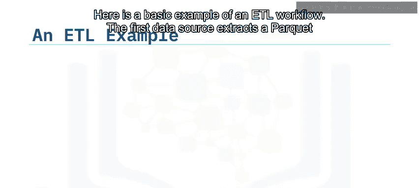

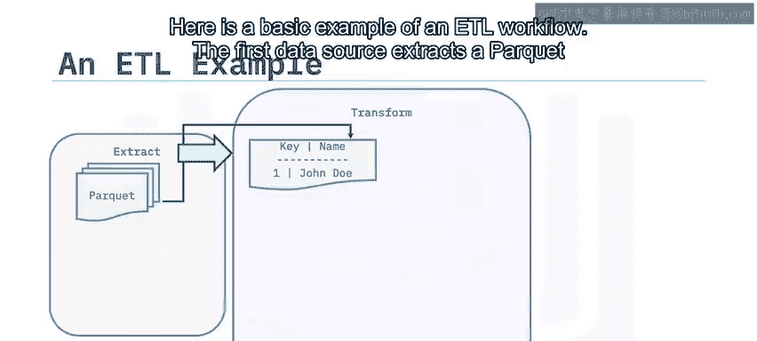

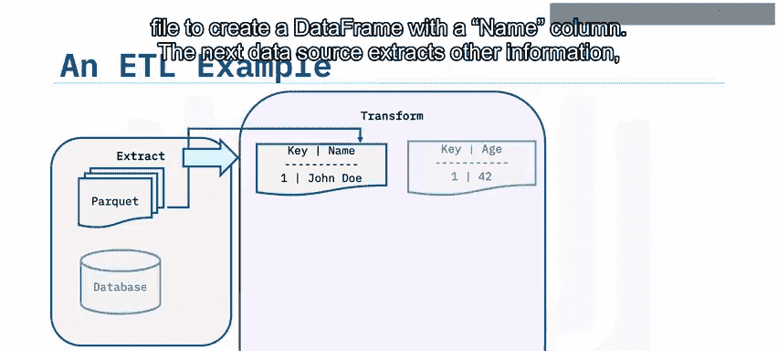

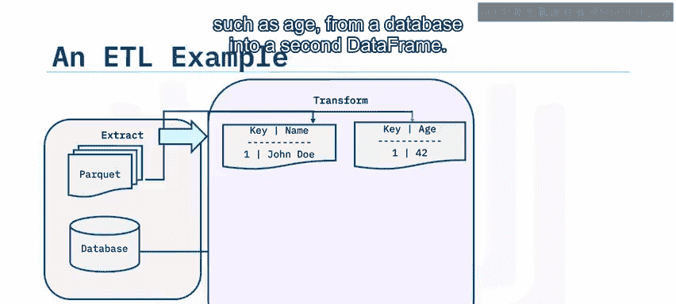


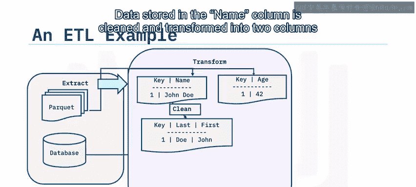


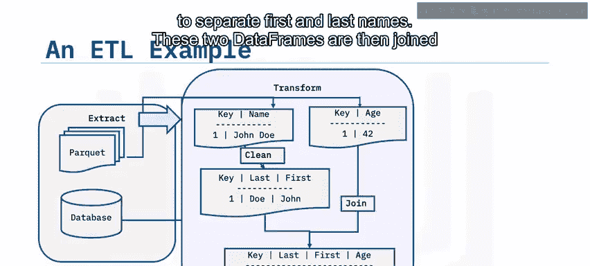


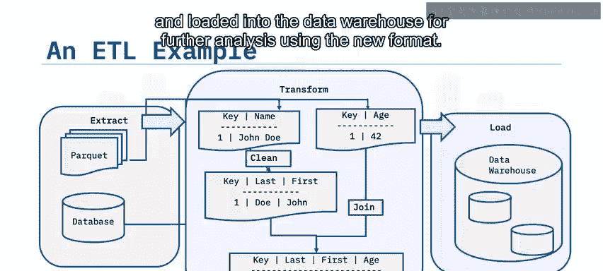


这是一个基本的ETL工作流示例：

1.  第一个数据源提取一个Parquet文件，创建一个包含`name`列的数据框。
2.  下一个数据源从数据库中提取其他信息（如`age`）到第二个数据框。
3.  存储在`name`列中的数据被清理并转换为两列，以分隔名和姓。
4.  然后，这两个数据框被连接起来，并使用新格式加载到数据仓库中，以便进行进一步分析。

## 总结 📝

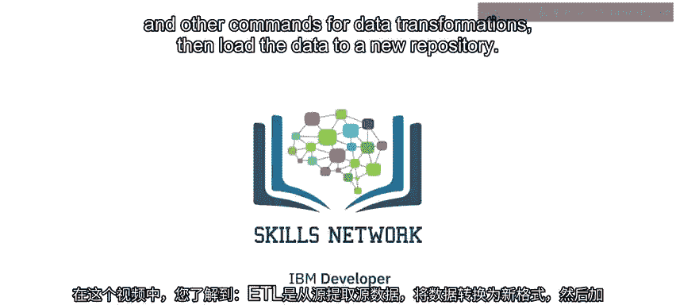

在本节课中，我们一起学习了ETL是从源提取数据、将数据转换为新格式以及将数据加载到数据库、数据仓库或其他存储的过程。


我们了解到，Spark可以从多个受支持的源提取数据。你可以应用Spark的`select`命令和其他命令进行数据转换，然后将数据加载到新的存储库中。