# IBM数据工程专业证书 课程11：《使用Spark和Hadoop进行大数据介绍》｜ 第3课：大数据的影响 📊


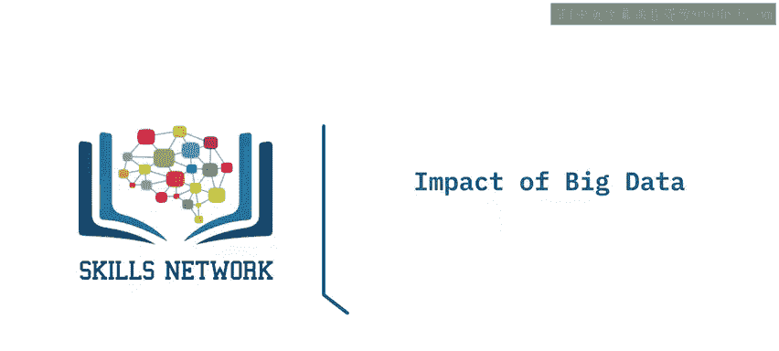

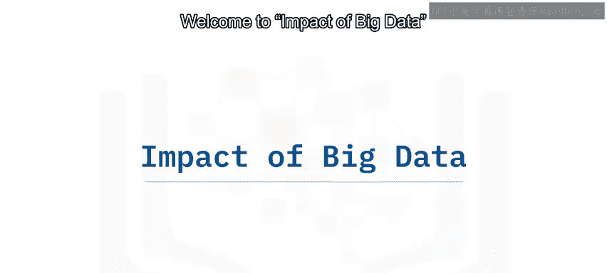

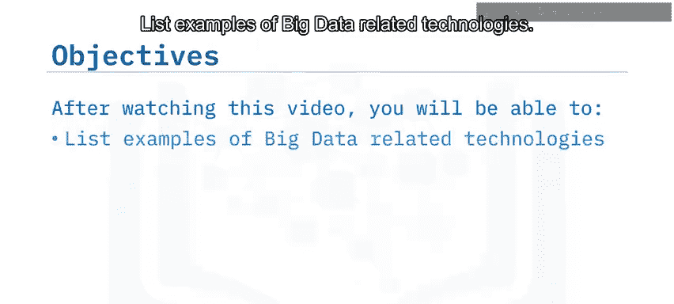

在本节课中，我们将要学习大数据相关技术的实例，解释大数据对企业和个人的影响，并描述物联网及其对大数据的影响。

大数据是本世纪最重要的课题之一。在全球范围内，数以百万计的人正在生成和使用大数据，却未必意识到这一点。人们相互发送的照片、视频和文本等个人数据，构成了消费品公司收集的数据主体。因此，思考大数据如何影响企业和个人是很有意义的。

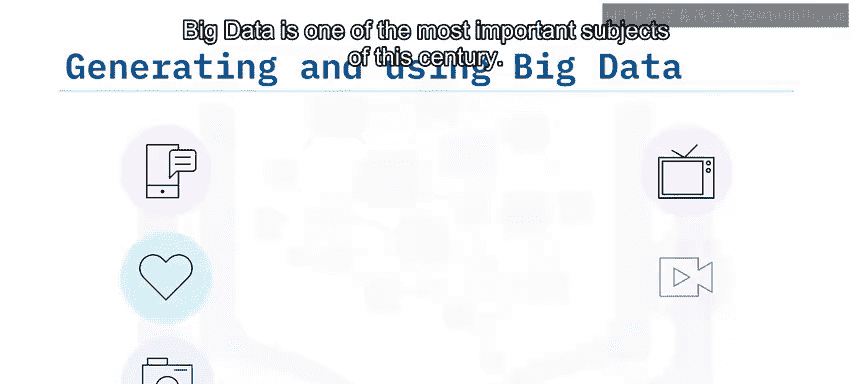

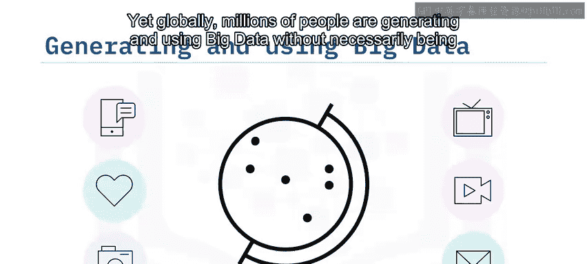

## 大数据对个人的影响 👤

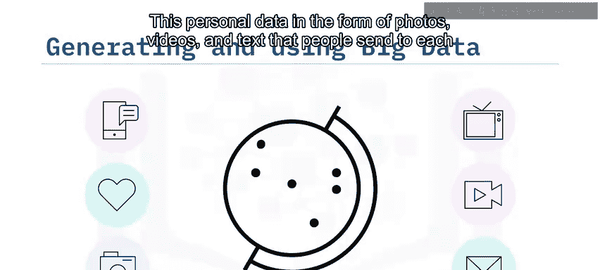

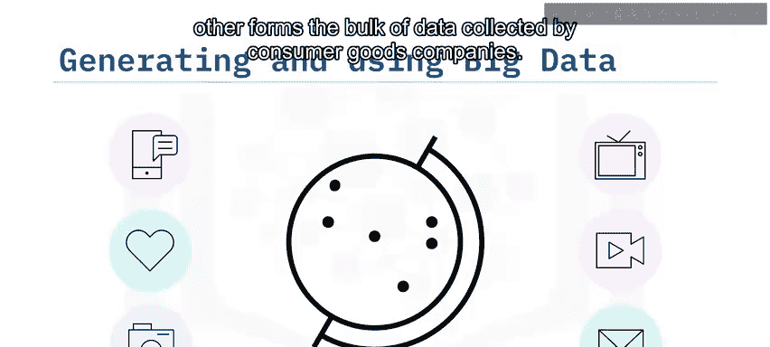

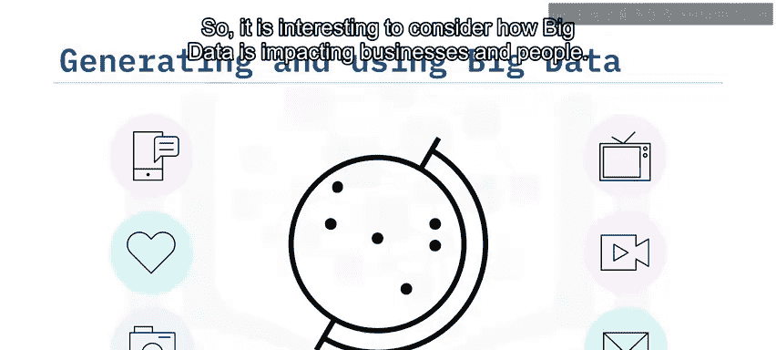

上一节我们提到了大数据的普遍性，本节中我们来看看大数据如何直接影响个人的日常生活。

### 推荐引擎


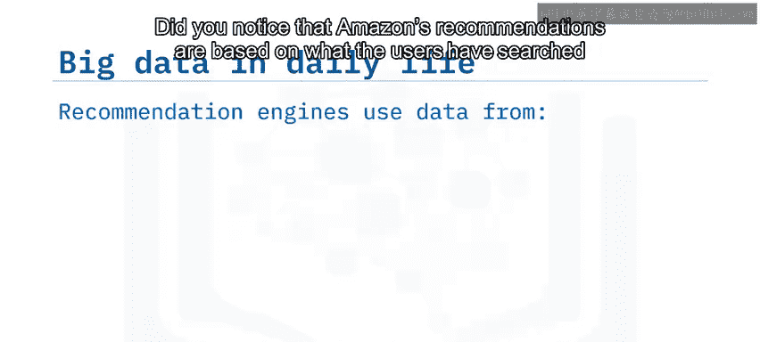

你是否曾在亚马逊上搜索或购买过产品？你是否注意到，亚马逊的推荐是基于用户过去的搜索记录、购买历史、虚拟购物车中的商品、用户评分和喜欢的商品，以及其他用户浏览和购买的商品。像亚马逊、Netflix和Spotify这样的公司，使用基于大数据的算法，根据客户偏好和历史行为做出个性化推荐。推荐引擎是大数据的一个常见应用。

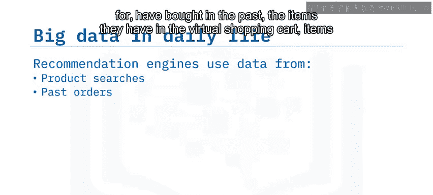

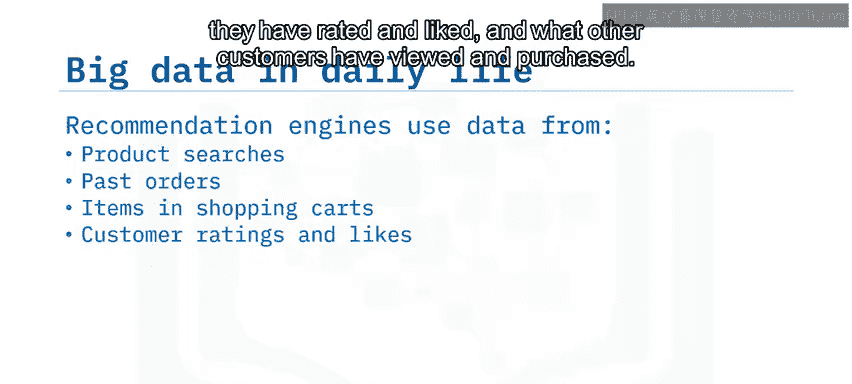

以下是推荐系统的一个简化工作原理：
```python
# 伪代码示例：基于协同过滤的推荐
def recommend_items(user_id, user_history, all_users_data):
    # 1. 找到与目标用户行为相似的其他用户
    similar_users = find_similar_users(user_id, all_users_data)
    # 2. 聚合这些相似用户喜欢的物品
    recommended_items = aggregate_preferred_items(similar_users)
    # 3. 过滤掉目标用户已经接触过的物品
    final_recommendations = filter_seen_items(recommended_items, user_history)
    return final_recommendations
```

### 个人助理

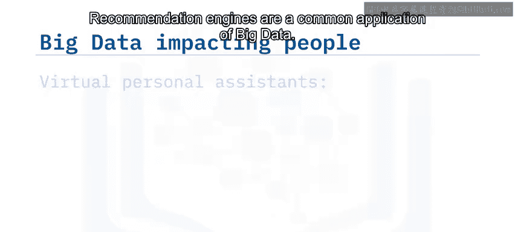

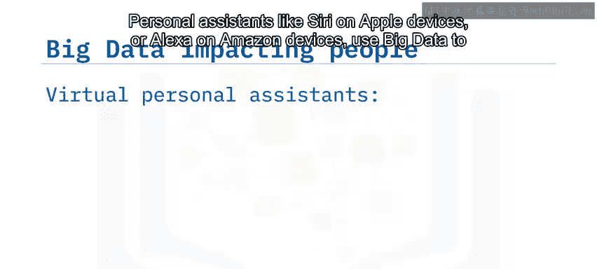

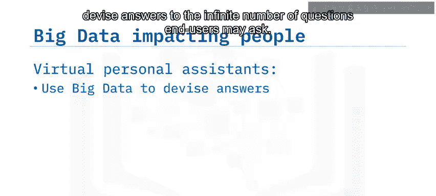

苹果设备上的Siri或亚马逊设备上的Alexa等个人助理，利用大数据来回答用户可能提出的无数问题。这些助理使用了有史以来最先进的神经网络。这使得它们能够将语音处理成文本，并将文本转化为可在该设备内多个应用程序中执行的复杂任务。为这些行为收集的大数据来源，不仅包括设备和云端的个人数据与偏好，还包括外部因素。

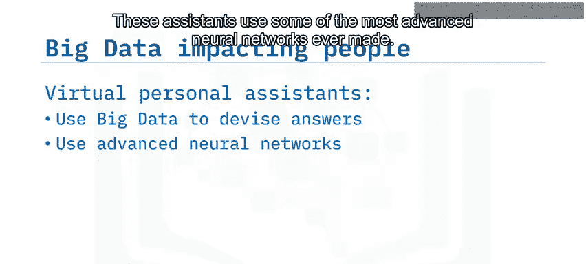

### 预测性服务

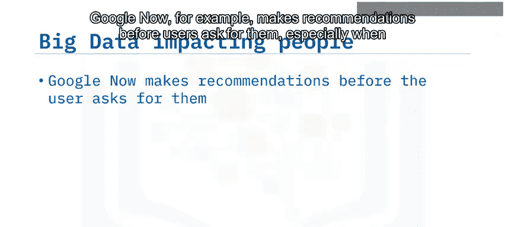

以Google Now为例，它甚至在用户提出请求之前就会做出推荐，尤其是当它与用户的日历和位置相关联，并且用户手机上的传感功能启用时。Google Now知道用户在哪里以及他们需要去哪里。它可以在用户询问之前就告知交通或天气等信息。在这种情况下，大数据的收集被用于预测未来的需求和行为。

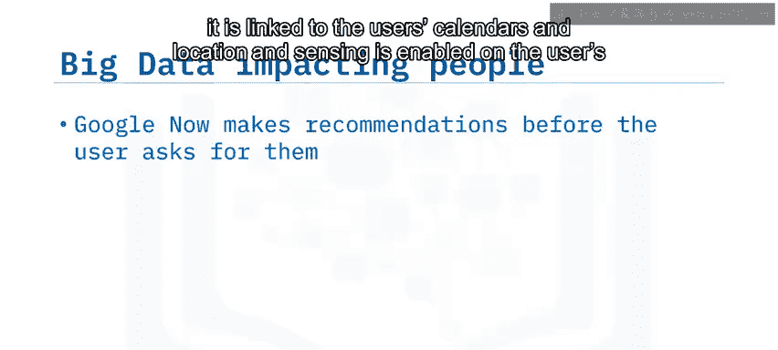

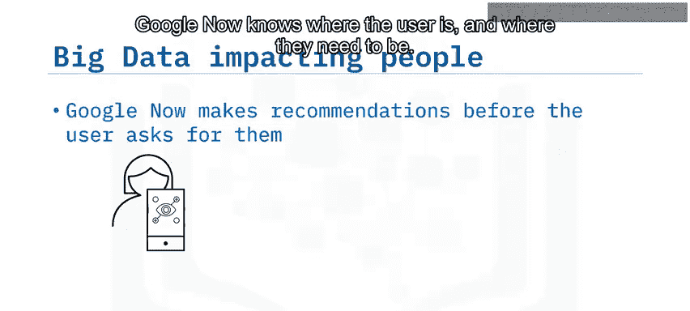

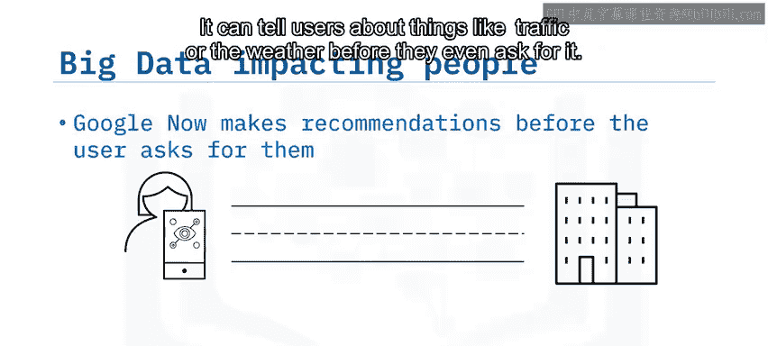

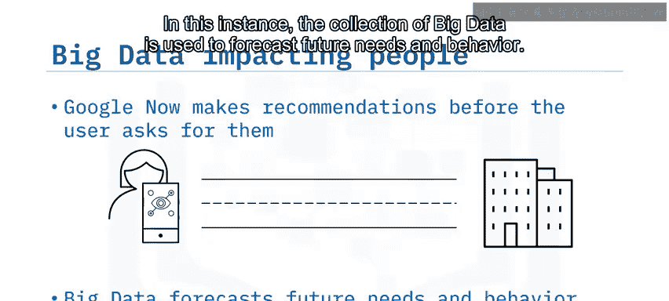

## 大数据对企业的影响 🏢

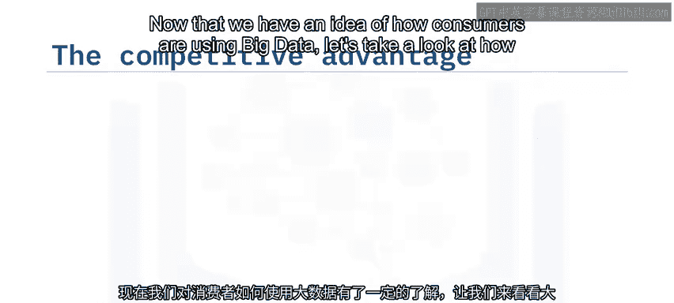

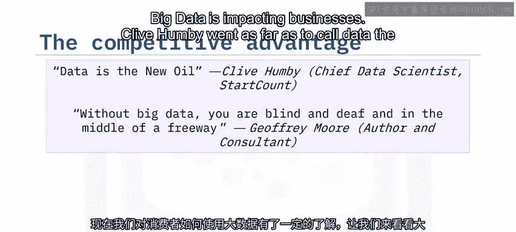

了解了消费者如何使用大数据后，让我们来看看大数据如何影响企业。克莱夫·亨比甚至将数据称为“新石油”，而杰弗里·摩尔则将数据的价值比作我们的视觉和听觉。

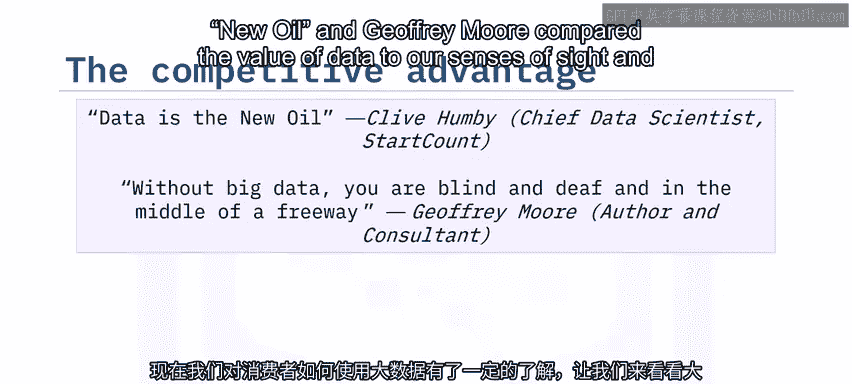

大数据正在从根本上改变企业竞争和运营的方式。强大的机器学习算法驱动着商业决策，最终提高了效率。近年来，对数据科学家和大数据工程师的年需求量显著增加，大数据技能组合对企业而言仍然具有极高的价值。

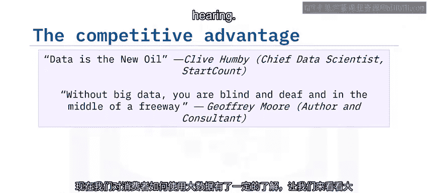

大数据分析的核心价值可以用一个公式表示：
**商业价值 = 数据量 × 数据质量 × 分析洞察力**

## 物联网与大数据 🌐

现在，我们来探讨一个与大数据紧密相关的概念：物联网。

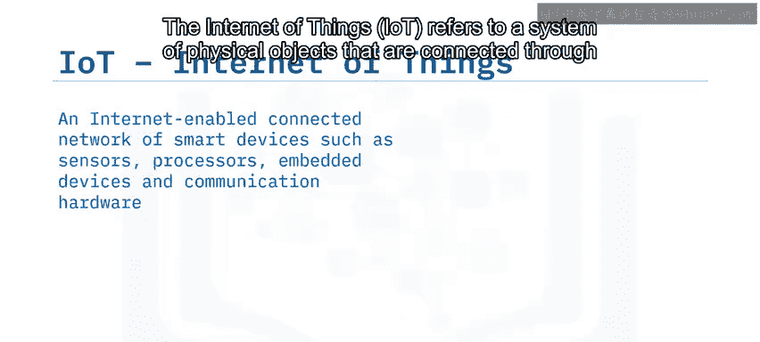

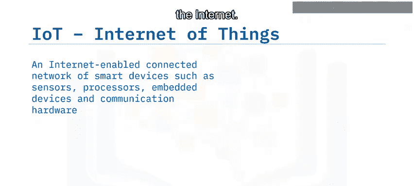


物联网指的是通过互联网连接起来的物理对象系统。一个“物”或设备可以包括我们家中的智能设备，或个人通讯设备，如智能手机或电脑。这些设备通过使用嵌入式技术，在无需人工干预的情况下，通过互联网收集和传输海量数据。所有这些设备实时地收集、分析、共享和传输数据。没有大数据，物联网设备将不具备使其在全球获得如此多关注的功能和能力。根据预测，到2030年，物联网设备的数量将是世界总人口的四倍。

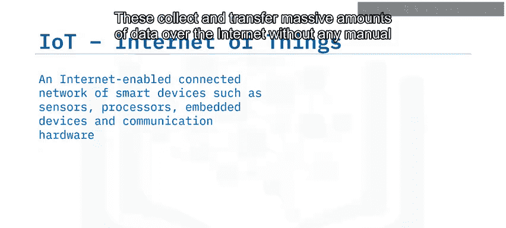

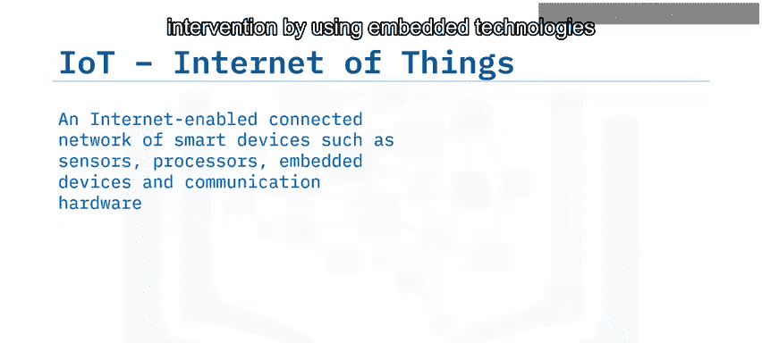

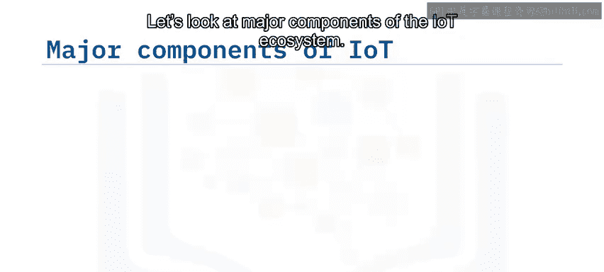

### 物联网生态系统的主要组成部分

以下是物联网生态系统的主要组成部分：

1.  **智能设备与传感器网络**：一个由智能设备和传感器组成的、支持互联网的连接网络，不断产生和传输各种数据。
2.  **网关**：这些大数据通过一个网关传递，网关将其路由到云中预定的存储位置。
3.  **数据处理与分析**：数据工程师使用复杂的算法来理解这些收集到的大数据，并将其编译成人类可以解读的分析形式。
4.  **决策与应用**：分析后的数据随后被用于制定商业和消费者决策，以提升客户体验和生产力。

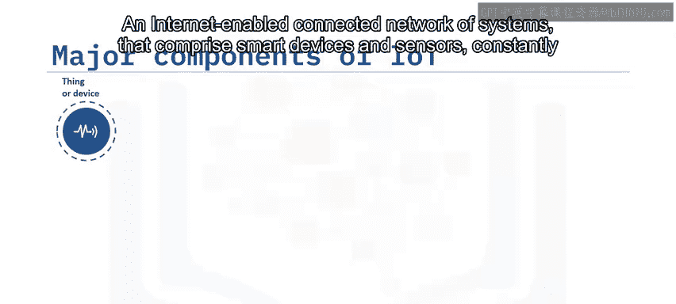

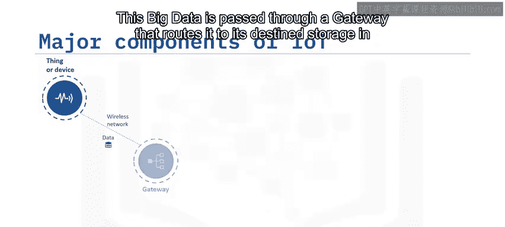

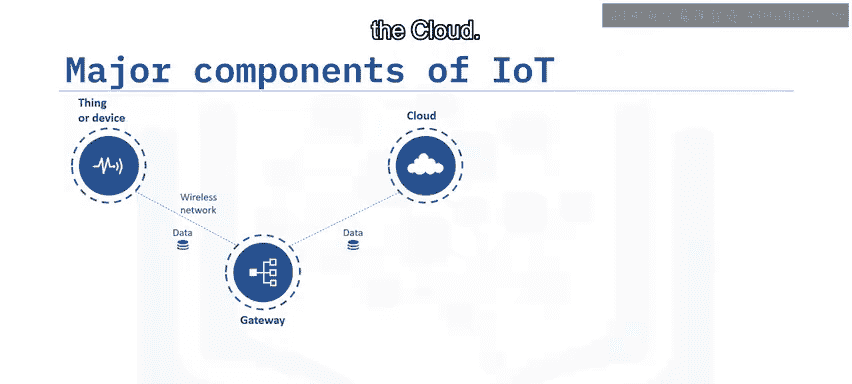

例如，一个安全摄像头可以持续上传录像，基于云的大数据算法可以在检测到任何活动时向用户发出警报。

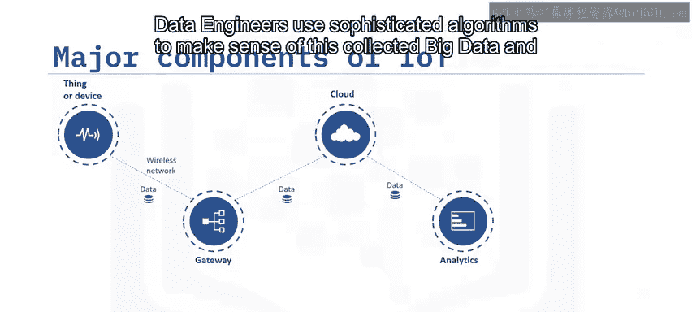

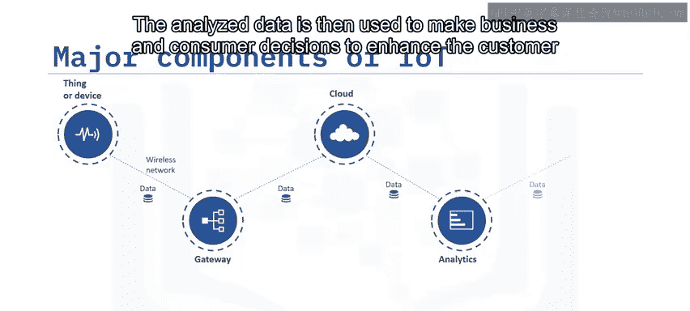

物联网数据流的简化表示如下：
`传感器数据 -> 网关 -> 云存储 -> 大数据分析平台 -> 可视化报告/自动决策`

---

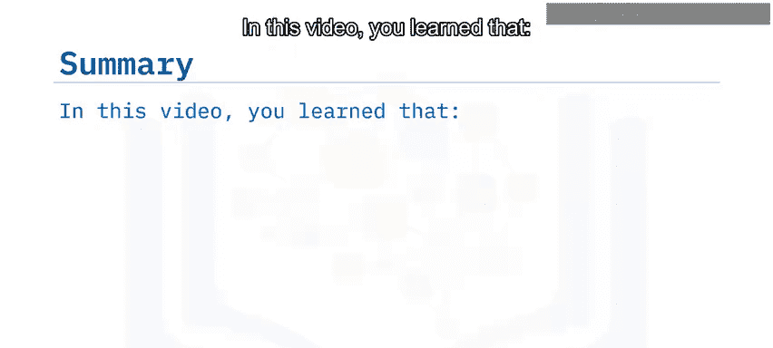

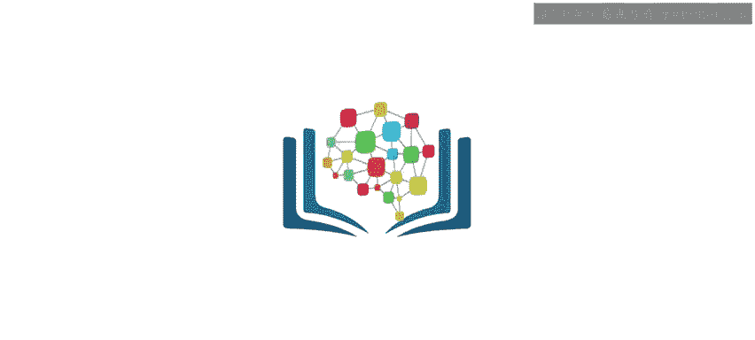

本节课中我们一起学习了大数据无处不在，它被收集并用于驱动商业决策和影响人们的生活。苹果设备上的Siri或亚马逊设备上的Alexa等虚拟个人助理，利用大数据来回答用户可能提出的无数问题。Google Now通过使用大数据预测未来需求和行为来影响人们。物联网设备持续产生海量数据，而大数据分析帮助企业从物联网设备收集的数据中获得洞察。