# IBM数据工程专业证书 课程12：《使用Spark进行数据工程和机器学习》｜ 第4部分：Elyra流水线编辑器入门 🚀

在本节课中，我们将学习Elyra平台中的流水线编辑器。我们将了解其核心功能、如何构建和配置流水线，以及如何将其部署到不同的执行环境中。

---

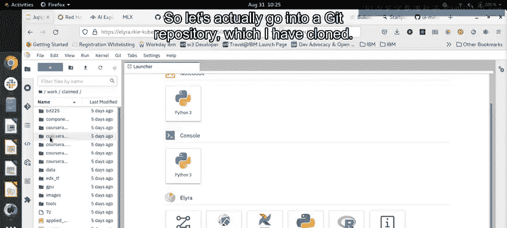

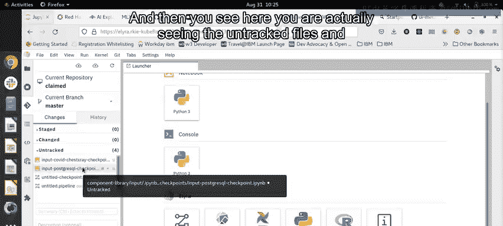

## Elyra平台概览

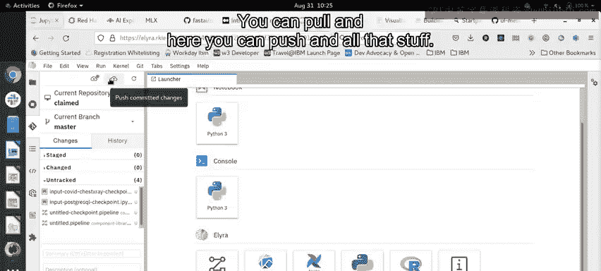

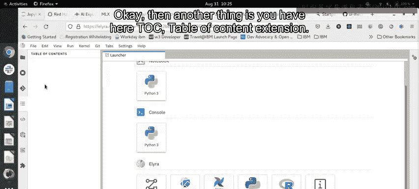

Elyra是一个基于JupyterLab的扩展平台，提供了多种增强功能，以支持数据科学和机器学习工作流。它运行在Kubernetes环境中，例如IBM Kubernetes引擎，但也可以在Docker或任何Kubernetes环境中部署。

上一节我们介绍了课程背景，本节中我们来看看Elyra平台本身提供的几个关键扩展功能。

以下是Elyra包含的主要扩展：

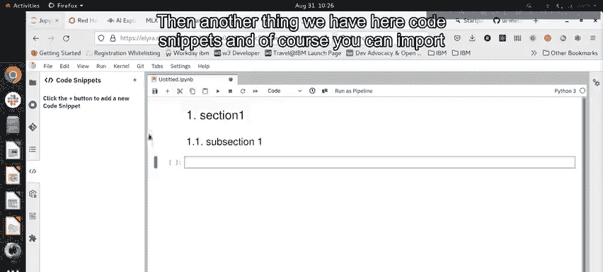

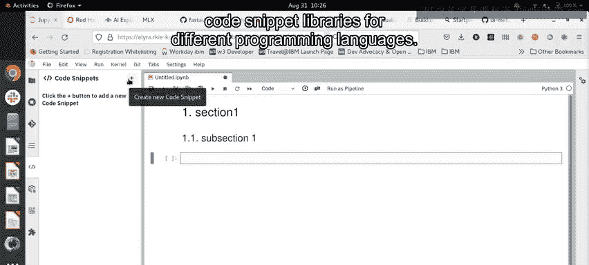

*   **Git扩展**：允许在JupyterLab界面内直接进行版本控制操作，如查看未跟踪文件、暂存更改、提交、推送和拉取代码。
*   **目录扩展**：为笔记本中的Markdown单元格自动生成带编号的目录，便于导航。
*   **代码片段扩展**：支持导入不同编程语言的代码片段库，可以通过拖放快速将常用代码插入笔记本，无需手动搜索。
*   **运行时配置**：用于配置流水线执行环境，我们将在后面详细讨论。
*   **运行时镜像配置**：管理运行组件所需的容器镜像。
*   **扩展管理器**：用于管理所有已安装的扩展。

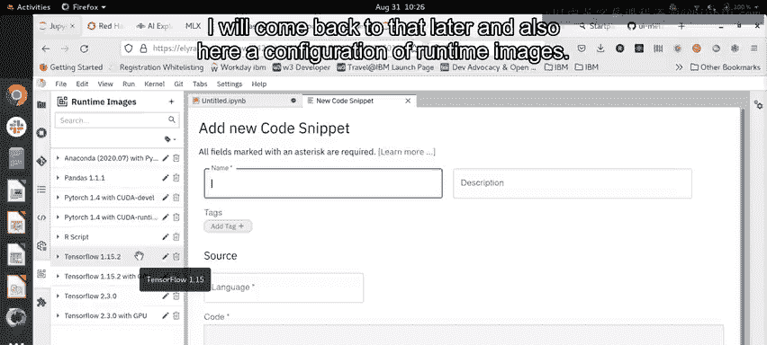

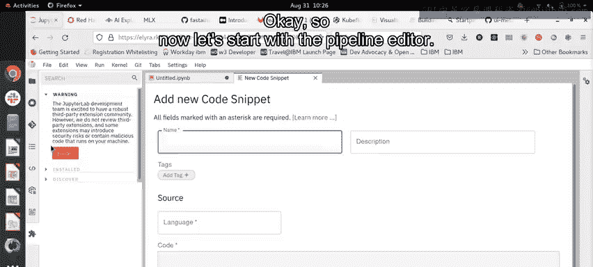

## 深入流水线编辑器 🛠️

了解了Elyra的基础功能后，我们现在聚焦于其核心组件——流水线编辑器。这个工具非常强大，允许你通过可视化方式构建工作流。

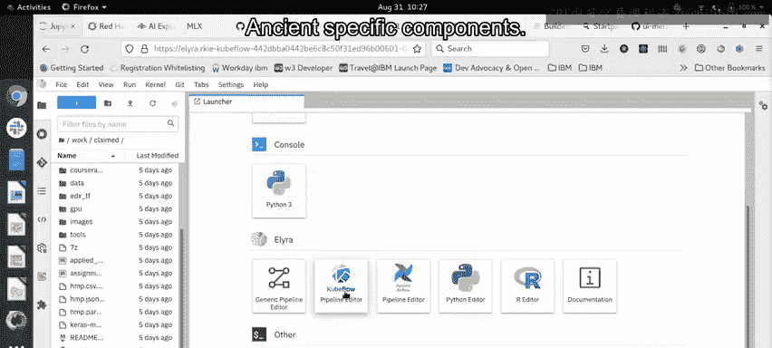

流水线编辑器支持将构建好的流水线推送到不同的执行引擎。目前主要支持本地执行、Kubeflow和Apache Airflow。

Elyra提供了两种类型的流水线编辑器：
1.  **通用流水线编辑器**：可以将流水线推送到本地、Kubeflow或Airflow。
2.  **执行引擎专用流水线编辑器**：允许使用特定引擎（如Kubeflow或Airflow）的专用组件。

### 组件库与拖放构建

在编辑器左侧，你可以看到一个组件面板。在通用编辑器中，你可以找到如Jupyter笔记本、Python脚本或R脚本等基础组件，只需将它们拖放到画布上即可。

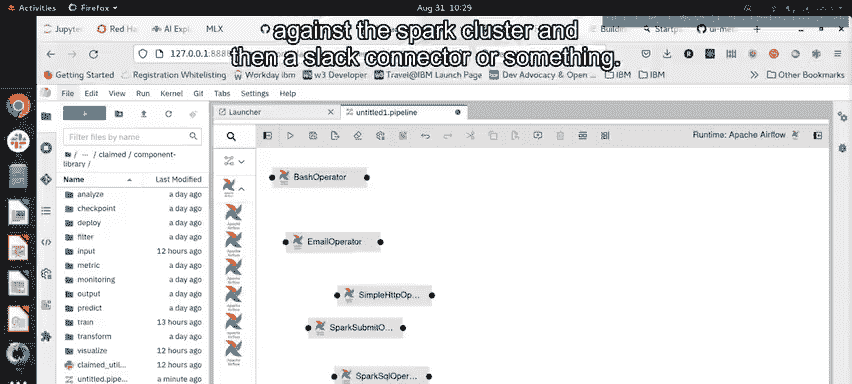

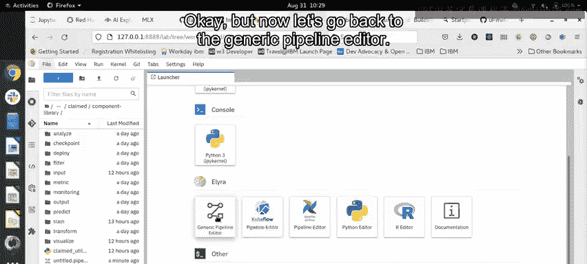

如果切换到Kubeflow专用编辑器，你会发现更多针对Kubernetes工作流优化的组件，例如数据过滤组件。而在Airflow专用编辑器中，组件更加丰富，包括：

*   `BatchOperator`
*   `EmailOperator`（用于发送邮件）
*   `HttpOperator`
*   `SparkSqlOperator`（用于向Spark集群提交SQL语句）
*   `SparkSubmitOperator`（用于提交Spark应用程序）

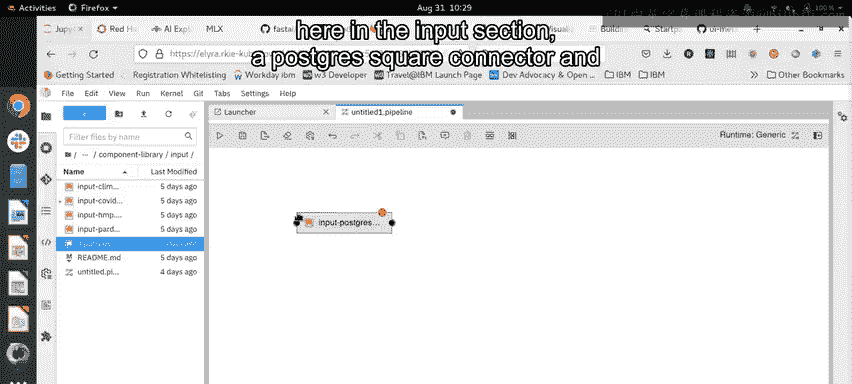

### 配置组件参数

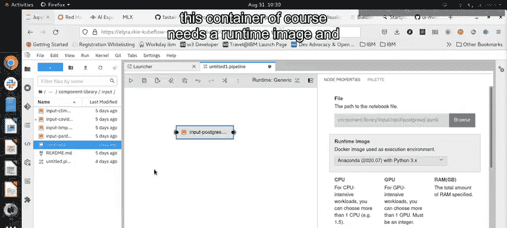

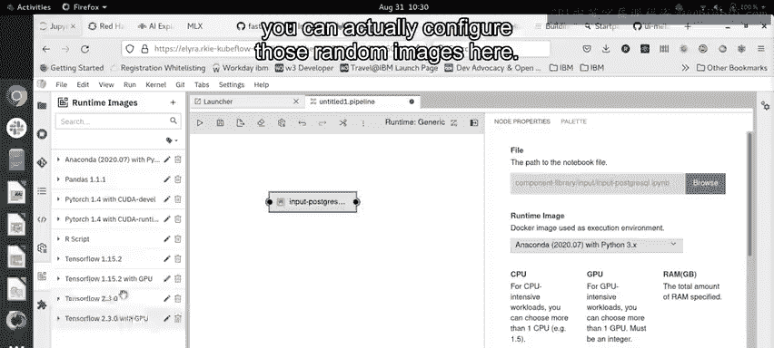

每个组件都需要在特定的容器运行时镜像中执行。你可以在Elyra的“运行时镜像配置”部分定义和管理这些镜像。

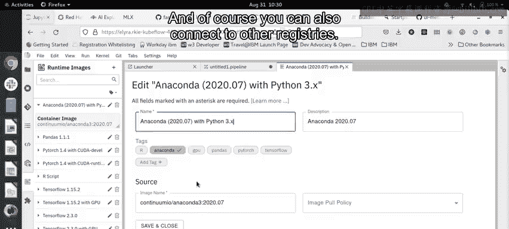

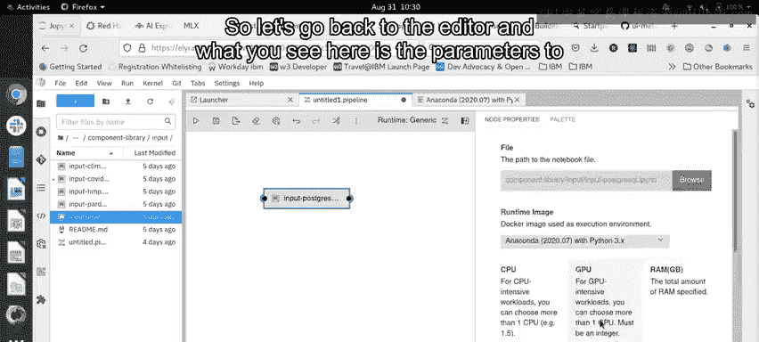

当你将一个组件（例如一个“PostgreSQL连接器”组件）拖到画布上并选中它时，其参数界面会自动在右侧生成。对于数据库连接器，你需要配置的参数包括：

*   `host`：数据库主机名
*   `database`：数据库名称
*   `user`：用户名
*   `password`：密码
*   `port`：端口号
*   `sql`：要执行的SQL查询语句
*   `output_filename`：输出CSV文件的名称

### 连接组件与数据流

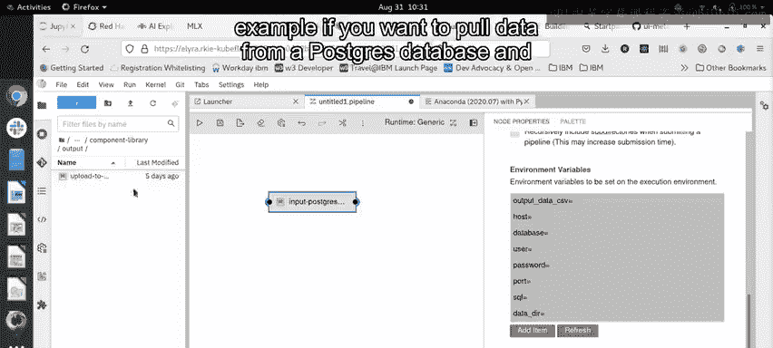

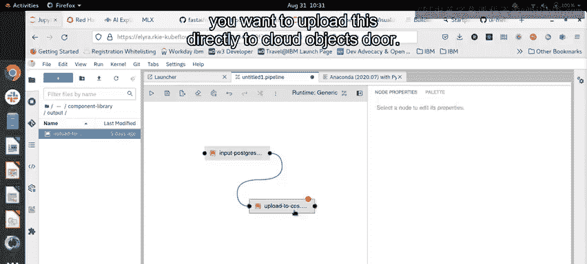

组件之间可以通过连接线建立依赖关系，形成数据流。例如，你可以将“PostgreSQL连接器”的输出连接到“云对象存储上传器”组件。

对于云存储组件，你需要配置诸如访问密钥、秘密访问密钥、端点URL和存储桶名称等属性。Elyra的组件兼容IBM Cloud Object Storage、Amazon S3、MinIO以及其他任何S3兼容的对象存储服务。

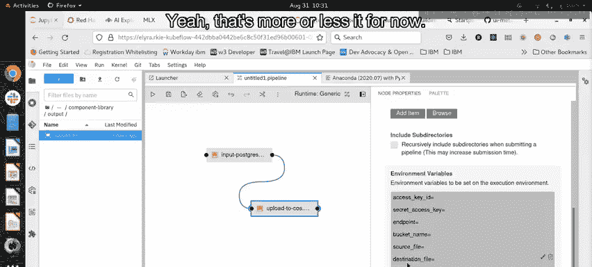

### 底层代码与“契约设计”

双击画布上的任何组件，都会打开其底层的Jupyter笔记本。你会看到一种基于“契约设计”的接口配置。组件的输入参数通过环境变量注入。

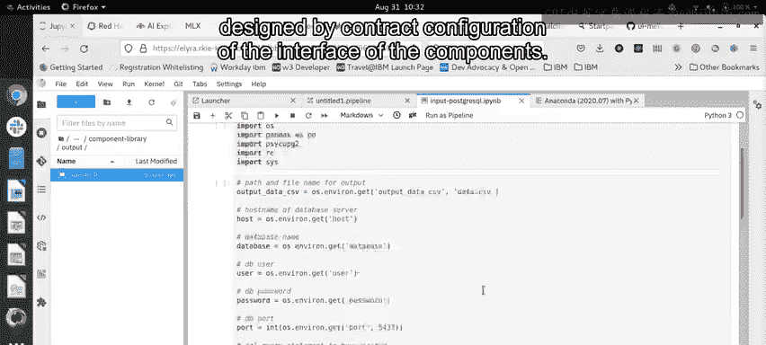

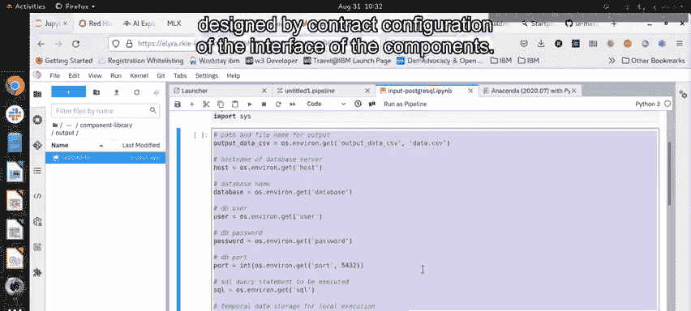

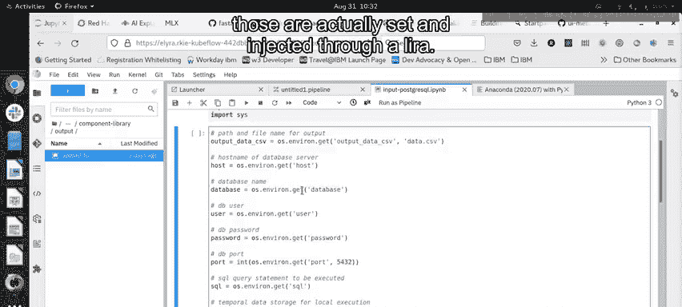

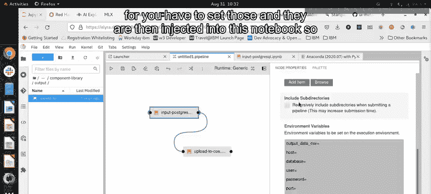

在笔记本中，你可以看到类似以下的代码，它负责接收这些注入的参数：

```python
import os
# 从环境变量中读取参数
db_host = os.environ.get('DB_HOST')
db_name = os.environ.get('DB_NAME')
query = os.environ.get('SQL_QUERY')
# ... 使用这些参数连接数据库并执行查询
```

这种方式意味着，即使你不编写代码，也能通过配置完成数据抽取（如从数据库查询并写入CSV文件）这样的任务。同时，你保留了随时查看和修改底层源代码的灵活性，实现了“低代码”与“全代码”体验的平衡。

## 流水线执行与监控 ▶️

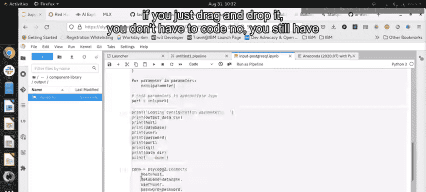

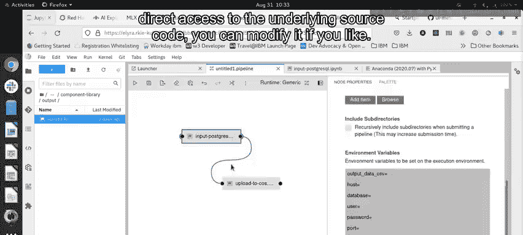

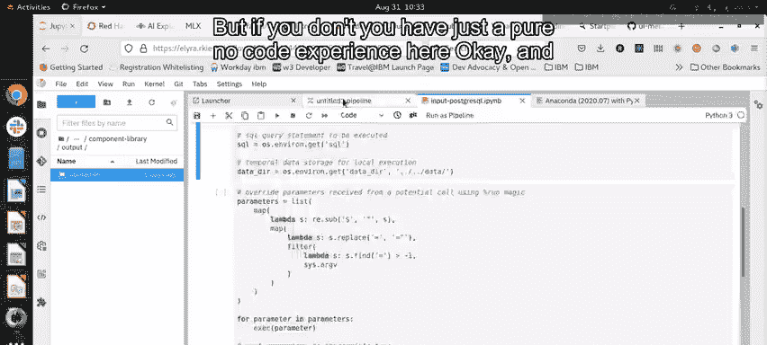

配置好流水线后，你可以选择执行它。Elyra支持两种主要运行方式：


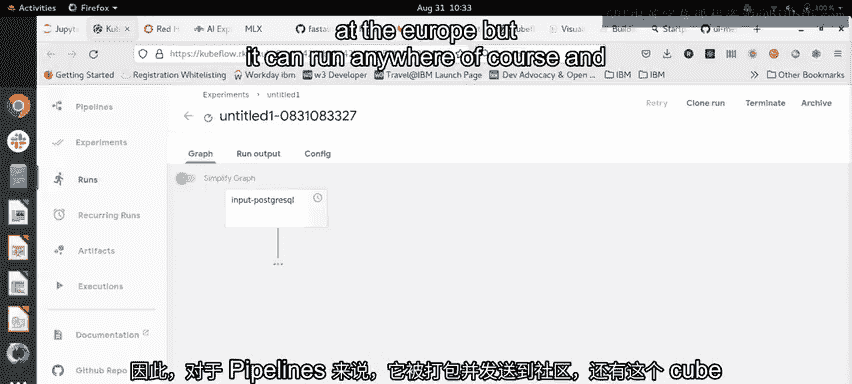

1.  **本地执行**：在本地环境中运行流水线进行测试。
2.  **提交到Kubernetes/Kubeflow**：将流水线打包并提交到Kubeflow Pipelines引擎（可以运行在IBM Cloud或其他任何Kubernetes集群上）。

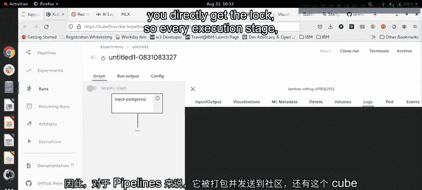

当流水线在Kubeflow中运行时，每个组件（对应一个笔记本）都会在一个独立的Pod（容器）中执行。你可以实时查看每个执行步骤的标准输出日志，方便监控和调试。

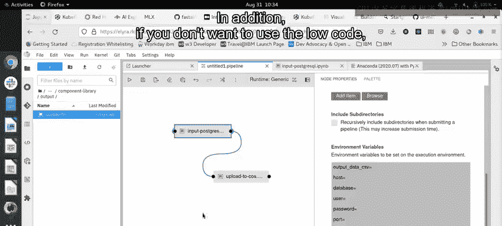

## 超越编辑器：CLAIMED组件库与编译器

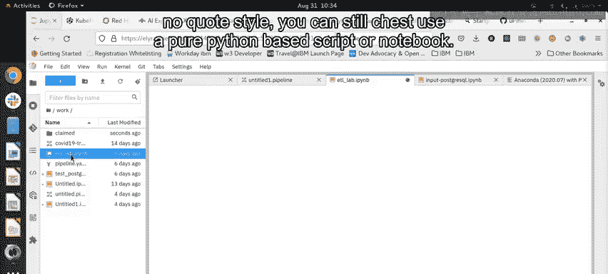

Elyra的强大之处不仅在于UI。其背后是一个名为**CLAIMED**的组件库（Component Library for AI, Machine Learning, and Data Science）。这个库的核心思想是标准化和复用。

即使不使用Elyra UI，你也可以直接编程方式调用这些组件：

```python
# 示例：以编程方式使用组件
from claimed_components.postgres import PostgresExtractor
component = PostgresExtractor(host='myhost', db='mydb', ...)
component.execute()
```

此外，项目还提供了 **C3**，即CLAIMED组件编译器。它能将一个符合规范的Jupyter笔记本，自动编译成标准的Kubeflow Pipeline组件。这些组件可以上传到ML Exchange等仓库中进行共享和管理。之后，你可以在任何Kubeflow环境、IBM Watson Pipelines或Elyra本身中使用这些共享组件。

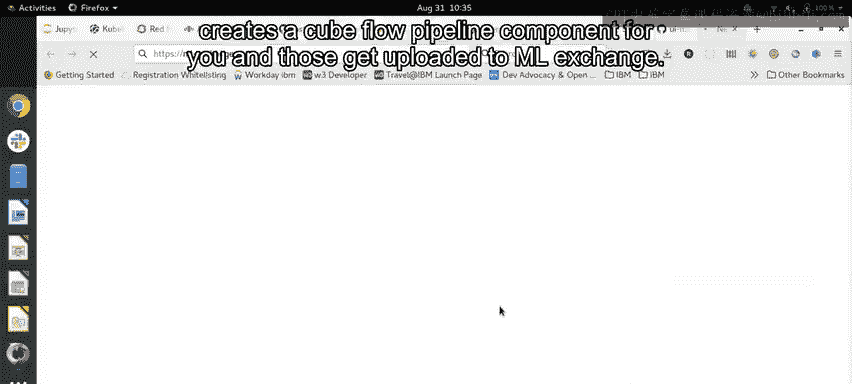

---

## 总结

本节课我们一起学习了Elyra流水线编辑器的核心功能。我们了解到Elyra不仅是一个可视化流水线构建工具，更是一个集成了Git管理、代码片段、运行时配置的完整数据科学平台。通过拖放组件和配置参数，我们可以快速构建从数据提取、处理到模型训练的工作流，并灵活地部署到本地或Kubernetes环境。更重要的是，其背后的CLAIMED组件库和C3编译器为实现组件的标准化、复用和共享提供了强大支持，极大地提升了机器学习工程化的效率和协作性。