# IBM数据工程专业证书 课程12：《使用Spark进行数据工程和机器学习》｜Spark ML基础 🚀


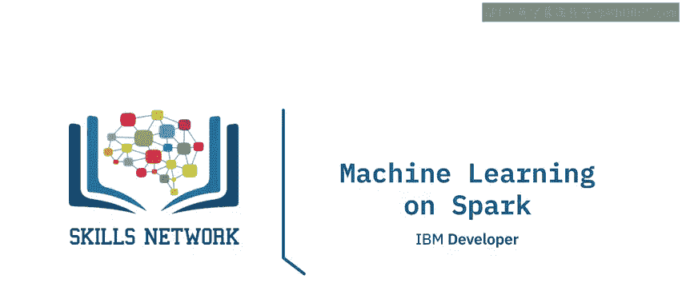

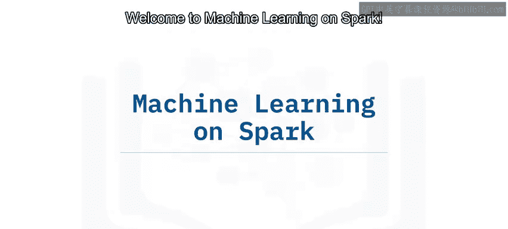

在本节课中，我们将要学习机器学习的基本概念，并了解Apache Spark的机器学习库——MLlib的核心功能与优势。

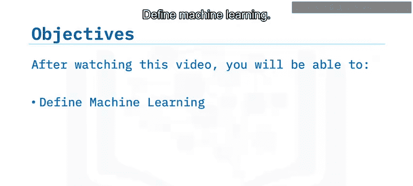

---

## 什么是机器学习？🤖

机器学习是计算机科学和统计学的一个分支，它研究能够从数据中自动学习的算法。这些算法并非被明确编程来执行特定任务，而是从数据和经验中学习。机器学习系统通常随着提供更多数据而提高性能。机器学习应用了作为人工智能核心的统计工具。一个机器学习系统应用特定的机器学习模型来训练数据模型。训练模型后，系统会对先前未见过的数据进行推断或预测。

---

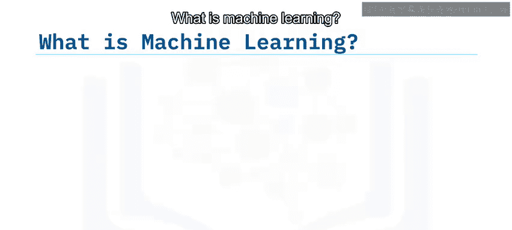

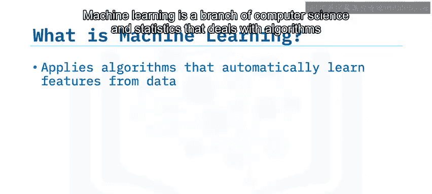

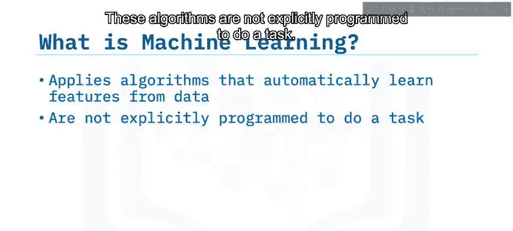

## Spark MLlib 简介 📚

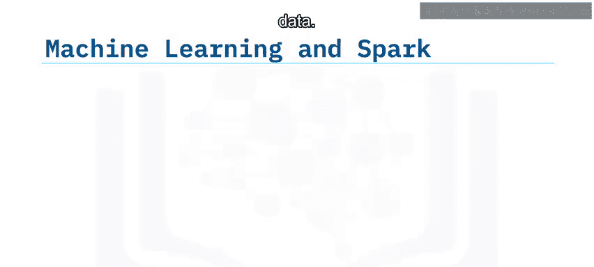

上一节我们介绍了机器学习的基本概念，本节中我们来看看Spark的机器学习库MLlib。

Spark ML库通常被称为MLlib，它代表机器学习库，是Spark的主要机器学习API。MLlib应用实用的机器学习算法，并且是可扩展的。MLlib执行机器学习操作，包括使用基于DataFrame的API训练模型。

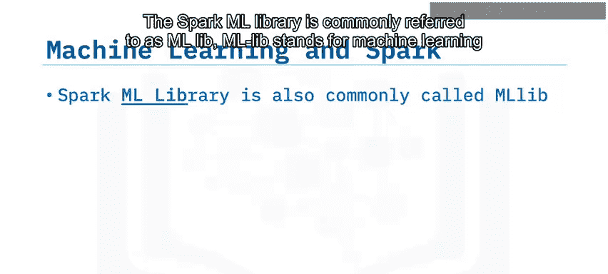

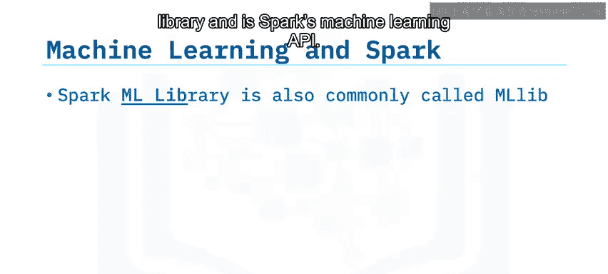

MLlib提供了许多工具来实现机器学习系统，例如机器学习算法。Spark MLlib预装了用于聚类、分类、回归和其他任务的标准机器学习算法。

此外，MLlib还提供了特征化功能，可以轻松地从原始数据中提取感兴趣的特征，包括特征提取、降维、字符串标记化等功能。

---

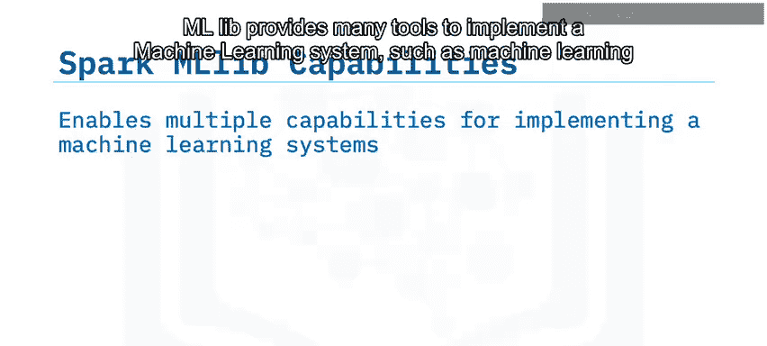

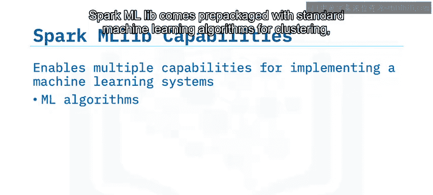

## MLlib 的核心功能与工具 🛠️

以下是MLlib提供的几项核心能力：

*   **管道**：Spark MLlib公开了一个管道API，使得机器学习端到端系统的开发、训练和部署变得更加容易。你可以使用Spark MLlib轻松保存和加载模型及管道。这对于在需要多个训练检查点的大型数据集上训练的模型非常有益。
*   **实用工具**：MLlib通过来自统计学、线性代数、图像处理等领域的便捷函数，简化了日常机器学习任务。
*   **数据源支持**：MLlib支持标准的Spark数据源，包括Parquet、CSV、JSON和JDBC。

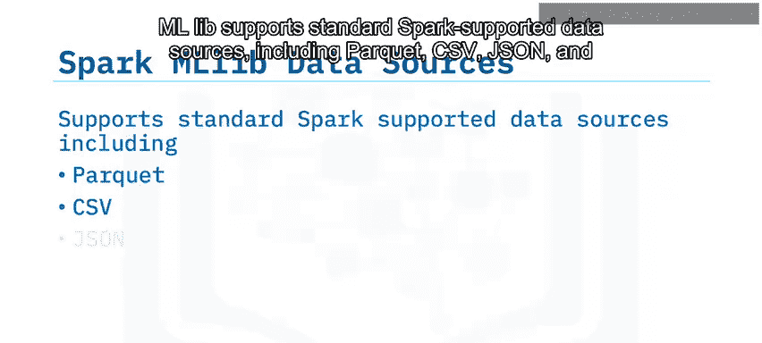

MLlib还拥有特殊的库来支持图像和LIBSVM数据类型，并支持特征向量和标签列数据。图像是机器学习模型（尤其是计算机视觉应用）常见且常用的数据源。LIBSVM是一种包含特征向量和标签列的数据框类型。

---

## MLlib 实用工具示例 📊

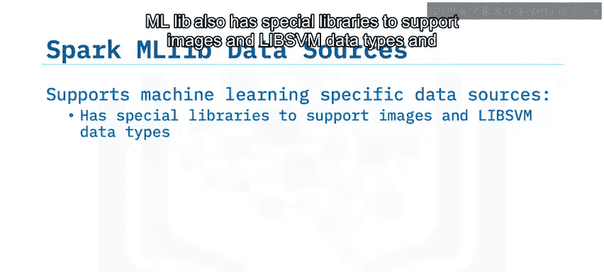

MLlib包含许多内置的实用函数，有助于数据处理、清洗和模型构建的中间步骤。以下是几个常用的实用工具：

*   **线性代数包**：实现基本的线性代数数据类型，如向量和矩阵。
*   **统计包**：包含用于计算相关性和执行假设检验的函数。
*   **特征模块**：将原始数据转换为可用于训练机器学习模型的有用特征。

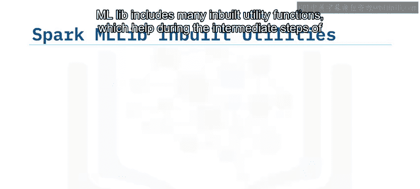

让我们看一个展示相关性实用函数用法的例子。这个例子使用线性代数库创建向量，然后使用统计库确定这些向量之间的相关性。

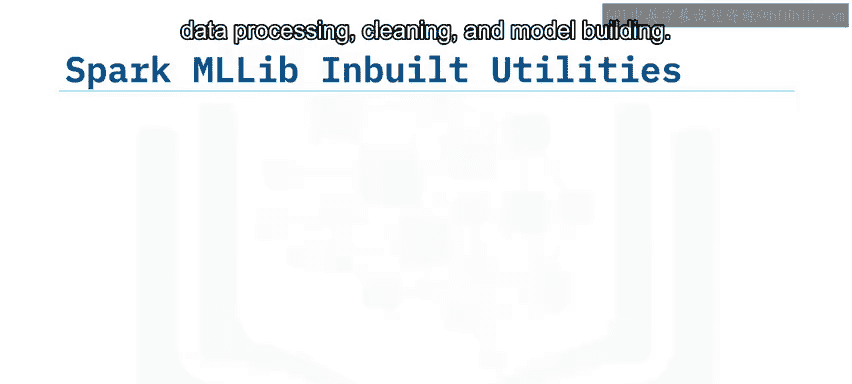

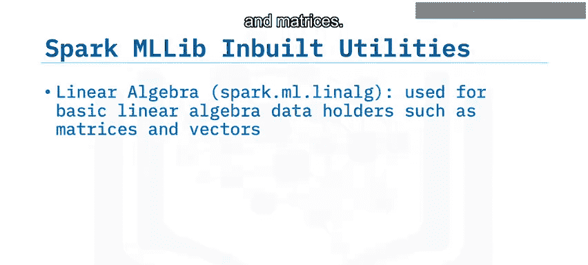

```python
# 示例代码：使用MLlib计算向量相关性
from pyspark.ml.linalg import Vectors
from pyspark.ml.stat import Correlation

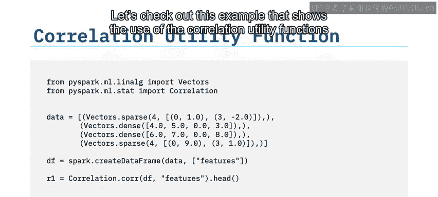

data = [(Vectors.dense([1.0, 2.0, 3.0]),),
        (Vectors.dense([4.0, 5.0, 6.0]),),
        (Vectors.dense([7.0, 8.0, 9.0]),)]
df = spark.createDataFrame(data, ["features"])
corr_matrix = Correlation.corr(df, "features").collect()[0][0]
print(corr_matrix)
```

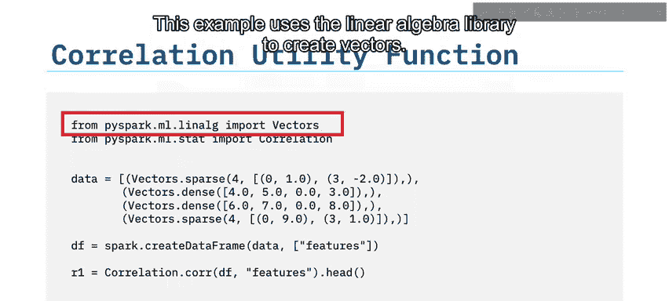

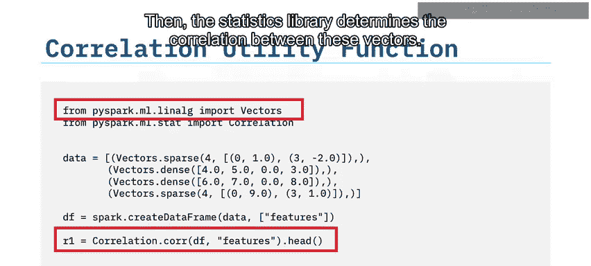

---

## Spark 机器学习管道 🔄

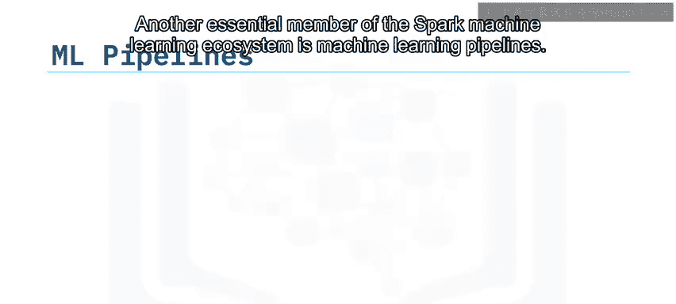

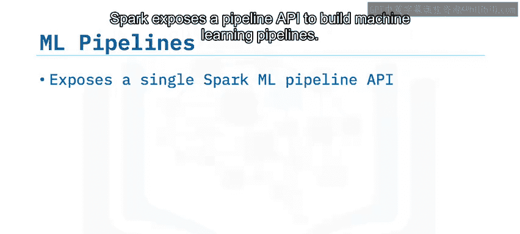

Spark机器学习生态系统的另一个重要组成部分是机器学习管道。Spark公开了一个管道API来构建机器学习管道。机器学习管道将机器学习系统的多个算法和部分组合成一个单一的工作流或管道。

以下是构建管道的两个核心概念：

*   **转换器**：顾名思义，转换器将一个数据框中的数据转换为另一个不同的数据框。例如，一个机器学习模型就是一个转换器对象，它将特征数据转换为预测数据。
*   **估计器**：估计器封装了算法以及模型在训练数据上经历的学习过程。

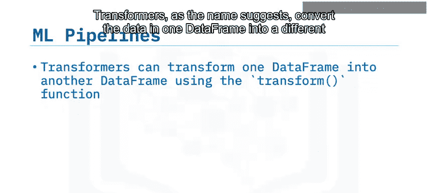

你可以使用转换器、估计器和管道API在Spark上构建机器学习管道。

---

## 总结 📝

本节课中我们一起学习了以下内容：


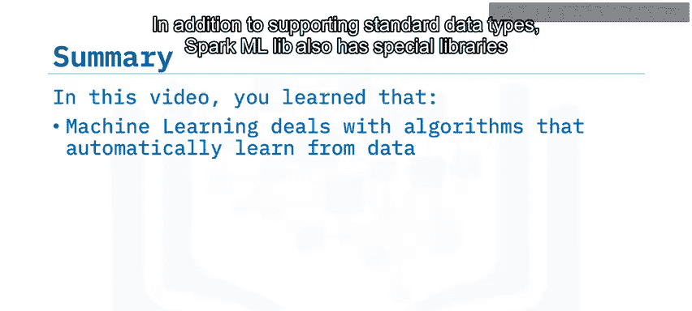

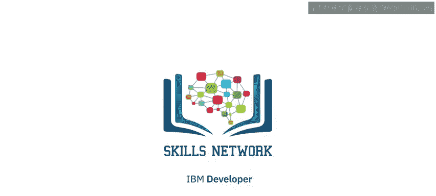

1.  机器学习是计算机科学和统计学的一个分支，研究能够从数据中自动学习的算法。
2.  除了支持标准数据类型，Spark MLlib还拥有特殊的库来支持图像和LIBSVM数据类型。
3.  Spark MLlib提供了许多工具来实现机器学习系统，包括机器学习算法、特征化、管道持久化和实用工具。
4.  Spark公开了一个管道API来构建机器学习管道。机器学习管道通过将多个算法和机器学习系统的部分组合成一个单一的工作流或管道，节省了开发人员的时间和精力。