# IBM数据工程专业证书 课程11：《使用Spark和Hadoop进行大数据介绍》｜P5：大数据工具与生态系统 🛠️

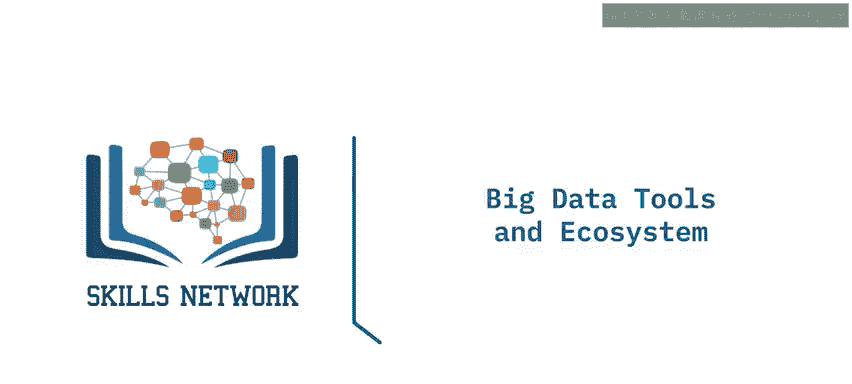

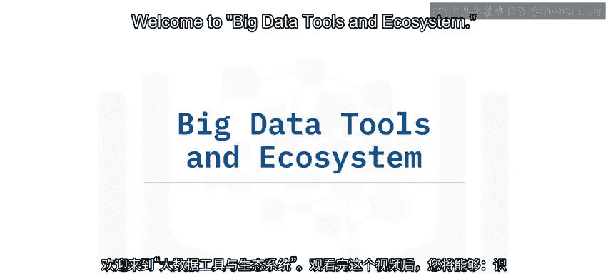

欢迎来到《大数据工具与生态系统》课程。

在本节课中，我们将要学习大数据生态系统中的核心工具类别。观看本视频后，你将能够：
*   识别大数据生态系统中的关键工具类别。
*   描述每个工具类别在大数据生命周期中的作用。
*   列举每个大数据工具类别中的主要工具和供应商。

大数据工具主要分为六个不同类别：**数据技术**、**分析与可视化**、**商业智能**、**云服务提供商**、**NoSQL数据库**和**编程工具**。接下来，我们将详细探讨每一个组成部分。

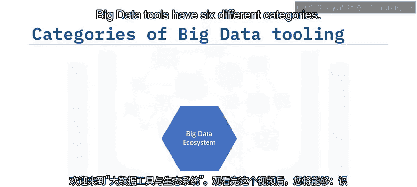

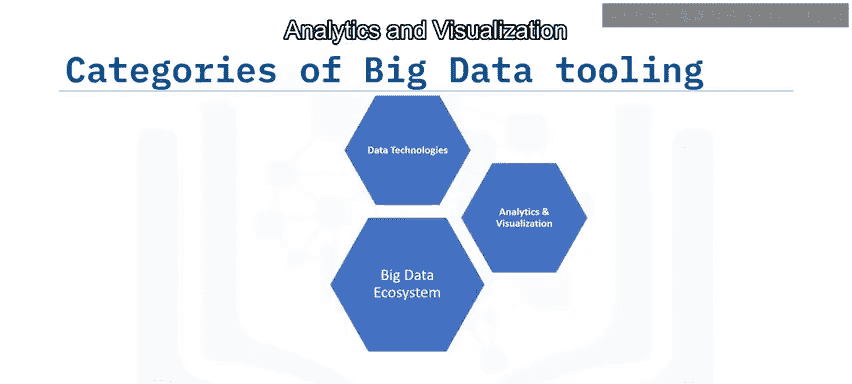

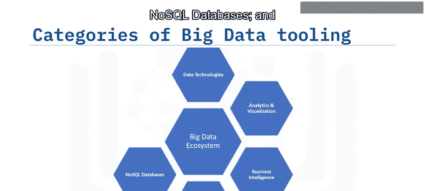

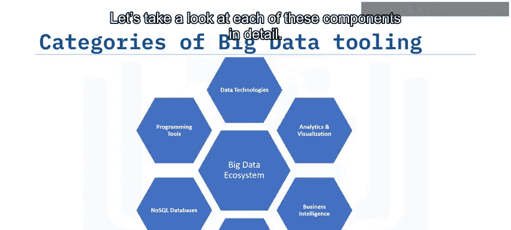

## 数据技术 🗄️

数据技术是专门设计用于分析、处理和从大数据中提取有意义信息的技术。这些功能超越了传统数据处理工具的能力范围。它们能够捕获、处理和共享大数据任务，处理结构化和非结构化数据，并提供高性能的并行处理。

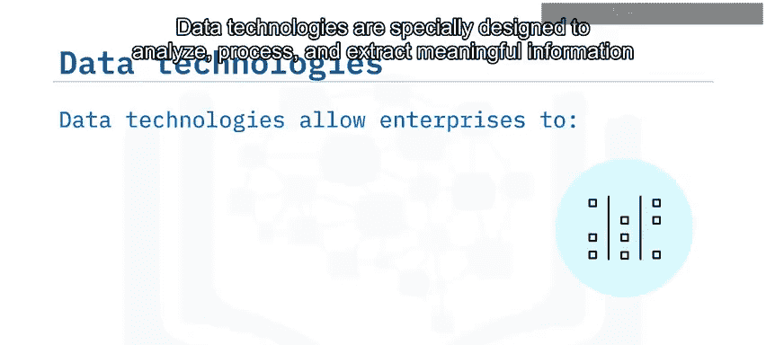

大数据领域的数据技术主要由开源项目主导，例如 **Apache Hadoop**、**Apache HDFS** 和 **Apache Spark**。同时，像 **Cloudera** 和 **Databricks** 这样的主要商业供应商也为这些项目做出贡献并提供支持。

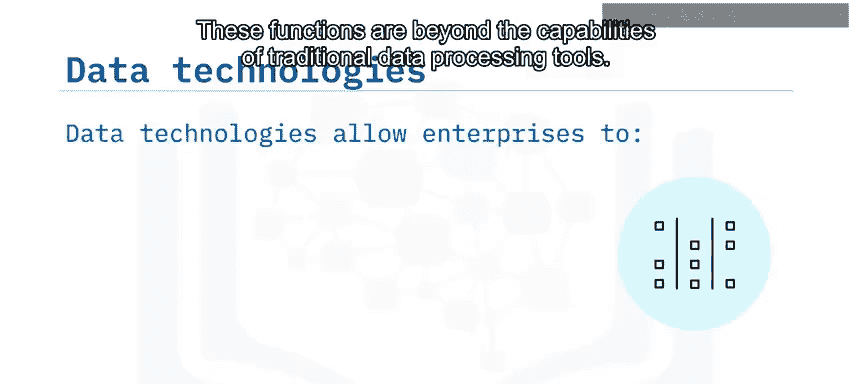

## 分析与可视化 📊

上一节我们介绍了处理大数据的基础技术，本节中我们来看看如何从数据中获取洞见。

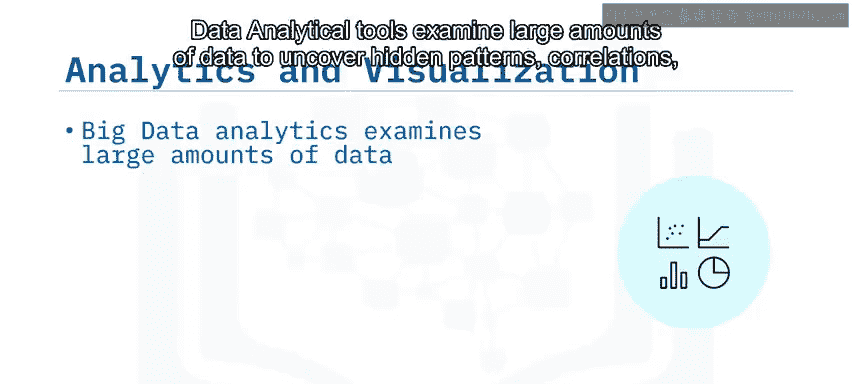

数据分析工具用于检查大量数据，以发现隐藏的模式、关联和趋势。另一方面，数据可视化则以图表、图形和地图的形式，对这些趋势进行视觉呈现。这些工具提供了一种易于理解的方式来查看和理解数据中的趋势、异常值和模式。

以下是该类别中的一些领先工具示例：
*   Tableau
*   Pentaho
*   SAS
*   Qlik
*   Teradata

## 商业智能 💡

仅仅分析和可视化数据是不够的。商业智能工具将原始数据转化为适合业务分析的有意义、可操作的信息。商业智能技术也涉及基本的数学概念，如概率、统计和流程图。从商业智能中获得的洞察有助于推动业务决策。

以下是一些商业智能工具的例子：
*   Cognos
*   Oracle
*   Power BI
*   Business Objects
*   Hyperion

## 云服务提供商 ☁️

大数据在存储、传输、处理、挖掘和服务海量数据方面提出了挑战。云服务提供商通过共享计算资源（包括计算、存储、网络和分析软件）提供基础架构和支持。云提供商还提供软件即服务模型及针对性解决方案，使企业能够轻松地聚合、处理和可视化数据。

以下是云服务提供商的例子：
*   AWS
*   IBM Cloud
*   Google Cloud Platform
*   Oracle Cloud

## NoSQL数据库 🗂️

大数据商业工具的另一个关键组成部分是专为大数据处理量身定制的NoSQL数据库。NoSQL数据库从设计之初就是为了大规模存储和处理海量数据，并支持日益增长的现代业务需求。NoSQL数据库将数据存储在文档中，而不是关系表中。

以下是NoSQL数据库的类型及例子：
*   **纯文档数据库**：如 **MongoDB**
*   **键值存储**：如 **Redis**
*   **宽列数据库**：如 **Cassandra**
*   **图数据库**：如 **Neo4j**

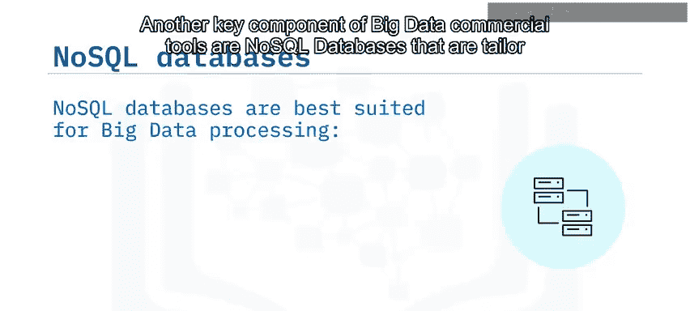

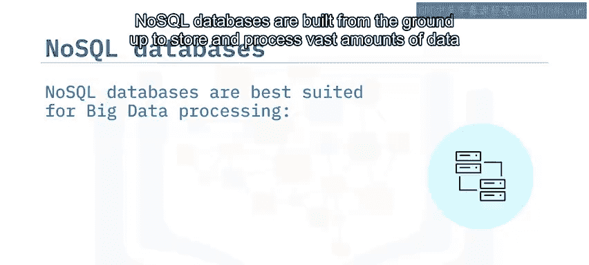

## 编程工具 ⌨️

编程工具是大数据商业工具的最后一个组成部分。这些编程工具执行大规模的分析任务，并将大数据操作化。它们还提供数据收集、清洗、探索、建模和可视化所需的所有必要功能。

以下是一些可用于大数据编程的流行工具：
*   **R**
*   **Python**
*   **SQL**
*   **Scala**
*   **Julia**

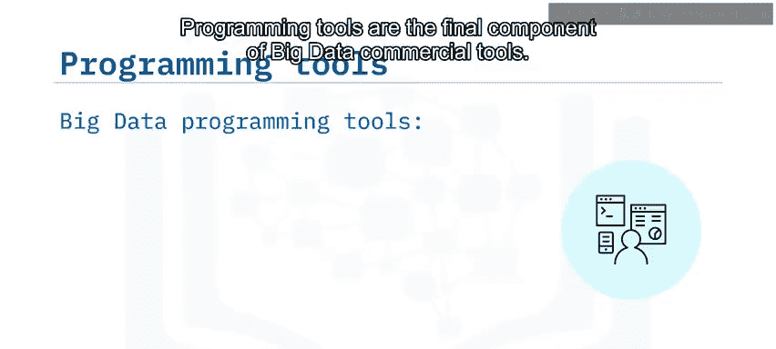

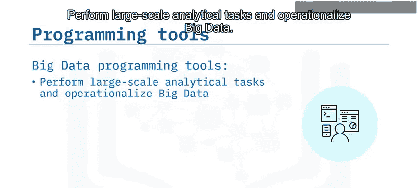

## 总结

在本节课中，我们一起学习了大数据工具的六个主要组成部分，即数据技术、分析与可视化、商业智能、云服务提供商、NoSQL数据库和编程工具。每个工具类别都在大数据生命周期中扮演着非常具体且关键的角色。同时，多个主要的商业和开源供应商为大数据处理提供了工具和支持。

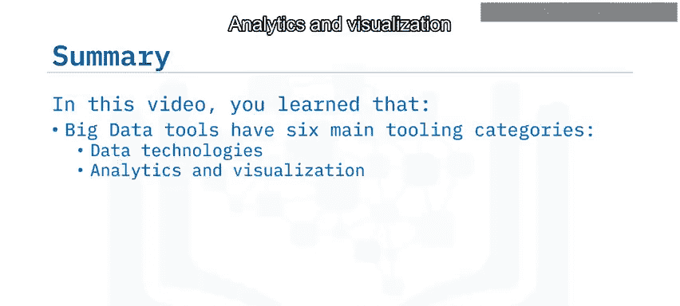

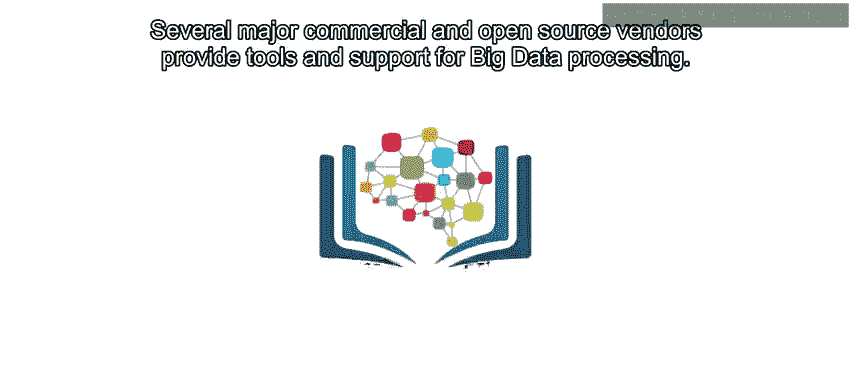

