# IBM数据工程专业证书 课程12：《使用Spark进行数据工程和机器学习》｜ 第6讲：使用Apache Spark进行分类与回归 🧠➡️📈

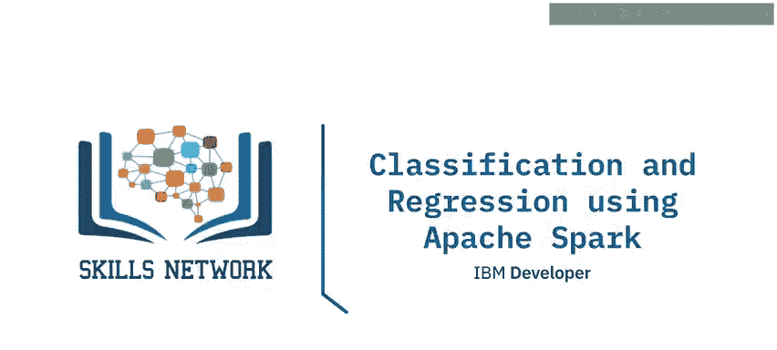

在本节课中，我们将要学习监督式学习的基本概念，以及如何在Apache Spark中执行分类和回归任务。我们将了解这两种任务的区别，并介绍Spark ML库为它们提供的支持。

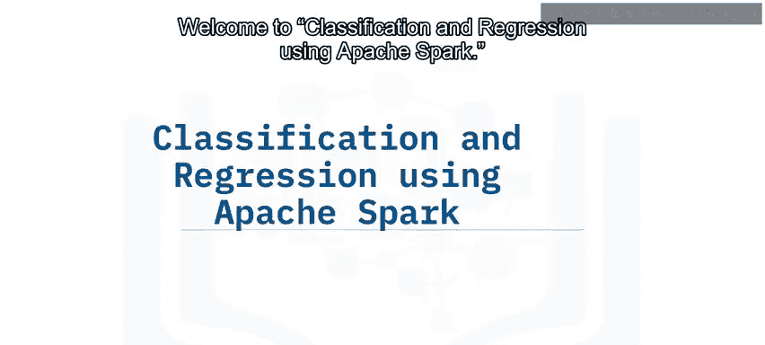

---

## 监督式学习概述

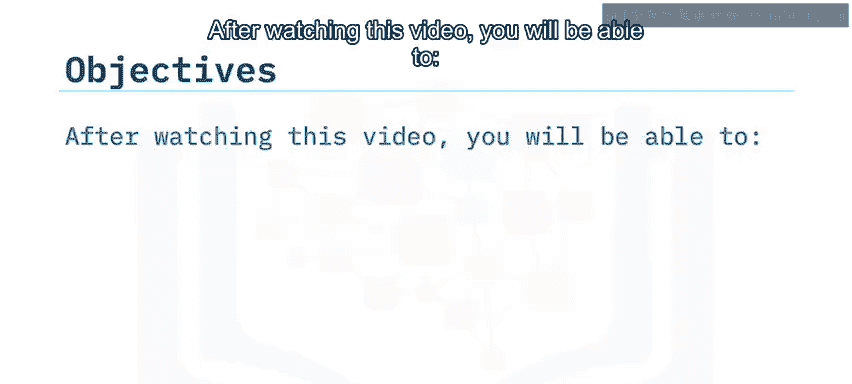

监督式学习是机器学习算法的一个子集。在监督式学习中，机器学习模型从**数据**及其对应的**标签**中学习。对数据的明确标注赋予了监督式学习“监督”的特性。在大多数情况下，监督式学习模型会随着更多高质量标注数据的加入而得到改进。然而，标注数据通常耗时且成本高昂。

上一节我们介绍了监督式学习的基本思想，本节中我们来看看它的两个主要任务：分类与回归。

---

## 分类任务

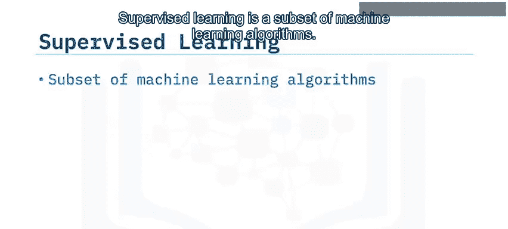

分类是一种监督式机器学习任务，它从一个**离散的**可能结果集合中产生预测或输出。在这种情况下，模型试图预测每个对象所属的类别。

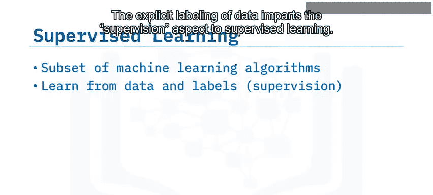

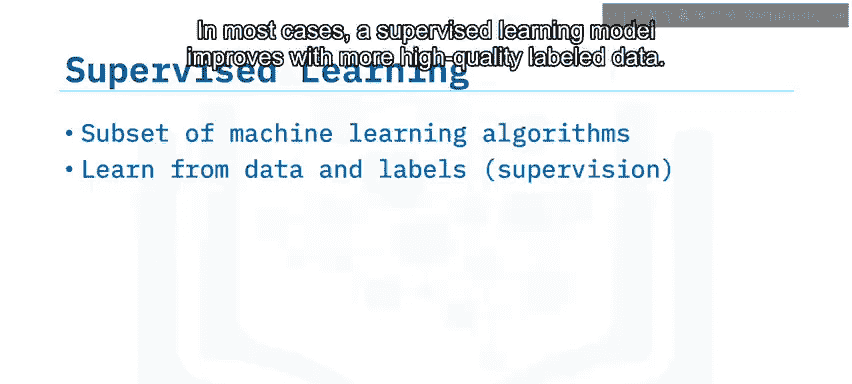

以下是分类任务的一些例子：
*   预测体育比赛的获胜者。
*   预测抛硬币的结果是正面还是反面。
*   对图像进行分类。

在每一个例子中，模型通过为输入对象分配一个类别来确定结果。

---

## 回归任务

另一方面，当模型近似一个**隐式函数**并为输入变量预测数值时，我们称此任务为回归。预测值通常是一个连续的实数，例如浮点数或整数。

以下是回归任务的一些例子：
*   天气预测。
*   股票市场价格预测。
*   房屋价值估算。

请注意模型是如何估计 **`F(x)`** 的，其中 **`x`** 是每个例子中的一个变量。以天气预测为例，我们可以将天气视为时间 **`T`** 的函数 **`F(T)`**，而回归任务就是估计这个函数的样子，或者说 **`F(T)`** 在所有可能时间点上的值。

---

## 在Apache Spark中实现机器学习

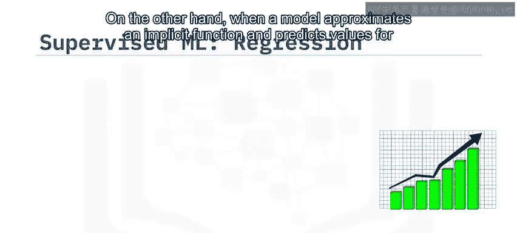

那么，如何在Apache Spark上执行监督式机器学习呢？Spark MLlib库为分类和回归都提供了相应的库。

*   使用 **`spark.ml.classification`** 库进行分类任务。
*   使用 **`spark.ml.regression`** 库进行回归任务。

---

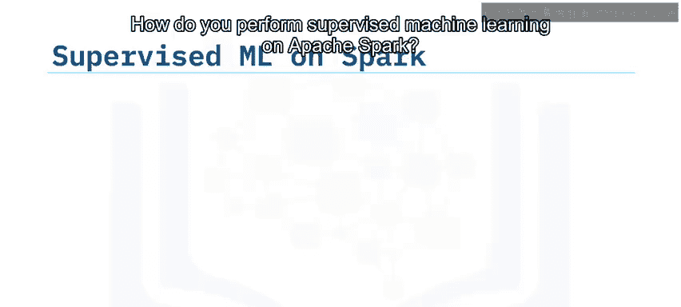

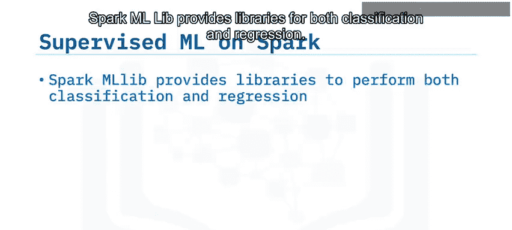

### Spark ML分类库

让我们更详细地看看分类库。Spark ML分类库内置了标准分类算法的实现。

以下是该库包含的一些算法：
*   逻辑回归分类器
*   决策树
*   随机森林
*   支持向量机
*   朴素贝叶斯
*   一对多分类器

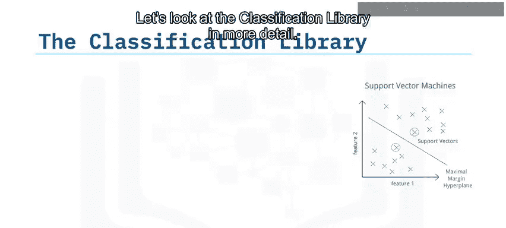

---

### Spark ML回归库

同样地，Spark回归库也提供了标准回归算法的内置实现。

以下是该库包含的一些算法：
*   线性回归
*   广义线性模型
*   决策树回归
*   生存回归
*   保序回归算法

---

## 总结

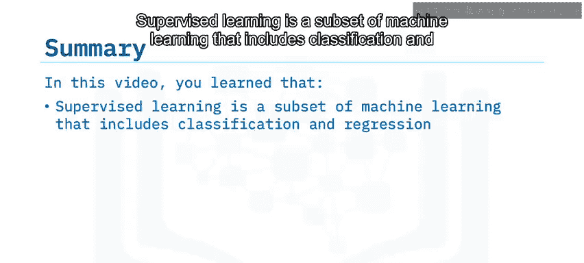

本节课中我们一起学习了：
1.  监督式学习是机器学习的一个子集，包含分类和回归。
2.  **分类**从一个离散的可能结果集合中产生预测。
3.  **回归**是一种隐式函数近似形式，模型为给定输入预测实数值输出。
4.  Spark ML通过大量可并行、可扩展的算法支持分类和回归任务。