# IBM数据工程专业证书 课程11：《使用Spark和Hadoop进行大数据介绍》｜ 第6讲：开源与大数据 📚

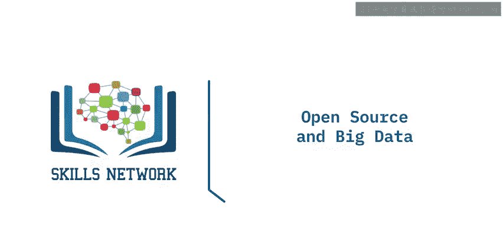

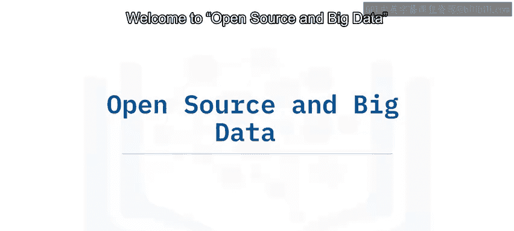

在本节课中，我们将要学习开源软件在大数据领域中的核心作用。我们将探讨开源的定义、其重要性，并介绍构成现代大数据基础设施基础的几个关键开源框架。

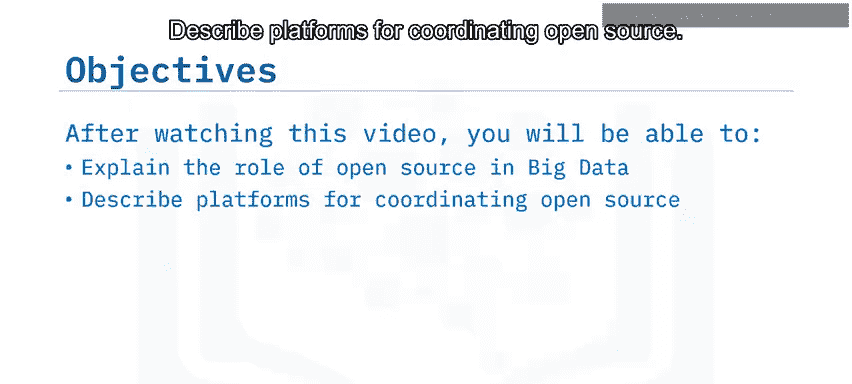

## 什么是开源软件？🔓

开源软件的一个简单定义是：它是免费的。不仅可运行的代码版本免费，其源代码也完全开放。这意味着每一行代码都可以供人们查看、使用并根据需要复用。

然而，一个项目只有在采用开放治理模型后，才成为真正的开源项目。这一举措确保了来自任何组织的贡献者都可以提议修改代码，并且整个项目的发展方向能够服务于社区的需求。

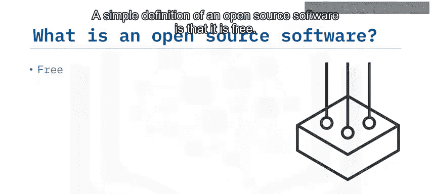

需要注意的是，并非所有开源软件都相同。与软件关联的许可证类型规定了你可以如何使用它。在使用任何开源软件之前，务必检查其遵循的许可证类型，并理解该特定许可证类型下的使用权限。

## 为什么大数据采用开源模型？🤔

开源项目是巨大的工程。虽然许多项目始于单一组织内部，但真正的开源项目能够超越任何单一组织的努力而持续存在。这些项目构成了所有现代大数据基础设施的基础。

以Linux内核为例。当Linus Torvalds最初将其作为开源项目开发时，操作系统领域有许多参与者，其中许多只提供其代码的专有版本。当时并不清楚谁最终会成为操作系统标准。近30年后，Linux已成为所有服务器的标准。对于全球几乎每一台数据服务器，无论其硬件、软件或服务提供商如何，这都是事实。

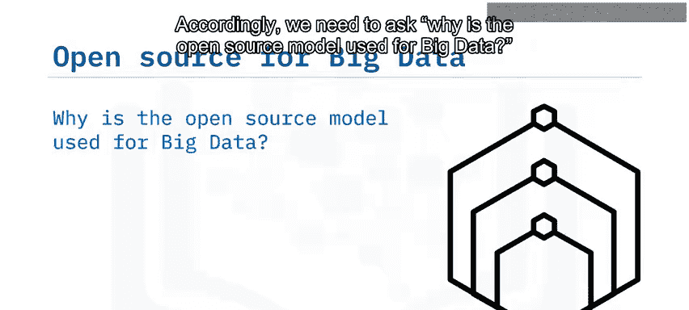

这种情况之所以发生，是因为该项目拥有了超越任何单一公司利益的生命力，并持续存在于任何组织的兴趣周期之外。

开源开发模式之于软件开发，就如同民主之于政府。它是进行项目最透明的方式，并最终服务于参与者的意愿。从某种意义上说，一个完全开放的模型最终会成为更有利的解决方案，这一结果令人惊讶，但事实一次又一次地证明了这一点。我们现在已毫无争议地接受了这种模式。

## 开源项目的治理与参与 👥

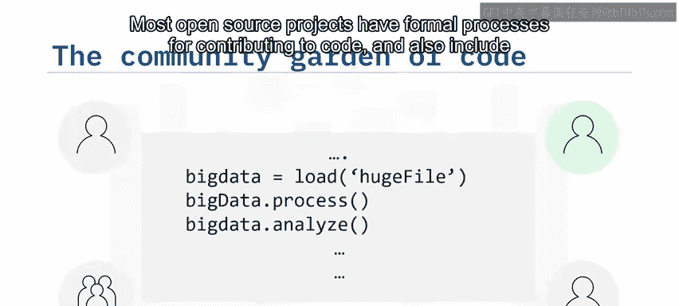

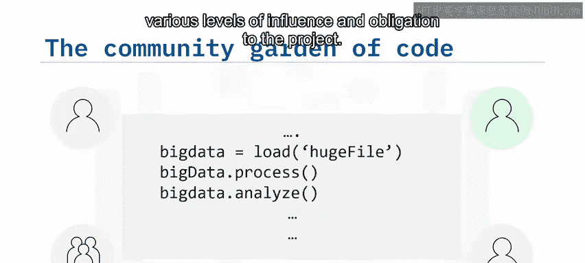

大多数开源项目都有正式的代码贡献流程，并包含对项目不同级别的影响力和义务。

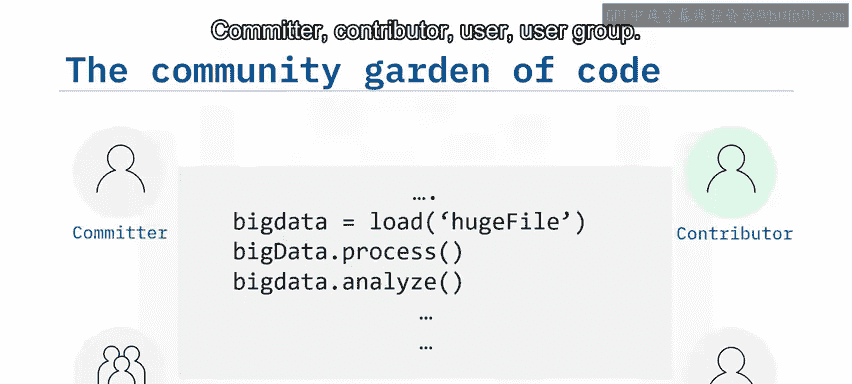

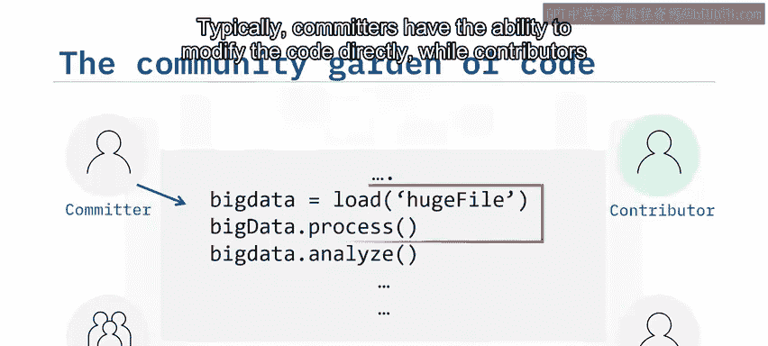

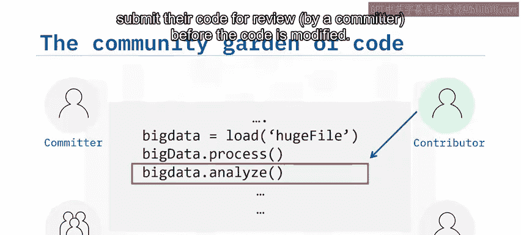

以下是项目中的主要角色：

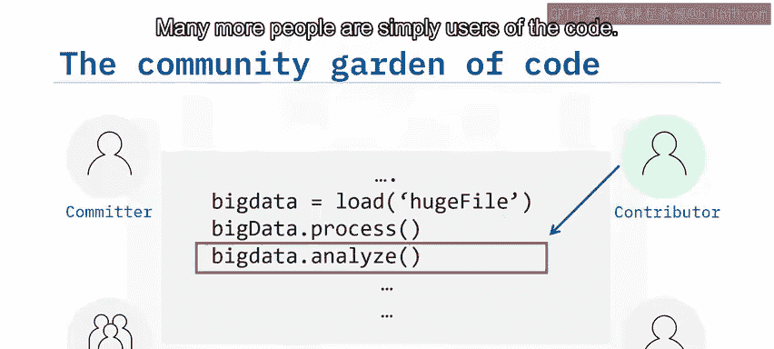

*   **提交者**：通常拥有直接修改代码的能力。
*   **贡献者**：在代码被修改前，需将其提交的代码交由提交者审查。
*   **用户/用户群**：更多的人仅仅是代码的使用者。

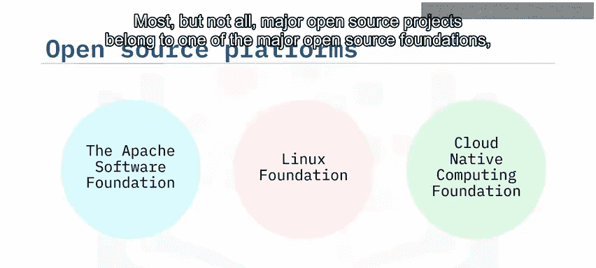

大多数（并非全部）主要的开源项目都属于某个主要的开源基金会，并遵循类似的治理程序。开源意味着代码可以自由查看，这是与专有软件的重要区别。然而，开放治理才是使项目真正开放和民主的原因。开源基金会规定了开源开发以及开放治理的最佳实践。

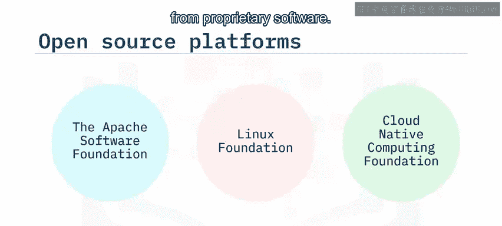

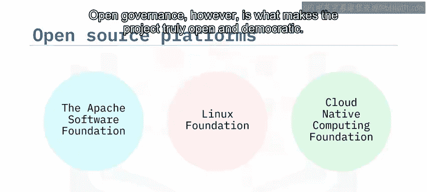

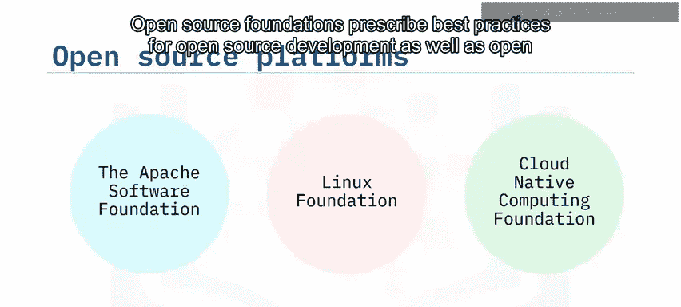

## 核心大数据开源框架：Hadoop生态系统 🗂️

迄今为止，大数据最大的组成部分是Hadoop项目及其三个主要组件：**MapReduce**、Hadoop文件系统**HDFS**和资源管理器**YARN**。

*   **MapReduce**：这是一个允许编写代码以在Hadoop集群上大规模运行的框架。它仍在使用，但不如Apache Spark等更现代的大数据计算框架那样广泛。
*   **HDFS**：这是存储和管理大数据文件的文件系统。它处理与大型分布式数据集相关的所有问题，包括容错性和分区。它仍然是行业的中流砥柱，全球70%的大数据存储在HDFS上。更现代的分布式存储方法（如S3和对象存储）正在投入使用，但它们都基于HDFS的设计原则。
*   **YARN**：这是Hadoop自带的资源管理器，也是包括Hive和Spark在内的大数据应用程序的默认资源管理器。它是当今使用的最健壮的资源管理器之一，但更现代的基于容器的资源管理器（如Kubernetes）正逐渐成为新的事实标准。

综上所述，这些是Hadoop生态系统的主要组件，大多数大数据应用程序都构建在它们之上。

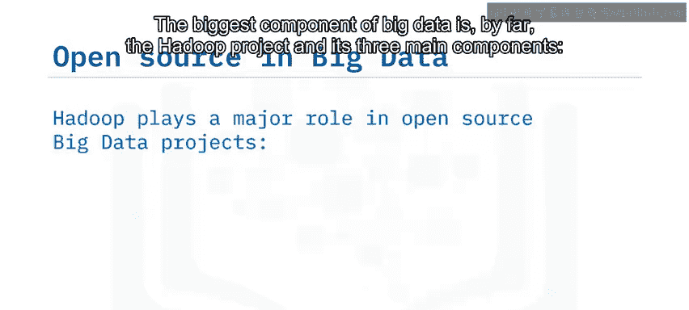

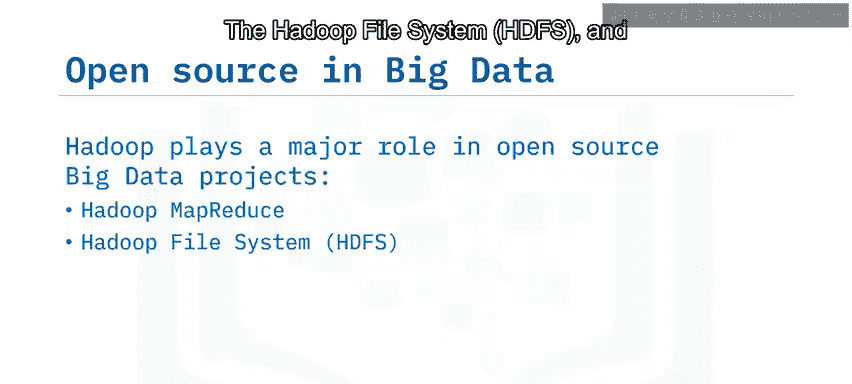

## 构建在Hadoop之上的大数据应用 🛠️

可供用户使用的大数据应用程序种类繁多，令人眼花缭乱。它们都构建在基本的Hadoop框架之上，或以某种方式与之交互。

例如，像**Hive**和**Spark**这样的框架支持在Hadoop系统上进行大量的ETL（提取、转换、加载）和计算任务。

一些与Hadoop生态系统紧密集成的系统包括**Apache HBase**，它是一个大型的NoSQL数据存储。它在Hadoop生态系统之外管理存储和计算资源，但通常驻留在同一集群上。

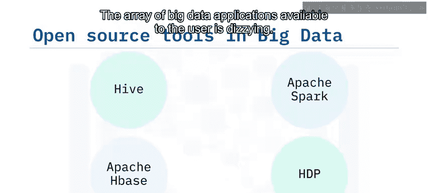

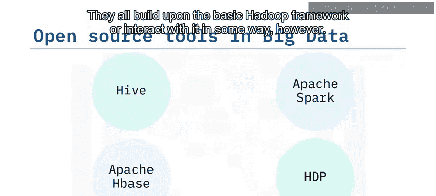

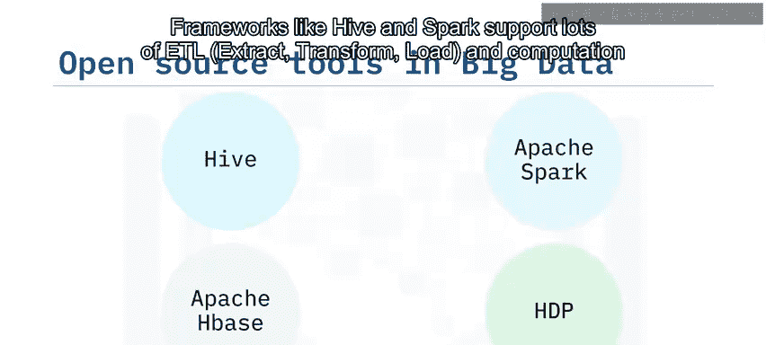

像**Hortonworks数据平台**这样的开源软件包提供了一组已经配置好可以协同工作的大数据工具，并包含了大多数重要的开源包，如Hadoop、Spark、Hive、HBase等。

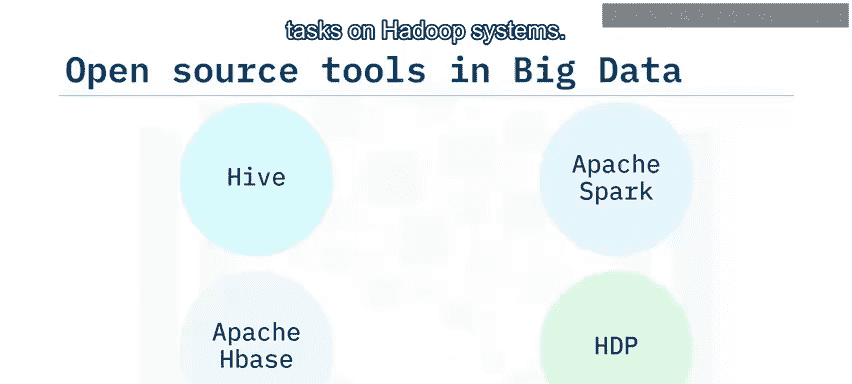

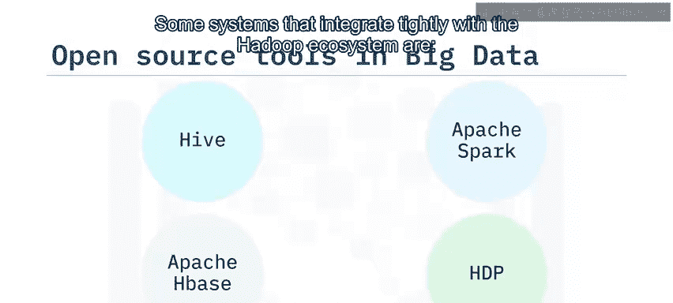

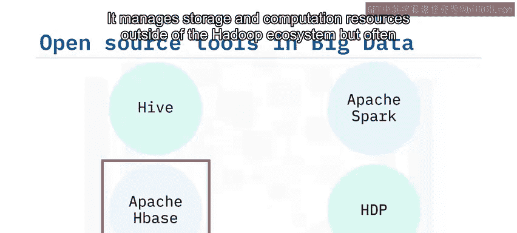

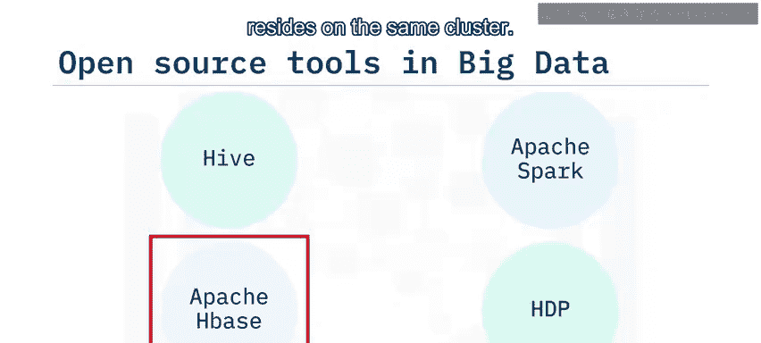

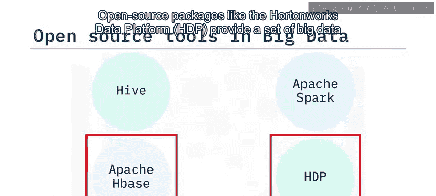

## 总结 📝

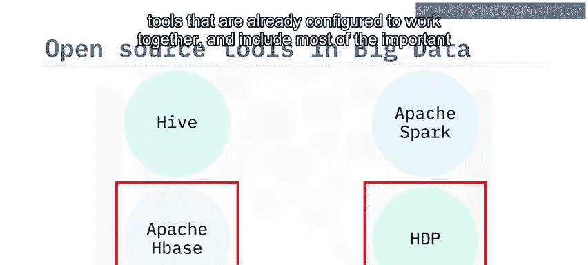

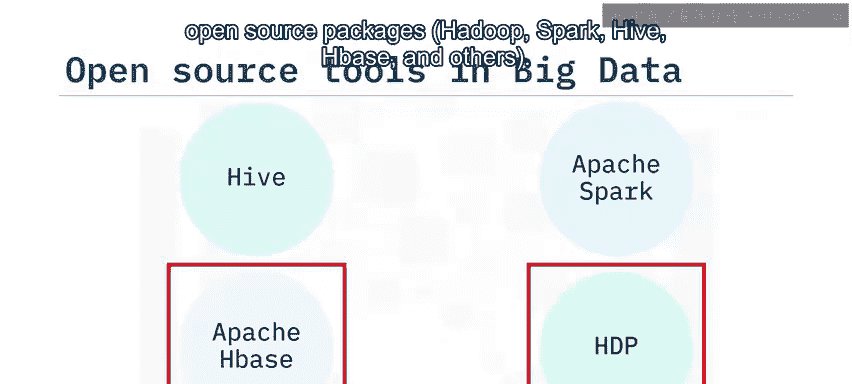

本节课中，我们一起学习了开源在大数据世界中的核心地位。

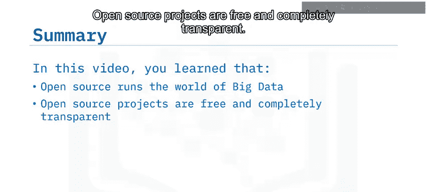

我们了解到开源项目是免费且完全透明的。大数据最大的组成部分是Hadoop项目，包括MapReduce、HDFS和YARN。此外，开源社区还提供了像Apache Hive和Apache Spark这样强大的大数据工具。理解这些开源组件及其关系，是构建和操作现代大数据解决方案的基础。