# IBM数据工程专业证书 课程12：《使用Spark进行数据工程和机器学习》｜P7：使用Spark ML进行聚类分析 🧩


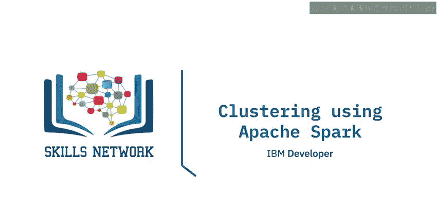

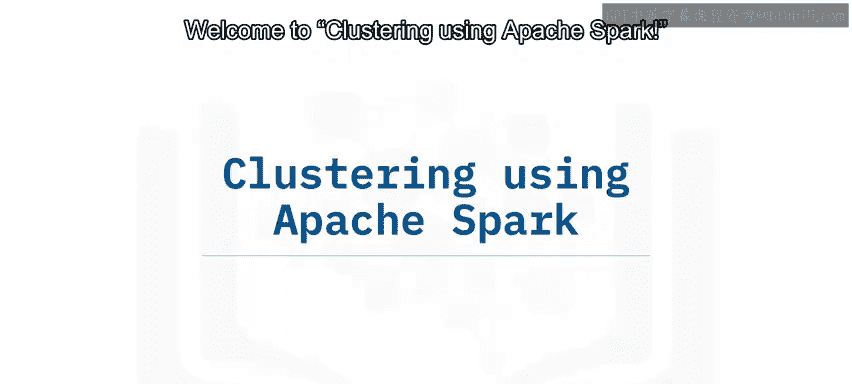

在本节课中，我们将要学习无监督学习中的聚类分析，并了解如何使用Apache Spark的MLlib库来应用K-means聚类算法。

---

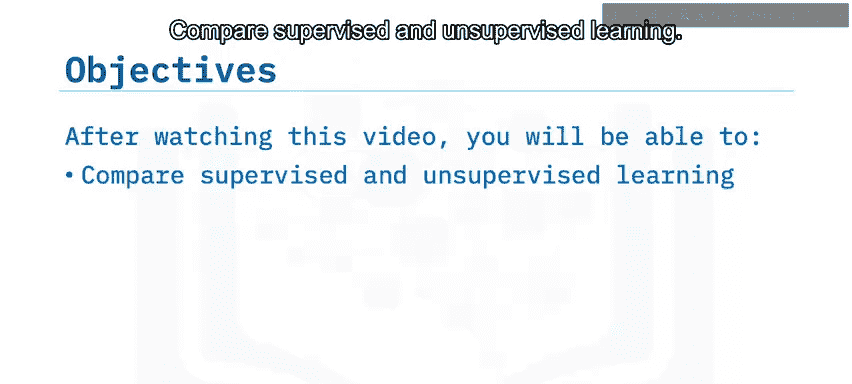

## 概述：监督学习与无监督学习

上一节我们介绍了监督学习的基本概念。本节中，我们来看看机器学习的另一个重要分支——无监督学习。

顾名思义，无监督学习不涉及任何监督。与监督学习不同，无监督学习不使用由特征映射到标签构成的显式标记数据集来训练模型。相反，模型会自动学习数据中的模式和分组（也称为潜在空间）。无监督学习通常比监督学习更高级、更复杂。无监督学习的例子包括聚类算法和推荐系统。

---

## 什么是聚类分析？ 🧮

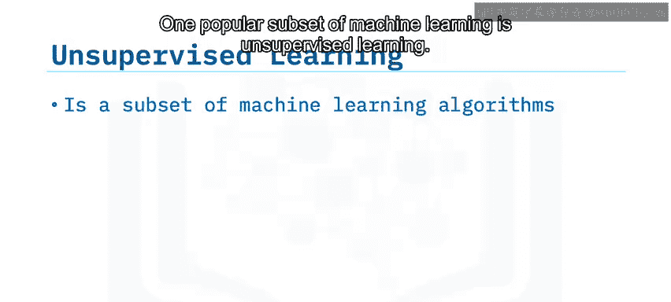

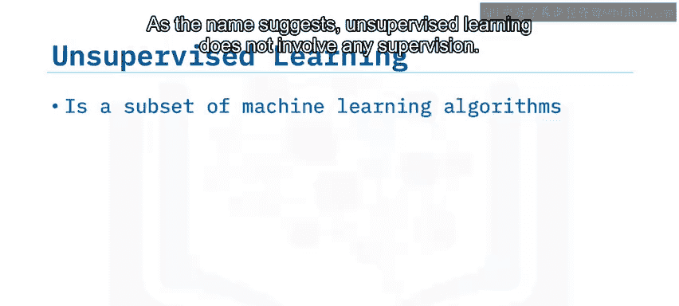

聚类分析是一种无监督机器学习技术，用于预测数据集中的簇。

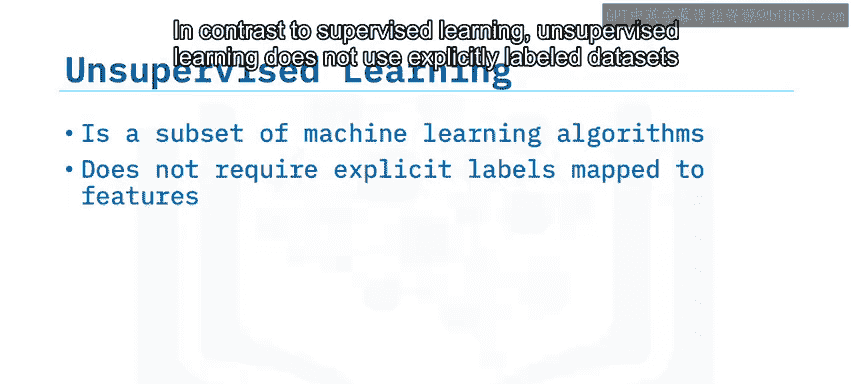

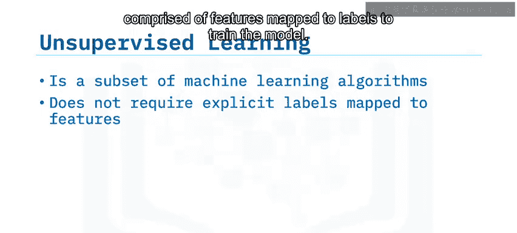

在聚类分析中，机器学习模型试图将数据集划分为簇或组。同一个簇内的所有元素都具有相似的特征。

---

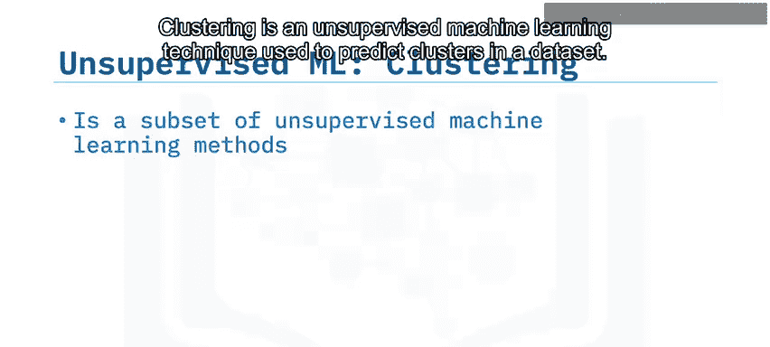

## Spark如何支持聚类分析？

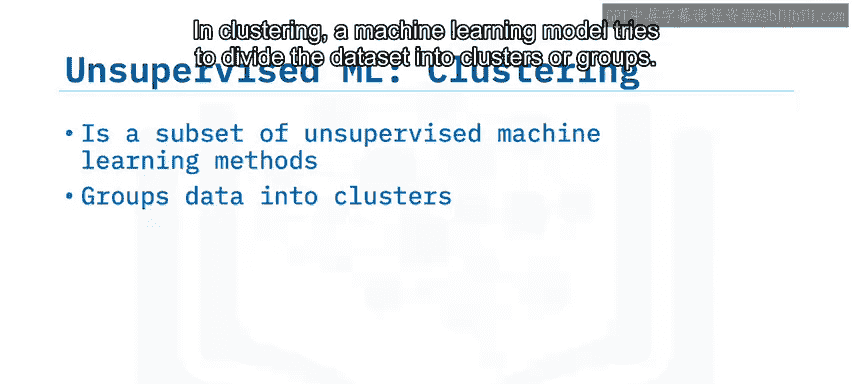

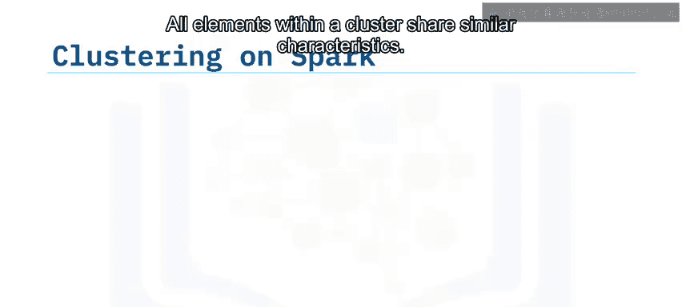

Spark MLlib提供了一个聚类库，其中包含了常用的聚类算法。

以下是Spark MLlib支持的部分算法：
*   **K-means**
*   **潜在狄利克雷分配**
*   **高斯混合模型**

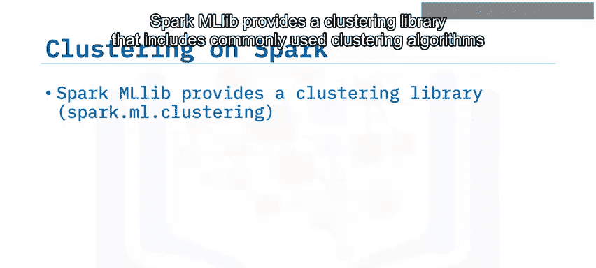

---

## 实践：使用Spark MLlib进行K-means聚类

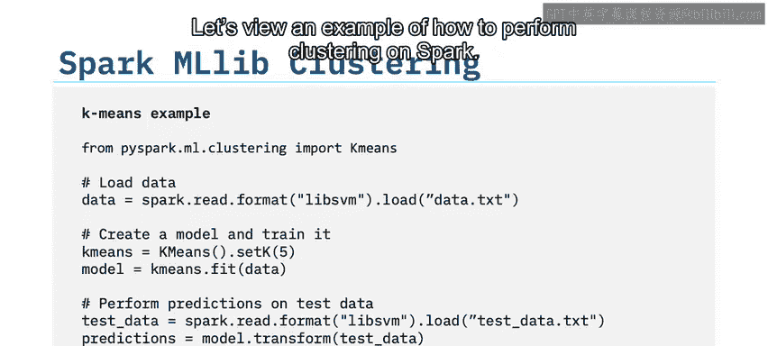

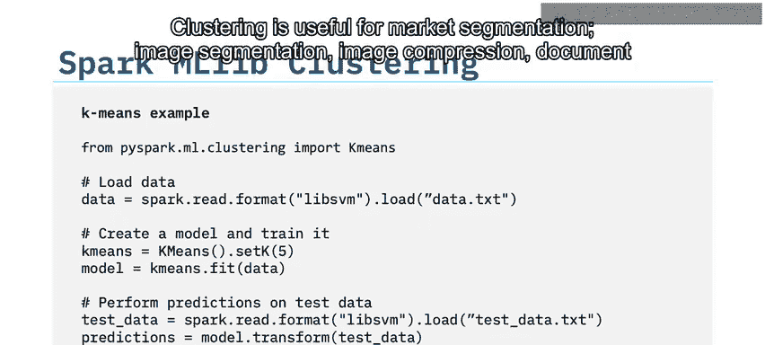

让我们通过一个例子来了解如何使用Spark执行聚类分析。聚类分析可用于市场细分、图像分割、图像压缩、基于主题的文档聚类等任务。

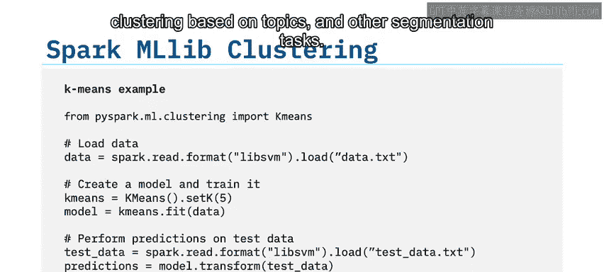

### 1. 导入库

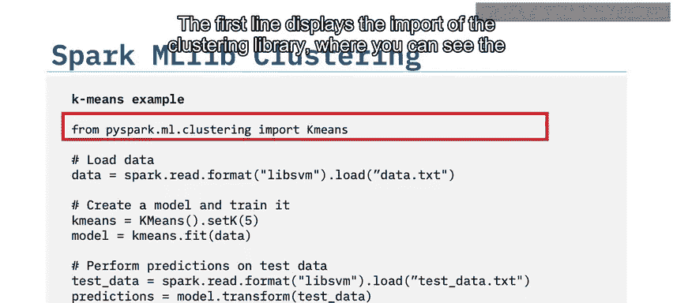

第一步是导入Spark MLlib中的聚类库。以下代码展示了如何导入K-means算法。

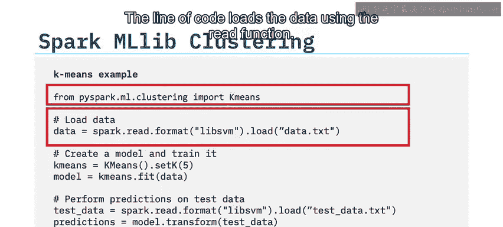

```python
from pyspark.ml.clustering import KMeans
```

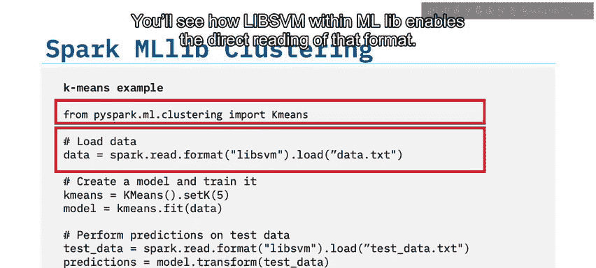

### 2. 加载数据

接下来，使用`read`函数加载数据。MLlib的`LibSVM`模块支持直接读取该格式的数据。

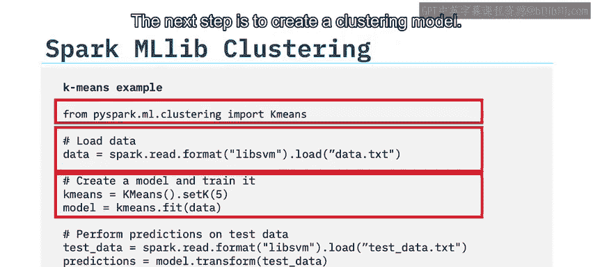

```python
dataset = spark.read.format("libsvm").load("data/mllib/sample_kmeans_data.txt")
```

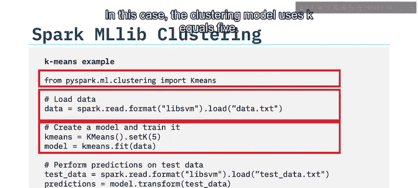

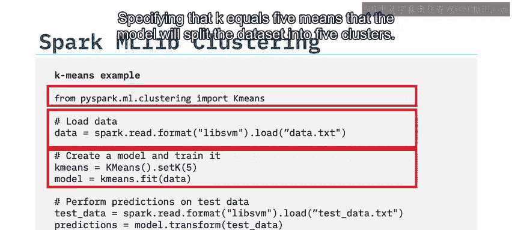

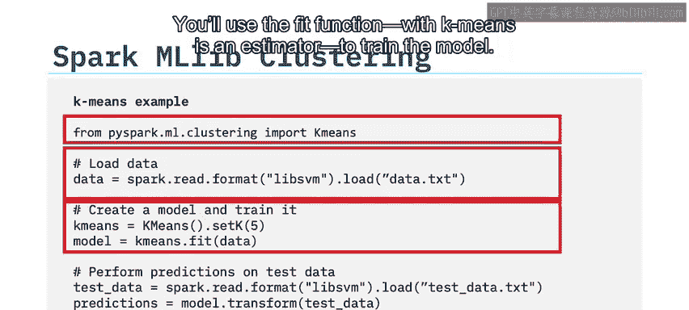

### 3. 创建并训练模型

下一步是创建聚类模型。在这个例子中，聚类模型使用`K=5`。指定`K=5`意味着模型将把数据集分成5个簇。使用`KMeans`作为估计器，并调用`fit`函数来训练模型。

```python
kmeans = KMeans().setK(5).setSeed(1)
model = kmeans.fit(dataset)
```

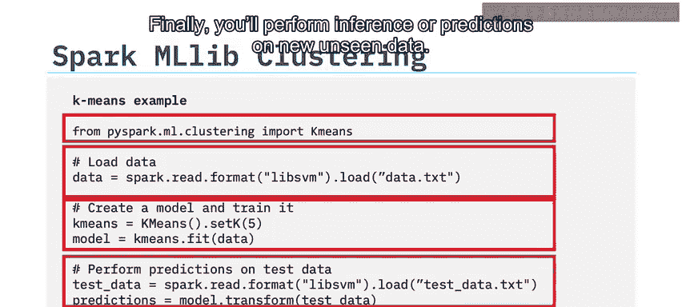

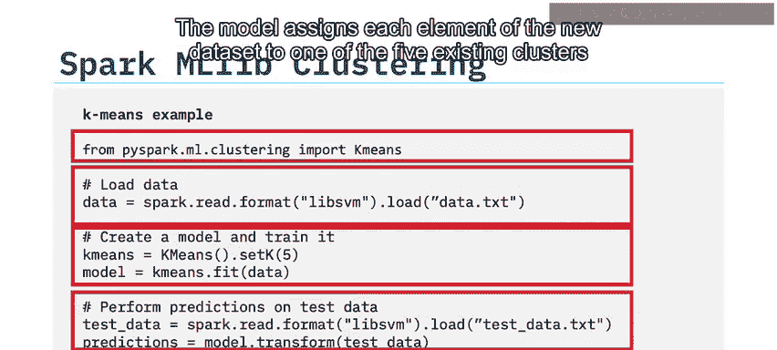

### 4. 进行预测

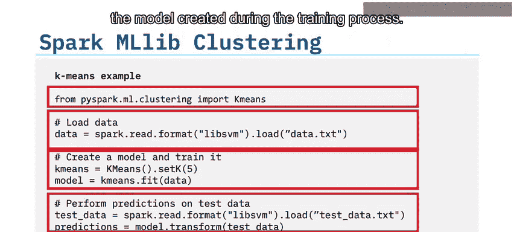

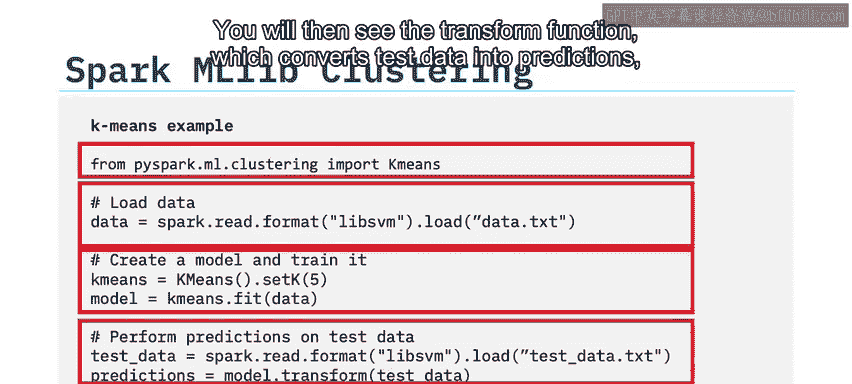

最后，对新的、未见过的数据进行推理或预测。模型会将新数据集的每个元素分配到训练过程中创建的五个现有簇中的一个。使用`transform`函数将测试数据转换为预测的簇分配。

```python
predictions = model.transform(test_data)
```

---

## 总结 🎯

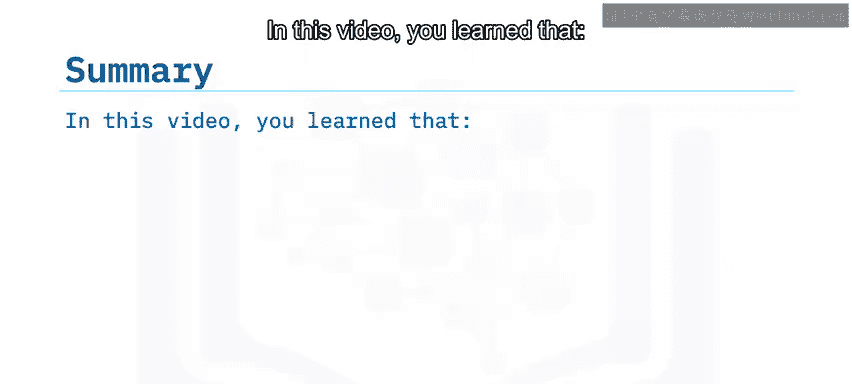

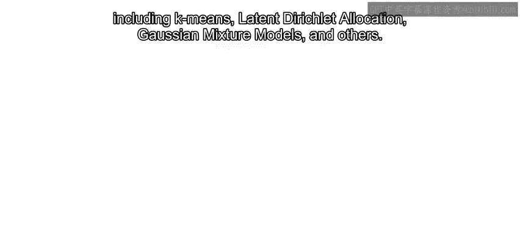

本节课中，我们一起学习了以下内容：
*   无监督学习不使用由特征映射到标签构成的显式标记数据集来训练模型。
*   聚类分析是无监督学习的一种类型，它将具有相似特征的数据分组到簇中。
*   Spark MLlib聚类库支持多种常用聚类算法，包括K-means、潜在狄利克雷分配和高斯混合模型等。