# IBM数据工程专业证书 课程11：《使用Spark和Hadoop进行大数据介绍》｜P7：超越炒作 🚀

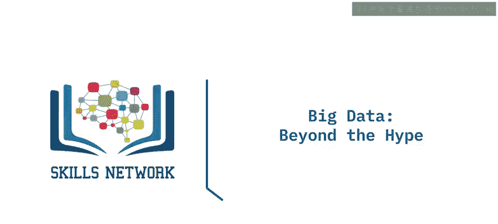

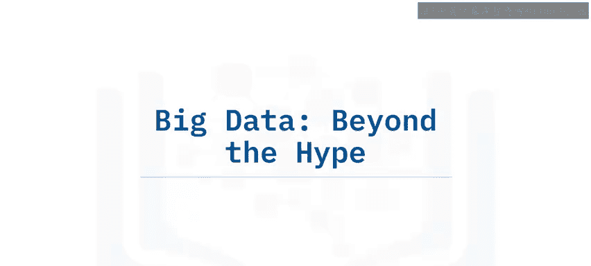

在本节课中，我们将学习关于大数据的基本事实，了解大数据的主要来源，解释不同类型的大数据，并描述云计算在大数据领域的重要贡献。

## 为什么大家都在谈论大数据？📈

观看本节视频后，你将能够描述关于大数据的事实。

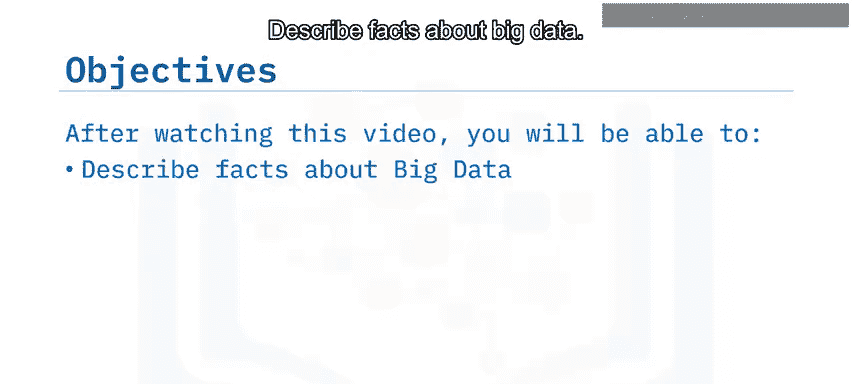

过去两年产生的数据量超过了人类历史上所有数据的总和。

预计到2026年，全球每年产生的数据量将增长40%。

届时，新产生的数字数据量将超过数字存储技术诞生以来所有数据总量的两倍。

右侧图表显示了全球数据量以泽字节（Zettabytes）为单位的增长趋势。

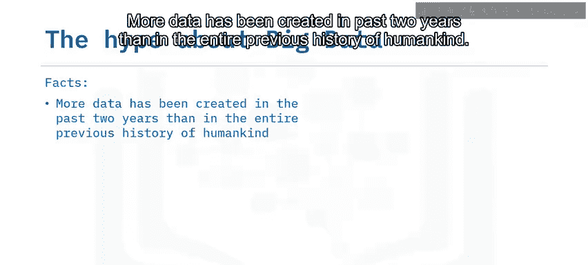

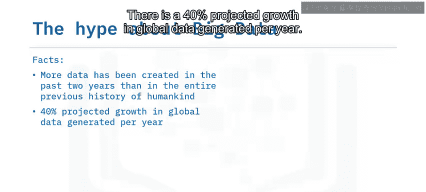

## 大数据的三大主要来源

上一节我们了解了数据量的爆炸式增长，本节中我们来看看这些数据主要来自哪里。大数据主要有三个来源。

以下是三大主要来源的详细说明：

*   **社交数据**：来源于点赞、推文和转发、评论、视频上传以及通过全球流行的社交媒体平台上传和分享的一般媒体内容。
*   **机器生成数据与业务生成数据**：这是组织在其自身运营中产生的数据。机器数据定义为由物联网（IoT）传感器、配备传感器的工业设备、安装在机械中的装置，甚至追踪用户行为的网络日志所生成的信息。
*   **交易数据**：来源于线上和线下发生的所有日常交易，例如发票、付款订单、存储记录、交货收据。

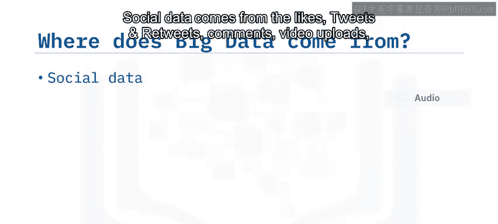

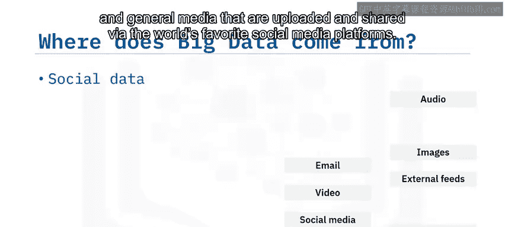

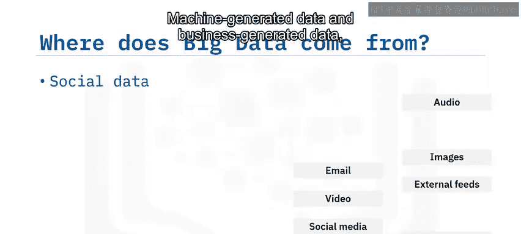

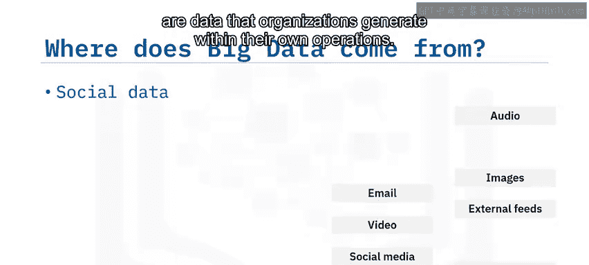

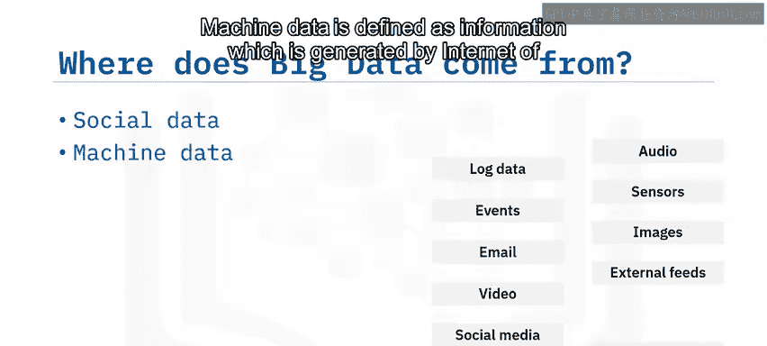

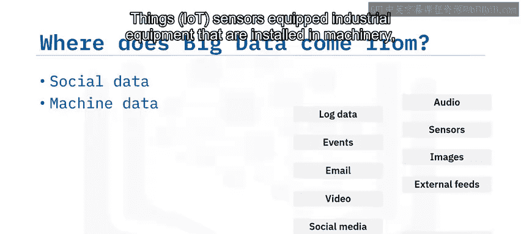

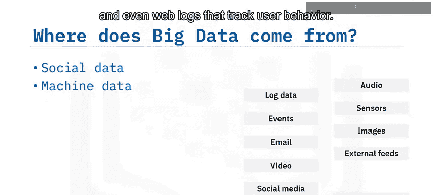

## 大数据的三种类型

了解了数据来源后，我们来看看数据本身的结构。大数据主要分为三种类型。

以下是三种数据类型的定义和示例：

*   **结构化数据**：指经过组织、标记并具有预定义数据模型，符合表格格式的数据。
    *   **常见示例**：姓名、日期、地址和信用卡号。
    *   **特点**：易于使用如 **`SQL`** 等编程语言进行查询。
*   **非结构化数据**：据说占全球数据的80%左右，不符合任何预定的格式。
    *   **常见示例**：图像、音频或视频文件、物联网设备的传感器数据、短信和社交媒体帖子。
*   **半结构化数据**：包含结构化和非结构化数据的成分，它大部分是非结构化的，但包含一些标识特定特征的元数据。
    *   **常见示例**：电子邮件属于半结构化数据类别，因为虽然电子邮件的内容通常是非结构化的，但存在几个特征，如电子邮件地址、主题行、徽标图像和URL，这些可以被提取到结构化表格中。

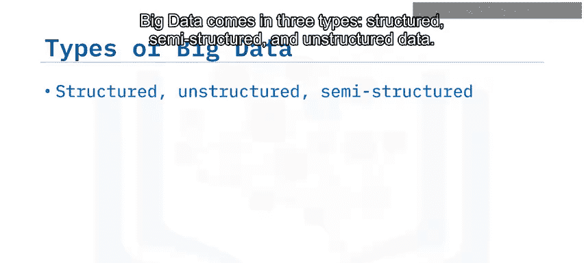

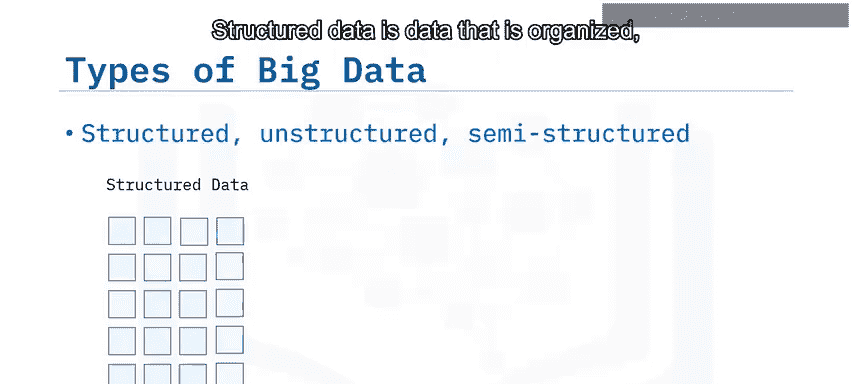

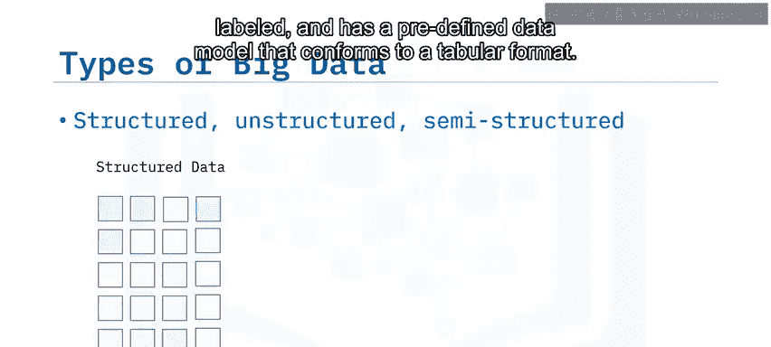

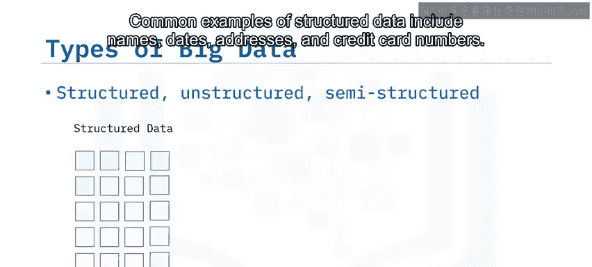

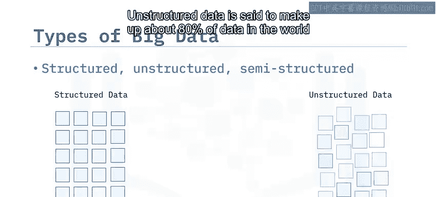

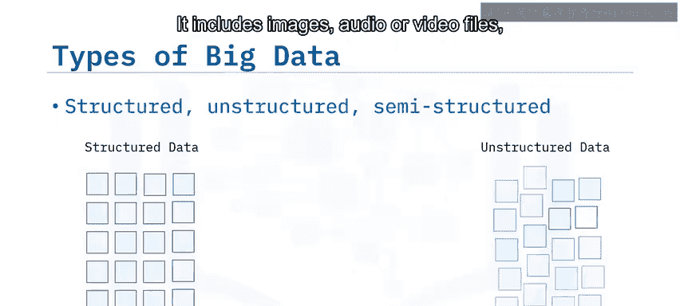

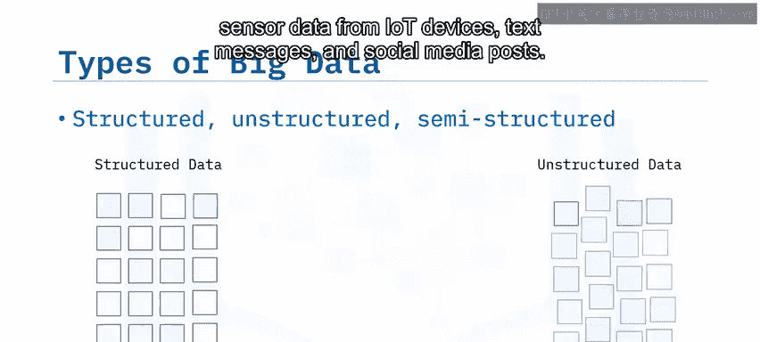

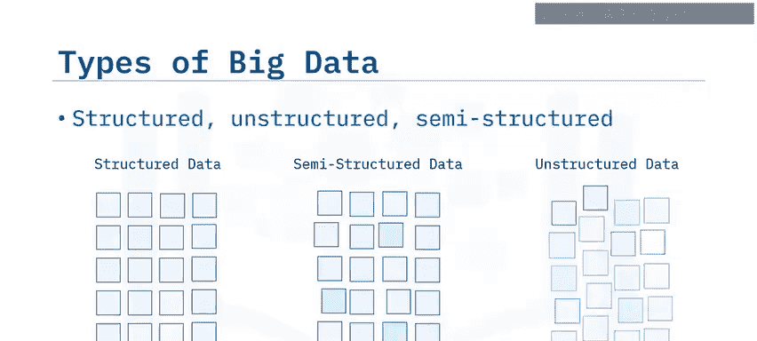

## 结构化大数据的来源

对于结构化数据，其来源通常具有明确的组织形式。

以下是结构化大数据的一些常见来源：

*   **关系型数据库**：如 MySQL, PostgreSQL。
*   **电子表格**：如 Excel 文件。
*   **特点**：使用这种结构，我们知道数据如何与其他数据关联、数据的含义，并且可以轻松使用 **`SQL`** 等语言进行查询。

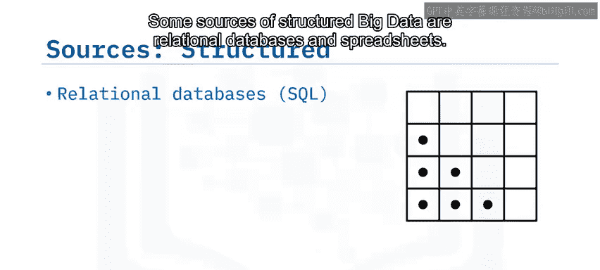

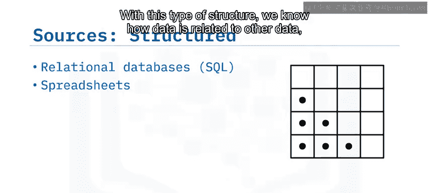

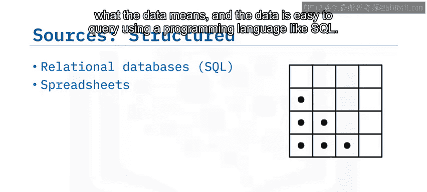

## 半结构化大数据的来源

半结构化数据虽然不完全规整，但包含一定的标记信息。

以下是半结构化大数据的一些常见来源：

*   **XML 文件**：使用标签定义数据层次。
*   **JSON 文件**：使用键值对和嵌套结构组织数据。
*   **特点**：这些数据源使用标签或其他标记来强制数据内的记录和字段的层次结构。

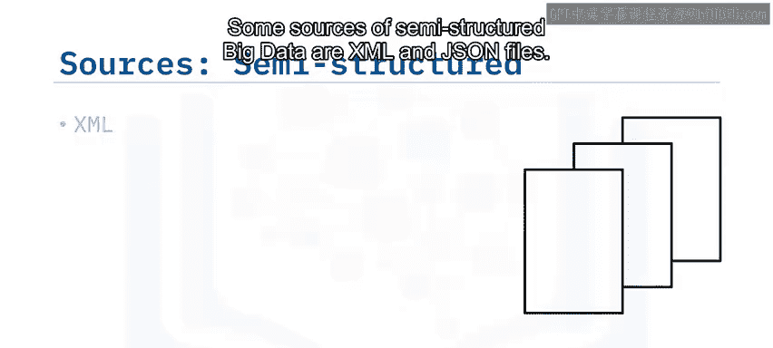

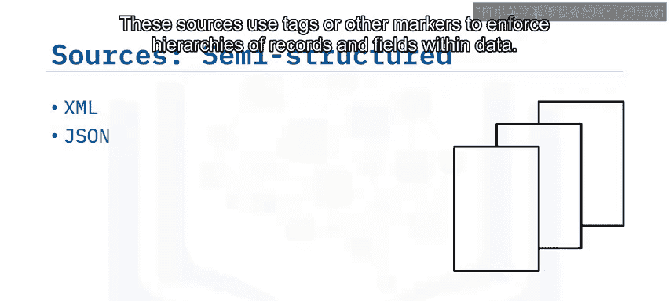

## 非结构化数据的爆炸式增长

目前，来自互联网活动，特别是视频制作和消费以及社交媒体活动的数据正在爆炸式增长。

随着网速的提高以及全球越来越多的人能够访问互联网，这些数字将持续增长。

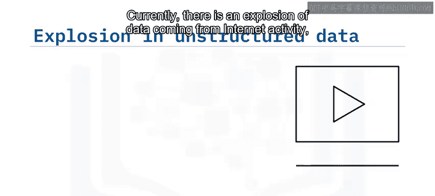

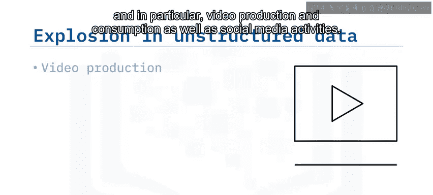

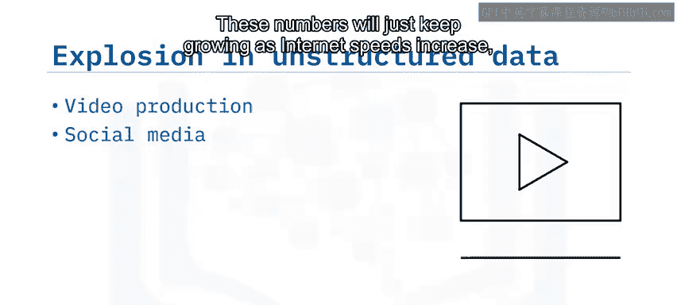

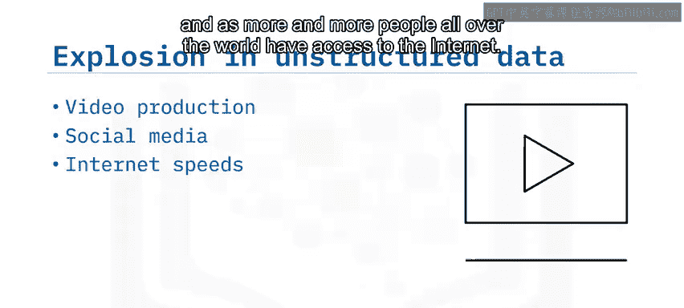

## 云计算的贡献 ☁️

处理如此海量且多样的数据需要强大的计算能力。云计算的出现在很大程度上推动了大数据时代的启动。

云计算允许用户通过互联网访问高度可扩展的计算和存储资源。

通过使用云计算，公司可以根据需要使用服务器容量，并迅速扩展到处理大数据集和运行复杂数学模型所需的大规模。

云计算降低了大数据分析的成本，因为资源在许多用户之间共享，用户只需为他们实际使用的容量付费。

😊

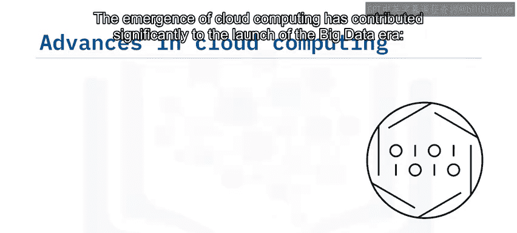

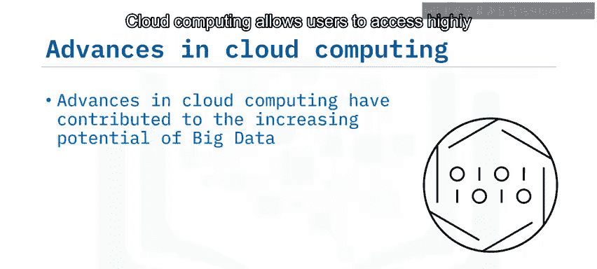

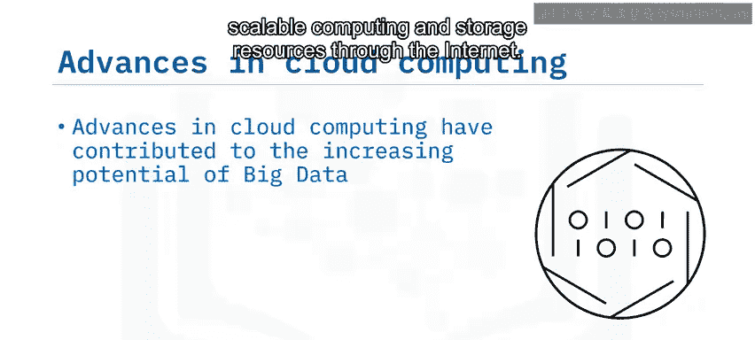

## 总结

本节课中，我们一起学习了以下核心内容：

*   大数据正以指数级速度增长。
*   数据类型包括社交、机器和交易生成的数据。
*   大数据以结构化、非结构化和半结构化的形式被收集。
*   云计算的进步促进了大数据潜力的不断增长。

😊

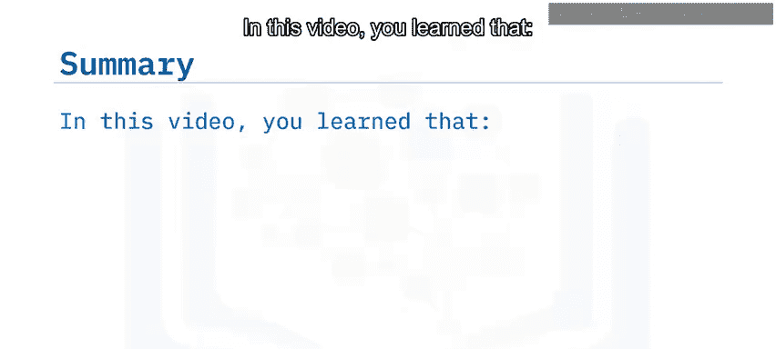

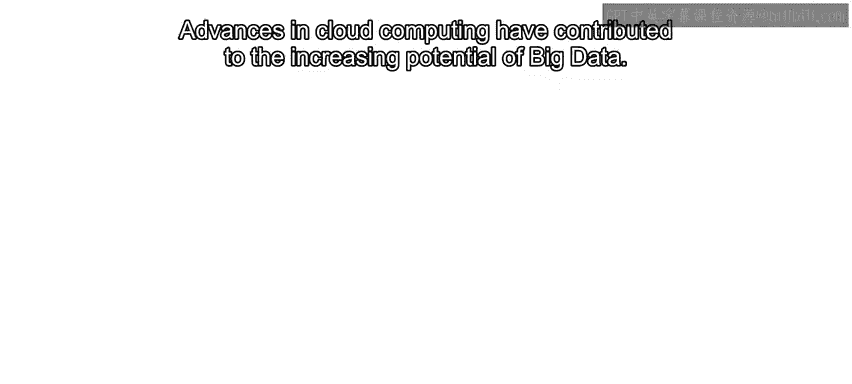

