# IBM数据工程专业证书 课程11：《使用Spark和Hadoop进行大数据介绍》｜ 第8讲：大数据用例 🚀

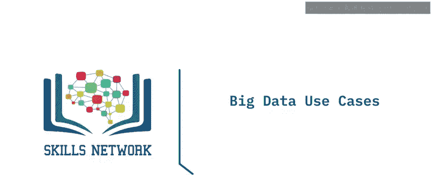

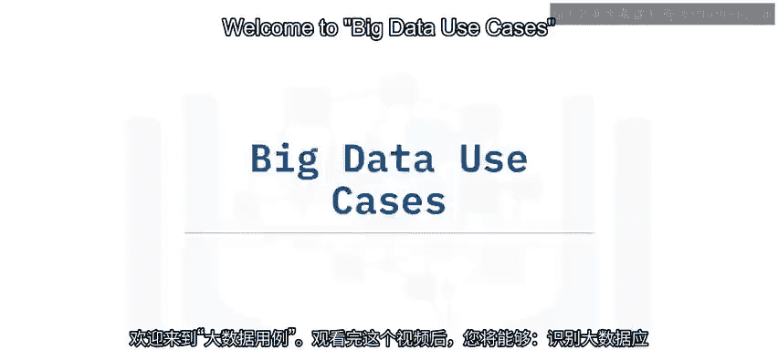

欢迎来到大数据用例课程。

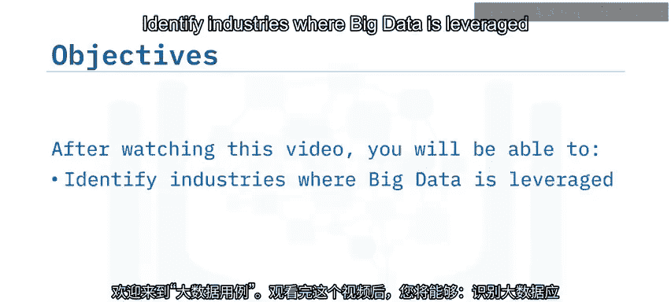

在本节课中，我们将要学习识别哪些行业正在利用大数据，并讨论和概述大数据在关键行业中的具体应用。

观看本视频后，你将能够识别利用大数据的行业，并讨论和概述大数据在关键行业中的使用情况。

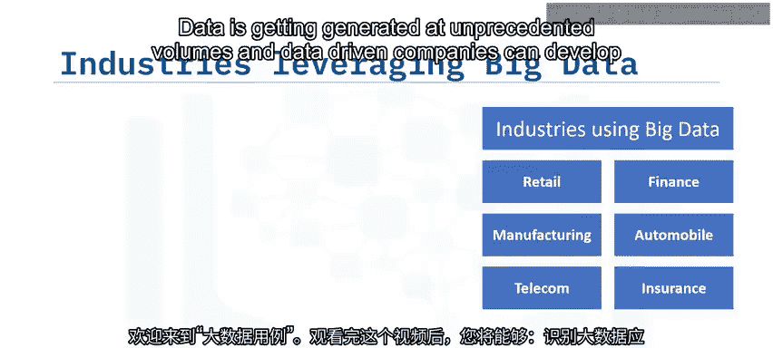

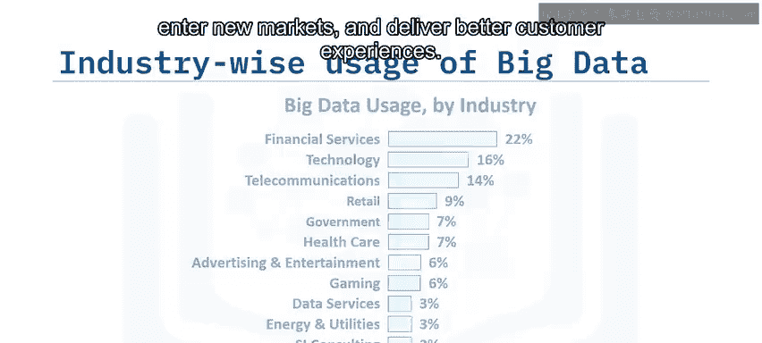

数据正以前所未有的规模生成。如果能够有效地聚合和分析数据以产生突破性的见解，数据驱动型公司就能在同行中获得竞争优势。每个主要行业都在利用数据洞察来改进决策、进入新市场并提供更好的客户体验。

观察行业趋势，金融服务、科技和电信公司是大数据的主要使用者，这并不令人意外。目前大部分创新都发生在这几个行业。紧随其后的是零售、政府、医疗保健、广告、娱乐和游戏行业。最后，数据服务、能源和公用事业、系统集成咨询、航运和运输行业构成了利用大数据的顶级行业列表。

现在，让我们来看看一些行业如何利用从大数据分析中获得的见解。

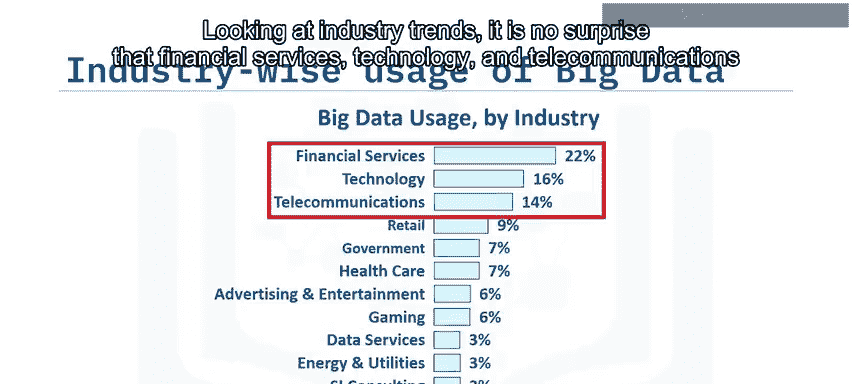

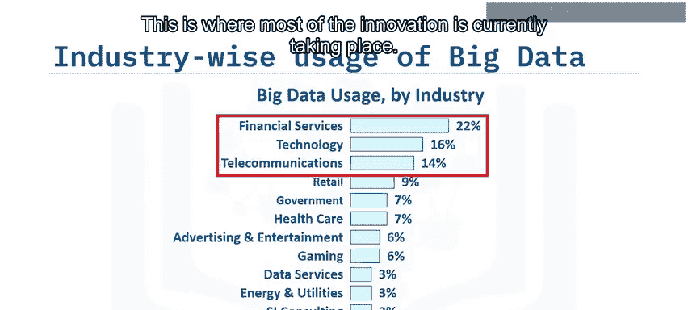

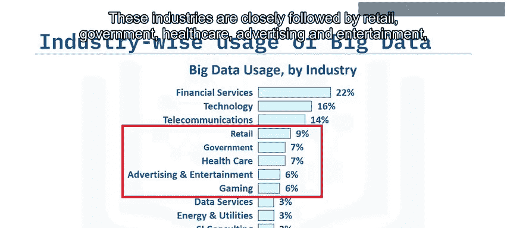

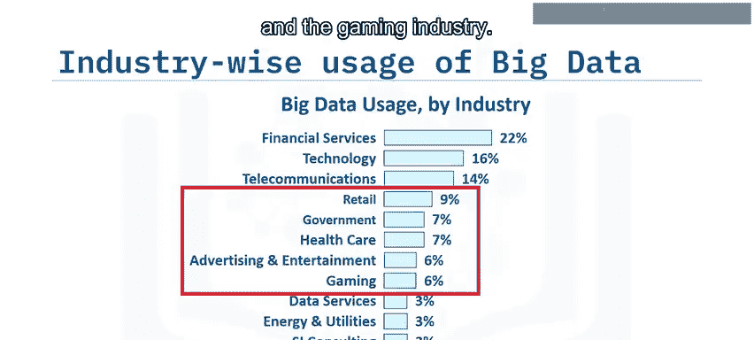

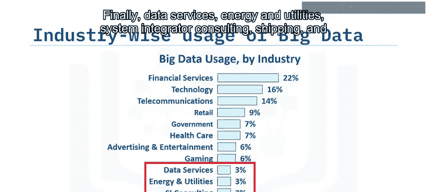

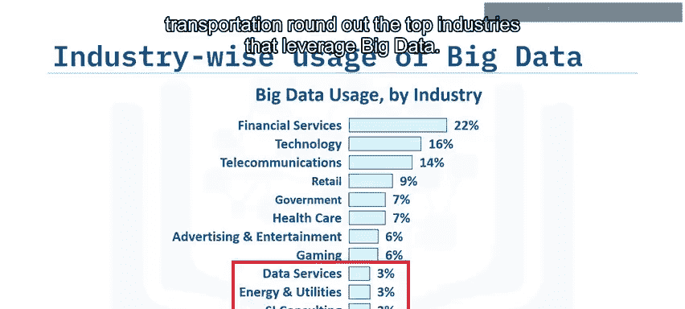

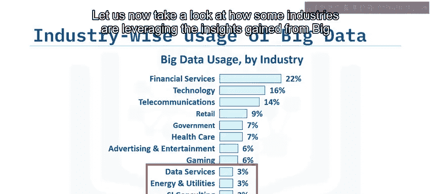

## 零售业 🛒

在零售行业，大数据的主要用途包括价格分析和情感分析。

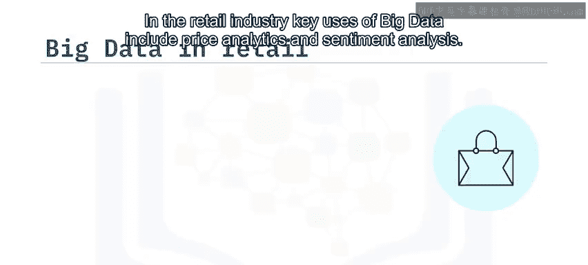

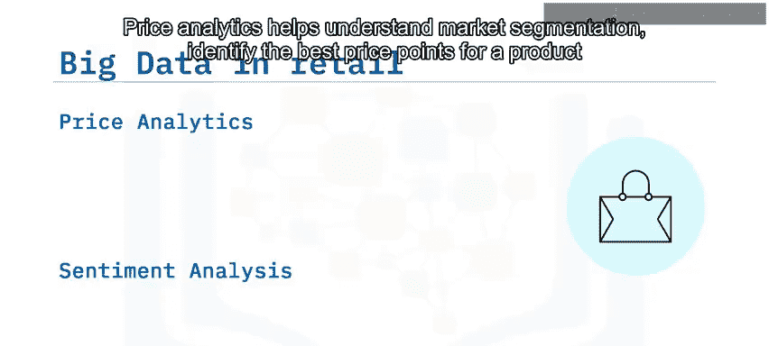

价格分析有助于理解市场细分，为产品线确定最佳价格点，并进行利润分析以实现利润最大化。

另一方面，情感分析利用社交媒体对话来了解消费者对产品的看法，并随后制定有效的营销策略以与客户建立联系。

## 保险业 🛡️

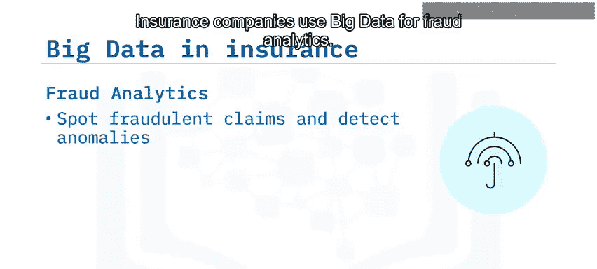

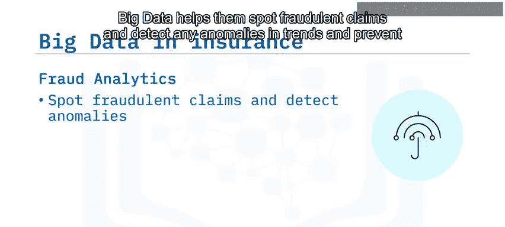

保险公司使用大数据进行欺诈分析。大数据帮助他们发现欺诈性索赔，检测趋势中的异常，并预防可疑活动。

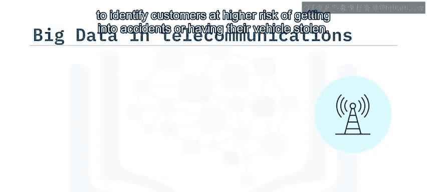

保险公司也使用大数据进行风险评估。例如，他们可能基于用户历史和行为分析使用**预测模型**来识别出事故或车辆被盗风险较高的客户。

## 电信业 📡

电信公司是大数据分析的顶级用户之一。

他们使用大数据来增强网络安全。基于**机器学习**的模式分析可以识别对网络的任何威胁，而预测性维护可以在网络遭受严重损害之前解决这些威胁。

基于用户位置的个性化促销是电信公司利用大数据的另一种方式。例如，如果用户在午餐时间靠近某家特定餐厅，他们可能会收到该餐厅的折扣券，从而提高转化率。

电信公司持续监控其网络的流量模式，这些模式可能很快会影响客户体验。分析会提醒他们何时是升级网络的最佳时机，从而帮助他们集中投资以获得最大回报。

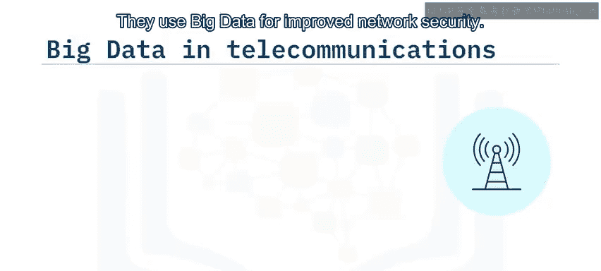

电信公司还基于实时因素运行定价促销。这些促销活动在目标客户群中进行测试，以产生优化的定价套餐。

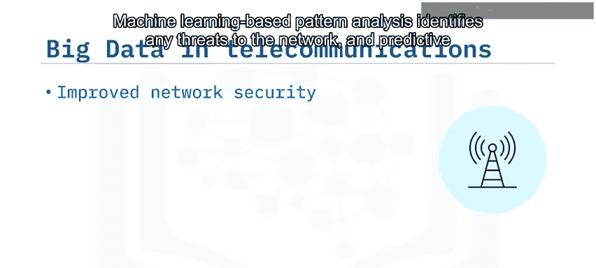

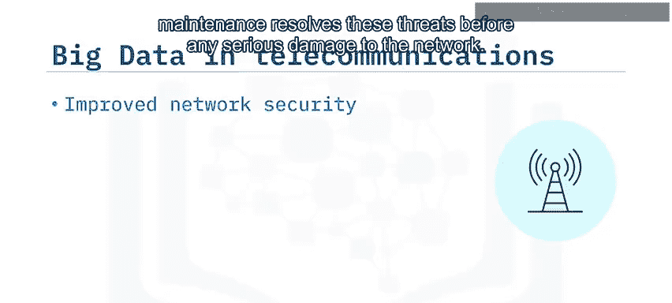

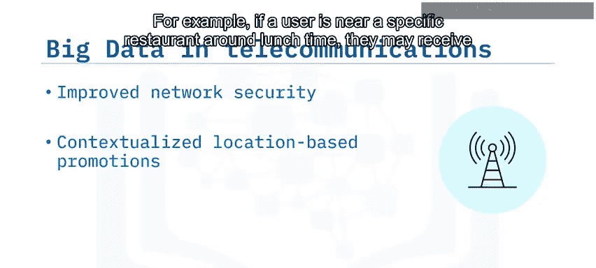

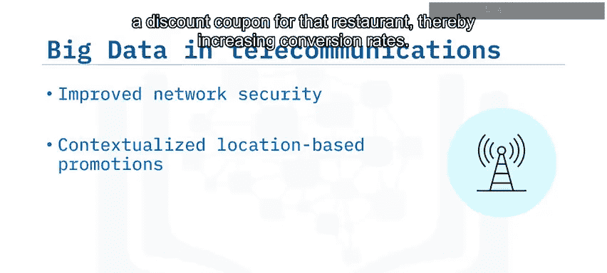

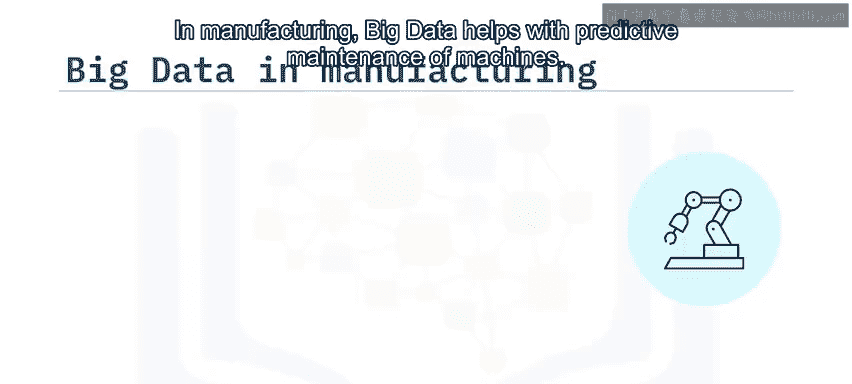

## 制造业 🏭

在制造业中，大数据有助于机器的预测性维护。来自传感器的数据被用来分析设备使用模式，以预测设备故障、维护需求和零件更换。

大数据也用于优化生产，通过使用**AI算法**来理解生产线，并在生产时间超出必要时推荐优化方案。

## 汽车业 🚗

从供应链分析到定向营销、交通管理和保险费率，汽车行业严重依赖大数据。

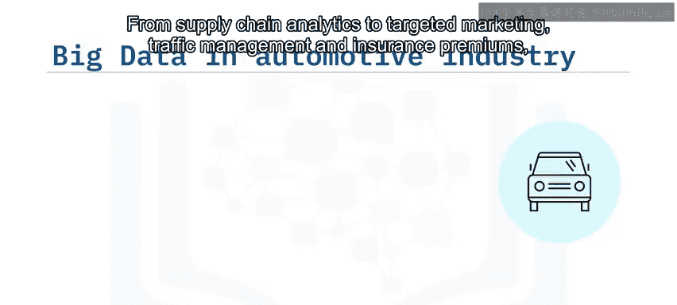

汽车服务是制造商的高收入领域。公司根据传感器数据预测故障并招揽客户进行维修。先发制人的零件订购减少了客户等待时间并提高了客户满意度。

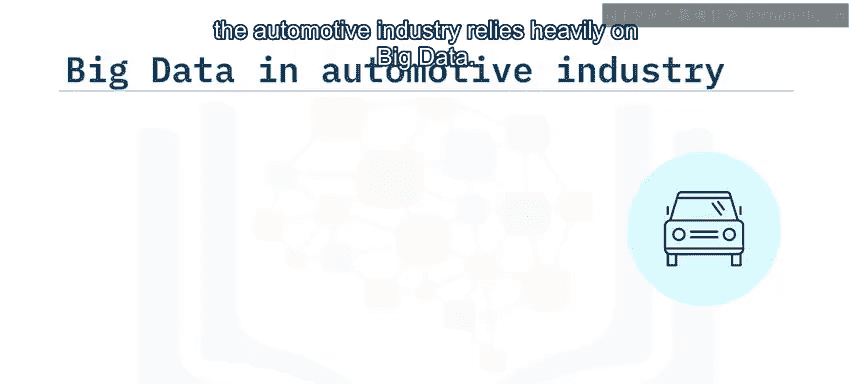

从联网汽车获取的实时数据正在推动自动驾驶汽车和卡车行业的发展。车辆可以根据其不断从周围环境收集的数据，实时调整速度和方向。

## 金融业 💹

与保险公司类似，金融公司使用大数据进行欺诈检测和风险评估。

金融领域大数据的其他用例包括客户细分，通过将客户划分为不同群体，如人口统计特征、交易周期、社交媒体和客户服务互动，公司为客户提供高度个性化和有针对性的解决方案。

算法交易是大数据被广泛应用的另一个主要领域。金融交易通常是时间敏感的，并使用数学预测模型，因此它们是应用机器学习以做出更快且不断改进的决策的完美候选。

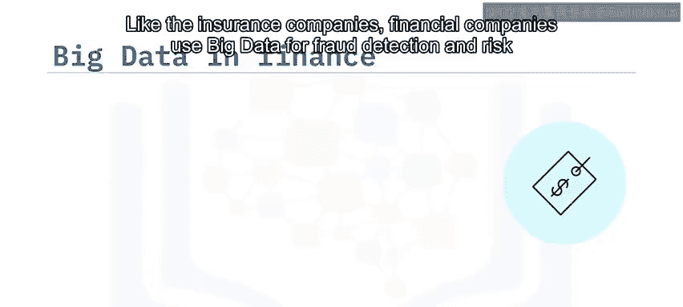

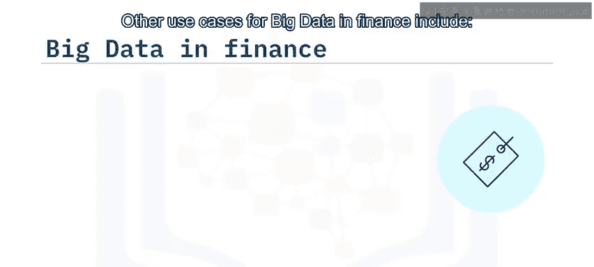

## 总结 📝

在本视频中，你了解到公司正严重依赖大数据来使自己区别于竞争对手。零售、保险、电信、制造、汽车和金融等行业正通过多种方式利用大数据来降低成本、提高客户满意度并做出具有竞争力的商业决策。

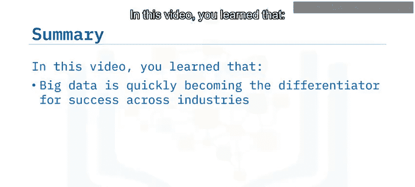

