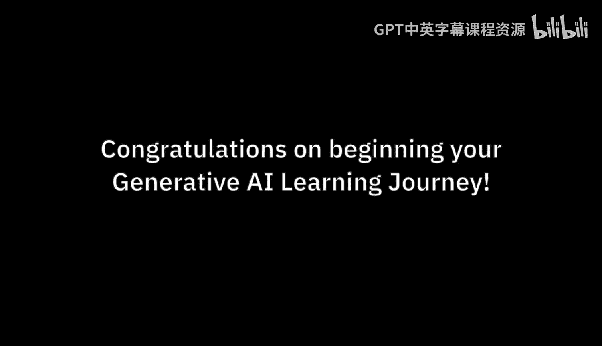
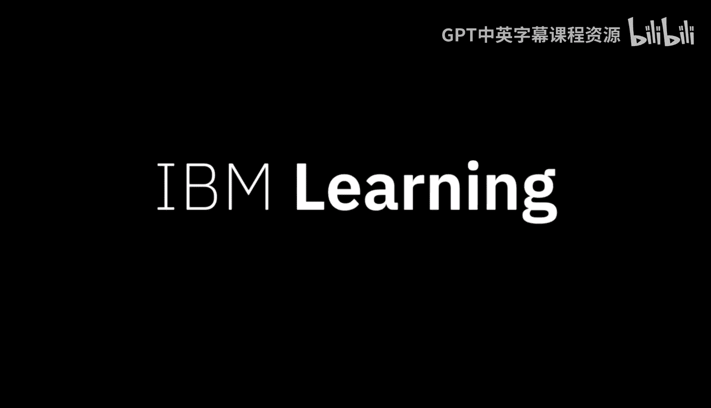

# IBM《生成式AI基础（五课全）｜Generative AI Fundamentals》中英字幕 p02 02_01_02_为何学习IBM生成式AI.zh_en [BV11XSYBfEje_p2]

Generative AI is on the minds of every leader。🎼In every organization， businesses or governments。

 and with interest comes opportunity。Organizations are looking for people who understand the technology。

🎼And most importantly， have the skills to apply it。Unlike many of the previous trending technologies。

Generative AI touches almost every role in every profession。

🎼Generative AI skills are expected to become important， not just for computer scientists。

 for everybody， which is why they will be essential as word processing， spreadsheets。

 even basic business literacy。 This is why these programs are generative AI for everyone。

There's a lot of new interest happening right now in AI。

And businesses are looking beyond consumer AI。A chatbot interface is a great way to demonstrate generative AI potential。

🎼Real life use cases are embedding generative AI into existing processes and making it an integral function of nearly every business workflow。

🎼IBM is proud to be helping businesses integrate generative AI into their operations。

 These are skills you will gain as part of these programs that should help you with your career and make be very applicable to your job instantly。

😊，🎼Businesses are excited by the potential generative AI。

 but they're also apprehensive of potential dangers。

 This mission is too important for me to allow you to jeopardize it。

These programs will give you the skills to deal with AI ethics that are grounded and a responsible approach really started at IBM。

