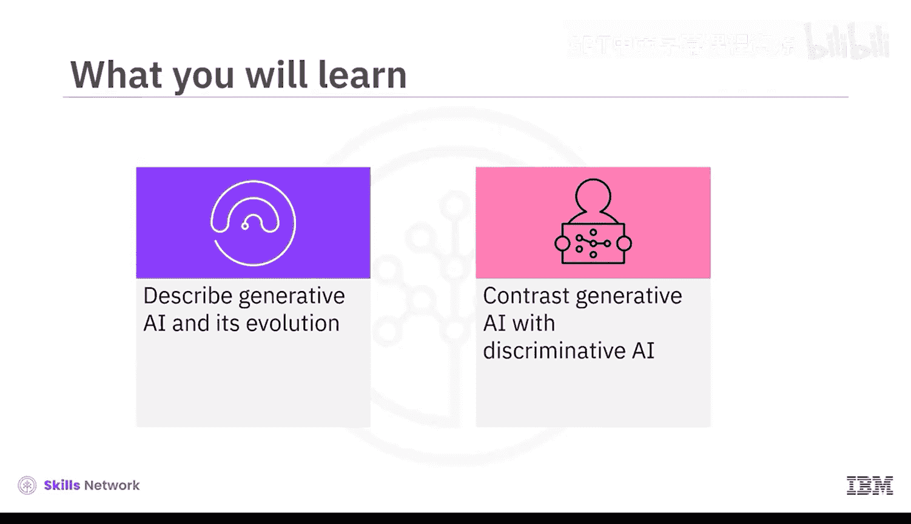
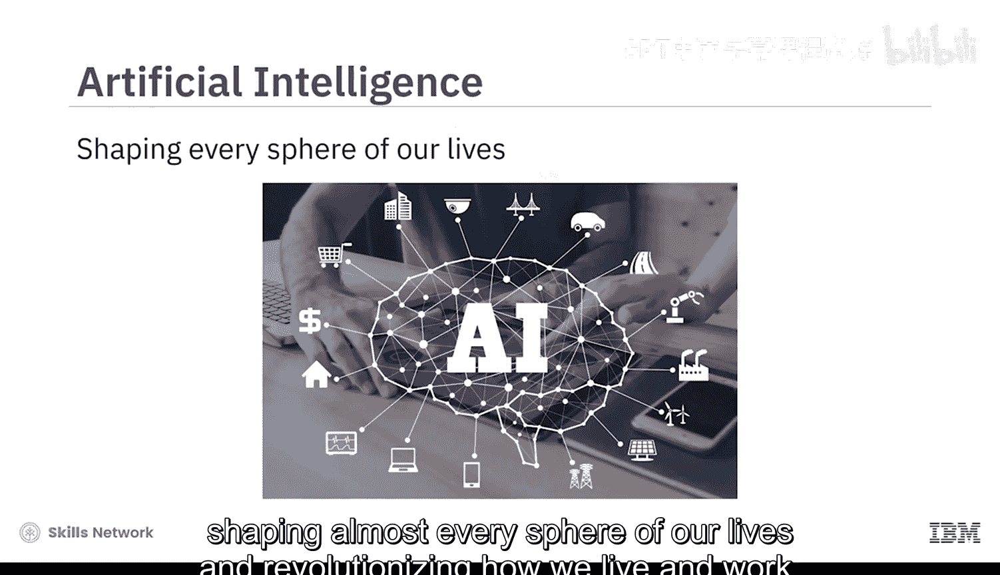
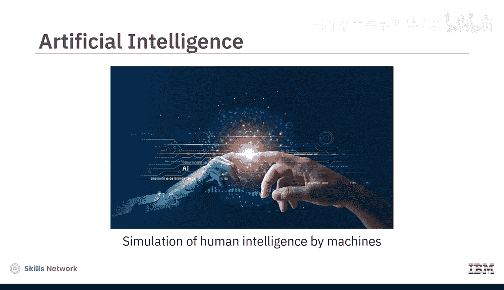
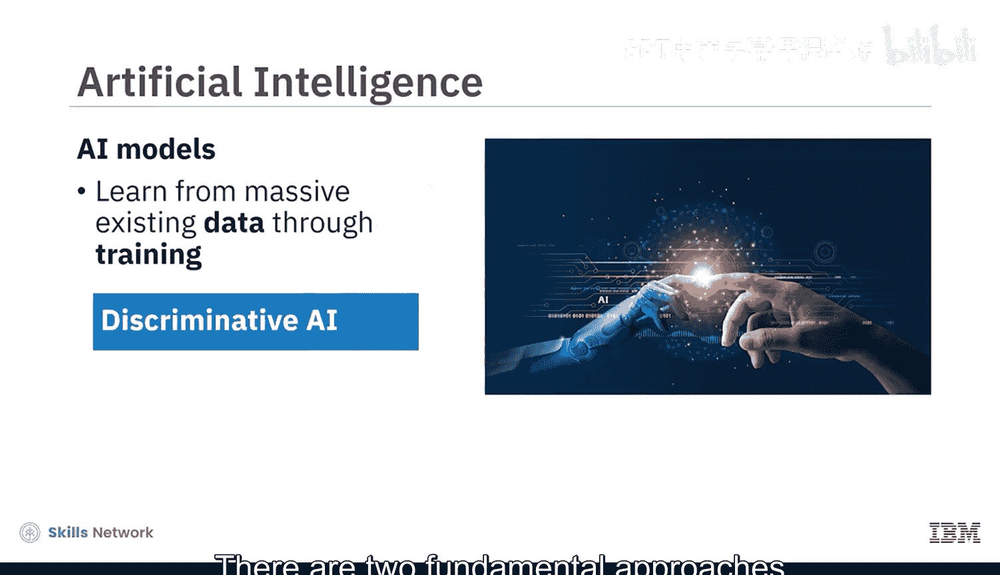
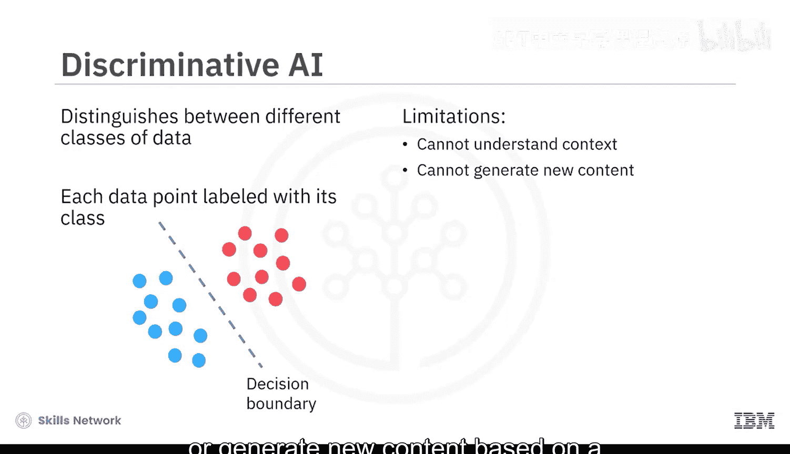
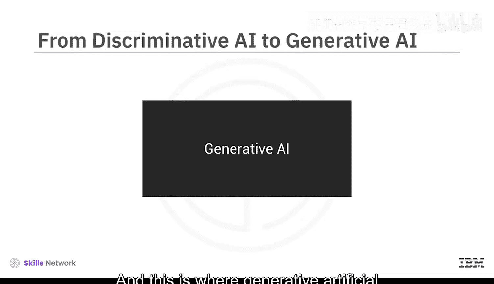
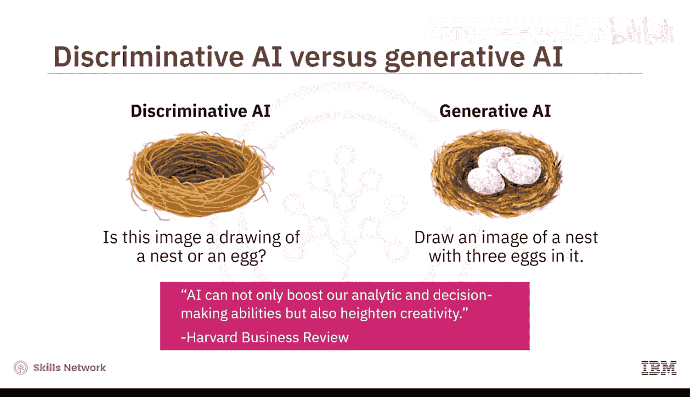
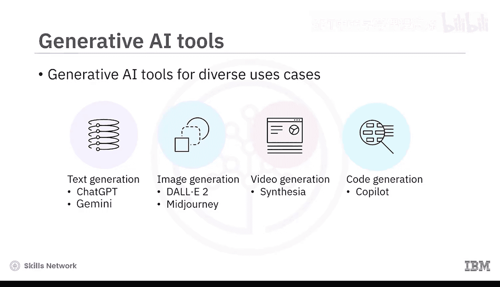
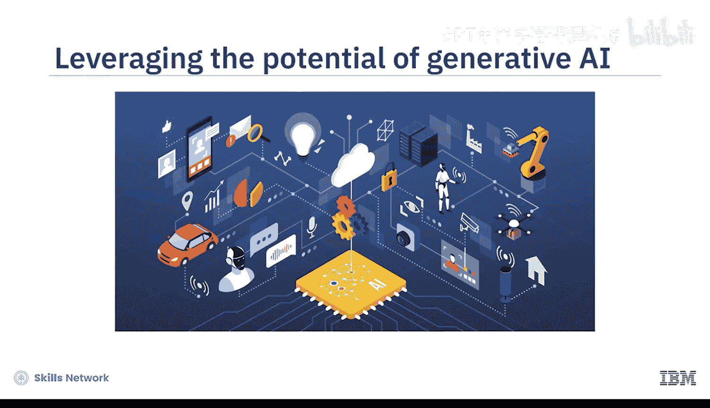
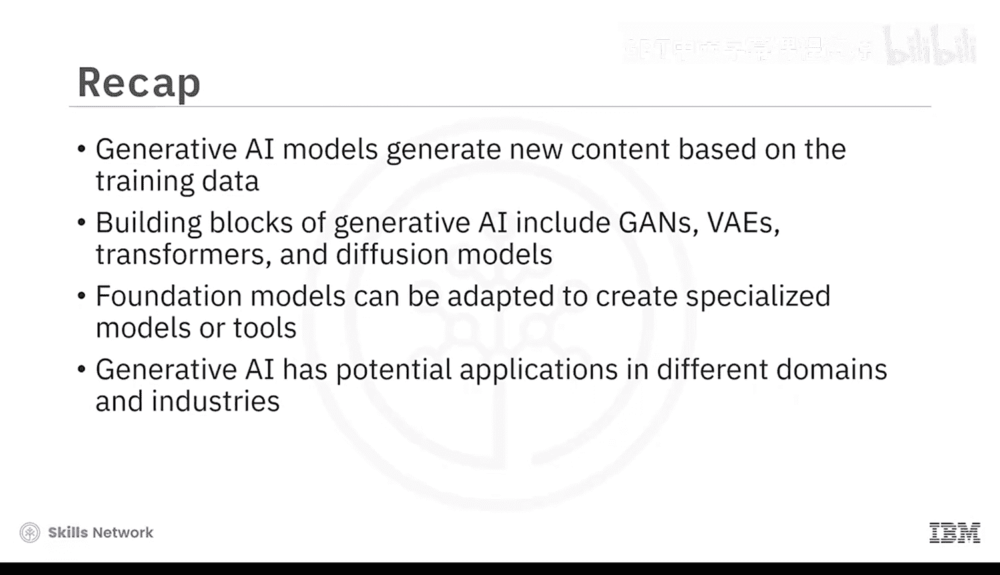

# IBM《生成式AI基础（五课全）｜Generative AI Fundamentals》中英字幕 p05 05_01_01_生成式AI导论.zh_en [BV11XSYBfEje_p5]

Welcome to Introduction to Genrative AI。After watching this video。

 you'll be able to describe generative AI and its evolution。

 you'll also be able to explain how generative AI differs from discriminative AI。

Artificial intelligence or AI has been around for years。

 shaping almost every sphere of our lives and revolutionizing how we live and work。

At its core， AI can be defined as the simulation of human intelligence by machines。

 AI models learn from vast amounts of existing data。

 The process of learning from data is called training。

There are two fundamental approaches to AI， discriminative AI， and generative AI。

Discriminative AI is an approach that learns to distinguish between different classes of data。

 A discriminative AI model is given a set of training data where each data point is labeled with its class。

 The model then predicts the class of a new data point by finding the side of the decision boundary that the data point falls on Discriminative AI models use advanced algorithms to differentiate classify。

 identify patterns and draw conclusions based on training data。

 An example of how a discriminative AI model works can be seen in how email spam filters can differentiate between spam and non spam emails。

Discriminative AI models are best applied to classification tasks； they cannot， however。

 understand context or generate new content based on a contextual understanding of the training data。

And this is where generative artificial intelligence or generative AI comes in。

Generative AI models learn to generate new content based on the training data。

 they can capture the underlying distribution of the training data and generate novel data instances。

Generative AI starts with a prompt。 This can be text， an image。

 video or any other input that the model can process as an output， the model generates new content。

 including text， images， audio， video， code and data。

 generative AI can produce output in the same form in which the prompt is provided。 For example。

 text to text or in a different form from the prompt， such as text to image or image to video。

Here is a simple example to understand the difference between discriminative or traditional AI and generative AI。

 Discriminative AI would be best suited to answer questions such as is this image a drawing of a nest or an a generative AI would respond to prompts such as draw an image of a nest with three eggs in it。

While discriminative AI mimics our analytical and predictive skills。

 generative AI goes a step further to mimic our creative skills。

 As implied by this comment from the Harvard Business Review。

 AI can not only boost our analytic and decision making abilities， but also heighten creativity。

Generative models can take what they have learned and create entirely new content based on that information。

Both discriminative and generative models are created using deep learning techniques。

 deep learning involves training artificial neural networks to learn from vast amounts of data。

An artificial neural network is a collection of smaller computing units called neurons。

 which are modeled in a manner that is similar to how a human brain processes information。

The creative skills of generative AI come from generative AI models such as generative adversarial networks or GNs。

 Vaal auto encoders or VEs， Transformers and diffusion models。

 These models can be considered as the building blocks of generative AI。

Generative AI is not a new concept。 Its roots traced back to the origins of machine learning。

 In the late 1950s， when scientists proposed machine learning。

 they explored using algorithms to create new data。 During the 1990s。

 The rise of neural networks infused advancements in generative AI further during the early 2010's。

 deep learning supported by the availability of large data sets and enhanced computing power。

 further advanced the development of generative AI。 In 2014。

 generative AI was transformed with the introduction of GNs by Ean Goodfellow and its colleagues。

 GNs and other models such as Vas and transformers set the stage for generative AI's growth and the development of foundational models and tools。

Foundation models are AI models with broad capabilities that can be adapted to create more specialized models or tools for specific use cases。

A specific category of foundation models called large language models or LLMs are trained to understand human language and can process and generate text。

In 2018， Open AI introduced a transformer based LLM called generative pretrain transformer or G over the years。

 different LLMs such as GT3 and GT4 in the GT series， Google's pathways language model or PM。

 and Meta's large language model Me AI or Alllama have significantly enhanced generative AI to generate coherent and relevant text。

 There have been similar developments and models for other use cases。 For example。

 stable diffusion in Dll E or models for image generation。

The development of a variety of generative models has led to a growing market for generative AI tools for diverse use cases。

 For instance， you have chat GT and Gei Pro generation， Dolly2 and midjoney for image generation。

 synynthesia for video generation and Copit and Alpha code for code generation。

The rapidly emerging models and tools have generated a wide scope for generative AI applications across domains。

 to quote from McKinsey's report on the economic potential of generative AI。

 generative AI has the potential to change the anatomy of work。

 augmenting the capabilities of individual workers by automating some of their individual activities。

 The report also predicts that generative AI's impact on productivity could add trillions of dollars in value to the global economy。

In this video， you learned that generative AI models can generate new content based on the data they are trained on。

 Further， you learned that the creative skills of generative AI are built from models such as GANs。

 VAEs， transformers， and diffusion models。Foundation models can be adapted to create specialized models or tools tailored to specific use cases。

 Finally， you learned that generative AI models and tools have a wide scope for applications across different domains and industries。

