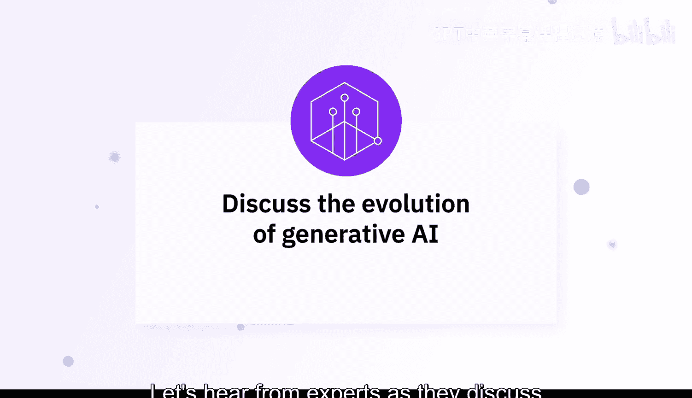
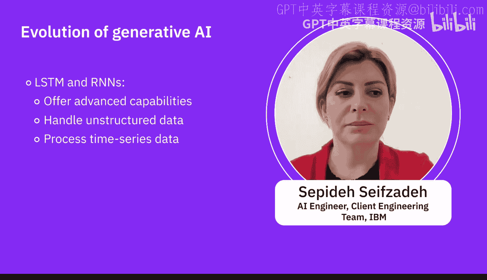
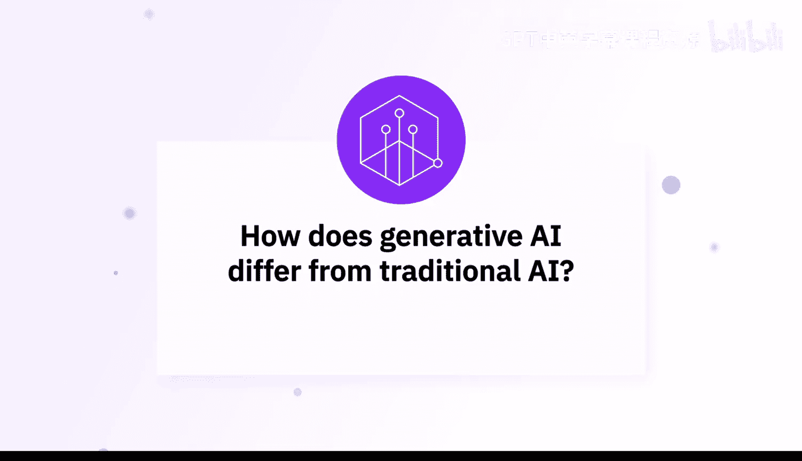
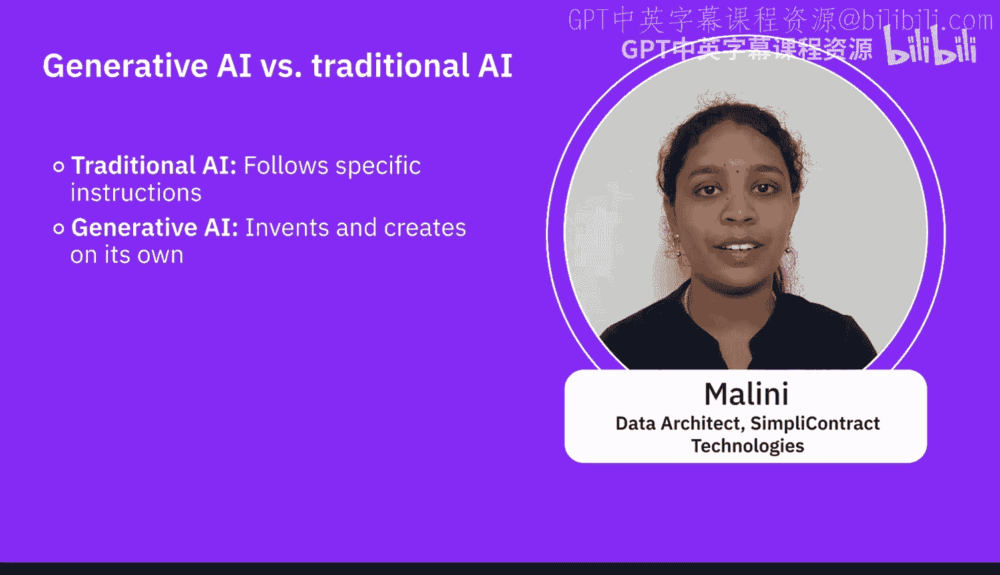

# IBM《生成式AI基础（五课全）｜Generative AI Fundamentals》中英字幕 p08 08_01_04_专家观点：探索生成式AI的演进历程.zh_en [BV11XSYBfEje_p8]

Hello and welcome to this expert Viewpoints video。 Let's hear from experts as they discuss the evolution of generative AI。

😊。

Generative AI has evolved along with artificial intelligence but has gained more traction recently。

 it was government for more than 20 years where it existed but was not really popular and recently with the advent of technologies like GNs and variational auto encoder system。

This has gained a lot more traction and has almost become the future of the industry。

Evolushow generative AI is marked by significant advancements in the ability to create new and original content。

 Earl generative AI model struggled a little bit with some coherence and quality。

 but the reason ever since G3， in other words， G4 and Dolly produced highly sophisticated text and images。

 enhancing creativity and automation in various fields。Forgive the old school。

 Ru funnelling AI gener AI is here， and it is a creative power house。

 Think of it as a super smart artist who can make new things， not just polo orders。

 It paints pictures， her write stories， even it comes up with fresh ideas。😊，First。

 we had rule based mechanism in traditional models。

 the system was actually only working within the context we provided it and followed their rules。

And after that， we had machine learning models and statistical models that could find the patterns in the data and based on the semi supervised learning or supervised and reinforcement learning。

 they could do more intelligently in comparison to the rule based， and they could find some patterns。

We have superhero models like we and Gs， helping it learn and create V learn patterns to make similar things While G have a cool battle that makes poor super realistic pictures and art。

😊，Auto aggressivegressive models are also friends， creating things step by step。

 perfect for language stuff like talking and ride。😊。

Deep learning and neural network could find a pattern in the dataset in more advanced way and tackle unstructured formatted data。

Then there was a generation of GNs， generative adversarial networks that actually it was a new era for generative task and generation of new data。

And later we had LSM and we call a neural network that could help us more advance in tackling some of the use cases and tackling the unstructured formatted data and time series data set。

Moving on to the second question， how does generative AI differ from traditional AI approaches。

Distinguishing it from traditional AI approaches， traditional AI focuses on analyzing and predicting from existing data such as classification。

 regression， recommendation tasks。 It contrasts generative AI。

 particularly with the advent of a generative adversarial networks called GANs and transformer models。

 It creates new data resembling the training data that it used。

Artificial intelligence growth was from a basic level to application and predictive order level in the past 5060 years。

Generrative AI is more about generating human quality output using artificial intelligence technique。

In the recent years， in 2017， there was a paper At is all unique。

 which actually is a new era for generated tasks and many GPT like models are now available in open source community and the idea is to have a pre-trained model and a huge data that can easily be fine tuned for a specific task。

So why is it different， Old AI did what you told it Generative AI in ones and creates on its own。

 like a cold AI inventor， ready to unleash the creative power of AI。

 Let's explore this absentemble together。😊。

。