# IBM《生成式AI基础（五课全）｜Generative AI Fundamentals》中英字幕 p11 11_02_03_图像生成工具.zh_en [BV11XSYBfEje_p11]

Welcome to Tools for Image Gene After watching this video。

 you'll be able to describe the basic capabilities of generative AI models for image generation and explain the key capabilities of common models and tools for image generation。

Generative AI image generation models can generate new images and customize real and generated images to give you the desired output。

 For example， you may want to generate an image of a child with a book in her hat。 Further。

 you may want to change the color of the book cover in the generated image。

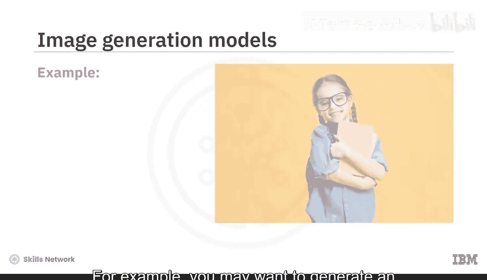

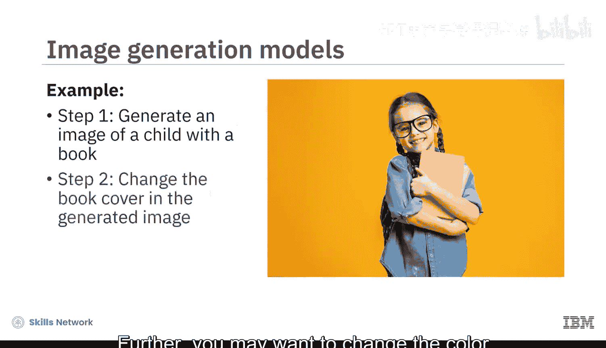

Let's generate a new image using a free AI image generator free pick。

 You need to enter a text prompt describing the image you want to create。

 Let's say you enter the following prompt。 a boat sailing on a calm lake at sunset surrounded by lush greenery and a serene sky。

 Remember， how you describe your image in the words you include in the prompt determine the accuracy and quality of the image that gets generated。

 Let's select the style and generate the image。Here we have multiple images generated。

 you can select and download an image， or you may want to generate other images by modifying the prompt。

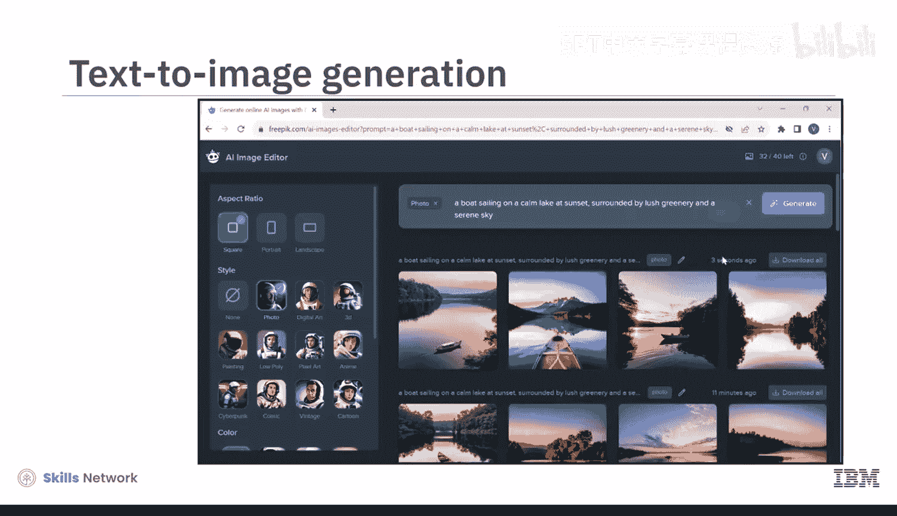

Let's look at some more possibilities of image generation models Iage to image translation refers to transforming an image from one domain to another while preserving the original matter and style。

 for example， converting sketches to realistic images， converting satellite images to maps。

 converting security camera images to higher resolution images。

 and enhancing detail and medical imaging。Style transfer and fusion involve extracting the style from one image and applying it to another。

 creating hybrid or fusion images， for example， converting a painting to a photograph in painting refers to reconstructing missing or damaged parts of an image to make it complete。

You can use this for art restoration， forensics， removing unwanted objects and images while preserving continuity and context。

 and blending virtual objects into real world scenes and augmented reality。

Outpat involves extending the original image by generating new parts to it that are like extensions of the original。

 This can be used for generating larger images， enhancing resolution and creating panoramic views。

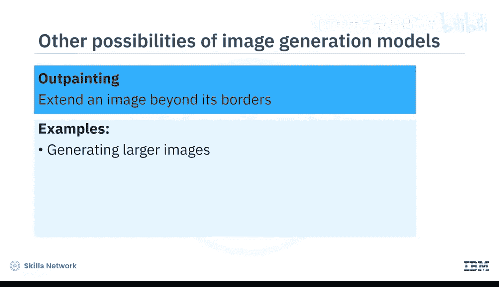

The image generation and modifications capabilities of generative models and tools have evolved with the evolution of models that power them。

Open AI's Doi is based on the GT model trained on larger data sets of images and their textual descriptions。

 Dolly can generate high resolution images in multiple styles。

 including photorealistic images and paintings。 Dolly has evolved in the new versions of Do provide capabilities for generating multiple image variations。

 and image transformation through in painting and outpating。

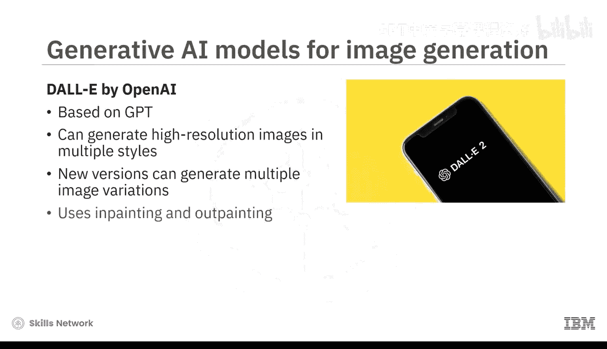

Stable diffusion is an open source text to image diffusion model diffusion models are generative models that can create high resolution images。

 Stable diffusion is primarily used to generate images based on text prompts。

 though it can also be used for image to image translation in painting and outpa。

Nvidious's stylegan model separates the modeling of image content and image style。

 enabling precise control over style for manipulating specific features like pose or facial expression。

 Stylegan has evolved to generate higher resolution images with more realistic details。

You can explore generative AI's text to image generation capabilities using free tools like crayon。

 FreeP and Pixar。 these tools can generate images in different forms and styles。

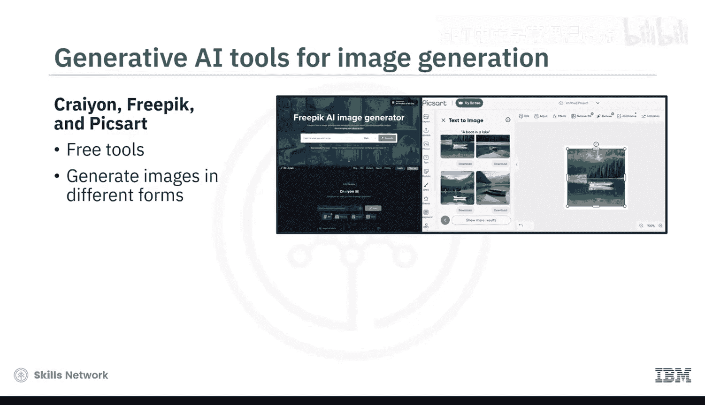

Phoor and deep artifacts offer a variety of pretrain styles allowing you to create your own custom styles。

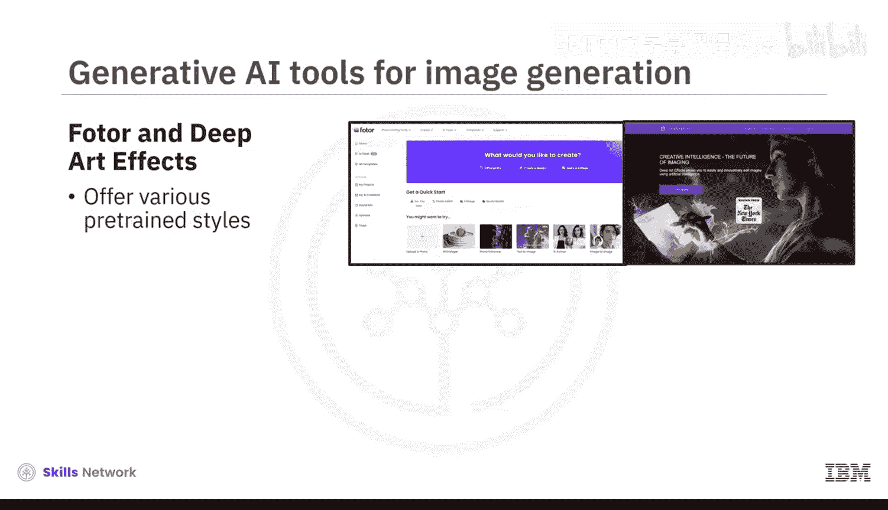

Deepart。IO is an online platform that turns photos into artwork of different styles。

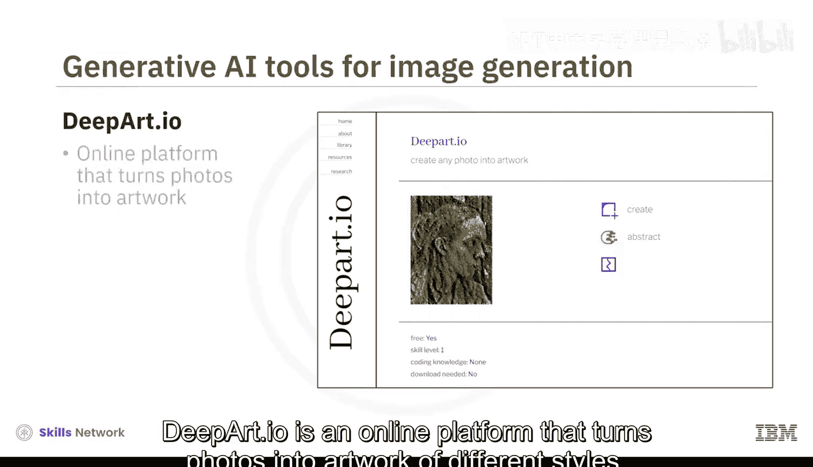

MidJourney is a platform that enables image generator communities that help artists and designers to create images using AI and explore each other's creations。

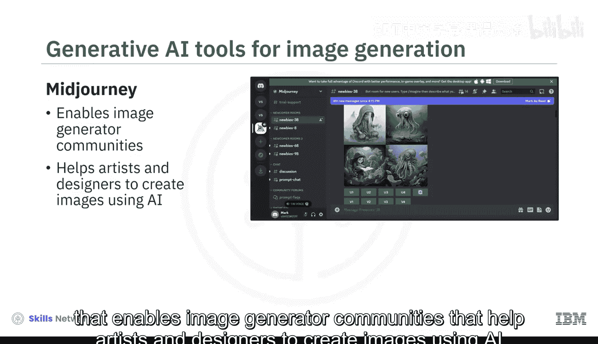

Many generative AI image generators can also be integrators' APIs to embed their functionality and capabilities into different software programs and tools。

 some popular image generators that offer APIs include Di， midjoourney and Cayon。

Technology giants such as Microsoft and Adobe have also stepped into the world of AI image generators。

Microsoft Bing image creator is based on the Dolly model。

 you can access this tool by navigating to Bing。com/create or through Microsoft Edge。

 This makes Microsoft Edge the first browser with an integrated AI image generator。

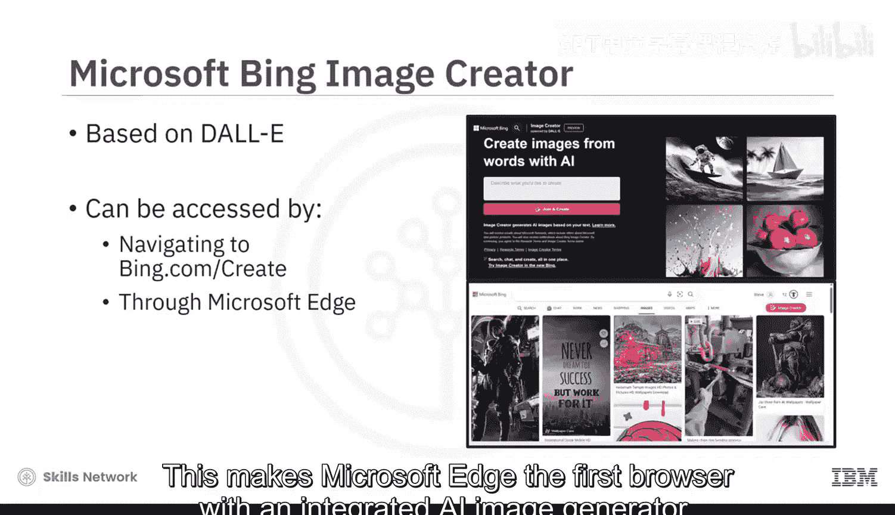

Adobe Firefly is a family of generative AI tools designed to integrate with Adobe's creative Cloud applications。

 such as Photoshop and Iustrator Firefies trains on Adobe stock photos。

 openly licensed content and public domain content。

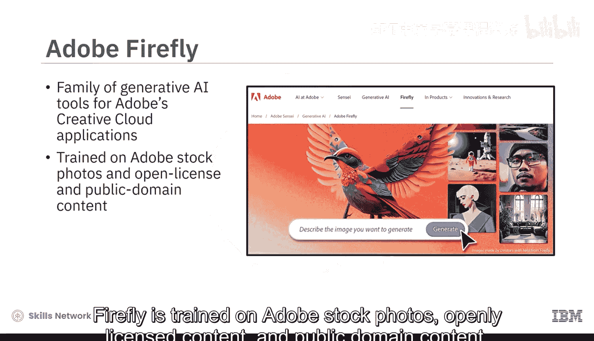

Fireffly can take text prompts in over 100 languages and include tools that allow you to manipulate color。

 tone， lighting， composition， generative fill， text effects， generative recolor， 3D to image。

 and extend image。In this video， you learn that generative AI based models and tools can generate new images through both text and image prompts。

 They also offer capabilities for image to image translation， style。

 transfer in painting or outpainting。 A few prominent image generation models include Dolly。

 stable diffusion and style G。 There are several image generating tools available that offer diverse capabilities for image generation and transformation。

 A few image generateds can also be integrated as APIs。

 You also learn that Adobe Fireflies a family of generative AI tools designed to integrate with Adobe's creative cloud applications。

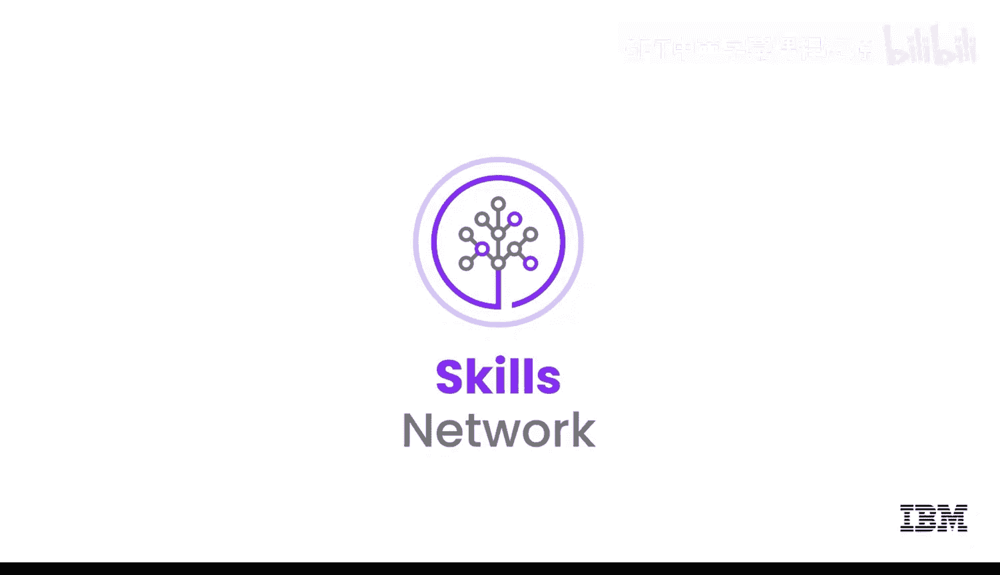