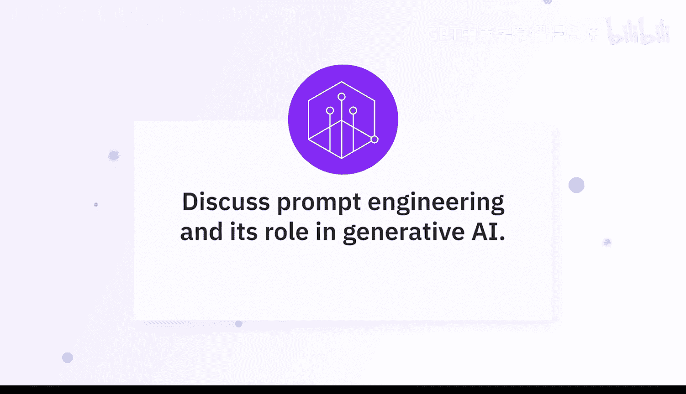
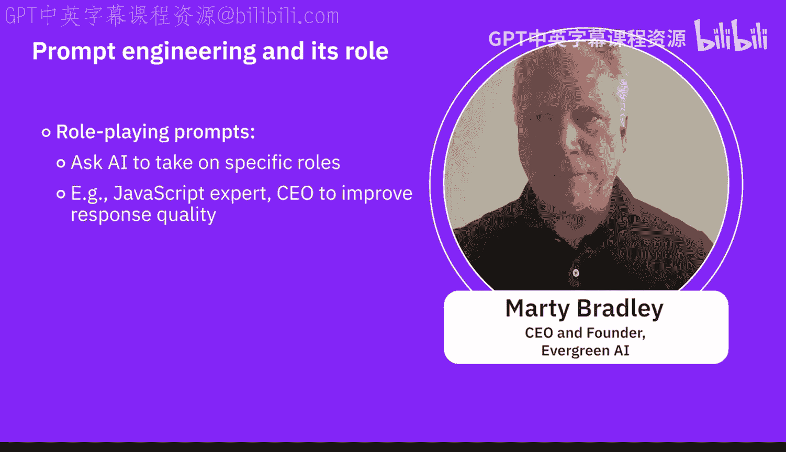
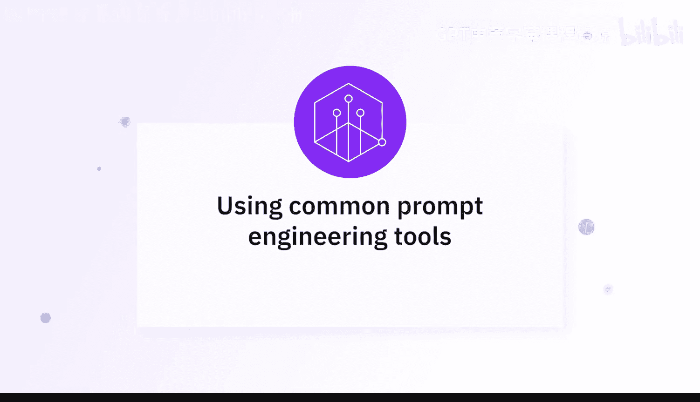
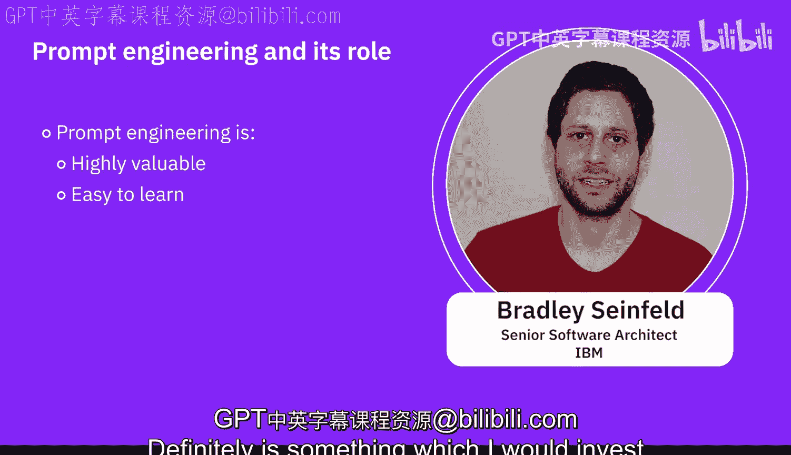
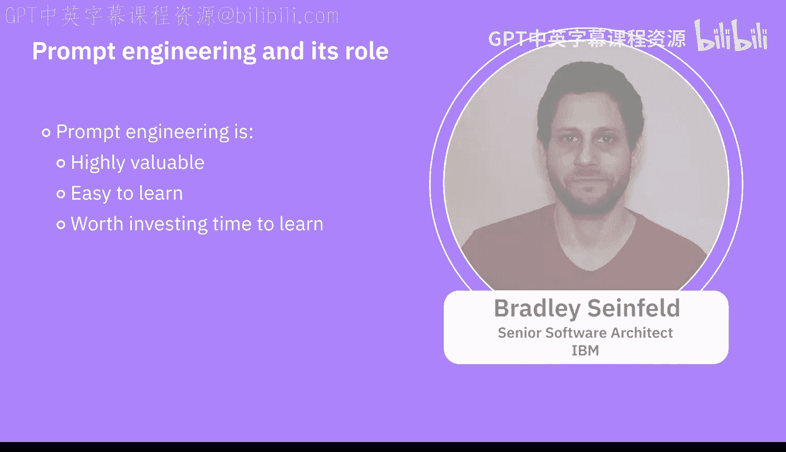

# IBM《生成式AI基础（五课全）｜Generative AI Fundamentals》中英字幕 p23 07_01_06_专家观点：探索生成式人工智能中的提示词工程.zh_en [BV11XSYBfEje_p23]

Hello and welcome to this experter Viewpoints video。

 Let's hear from experts as they talk about prompt engineering and the role it plays in generative AI。

Prompt engineering basically is the technique of writing good or effective prompts。

 which the model will be able to use to create effective outputs that is consistent and prominent outputs。

The techniques that are usually in place for prompt engineering are with respect to the application that you use。

 but the basic things are there， you have to have the you know the clarity of thought。

 the context and list of the particular features that you want from it。

Prompt engineering is a term that's come around in the last couple years because of January May I。

 And so what prompt engineering is understanding how to prompt the large language model to get the responses you want。

 So there are things like zero shot prompting where it's a typically the way people use Stry P today where they just ask it to do something。

 So the shot is an example。 So zero shot。 No example is just do this。

 And then there's one shot where you go， hey， can you write this out for me。

 Here's an example of the format that I want you to use。

 So now can use the format to inform the information that it needs。

 and ask you questions in format the output a little bit better。

For Pro engineering there is many different parameters that we can use to interact with the model。

 so first we should specify the task and explicitly ask the model what we are looking for and provide some context and sometimes we can provide some examples which is the concept of few shot learning so that the model can learn or see how we want the output to be。

 we can have some iterative feedback so that the model can learn based on the different prompts and fine tuning we can see which one is performing better and provides us with the response that we are looking for。

There are things like Q shots you remember shots or examples。

 So few shot means you give it two or three more examples。

 And the interesting thing with the examples is they don't have to be correct examples。

 They just need to be formatted correctly。 So what you can do is you can do a couple of examples。

 then I actually use Gen AI to create more examples for you in that same format。

 and then you can add that to your prompt。Prompt generation is just so critically important to get the right outputs from your prompts。

It's as simple as if you ask the wrong question， you're going to get the wrong answer back。

 that applies to humans too， and at this point in time it's especially true for these generative AI models。

And enter things like chain of thought where you say， I'm going to give you a series of steps。

 And I want you to fill the plan and then think step by step as you execute this when you do that in a prompt it helps CLM stay on track。

 So it'll make a plan， you'll hold that internally。

 and then it'll go through each of those instructions one by one and then put the answer together at the end。

 So if you have a very complex thing that you're trying to do。

 try to learn things like chain of thought in your prompting。 And again。

 the biggest thing and the thing you hear the most is tell to play a role or give it a specific type of person to be a as a jobvascript expert as a product manager as the CEO of a small business organization。

 The more you can give it those type of examples， the better that your output's going to be。

Moving on， let's explore what experts have to say about their experiences using common prompt engineering tools。

😊。

One of the most prominent tools that are available for prompt engineering is the Watson next Studioo promptmp Engineering Lab。

Which particularly is a very good tool for practicing and developing effective prompts for a specific application。

What are some common prompt engineering tools， the sites like O AI， I'm sure Microsoft Copi it。

 they have sections on how to write good prompts and if you can use these tools to help you write your prompt and see if you're going to get the kind of responses you get。

Other thing is that how generative and restricted we want to make our model。

 so there are some parameters like temperature top K top P that enables our model to be more generative as well so we can control that and we can provide it some examples as I mentioned so that the model knows what is the desired structure of the output that we are looking for。

So Pro engineering is actually a task that enables us to interact with our model and ask it to provide the response in a format and in a way that we are looking for。

😊，For example， I was working with Chachi T P， and I wanted to understand how to explain a workflow to it。

 And Ive background。 So I have different formats that I could use。 So I basically said， hey。

 I want you to analyze the workflow for me。 What's the best format for me to give that to you in。

 And it came back and it gave me a structure and say， hey， if you can put it in the structure。

 it'll help me correlate these fields when you asked me questions as part of my prompt。

 I prompted it， and I created the structure that I wanted。 And sure enough。

 it could match one to one and do all kinds of interesting things that I wanted it to do。

Models like Lama2 have actually specific syntaxes that you have to follow。

 And if you don't follow those correctly， you're gonna have a bad time now things still work。

 you still get output and in all cases， you'll still get an output。

 but the point is we want to get the output we want with as little trial and error and as little waste of time and money and resources as possible。

 So prompt engineering super valuable right now， very easy to learn definitely is something which I would invest a good amount of time in right reference。

