# IBM《生成式AI基础（五课全）｜Generative AI Fundamentals》中英字幕 p26 10_02_03_思维链方法.zh_en [BV11XSYBfEje_p26]

Welcome to this video on the Chain of Thought App。

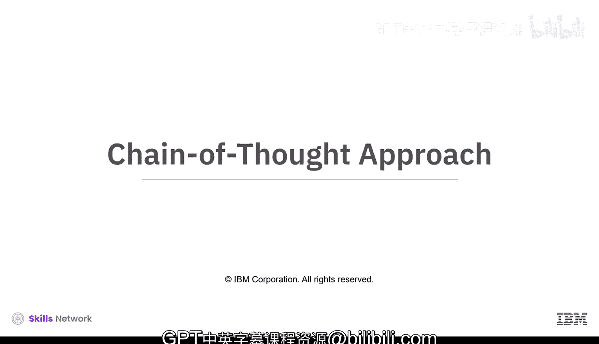

After watching this video， you'll be able to define the chain of Dot approach and describe its applications in generative AI models。

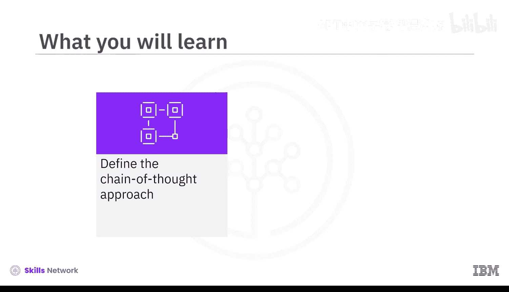

The chain of thought approach is a method that involves breaking down difficult or complex tasks into smaller。

 more manageable steps through a series of prompts or questions。

Each prompt builds upon the previous one， guiding the AI model to think through the problem step by step and generate the desired response。

This approach enables the model to demonstrate its reasoning process and improves its ability to solve similar problems accurately。

By feeding the model questions along with their solutions。

 the chain of thought helps the model approach tasks in a structured and logical manner。

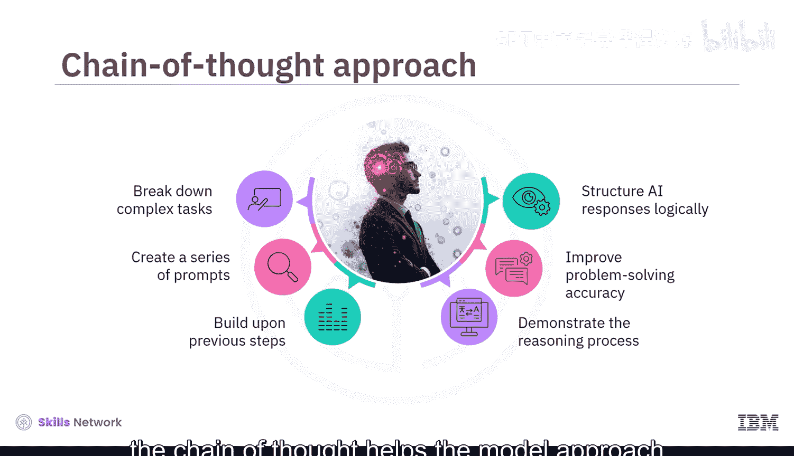

The approach is widely used in generative AI because it enhances logical reasoning and ensures that every step in the process is considered。

 leading to more accurate results。It also improves explainability。

 allowing users to trace how the AI reached its conclusion and simplifying debugging。 Additionally。

 it helps overcome the limitations of language models which are not naturally designed for multistep reasoning unless prompted。

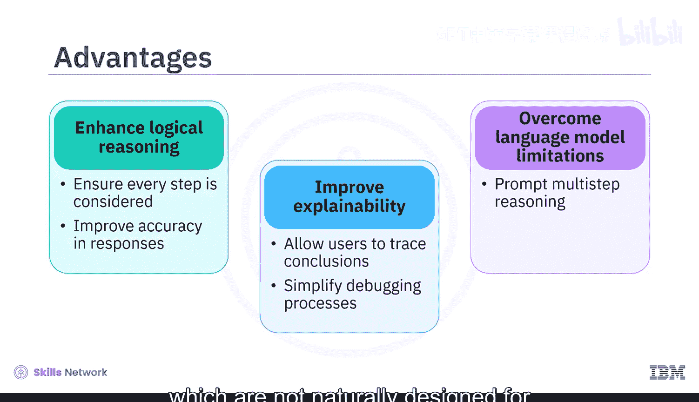

The two most common models in chain of thought modeling are few shot chain of thought and0 shot chain of thought。

 Viewew shot chain of thought gives examples to show how to break down a problem。

 While zero shot chain of thought encourages the model to think through the steps independently。

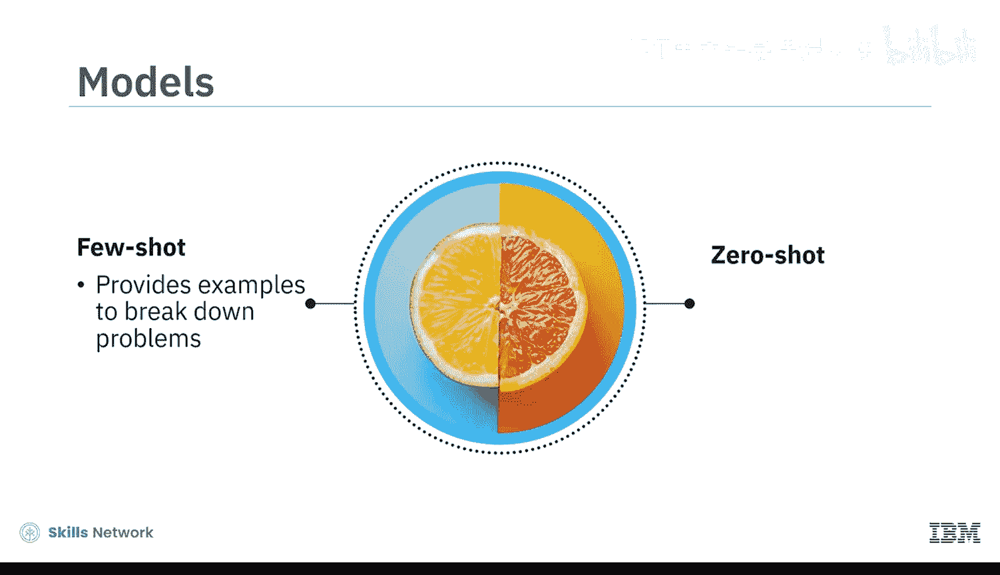

Let's consider an example to illustrate both methods。 We'll start with the few shot methods。

 The sample problem is about a store that sells oranges at $3 each with a buy two get one free offer。

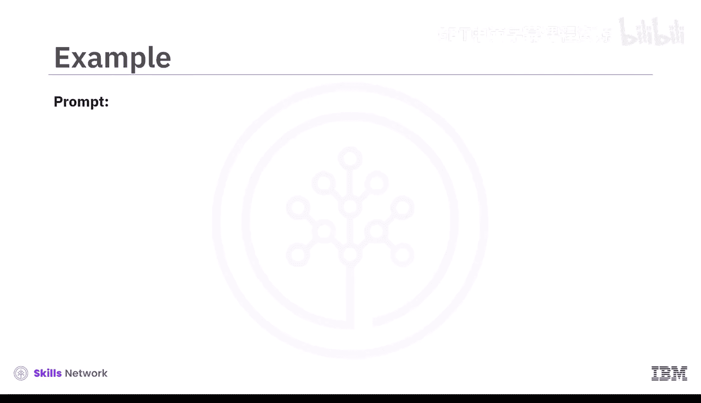

The solution walks through the steps by recognizing that every third orange is free。

 so the cost of three oranges is the same as paying for two。Extend that logic。

 six oranges would cost the same as four， which comes to $12。Now。

 a similar problem is given to the system。 This time。

 the question is about a store that sells pen cases with a buy one get one free offer。

 and each pen case costs $5。 using the same chain of thought reasoning。

 the system first understands the offer structure and then generates the response based on the reasoning provided as a sample example within the prompt。

 It is thus able to reach the correct answer， the cost will be $25。 Since out of 10 pen cases。

 only5 will be paid for。

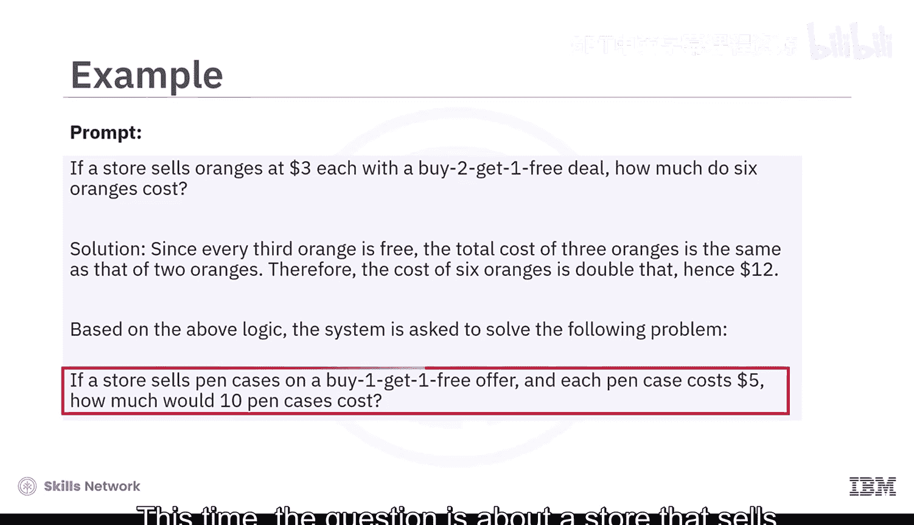

In the zero shot method， no example is provided， and the system is encouraged to figure out the answer independently。

 phrases such as let's think step by step， or let's work this out step by step to ensure we have the right answer are added to the prompt to help the system device methods solve the problem independently。

Let's take the same pen case problem and see how it is solved using the zero shot method。

 The prompt is given as follows。 If a store sells pen casess on a buy one。

 get one free offer and each pen case costs $5， How much would 10 pen casess cost。

 Let's think step by step。In this case， the system doesn't rely on a sample or example beforehand。

 Instead， it tries to reason through the problem on its own。 It starts by interpreting the offer。

 understanding that for every two pen cases， the customer pays for just one。

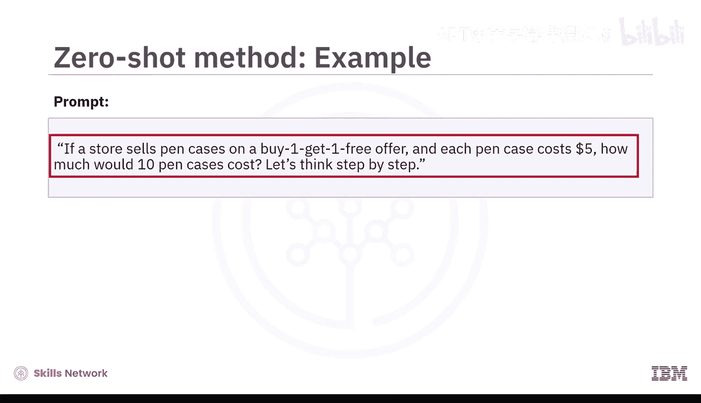

Then it applies that understanding to the problem。 It groups the 10 pen cases into five paid and free pairs。

 realizes that only five pen cases need to be paid for and calculates the total is $25。

 So without even seeing a sample first， the system is able to work through the logic step by step and arrive at the correct answer。

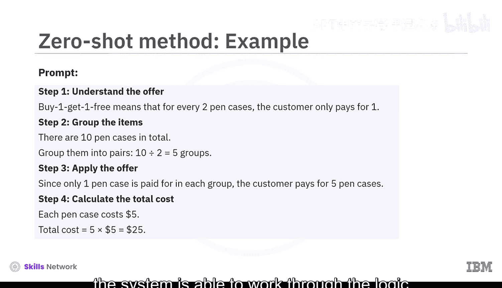

Chain of thought has several challenges to consider。

 B down responses into steps can slow down the model。

 which may not be ideal for fast applications like chatbots。 Additionally。

 this approach can make simple problems unnecessarily complex， making the AI seem less efficient。

 an error in the early steps can carry over， resulting in an incorrect answer。

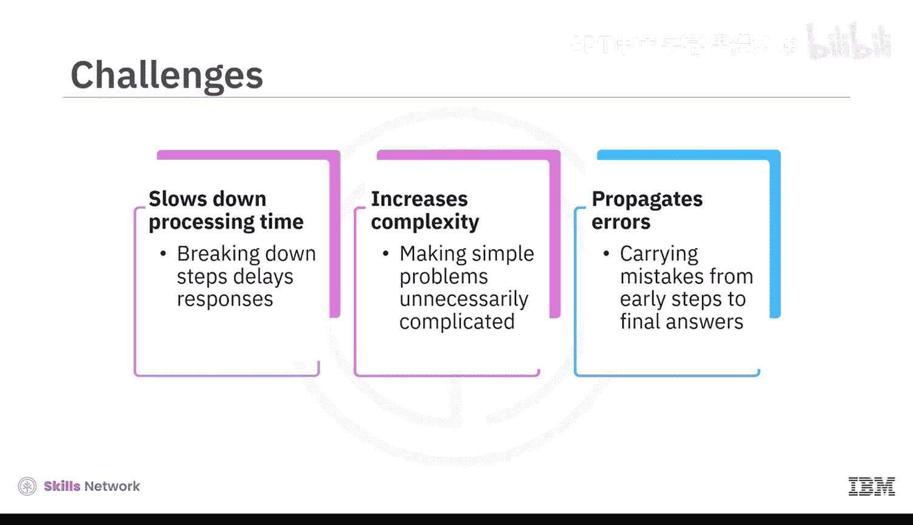

In this video， you learned that the chain of thought approach breaks down complex tasks into smaller steps。

 improving logical reasoning and accuracy in AI models。

 The two main chain of thought methods are few shot。

 which provides examples to guide problem solving and zero shot。

 which encourages the model to think through the steps independently While chain of thought enhances decision making and explainability。

 It can slow down processing， complicate simple tasks and carry over errors from early steps。

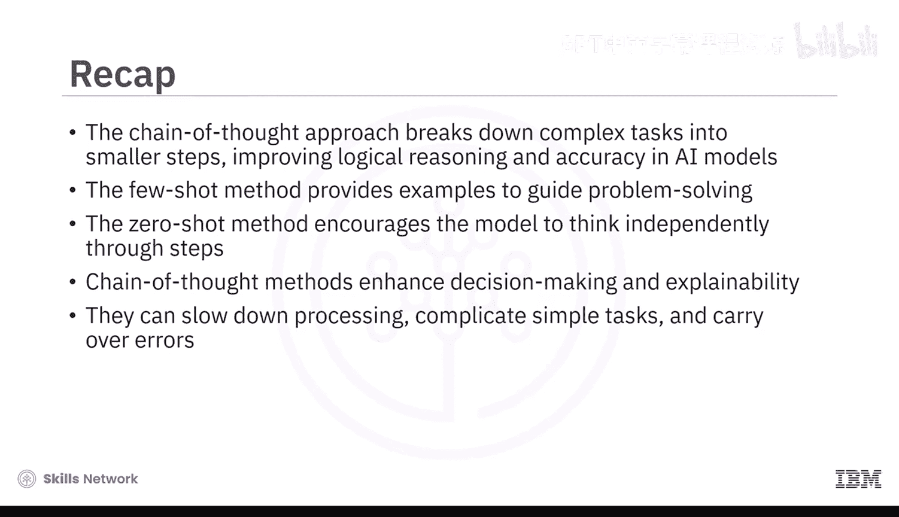

。

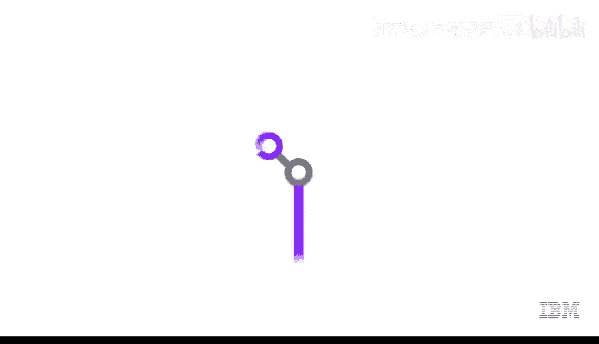