# IBM《生成式AI基础（五课全）｜Generative AI Fundamentals》中英字幕 p27 11_02_04_思维树方法.zh_en [BV11XSYBfEje_p27]

Welcome to this video on the Tree of thought approach。 After watching this video。

 you'll be able to describe the Tree of thought approach。

 You'll also be able to explain the process of using the T of thought approach for prompt engineering by exploring some real world examples。

 Finally， you'll list the challenges associated when using the Tre of thought approach。😊。

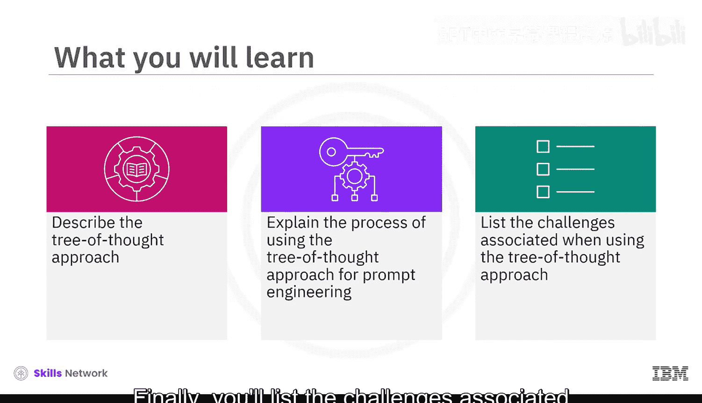

Imagine you and your friend and need to pick a place to eat。 First。

 you consider what type of food you're in the mood for。

 Then narrow it down based on the budget and how far you're willing to travel。 Finally。

 you settle on a spot that fits your tastes and preferences。

This is an example of a tree of thought approach in action。

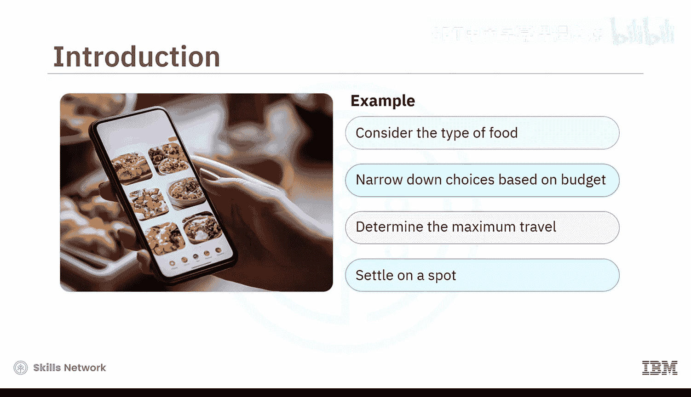

The tree of thought approach enhances AI reasoning by structuring prompts like a tree with hierarchical branches representing different lines of thought。

 It allows the AI to evaluate multiple possibilities simultaneously。

 assess potential outcomes and focus on the most promising options。

 This technique is valuable for solving complex problems by offering explicit guidance and exploring various solutions。

 Let's explore some examples that use the tree of thought approach。

Let's consider a scenario area where an online store experiences a mysterious sales decline。

 The prompt is， our online store has seen a 20% drop in sales over the past three months。

 despite steady website traffic。😊，What could be causing this and how should we approach fixing it。

 Think of three possible reasons and try to approach the solution from multiple directions。

 G a single structured plan of action。

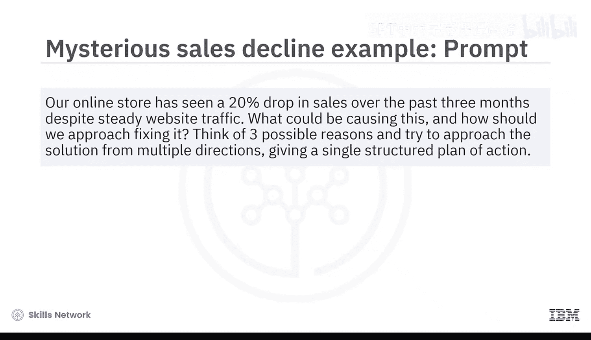

As a response to the prompt， the model begins by identifying and clearly outlining the three most likely causes of the sales decline。

 poor conversion rate， product or pricing issues or external market factors。

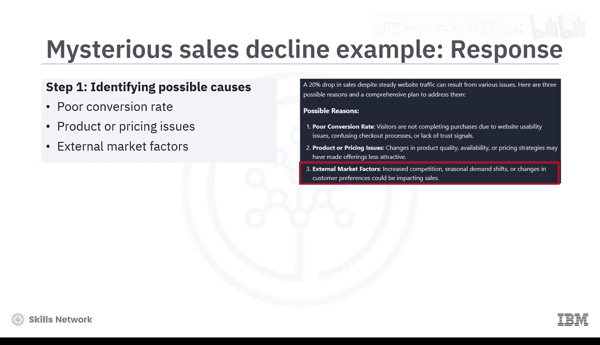

It then proposes a multi directionional approach to fixing the targeted issue。

 where a strategy is developed for each of the principal reasons identified。 Finally。

 the model presents a structured implementation plan addressing the issue across short term。

 medium term and long term actions。

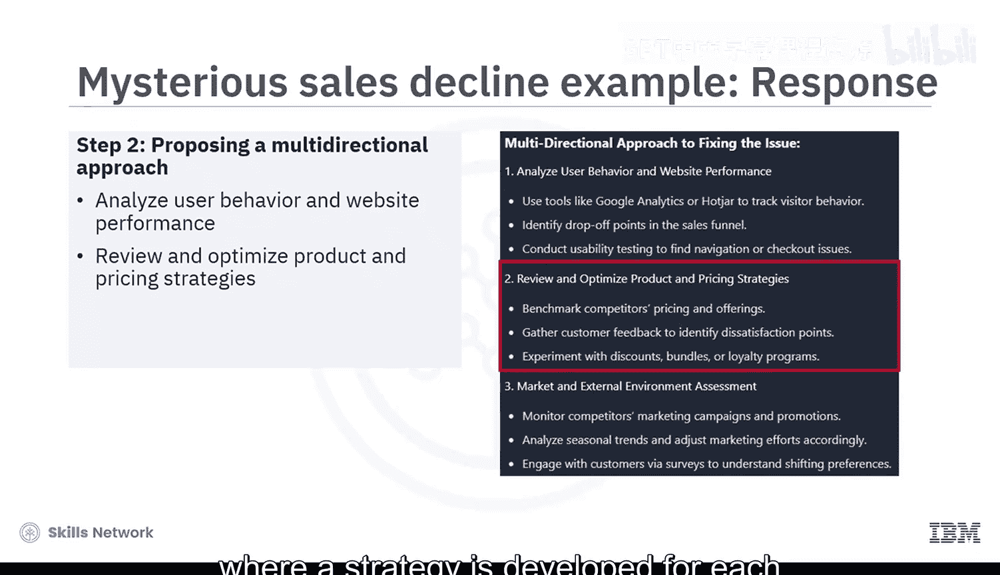

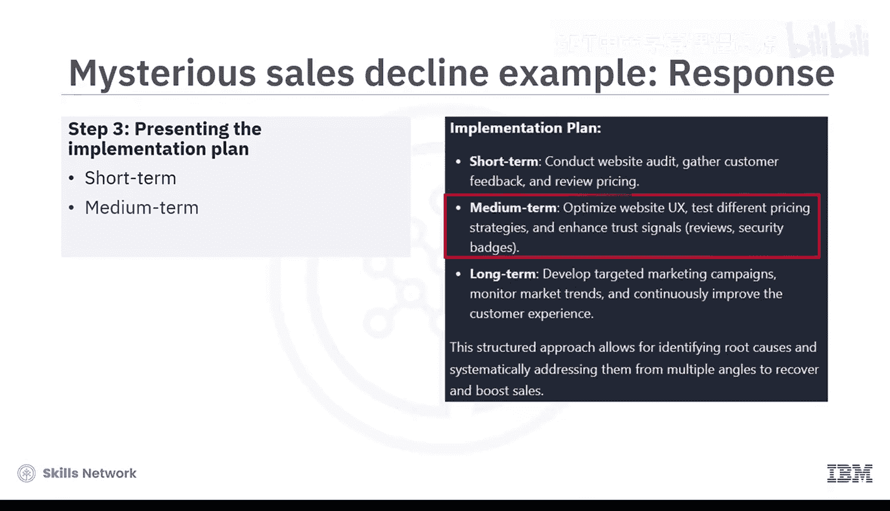

Let's analyze the On store example to understand how the treat of thought approach of prompting played a key role in guiding the model to deliver a structured。

 actionable response to a complex business problem。

By encouraging the model to explore multiple reasoning paths。

 the prompt enabled a deeper analysis across interconnected dimensions。

Instead of offering a generic response， the model broke down the issues into three distinct causes。

 evaluated corrective strategies from different functional perspectives， such as user experience。

 pricing and market trends and synthesized a step by step action plan。

 This mirrors the way human experts approach complex。

 multifaceted problems by testing parallel hypotheses。

 discarding weaker options and building a comprehensive solution。

 This explains how the tree of thought approach of prompting。

 enhanced the model's ability to reason holistically and deliver a response that is both diagnostic and strategic。

Proceeding further， this approach can also extend to a wide range of real world challenges。

 The tree of thought approach of prompting goes beyond extracting answers。

 It encourages the model to reason through branches of possibilities。

 evaluateate them in parallel and converge on well supported recommendations。

This type of reasoning is especially valuable when decisions involve uncertainty。

 competing priorities， or multiple plausible paths forward。Beyond business strategy。

 it can also be applied to personal dilemmas， such as navigating a career change。

Let's look at a prompt that demonstrates how the Tree of thought approach can support thoughtful decision making in the context of navigating a career change。

I'm considering a career switch， but feeling uncertain。

 Exp three different paths I could take based on my current skills and interests。

 like upskilling in my current domain， Piing to a related field or making a radical change for each path。

 B it down into subdecisions and steps I need to take Eate potential risks and benefits and help me identify what factors I should consider choosing the best direction。

To respond to the prompt， the model traverses each line of thought outlines the pros and cons of different career switch options。

 while upskilling in the current domain is presented with the advantage of staying aligned with industry trends。

 limitationsations such as time and financial investment are presumed。

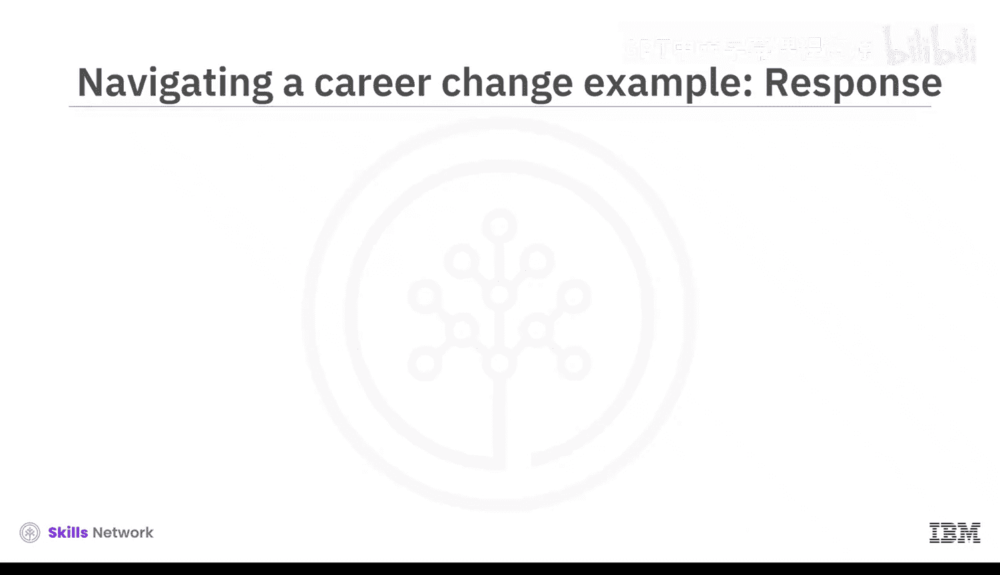

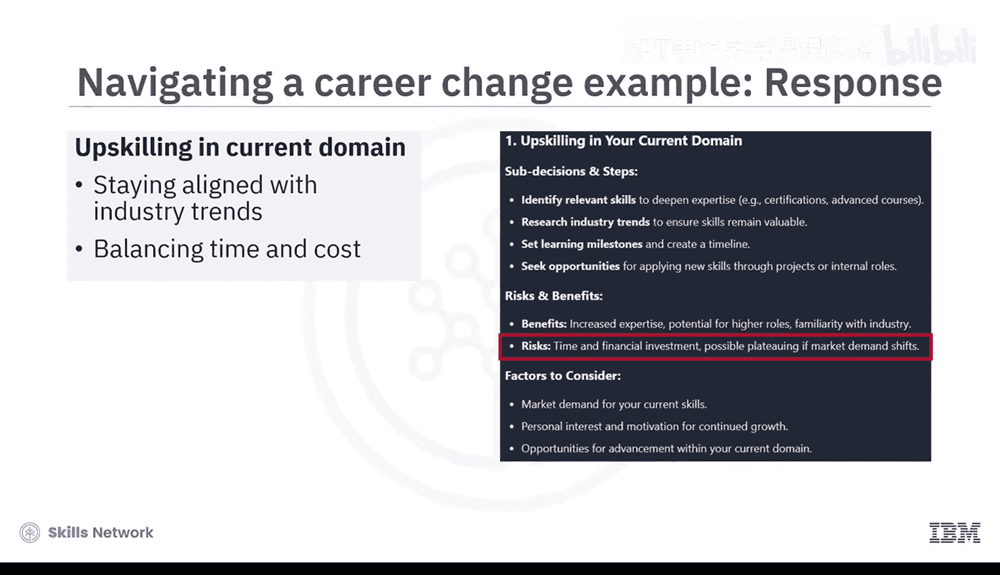

For pivoting to a related field， the model presents the benefits such as broadening of career opportunities。

 In addition， it also flags limitations of compatibility of existing skills with the new role。

 Lastly， for a radical career change， it points to the potential for greater personal  fulfillment。

 but is limited by the financial risks and the chance of failure。

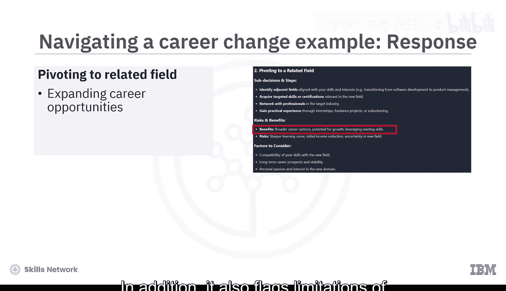

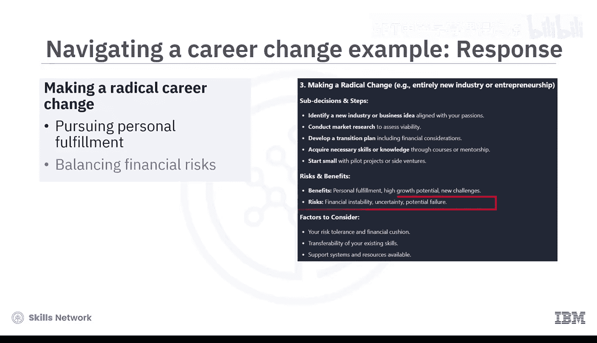

Ultimately， the model leaves the final decision to the user to evaluate the best path。

 giving duew points of consideration such as personal interests， risk tolerance and market demand。

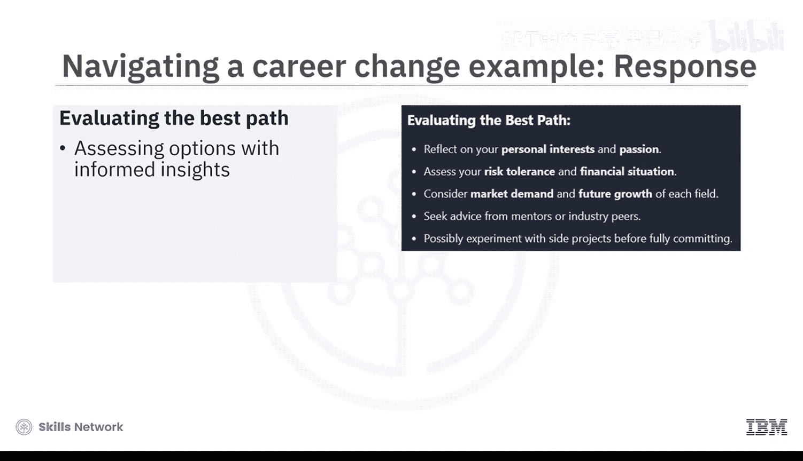

While the tree of thoughtt approach of prompting is highly effective for structured reasoning and tackling complex multi step problems。

 it also has its limitations。A common challenge is that it can lead to overgeneration where the model explores too many branches or digresses into less relevant paths。

 making the response unnecessarily long or diluted。Also。

 this method may assume all reasoning paths to be equally valid， which isn't always the case。

 specifically in high stakes or time sensitive scenarios where prioritization is critical。

Additionally， there is a risk of false confidence if the model creates detailed reasoning chains around flawed logic or inaccurate facts。

 potentially giving a false sense of credibility to weak conclusions。To conclude。

 when used thoughtfully， this approach offers a powerful framework for navigating ambiguity and making informed decisions with the support of AI。

In this video， you learned that。The tree of thought approach is an advanced prompt engineering technique that enables generative AI models to tackle complex problems by reasoning through multiple solution paths in a structured step by step manner。

 It encourages the model to explore different possibilities。

 evaluate them in parallel and deliver thoughtful， well supported conclusions。😊。

This approach is particularly useful for real world situations that demand layered decision making。

The tree of thought approach of prompting comes with some limitations also。

 such as the risk of overgeneration， excessive branching into low value pads。

 and the need for careful interpretation by users。

