# IBM《生成式AI基础（五课全）｜Generative AI Fundamentals》中英字幕 p31 01_01_01_课程介绍3.zh_en [BV11XSYBfEje_p31]

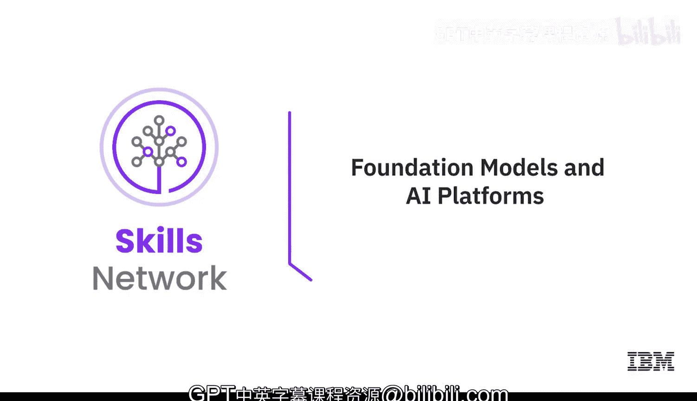

What is it about generative AI models， specifically foundation models that is reshaping industries across the globe。

 This is a question that is well answered in this course。

 which brings in focus the core principles of generative AI。

 These principles are at the heart of creating powerful AI models。

 platforms and applications that can solve complex real world problems relatively quickly with a strong understanding of these principles。

 you can maximize your experience of generative AI。 Therefore， this course invites all beginners。

 whether professionals， enthusiasts， practitioners or students。

 If you have a genuine interest in the rapidly developing field of generative AI。

 This course is for you。 a course， for everyone， regardless of your background or experience。

 By the end of this course， you'll be able to identify the core concepts that form the building blocks of generative AI list the capabilities of commonly used generative AI models。

 Ex how foundation models generate text images and code and describe the purpose of dynamic AI platforms such as IBM Wats and X。

😊。

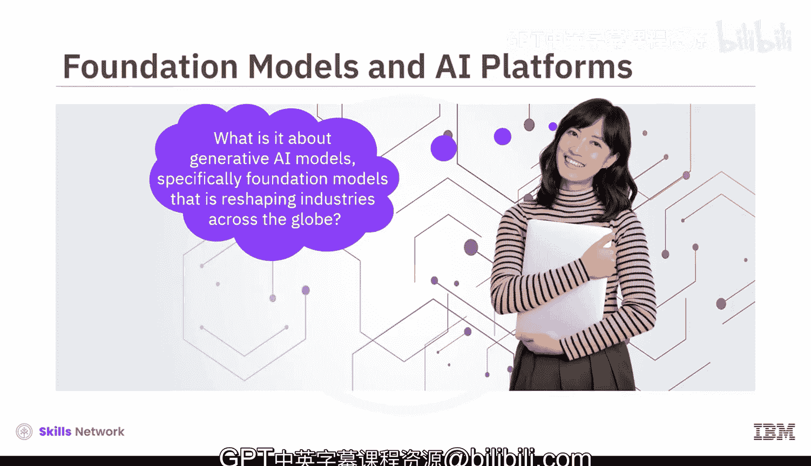

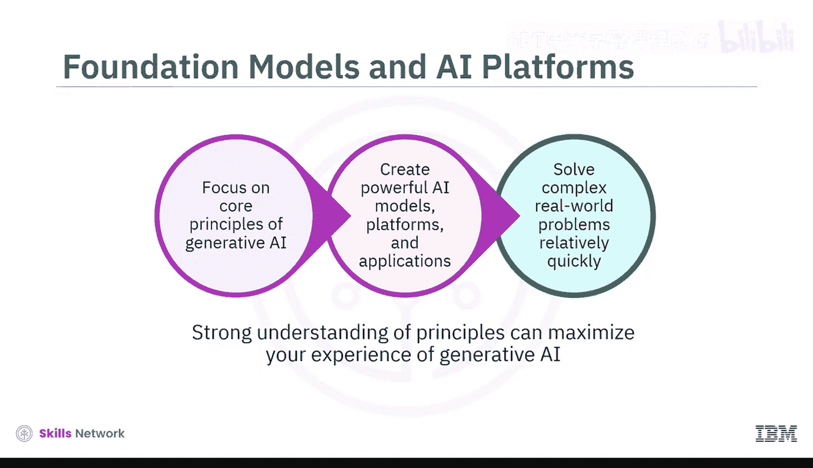

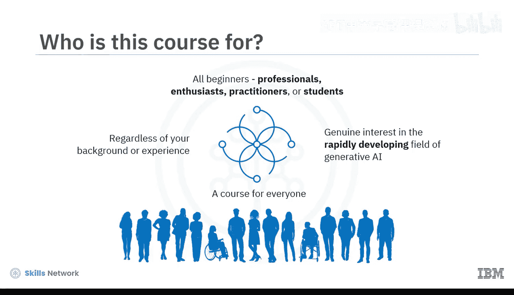

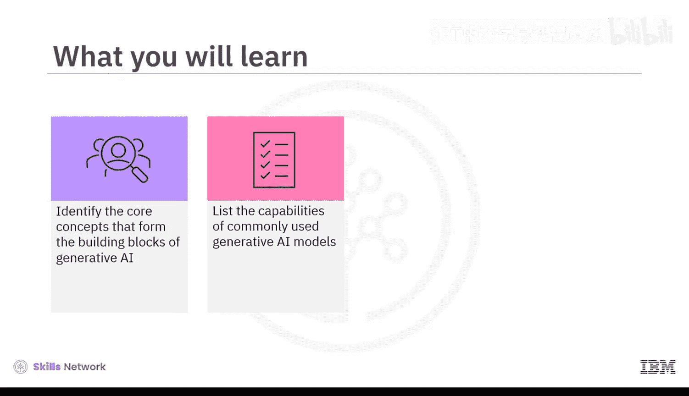

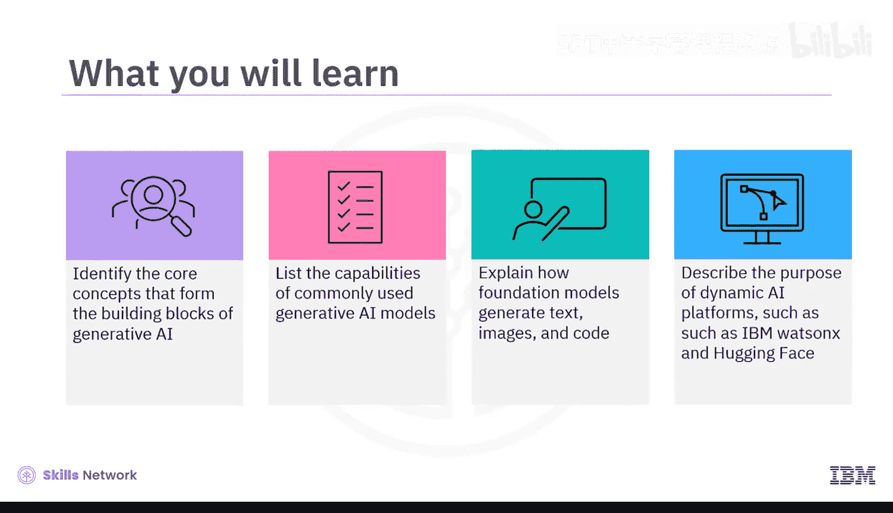

And hugging face， as this is a focused course comprising three modules。

 you're expected to spend  one to2 hours to complete each module In module1 of the course。

 you'll explore the principles and components of deep learning architecture and understand how large language models are created。

 You'll also differentiate between the capabilities of commonly used generative AI models。

 such as variational autoencors， generative adversarial networks， Transer based models。

 diffusion models and foundation models。

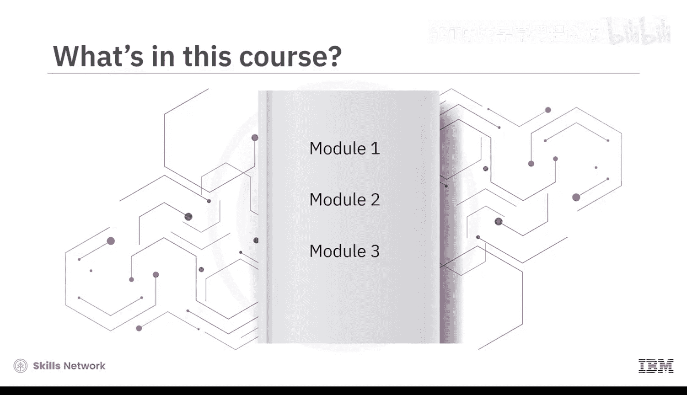

In module 2， you'll learn how pre traineded foundation models generate text images and code through examples of T 5。

 The bidirectional autoregressive transformer model， Imogen and code to sequence models。

 Further in this module， you'll understand how dynamic AI platform such as IBM Watson X and hugging face are helping businesses create value and gain a competitive edge。

 module 3 request your participation in a final project and presents a graded quiz to test your understanding of course concepts。

 You can also visit the course glossary and receive guidance on the next steps in your learning journey。

 The course is curated with a mix of concept videos and supporting readings。

 Watch all the videos to capture the full potential of the learning material。

 You'll enjoy handson labs that demonstrate the capabilities of foundation models and participate in a final project in module 3。

😊。

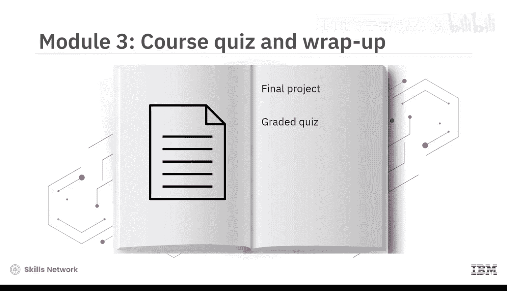

There are practice quizzes at the end of each lesson to help you reinforce your learning。

 At the end of the course， you'll also attempt a graded quiz。

 The course also offers discussion forums to connect with the course staff and interact with your peers。

 Most interestingly， through the expert viewpoint videos。

 you'll hear experienced practitioners share their perspectives on the concepts covered in the course。

 If you've been wanting to get a grasp on the technology that's pushing the boundaries of machine learning。

 You've come to the right place。 Let's get started。😊。

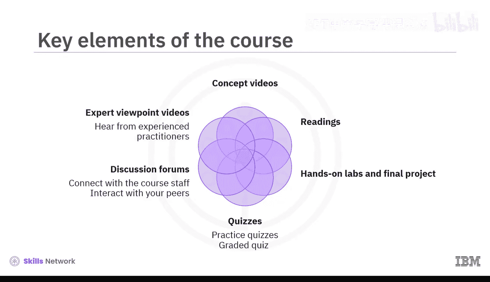

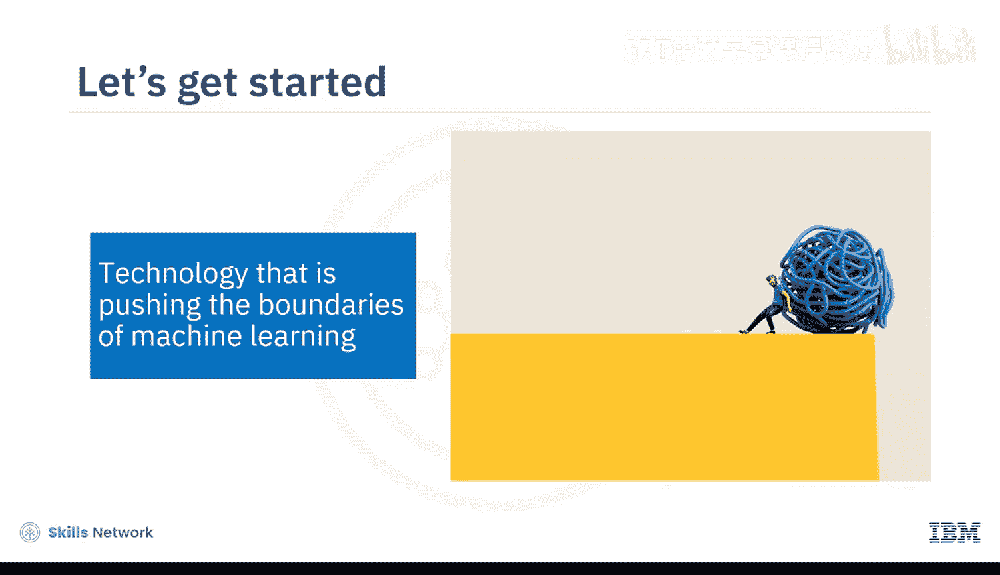

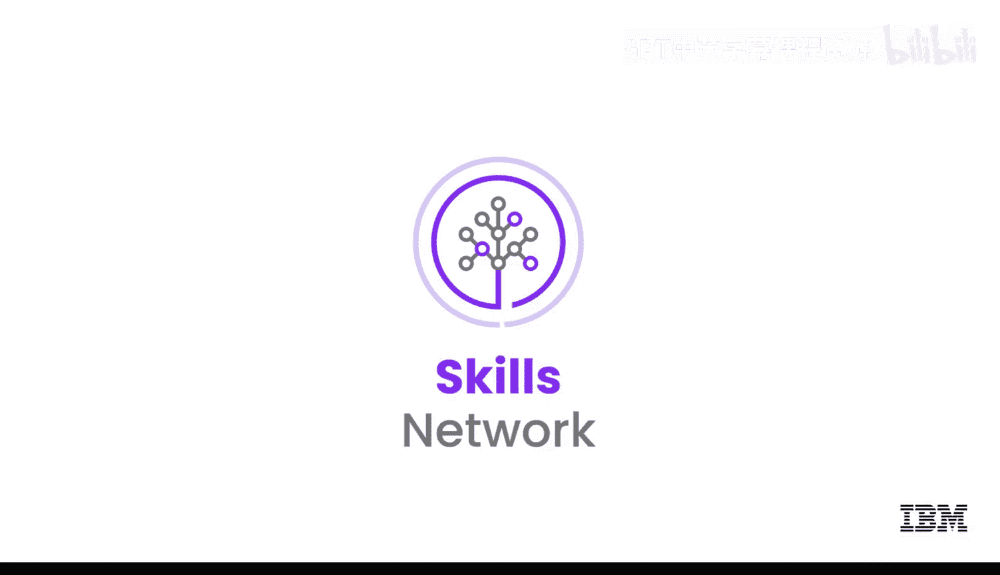