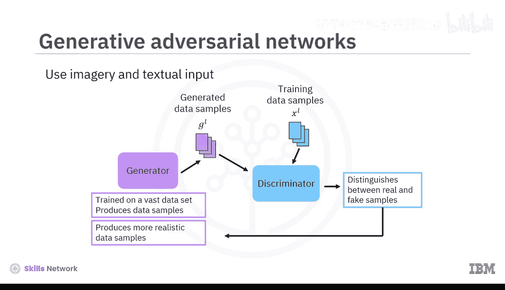
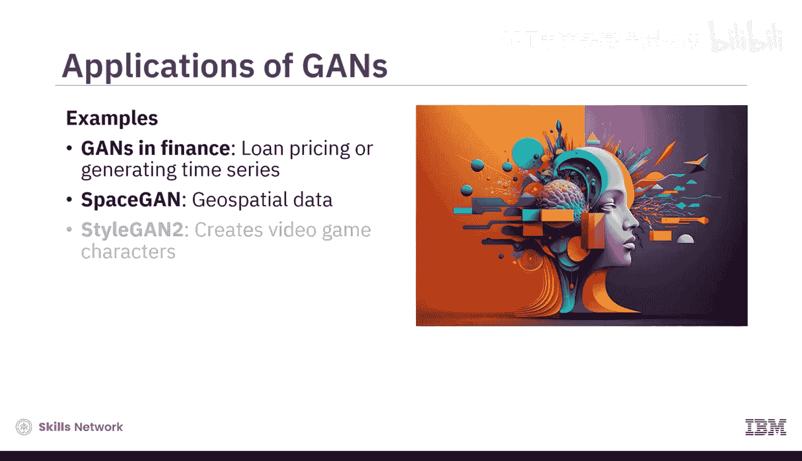
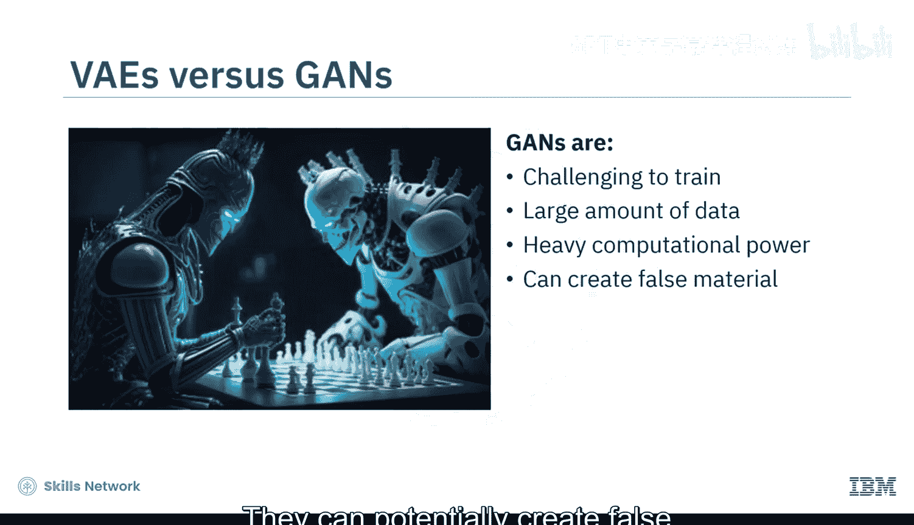
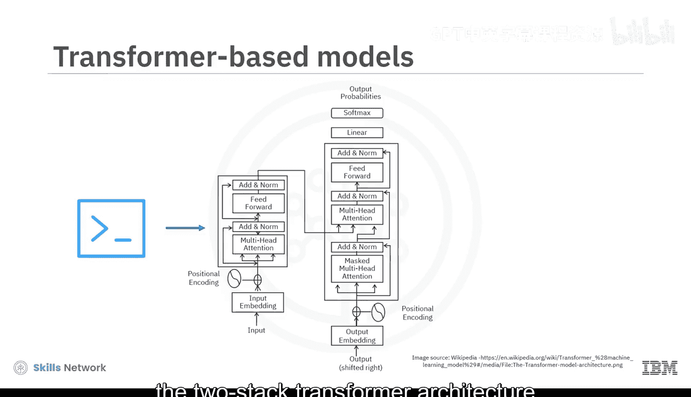
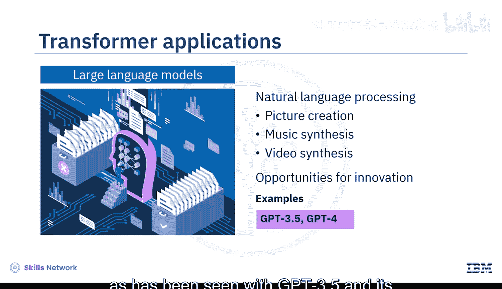
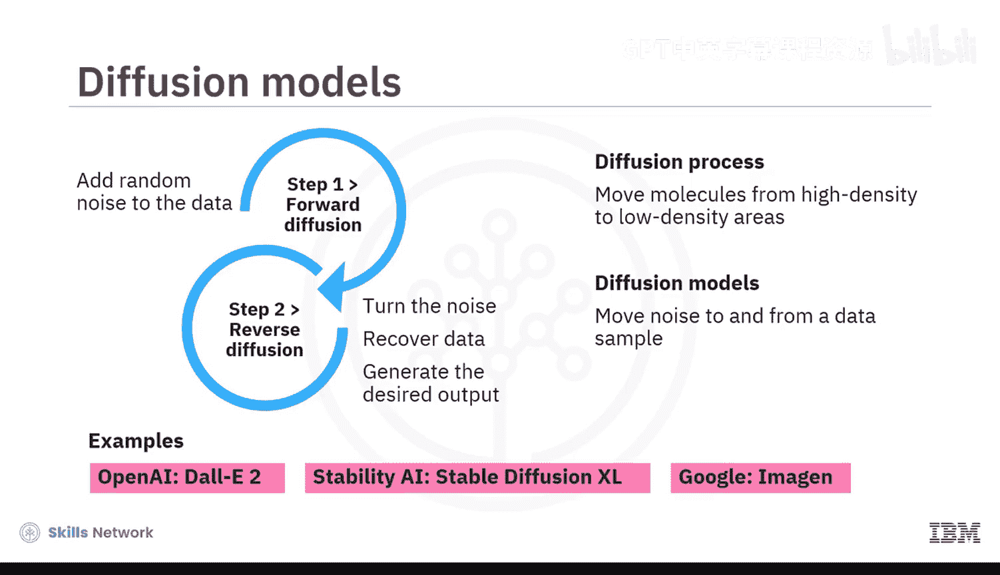
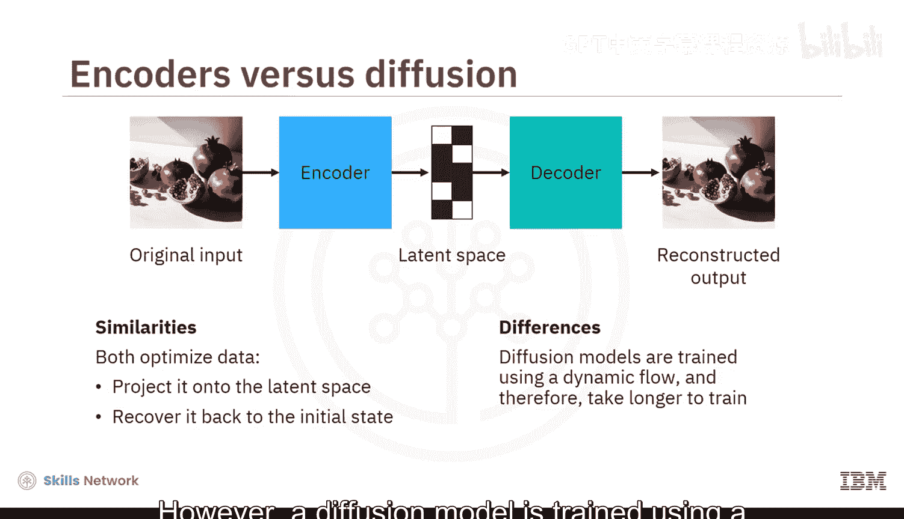
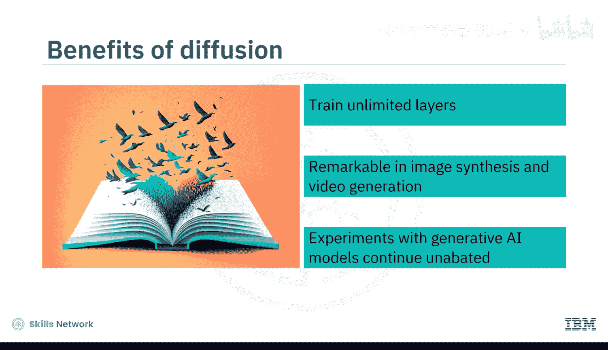

# IBM《生成式AI基础（五课全）｜Generative AI Fundamentals》中英字幕 p33 03_01_02_生成式人工智能模型.zh_en [BV11XSYBfEje_p33]

Welcome to generative AI models。 After watching this video。

 you'll be able to identify the core generative AI models that serve as the building blocks of generative AI and list their distinctive features。

 in the world of generative AI。 These four models have made a significant impact。 Vaational autoenrs。

 generative adversarial networks， Transformer based models and diffusion models。

 Each model employs a different type of deep learning architecture and applies probabilistic techniques。

 Let's gain insight into how they work。 Vaational autoencors or Vas are the most popular of all generative AI models for two reasons。

 A， they work with the diverse range of training data， such as images， text and audio and B。

 they rapidly reduce the dimensionality of your image。

 text or audio to create a newer improved version。 First， the encoder。

 which is a self sufficient neural network studies the probability distribution of the input data。

 In simple terms， this means that it isolates the most useful。😊。

Data variables This allows the encoder to create a compressed representation of the data sample and store it in the latent space You can think of this latent space as a mathematical space within the model's architecture。

 where large dimensional data is represented in a compressed format Next the decoder or reverse encoder。

 which is also a self-sufficient neural network decompresses the compressed representation in the latent space to generate the desired output。

Basically， the algorithms are trained using a maximum likelihood principle。

 which means they try to minimize the difference between the original input data and the reconstructed output。

Although VEs are trained in a static environment， their latent space is characterized as continuous。

 Therefore， they can generate new samples by randomly sampling from the probability distribution of data。

 because they can produce realistic and varied images with little training data。

 VEes are used in image synthesis， data compression and anomaly detection tasks。 For example。

 the entertainment industry uses VEs to create game maps and anime avatars。

 The finance industry uses VEs to forecast the volatility surfaces of stocks。

 The healthcare sector uses VaEs to detect diseases using electrocardiogram signals。

 generative adversarial network or G is another type of generative AI model that uses imagery and textual input data。

 In this model， two convolutional neural networks or CNNs compete with each other in an adversarial game。

 One CNN plays the role of a generator and is trained on a vast data set to produce data samples。

 The other。CNN plays the role of a discriminator and tries to distinguish between real and fake samples based on the discriminator's responses。

 the generator seeks to produce more realistic data samples。

 GNs can generate new realistic looking images perform a style transfer or image to image translation and even create deep fakes The finance industry uses GNs to train models for loan pricing or generating time series tools such as spacegan work with geospatial data and video stylegan2 is known for creating video game characters Unlike variational autoencors。

 GNs can be challenging to train as they require a large amount of data and heavy computational power They can potentially create false material。

 which is an ethical concern。

Transformer based models were introduced a few years ago when recurrent neural networks or RnNs started facing a problem called vanish ingredients。

 due to this problem， RNs were struggling to process long sequences of text to get around this challenge。

 Transformers were built with attention mechanisms that could focus on the most valuable parts of the text while filtering out the unnecessary elements。

 This allowed transformers to model long term dependencies in text。 For instance。

 when you enter a simple prompt， the two stack transformer architecture uses an encoder decoder mechanism to generate coherent and contextually relevant text。

 As transformer models can query extensive databases。

 they are able to create large language models and perform natural language processing tasks such as picture creation。

 music synthesis and even video synthesis。 This marks a significant breakthrough in our approach to content creation and offers many opportunities for innovation。

 as has been seen with G 3。5 and its。

versions， Bert and T5。Diffusion models are a more recent addition to the world of generative AI models。

 They address the systematic decay of data that occurs due to noise in the latent space by applying the principles of diffusion。

 These models try to prevent information loss。 Just as in the diffusion process where molecules move from high density to low density areas。

 diffusion models move noise to and from a data sample using a two step process。

 Step 1 is forward diffusion in which algorithms gradually add random noise to training data。

 Step 2 is reverse diffusion in which algorithms turn the noise around to recover the data and generate the desired output。

 Open AI's dolly to stability AI stable diffusion Excel。

 and Google's imaging are mature diffusion models that generate high quality graphical content。

Similar to variational autoencors。 diffusion models also try to optimize data by first projecting it onto the latent space and then recovering it back to the initial state。

 However， a diffus。

Model is trained using a dynamic flow and therefore takes longer to train。

 Then why are these models considered the best option for creating generative AI models。

 because they train hundreds， maybe even an unlimited number of layers and have shown remarkable results in image synthesis and video generation experimentsments with generative AI models continue unabated as unsupervised algorithms throw up one surprise after another。

In this video， you learned about the four core generative AI models that serve as the building blocks of generative AI Vaational autoencors rapidly reduce the dimensionality of samples。

 generative adversarial networks use competing networks to produce realistic samples。

 Transformer based models use attention mechanisms to model long term text dependencies。

 diffusion models address information decay by removing noise in the latent space。

