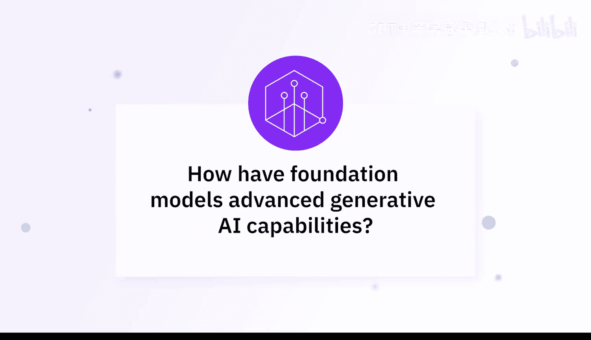
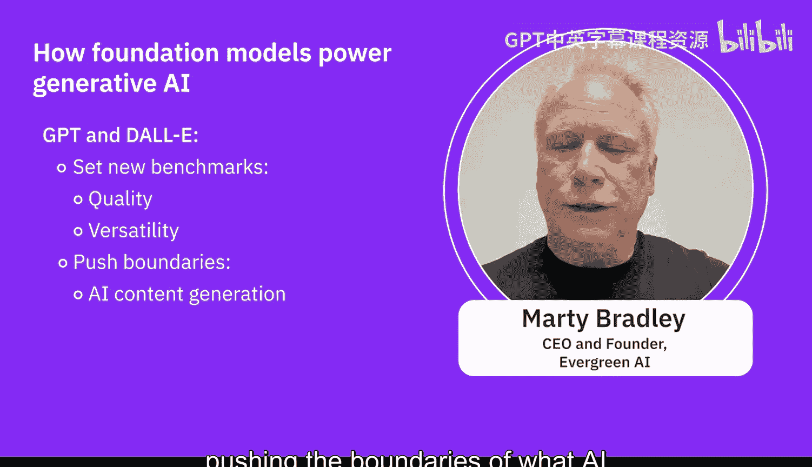
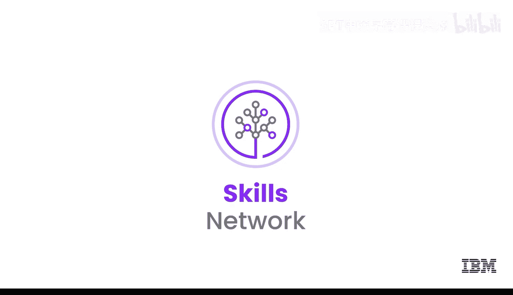

# IBM《生成式AI基础（五课全）｜Generative AI Fundamentals》中英字幕 p35 05_01_04_专家观点：推进生成式人工智能能力.zh_en [BV11XSYBfEje_p35]

Welcome to this expertert viewpoints video In this video。

 experts will discuss how foundation models such as GPT and Dolly have advanced generative AI capabilities。

😊。

Baab AI models like GPT and Dolly have significantly advanced the field by demonstrating the ability to create highly coherent and contextually appropriate content。

So specifically chattGT and Dolly were the two open source platforms that help the community get familiar with the concept of generative AI and having these two large models trained on a huge amount of data set。

 and they actually can tackle many different use cases， topics in their domain。

So the research in transformers has actually led to the point where we have you know combined the concepts of GNs and transformers to make GP so that is geneative pretrain transformer and the advantage of GP is very robust in terms of。

Talking about the language models per se because you know。

 the artificial or synthetic text generation for a pretrained transformer。

 which is specifically an NP pipeline， is a very popular choice because it has already been pretrained with a lot of good amount of information and it is able to generate。

Text， which is seemingly absolutely immaculate。For example。

 CIGT can tackle many different text generation use cases and it's very generalized because it has been exposed to many different data sets in the training phase。

 as well as dolly， similarly for image generation， it can be very creative and tackle many different use cases。

Within the image generation context and the concept of fine tuning also helps the community and others to use these models without having or demanding huge computation power needing a lot of data。

GPT or generative pretrain transformer excs in generating human light text。

 This enables applications such as chatbots， automated content creation， language translations。

 and Doly， on the other hand generates images from textual descriptions。

 It showcases the potential of AI and the creative domains like art， design and advertising。

So GPT models， yes GPT is one of the biggest backbones of the large language model industry and all the tools that are using that are popular Dli specifically is an auto encoded based back software because what it does is create artificial images so again these are popular choices both of them very specific to their application and yeah so the pretrained part of the geneative networks that they are using have been trained with so much amount of information that it is really something to use as a pretrained model。

Also， having these models， from the early stages， it was great that community talked about the ethical and social implications and it made us think about the ethical concerns so that we make sure that we care about the bias and ethical concernss in the responses that these models provide and make sure that we put some restrictions on the responses or monitor and care about the governance around the models so that we can trust the models that these large language model or generative AI provides for us from the early stages。

These modelss have set new benchmarks and quality and versatility。

 pushing the boundaries of what AI can achieve with content generation。

。

