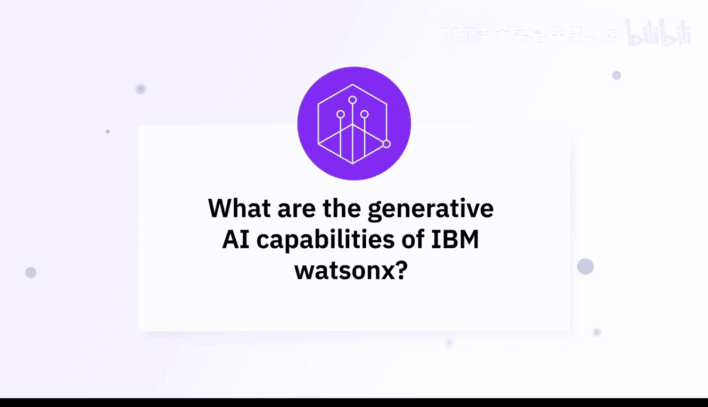
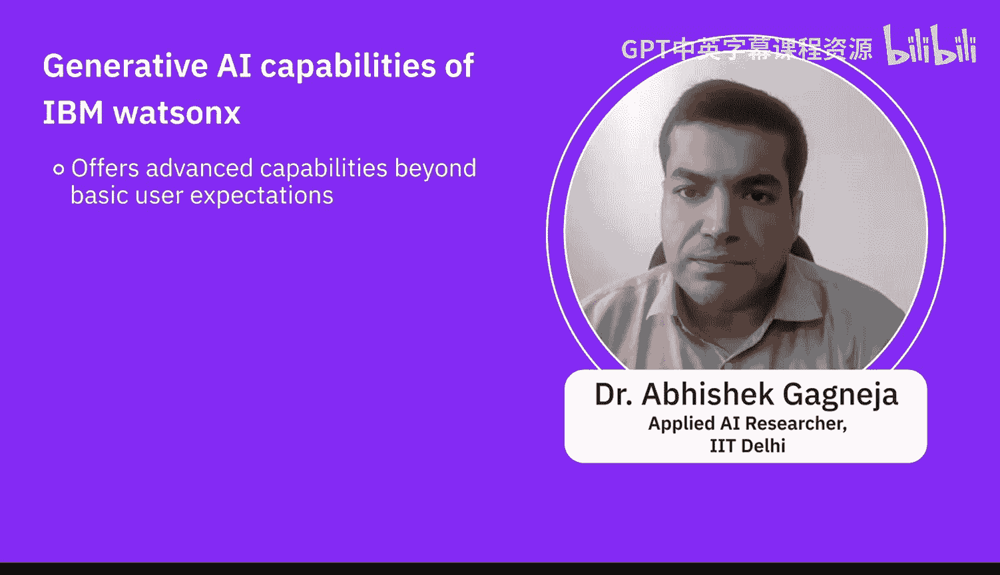
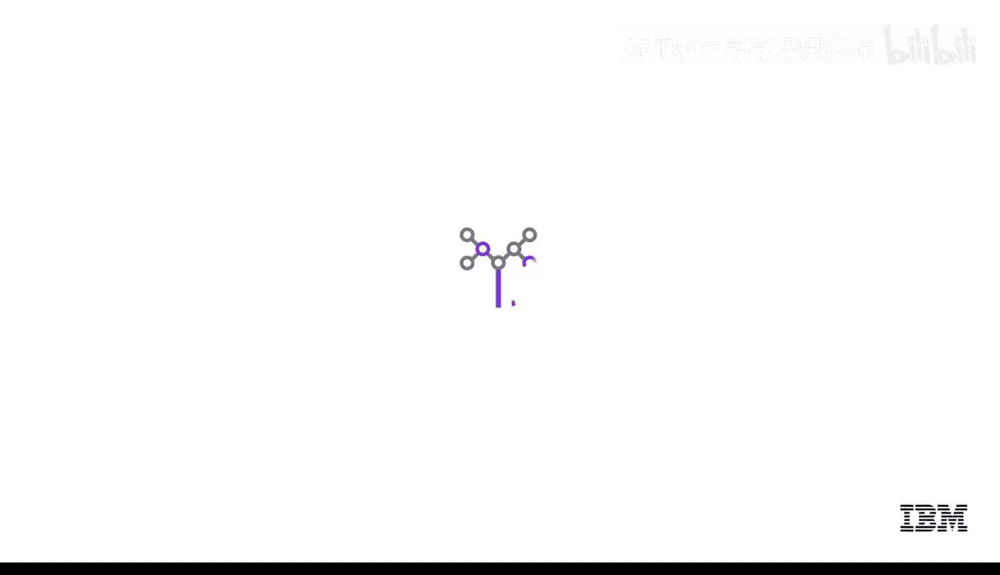

# IBM《生成式AI基础（五课全）｜Generative AI Fundamentals》中英字幕 p36 06_01_05_专家观点：探索IBM Watsonx的生成式人工智能能力.zh_en [BV11XSYBfEje_p36]

Hello and welcome to this expert viewpoints video。 In this video。

 AI experts will explore the generative AI capabilities of IBM Watson X。😊。

IBM Watson X offers advanced generative eye capabilities， tailored enterprise and needs。

 Watson X leverages state of the ARC AI models to generate text， code and data insights。

 It's a natural language processing NLP features allow the creation of detailed and contextually accurate reports。

 summaries and responses， making it valuable for customer service。

 content creation and data analysis。So IPM Watsonx is a complete compilation of a lot tools and generative VI capabilities of WatsonX include the use of all kinds of GPT models that are available at the back end。

So first of all， in order to tackle any data science use case and generative AI。

 we have to first access the right data set for that we have an offering called Vsson X data which enables us to overcome data silos and get access to the data wherever it resides。

 it is empowered by the strengths of generative AI so we can have interactive query so with a natural language we can ask which data we want if we want to measure table and if we want to do any data preprocessing the next phase is using Vasson X AI which is a bundle of offerings of different large language models including IBM large language models developed by IBM research as well as open source large language models。

 so we have included different large language models that can be used by the end user and our customers。

And we have made sure when developing our large language models that the data that we use to train these models are very well prepared。

 cleaned and that there is no offensive data set， no bias in the data。Along with that。

 there are further applications of a lot of automated softwares and you know automated tools that specifically are very convenient that make it very convenient for any kind of data scientist or a data engineer to work on these models。

We have a platform called Thats in Ex Govern， which not only helps us to catalog the models and have a unified。

Dashboard to see all the models， different model versions in which stage the model is。

 but also it helps us to monitor the performance of those models from different other aspects like hallucination bias and if there is any problem gives us larges and sometimes it mitigated back and it can show us to the transaction level。

 which data actually is creating this issue。Additionally， WatsonX supports cogeneration。

 helping developers automate repetitive coding tasks and enhance software development efficiencies。

 the platform's ability to generate synthetic data aids and training machine learning models。

 providing robust data sets while addressing privacy concerns。

So it's very important to also be able to evaluate the result of these large language models is' a little bit more sophisticated because the result is usually image and text and there is different ways to measure whether the response is what we were looking for so for different tasks such as rack sumization generation in our platform we have by default included the evaluation matrices and when you choose the task it automatically selects the evaluation matrices and helps you evaluate your model over time。

So Wason next capabilities are quite beyond what any basic level user would expect。And it's a very。

 very nice and very detailedered software and。

。

