# IBM《生成式AI基础（五课全）｜Generative AI Fundamentals》中英字幕 p37 07_02_01_预训练模型：文本到文本生成.zh_en [BV11XSYBfEje_p37]

Welcome to pretrained Model Text to Text generation After watching this video。

 you'll be able to explore the different models used for text to text generation in generative AI。

 you'll also be able to describe the uses and benefits of these models。

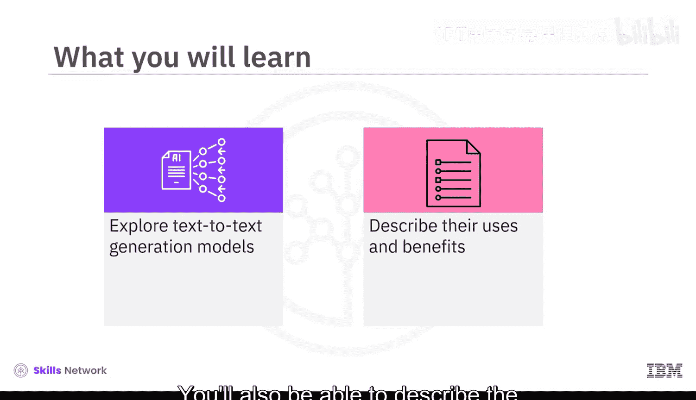

Summarize， code， translate， create content。 These are just some of the things that text to text generation models can do for you。

 But what exactly are text to text generation models。

 text to text generation models are a type of machine learning model used to generate text from a given input。

 They are trained on a large corpus of text。 These language models are trained to learn patterns。

 grammar and casual information。 using this input， the models generate the new text and can generate a variety of text formats。

 including code， scripts， musical pieces， emails， letters and so on。

There are two main text to text generation models， statistical and neural network models。

 statistical models use statistical techniques to generate text。

 One common statistical model is the Markov chain。A Markov chain generates text by starting with a seed state and then generating the next state based on the previous state；

 for example， it can predict and generate the next character based on previously observed language patterns。

Markov chains can generate text for several purposes like speech recognition and journalism。

 neural network models use artificial neural networks to generate text。

 These models can represent complex relationships between data。

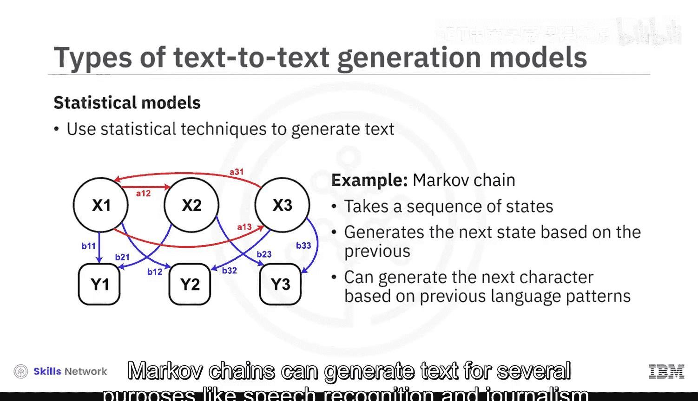

Neurural network models are typically trained on a large text corpus。

 They can then generate text similar to the text they were trained on。

 T to text generation models use either sequence to sequence or transformer type of models。

 sequence to sequence models first encode the input text into a sequence of numbers。

Then decode the sequence into a new one， representing the generated text。

 some examples of these tasks are summarization， speech recognition， and machine translation。

Transformer models directly map the input text to the generated text。

 allowing the models to generate more fluent and natural sounding text than sequence to sequence models。

A key feature of transformer models is how they leverage an AI concept called attention to emphasize the weight of related words。

This can help provide the context for a specific word or token describing some other type of data。

 For example， a section of an image。 Let's explore some of the most popular text to text generation models。

 First， you have the G created by open AI。 It is a substantial language model。

 Its development involved training on an extensive corpus of text and code。

 Epping it with the capability to produce text， Per language translation。

 generate diverse forms of creative content and provide informative responses to user inquiries。

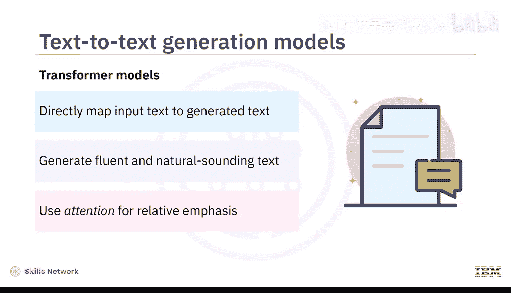

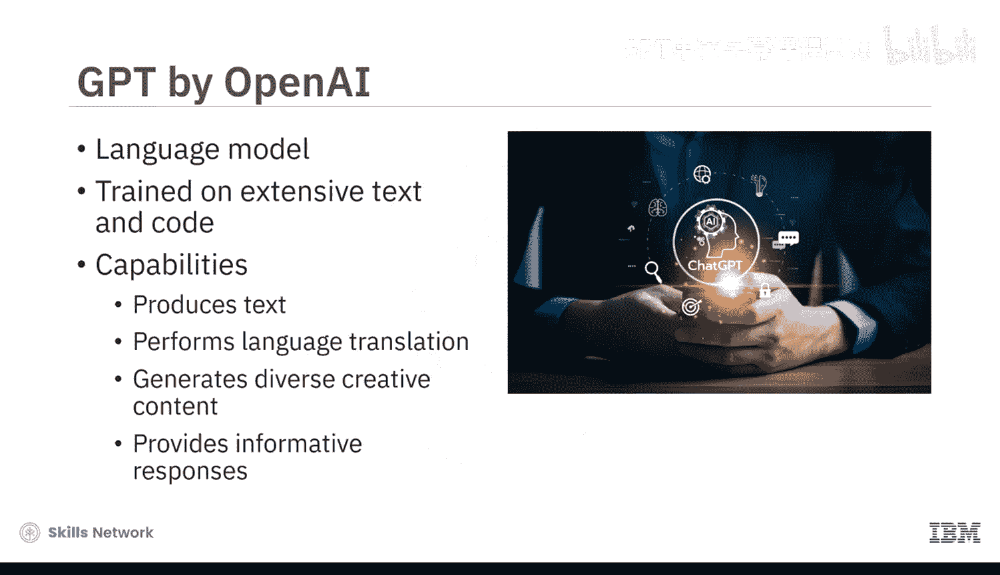

Then there is T5 T5 is a text to text transfer transformer model developed by Google AI。

This model is also trained on a substantial data set of code and text。

 and can be used for various tasks， including summarization， translation， and question answering。

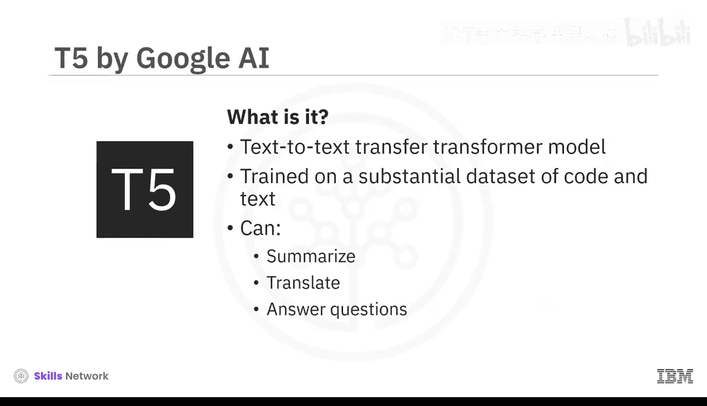

What makes T5 popular， generating text requires capabilities accomplished using deep learning models based on natural language processing。

 also called NLP。However， you need one model for language translation and another for language auto completion。

 making the approach inefficient。

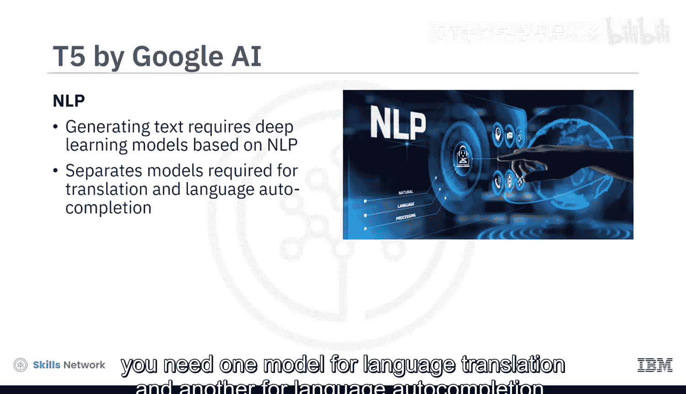

It gives rise to the need for a unified model capable of producing coherent and contextually appropriate text。

This requires an architecture that can convert all input and output data into text。

 The model can then learn from diverse examples and apply the learning to a wide range of tasks in NLP。

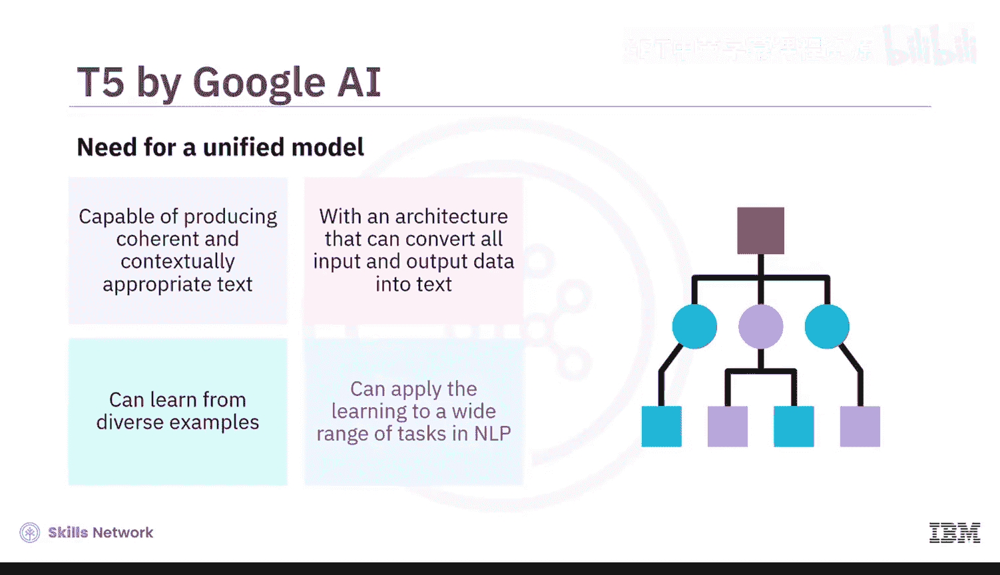

T 5 is the answer to this need。 It is a universal model that uses a standard encoder decor architecture to perform various tasks like transformations and classifications。

 It also leverages Trans learning capabilities。 The model trained on the data for one task can be fine tuned to perform another downstream task in the same domain。

 Finally， you have Bart。 Bart is a bidirectional auto regressive transformer models developed by Facebook AI。

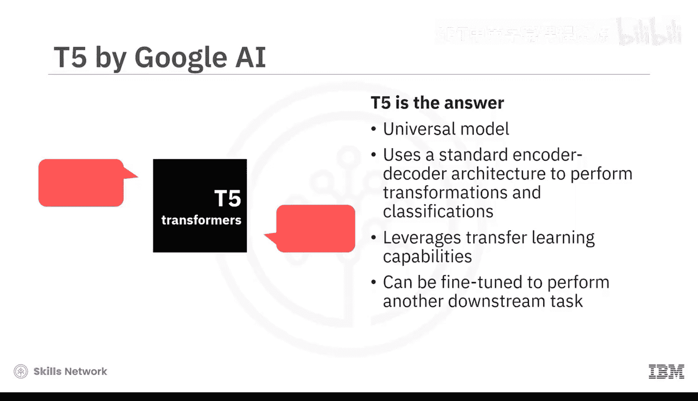

Bart is a deep neural network with a sequence to sequence translation architecture with bidirectional encoder representation like Bt and a left to right decoder like G。

 Bt stands for bidirectional encoder representations from transformers。

 It refers to a family of language models by Google that uses pretraining and fine tuning to create models that can accomplish several tasks。

 Bart's bidirectional nature processes text forward and backward。

 This Bt and G decoder combination allows Bart to perform tasks like analyzing sentiment answering questions。

 and LP tasks like language translation。 and generating humanlike text。 Further。

 its auto regression nature allows it to generate contextual text。

 taking feedback from previously generated tokens to generate new ones。

 The Bart capability also applies to computer vision tasks。

 The versatility of the model makes it useful across industries。 I'm sure by now。

 you can see how text to text。

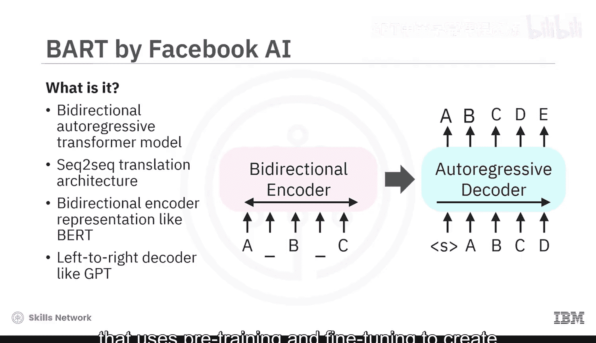

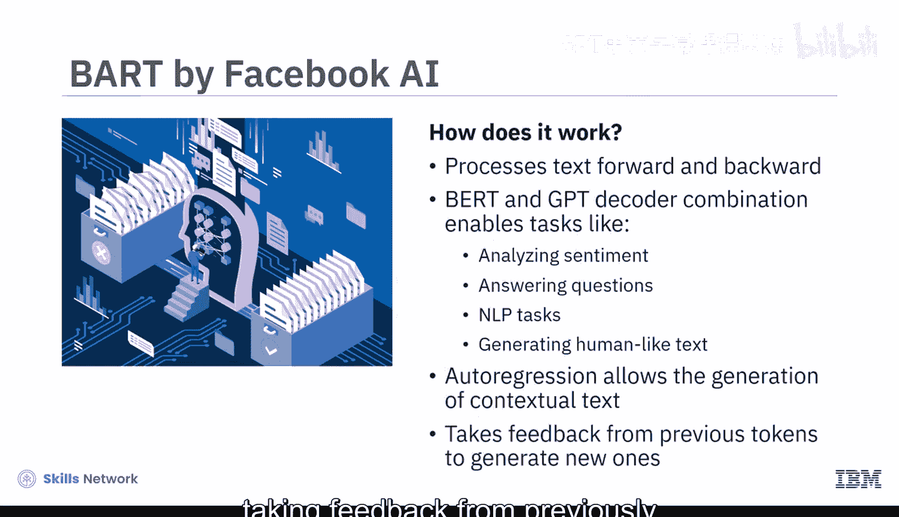

Generation models can be powerful tools for task completion。 Let's look at some examples。

 There is text summarization where these models can process the input text to generate the summarized text without changing the original text's meaning text to text models can support conversational intelligence by providing personalized assistance through text based query responses。

Finally， did you know that text to text models can produce digital text that helps create product descriptions。

 write emails， create resumes and so on。 Now that's something。

 because of these versatile applications， text to text models offers several benefits。

 They increase productivity through automation。 For example。

 they can generate marketing copies or even create social media posts。

 they improve the accuracy of tasks prone to human error。 For example。

 a text to text generation model can translate documents and context without mistakes。 In this video。

 you learned the meaning of text to text generation models and generative AI。

 you learned the two types of text to text generation models， Sta and neural networks。

 text to text generation models use either sequence to sequence or transformer type of models。

 You also explored the most popular text to text generation models GT， T5 and Bart Finally。

 you learned the several uses and benefits of these models。

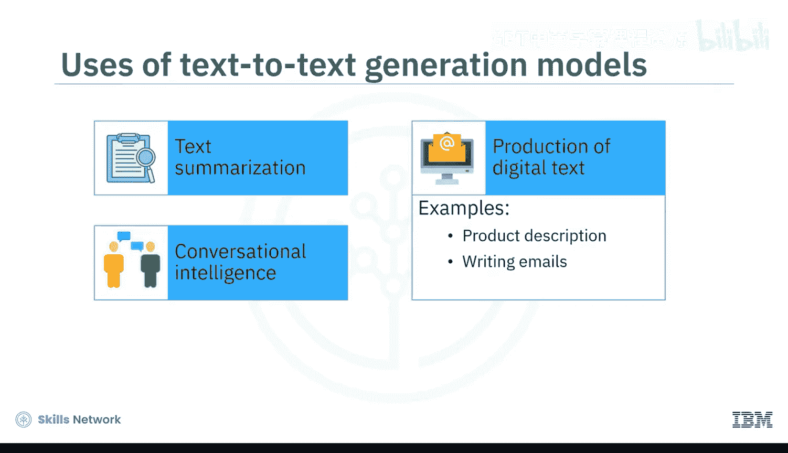

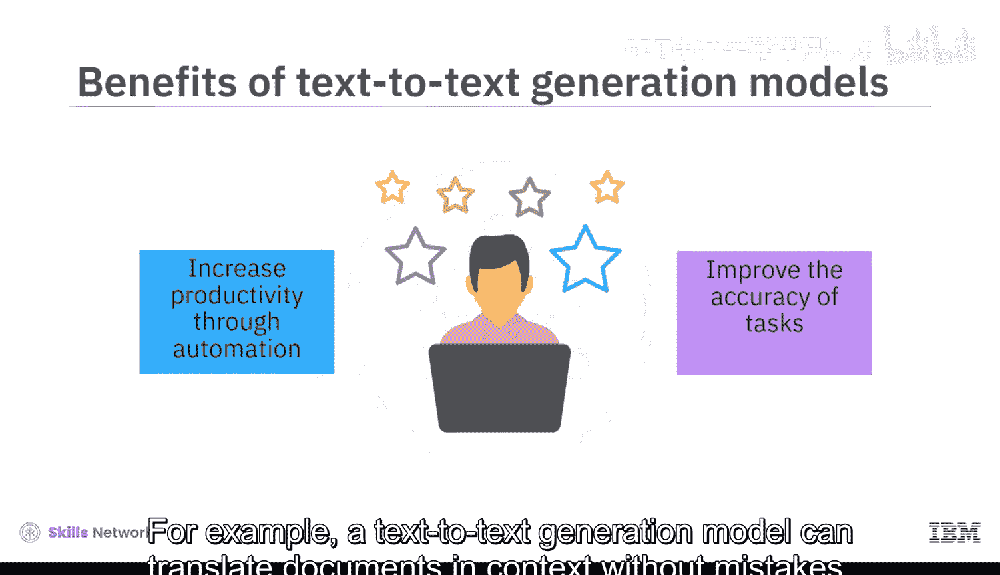

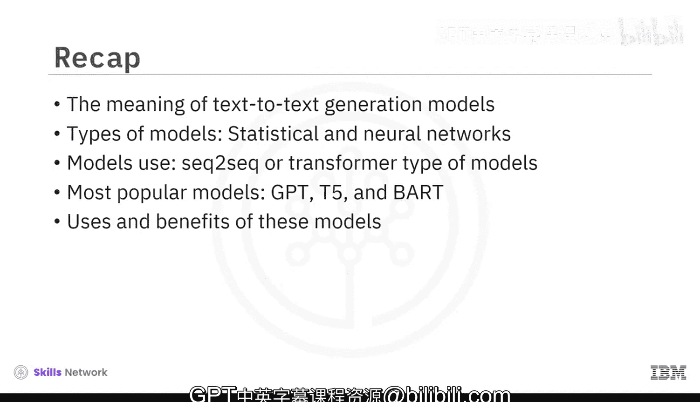