# IBM《生成式AI基础（五课全）｜Generative AI Fundamentals》中英字幕 p38 08_02_02_预训练模型：文本到图像生成.zh_en [BV11XSYBfEje_p38]

Welcome to pretrained models Tex to Image generation After watching this video。

 you'll be able to explore the different models used for text to image generation in generative AI。

 you will also be able to describe the uses and benefits of these models Tex to image generation models are a type of machine learning models They are used to generate images from text descriptions They use generative AI to make meaning out of your words and turn them into unique images。

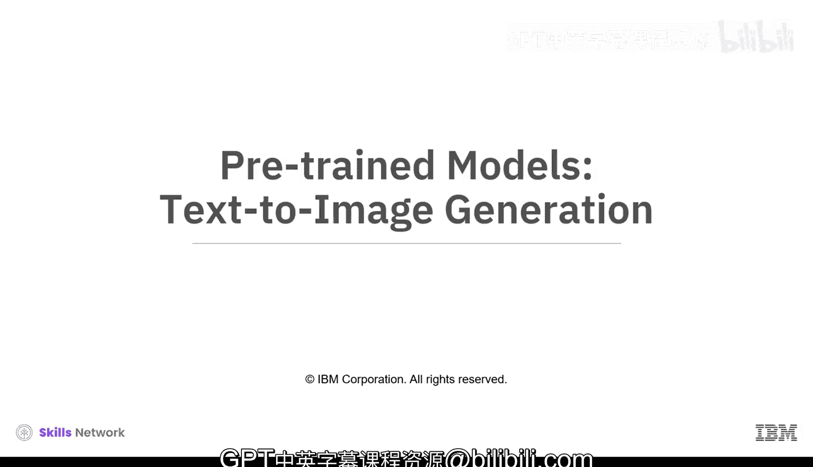

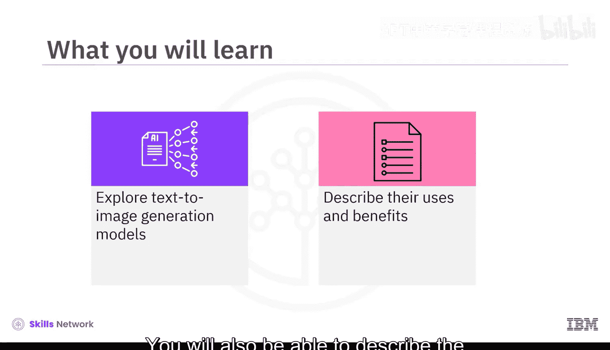

Text to image generation models are trained on a large data set of text and images and can be used to generate various types of images。

 These can be realistic images， abstract images， or even images that do not exist in the real world。

There are two types of text to image generation models。

 generative adversarial networks also calledganNs and diffusion models。

 Let's look at each GNs are a type of machine learning model that can be used to generate realistic images。

 They work by training two models against each other。

 A generator model that generates images and a discriminator model that distinguishes between real and fake images。

 The generator model is gradually improved over time until it can generate images that are indistinguishable from real images。

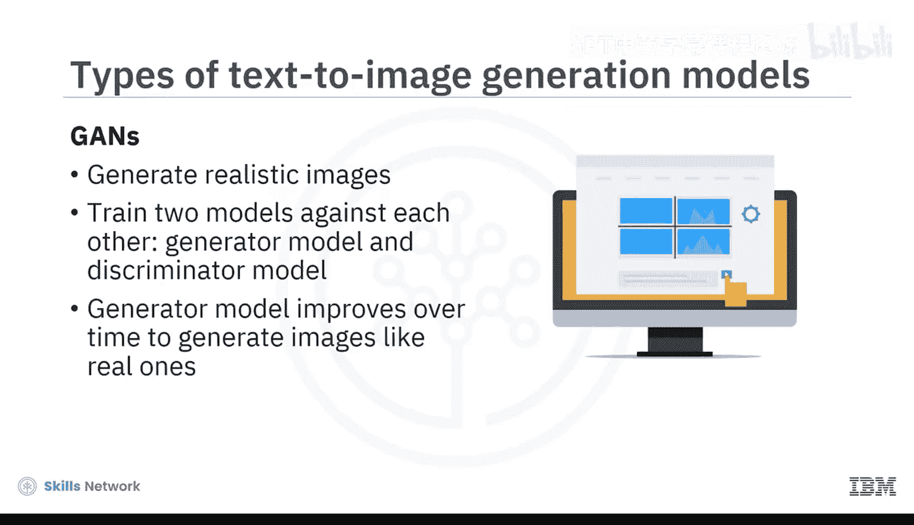

Diffusion models are also a type of machine learning model。

 They are used to generate images from text descriptions。

 They work by starting with a random image and gradually adding detail to the image until it matches the text description。

 diffusion models are typically more efficient than GNs and can be used to generate more creative and abstract images。

 Let's explore the most popular text to image generation diffusion models。 Dolly and imagegen。

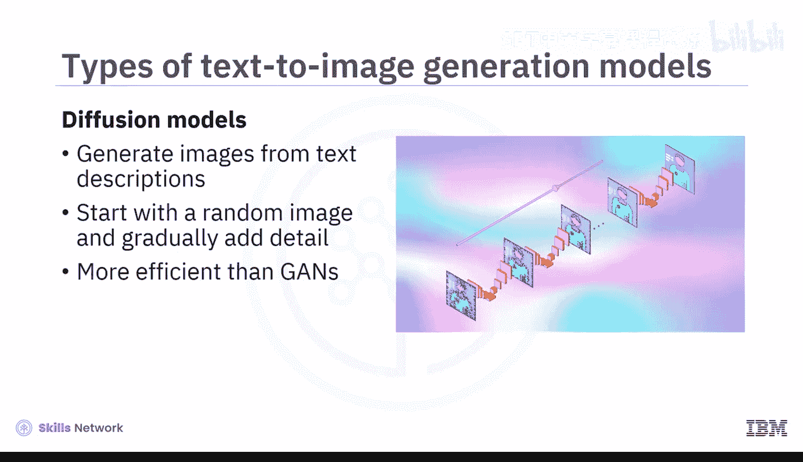

Doli is a text to image generation model developed by open AI Doli is trained on a massive data set of text and images and can be used to generate realistic images from various text descriptions。

 It also incorporates an evaluation mechanism to determine whether the final picture is accurate to achieve this。

 Dolly uses a combination of its core elements。Natural language processing， also known as NLP。

 machine learning and computer vision。 For example。

 it can take a simple description like a panda juggling a ball and turn it into a photo realisticistic image that hasn't been created before。

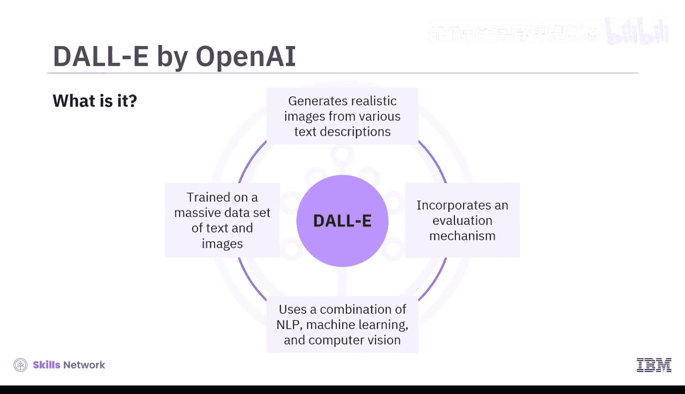

Not only that， but Dolly can also edit photographs based on a simple text description。

Such that the edit blends in seamlessly with the original image， it's called in paintinginting。

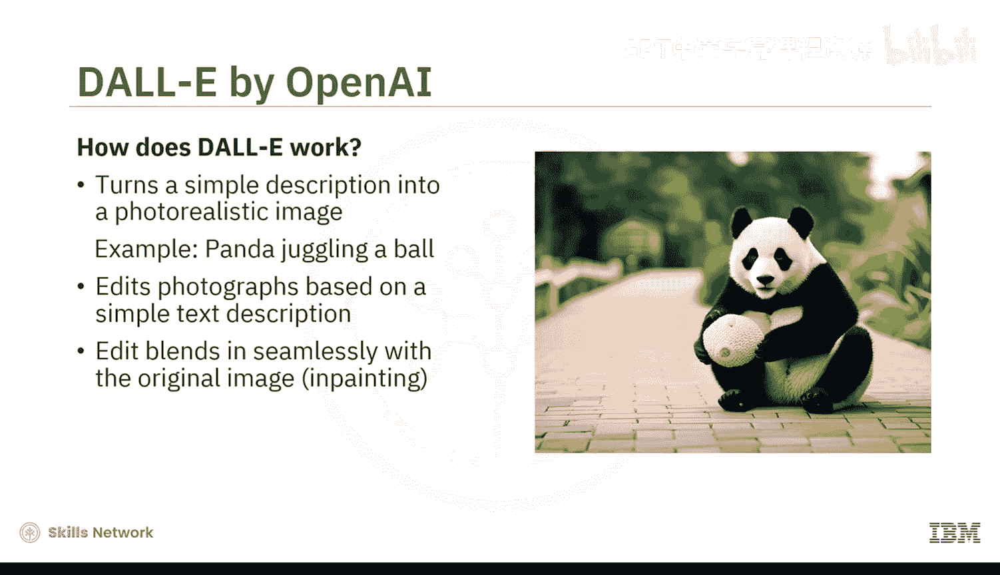

Dolly is special because deep learning allows it to understand individual objects such as pandas and balls and how things are related。

The latest version of Dolly is a large model， but not nearly as large as G 3， and interestingly。

 smaller than its predecessor。 Despite its size， this newer version generates four times better resolution images than the former version of Dolly。

 So what are the benefits of Dolly。 An image generated by Dolly tells us if the system understands what we've communicated or merely repeats what it has been taught。

 Further， Dolly plays a crucial role in developing useful and safe AI by enabling us to understand how AI makes sense of our world。

 The second popular model is Imogen。 Imogen is a text to image generation model developed by Google AI。

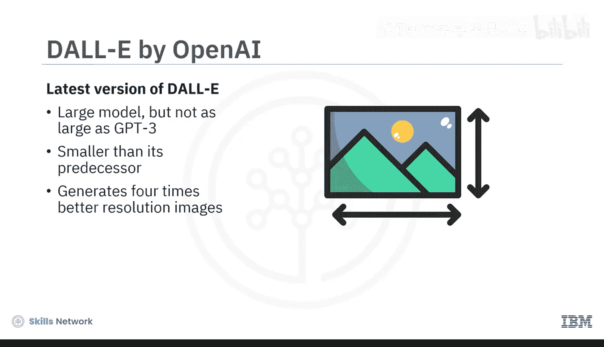

Just like Dolly， Imogen is also trained on a massive data set of text and images。

 Iogen is used to generate realistic images from a wide variety of text descriptions。

 Imogen leverages the power of large transformer models and deep language understanding to generate high fidelity images。

An important discovery has been that large language models like T5 pre traineded on text are pretty effective at encoding text to generate images。

 Hence， it would follow that increasing the language model size in Iogen would also augment image fidelity rather than increasing the size of the image diffusion model。

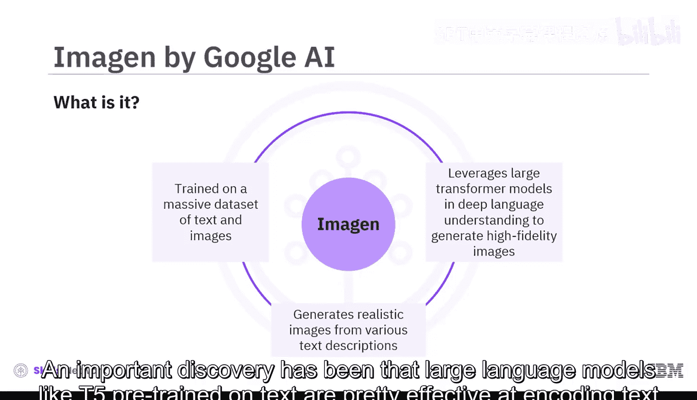

Imgen claims to be able to produce an unprecedented degree of photorealism。

 which is one of its key advantages。 This is how it works。 The model picks up text。

 such as two white umbrellas rising into the sky。 Cloududs are moving。

 It is raining and converts it into an image depicting just that。

 The image could be either photorealistic or an artistic interpretation。

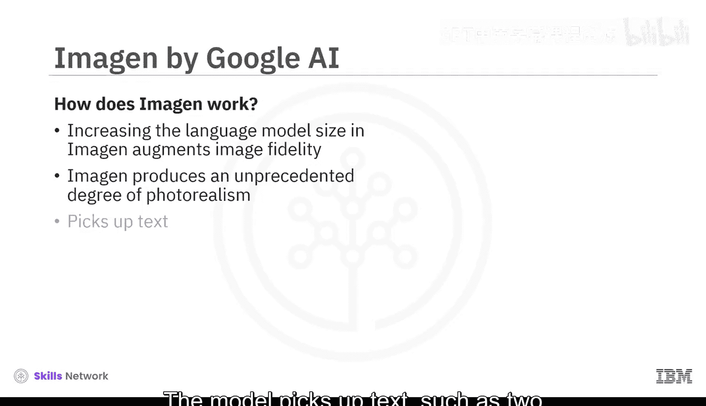

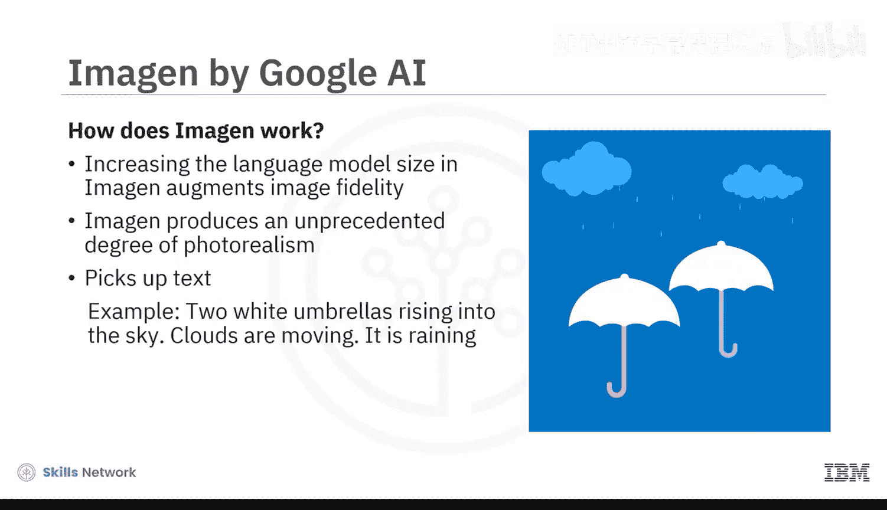

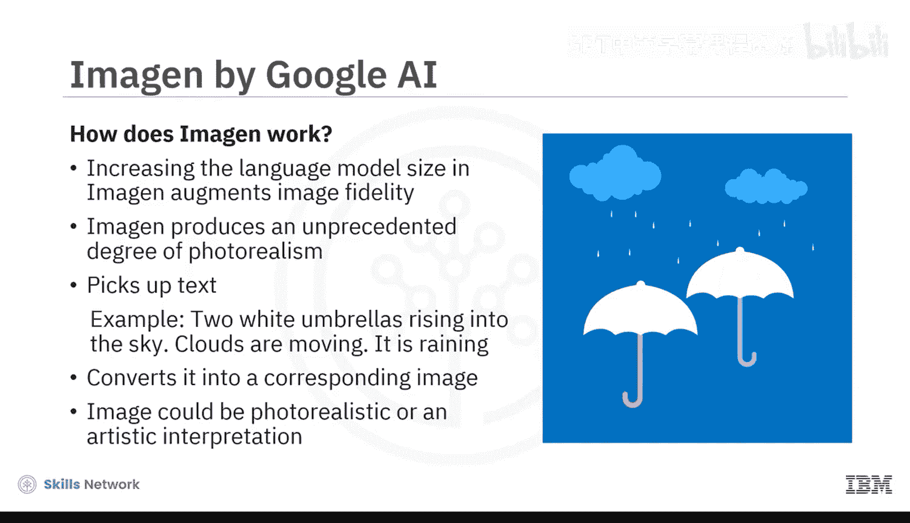

In this video， you learned how text to image generation models work。

These models are classified into two types， GNs and diffusion models within diffusion models。

 you explored the most popular text to image generation models， Dolly and Imogen。 Finally。

 you learned the benefits of each of these models。

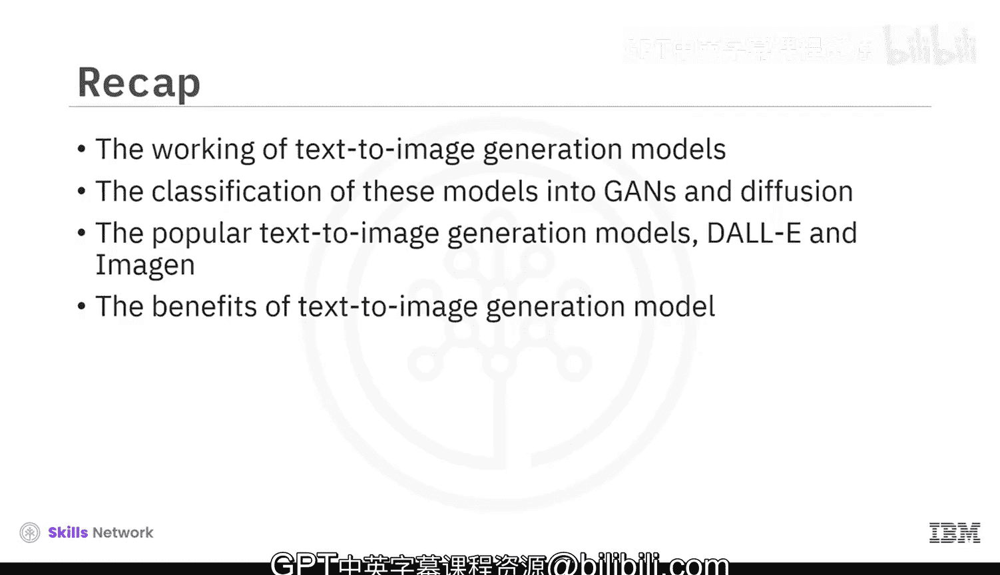

。