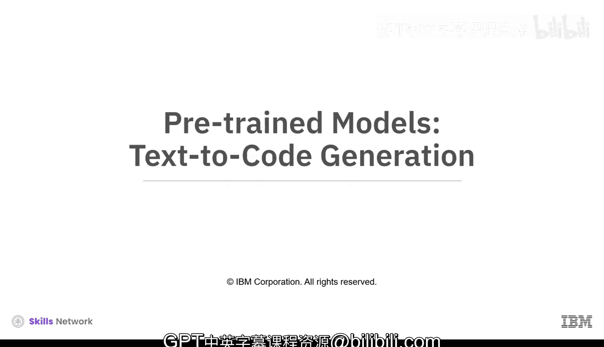
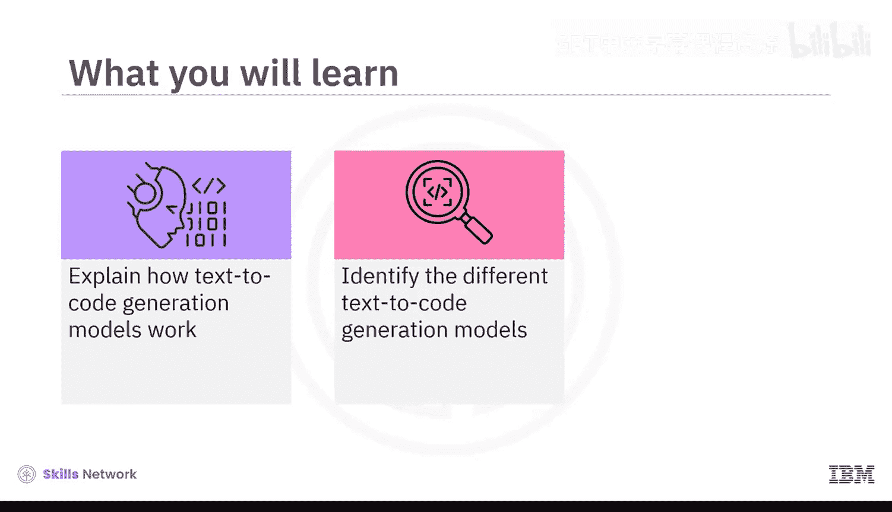
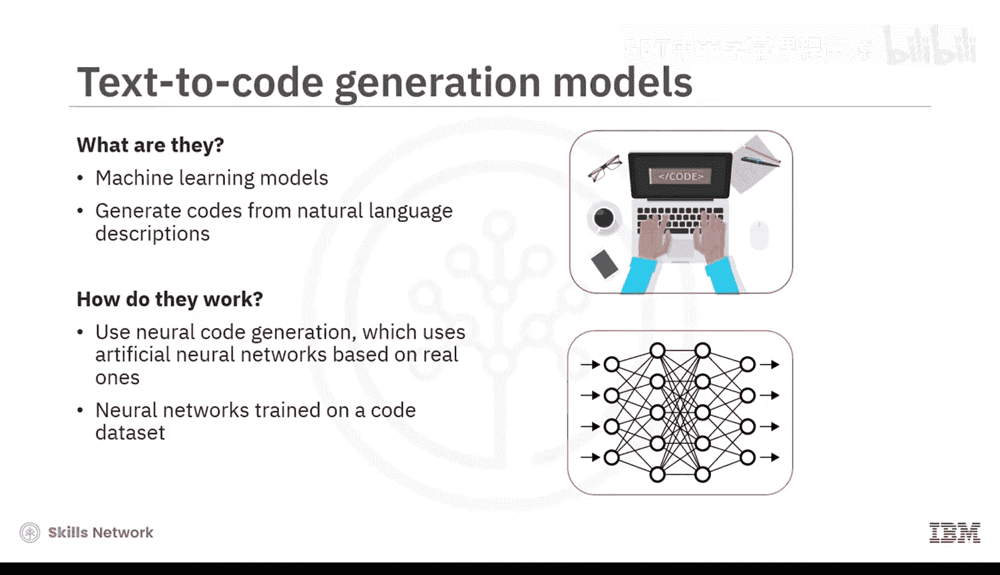
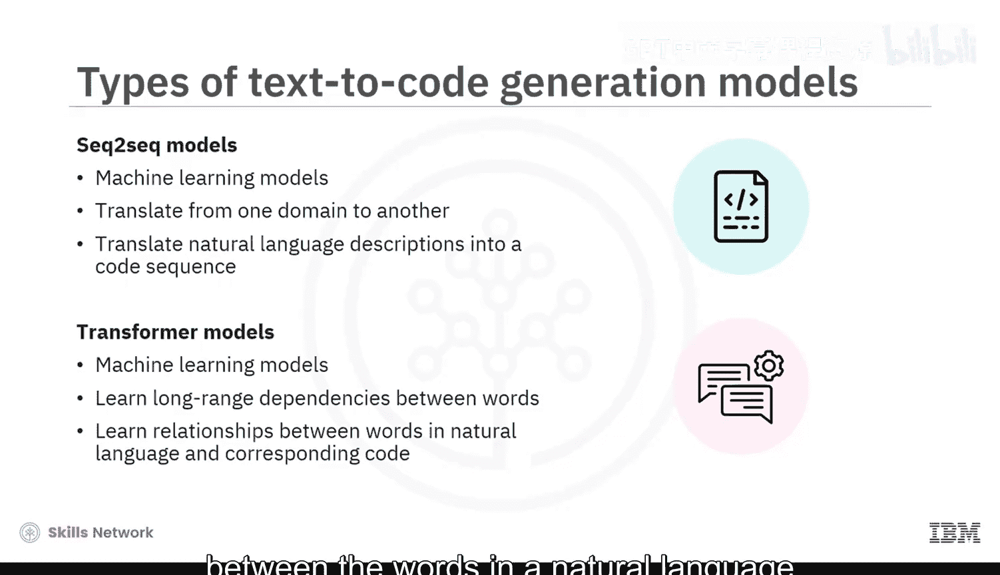
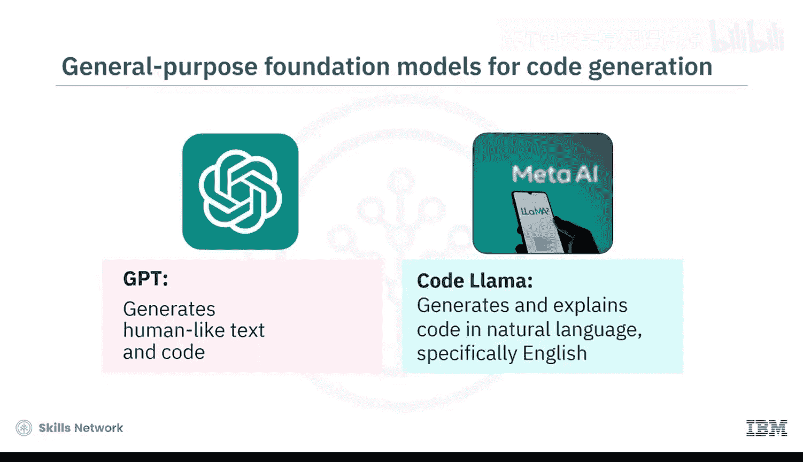
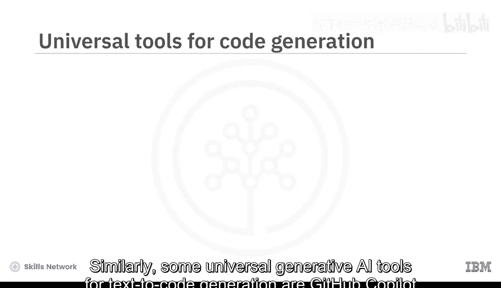
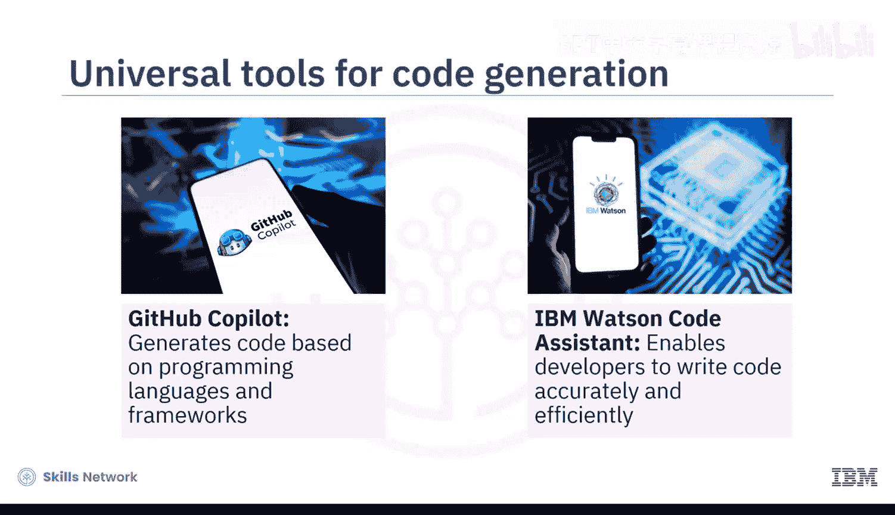
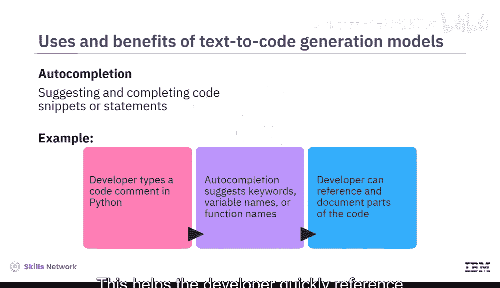
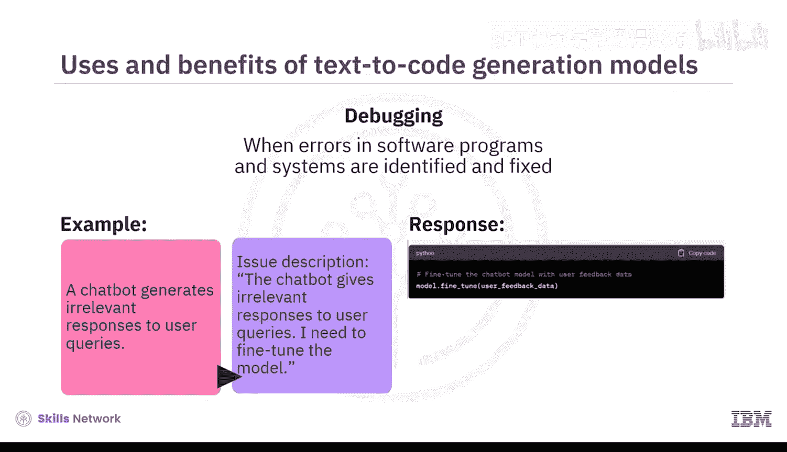
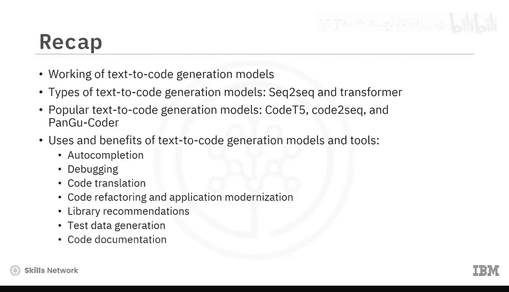

# IBM《生成式AI基础（五课全）｜Generative AI Fundamentals》中英字幕 p39 09_02_03_预训练模型：文本到代码生成.zh_en [BV11XSYBfEje_p39]

Welcome to pretrained models， text to code generation。 After watching this video。

 you'll be able to explain how text to code generation models work in generative AI。

 You'll also be able to identify the different text to code models and describe their uses and benefits。

 text to code generation models are a type of machine learning model used to generate code from natural language descriptions。

 The models use generative AI to write code through neural code generation。

 neural code generation is a process that uses artificial neural networks loosely based on neural networks in the human brain。

 These neural networks are trained on a substantial data set of code examples and then fine tune to generate code snippets。

 functionss and complete applications。 The generated code is similar in structure and function to the examples it has been trained on。

 There are two main text to code generation models。

 sequence to sequence and transformer sequence to sequence models are a type of machine learning model that can translate from one domain to another。

 In the case of。😊。

Text to code generation， the model can translate natural language descriptions into a code sequence。

 Transformer models are also a type of machine learning model that can learn long range dependencies between words。

 In the case of text to code generation。 the model is trained to understand the relationships between the words in a natural language description and the corresponding code。

 Several popular text to code generation models exist within the sequence to sequence and transformer model classifications。

 Let's look at some of them。 The first model is code T 5。

A sequence to sequence model developed by Google AI Code T 5 is the first pretrain programming language model that is code aware and encoder to coder based。

 Like most models， code T 5 is trained on a large data set of text and code。

 It can enable a wide range of code intelligence applications。

 These include code understanding and generation tasks。

 Some examples of these tasks are text summarization， Ques answering and language translation。

 The second popular model is code to sequence。 Code to sequence is a sequence to sequence model developed by open AI。

 It is an alternative approach that leverages the syntactic structure of programming languages to encode source code even better。

 Having been trained on a substantial text and code data set。

 code to sequence can generate code for several tasks。 such as code summarization。

 documentation and retrieval。 For example， The code to sequence approach can caption code snippets。

 That is， it can assign a natural language caption to the task performed by the snippet。 Finally。

 you have the。😊，Pangu codeder， pangu codeder is a transformer model developed by Microsoft Research。

 Pangu codeder is a pretrained decoder only language model that generates code from natural language descriptions。

 It's built on the pangu Alpha architecture。 A large scale neural network used for natural language processing。

 also called N LP。 This model can generate code for tasks like function definition。

 class definition and program synthesis。 For example。

 Pangu codeder can successfully synthesize running code to solve a problem based on a natural language description。

In addition， several other general purpose foundation models can be used for text to code generation。

 such as Open AIs G and code Lama by Me G Excels in humanlike text generation and demonstrates impressive capabilities in code creation。

 code Lama can generate and explain code in natural language specifically English Similarlyly。

 some universal generative AI tools for text to code generation are Github copit and IBM Watson code assistant Github codepit powered by open AI codex can generate code based on various programming languages and frameworks。

 IBM Watsson code assistant is built on IBM Watson X do AI and enables developers to write code accurately and efficiently with realtime recommendations。

 Autocomplete features and code restructuring assistance。

There are several uses and benefits of text to code generation models and tools。

 Let's look at some of them。 Tex to code generation plays a crucial role in auto completion。

 helping developers by suggesting and completing code snippets or statements as they type For example。

 as a developer types of code comment and Python or any programming language。

 auto completion suggests relevant keywords， variable names or function names based on the context of the comment。

 This helps the developer quickly reference and document parts of the code。

 Irov code documentation and readability。 Tex to code generation models can automatically generate code based on natural language descriptions。

 Here's an example to illustrate how The task is generating python code from natural language description。

 The natural language description is create a python function that can calculate the factorial of a given integer。

 here， you can see the generated Python code。 Furthermore。

 the stable underlying architecture of text to code generation tools reduces the time spent on de。

Debugging is when errors in software programs and systems are identified and fixed。 For example。

 supposeose a developer working on a chatbot using a generative AI model encounters a problem where the chatbot generates irrelevant responses to user queries。

 The developer states the chatbot gives irrelevant responses to user queries and need to finet the model。

 The text to code generation model generates the code snippets shown here。 In this case。

 the text to code generation model suggests a code snippet for fine tuning the chatbot model using user feedback data。

 This snippet assists the developer in quickly addressing the issue of irrelevant responses and improving the chatbot's performance。

That's not all。 Tex to code generation models can also facilitate code translation by automatically translating code between different programming languages。

 Faacilitating crossplatform compatibility and migration。

 they assist with code refactoring an application modernization by automating the identification of outdated or inefficient code segments and suggesting optimized replacements。

 streamlining the modernization process。 textex to code generation models can even provide recommendations for libraries and frameworks based on project requirements。

 helping developers make informed choices。 text to code generation models can generate test data by automatically creating code snippets that populate databases or data structures with diverse and realistic test cases。

 saving time in the testing process。 Finally， text to code models can automatically generate code documentation by generating comments。

 function descriptions and documentation based on code functionality making code bases more understandable and maintaining。

In this video， you explored the various text to code generation models and learned how they work。

 There are two types of text to code generation models sequence to sequence and transformer you also learned about the most popular text to code generation models code T5 code to sequence and pangu coder and their uses Finally。

 you learn the various uses and benefits of text to code generation models and tools for auto completion。

 debugging code translation， code refactoring and application modernization。

 providing recommendations for libraries and frameworks， test data generation and code documentation。

