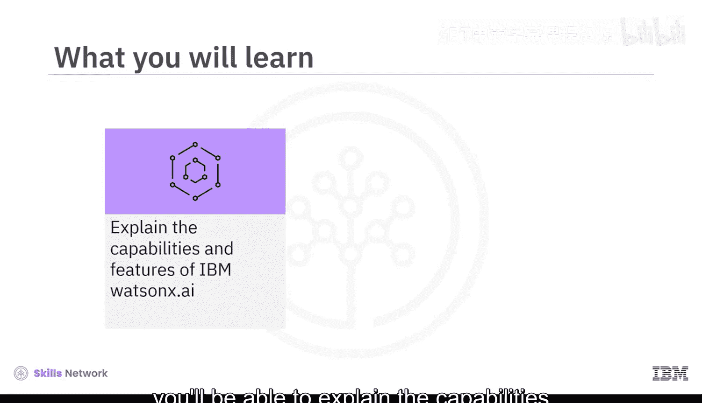
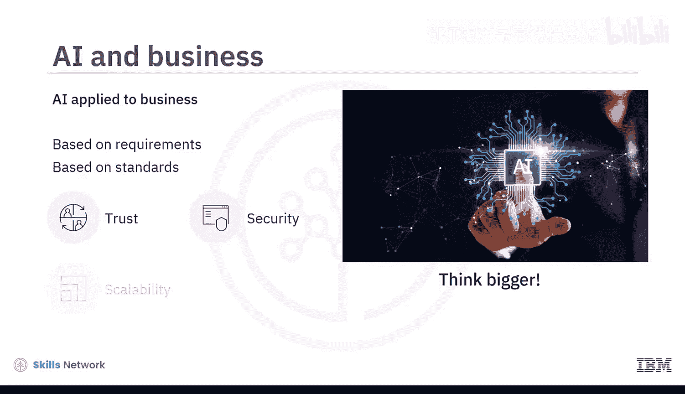
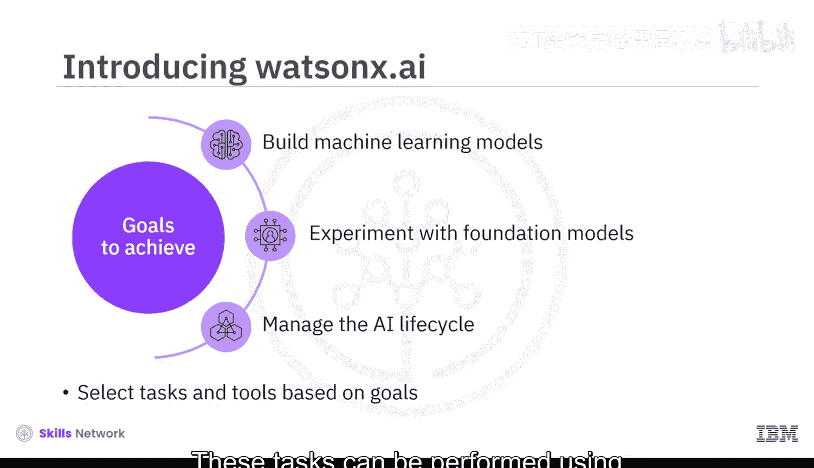
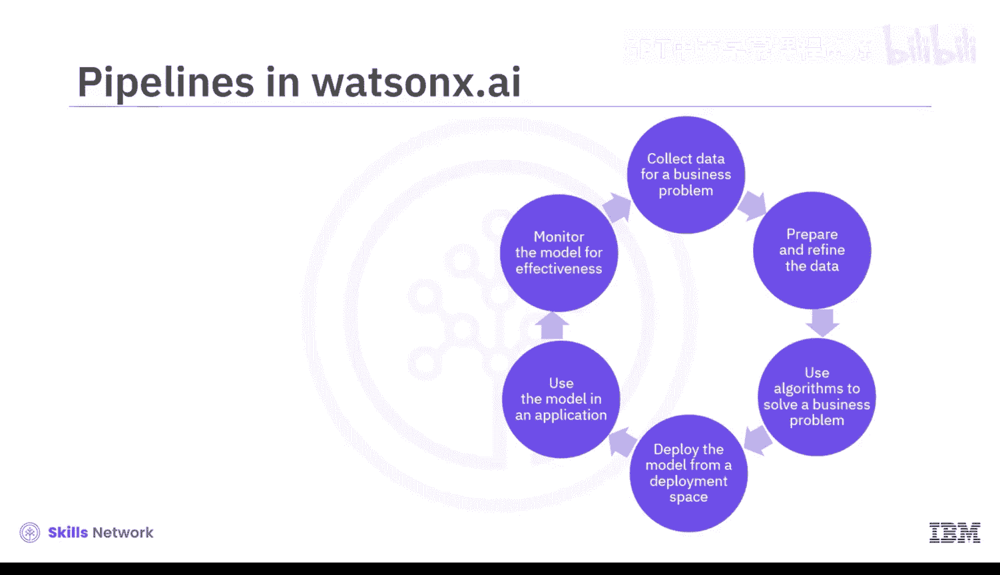
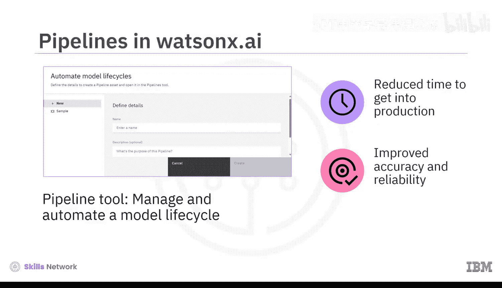
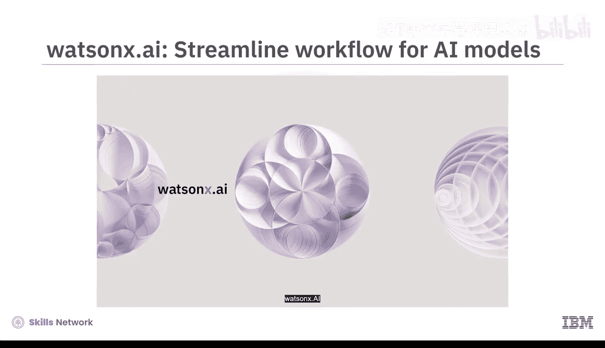

# IBM《生成式AI基础（五课全）｜Generative AI Fundamentals》中英字幕 p40 10_02_04_IBM Watsonx人工智能平台.zh_en [BV11XSYBfEje_p40]

Welcome to IBMWtson X do AI After watching this video。

 you'll be able to explain the capabilities and features of IBMWtson X do AI and identify the common tools available in Watson X do AI generating poem。

 art or a song through AI is fun， but when AI is applied to business。

 you need to think bigger AI for business needs to be built based on requirements based on higher standards。

 When you build AI in the core of your business， It needs to be trusted， secured。

 scalable and adaptable。 Here is a platform that helps businesses leverage AI IBM Watson X。

 IBM Watson X is an integrated AI and data platform for AI builders。

 The Watson X platform comprises three products。 The first product is Watson X do AI。

 A studio for new foundation models， generative AI and machine learning。

 The second product is Watson X do data， which is a data store and the third product is Watson X dot governance。

 which is a toolkit for monitoring and governance In this video will focus on Watson X do AI。😊。

Watson X dot AI is a studio of integrated tools powered by foundation models for working with generative AI and building machine learning models with Watson X do AI。

 you can train tune， deploy and manage foundation models easily。

 This helps you build AI applications and a fraction of the time and with a fraction of the data。

 with Watson X do AI。 These are some prominent goals you can achieve build machine learning models。

 experiment with foundation models and manage the AI lifecycle based on your goal。

 you can select the tasks offered by Watson X do AI。

 These tasks can be performed using the tools provided on the platform The tasks and tools and Watson X do AI align with the AI lifecycle of a model。

 You prepare your data， build an experiment and train models and solutions。

 Then you deploy your models and start building your applications。 Sub。

 you manage these models and repetitive processes。 Watson X do AI offers access to IBM selected open source models from hugging face。

 as well as a family of IBM trained。😊。

Moels of different sizes and architecturesAs an AI value creator you can also bring your models and data to Watson X AI with tools like promptla。

 AI builders can experiment with foundation models and build prompts that meet their needs。

 Promp lab enables users to experiment with prompts to support a range of natural language processing or NLP tasks including question answering content generation and summarization。

 Tex classification and extraction As an AI creator you may also want to customize models based on your data and for your business use cases。

 Watson X AI enables you to do so using the tuning studio tool With this tool。

 subsequent versions of Watson X AI will include tuning methods and examples for prompt tuning and fine tuning foundation models for better performance and accuracy。

 Pu a model into a product is a multistep process for managing and automating a model lifecycle。

 Watson X AI provides the pipeline tool The pipeline tool can be used to automate the steps involved in loading data training。

🎼Deploying models and evaluating models。 This can reduce the time to get a model into production and improve the accuracy and reliability of models。

 Let's learn from this video from IBM how different tools in Watson X。

 AI helped to create a collaborative environment to streamline workflow for AI models。

 Until recently， AI models had to be trained to perform a very specific task。😊。

But now with the power of foundation models， you can build powerful AI applications in a fraction of the time with a fraction of the data in our prompt laboratory。

 you can guide models to meet your needs。With easy to use tools for building and refining performance prompts to achieve your desired result。

If you want to further customize， you can tailor models to be even more accurate for your business' use case In our tuning studio。

 bring in data sets and tune your model with as few as1 hundred examples。

We provide state of the art tuning methods that you can set up with just a few clicks。

Now it's time to put your model to work。Create an enterprise grade deployment and start building your application。

 That's it with Watsonex。aiI， your team is empowered by a collaborative environment that streamlines workflows throughout the AI lifecycl。

🎼Multiply the power of AI for your enterprise。Practical， efficient， and easy to use Watsonex。ai。

IBMWattson X。AI ensures the security of the data and models you work on your data and the models you create are accessible only to you your data is stored in an encrypted format The models that you create are also private to your account IBM does not have access to your data or models and they will never be used by IBM or any other person or organization without your permission In this video you learned about IBM Watson X and AI and data platform that helps businesses create AI responsibly and with transparency One of the products of Watson X is Watson X。

 AI Watson X。 AI is a studio of integrated tools to train tune and deploy generative AI models prominentminent tools offered in Watson X。

 AI include promptla tuning studio and pipeline tool。

