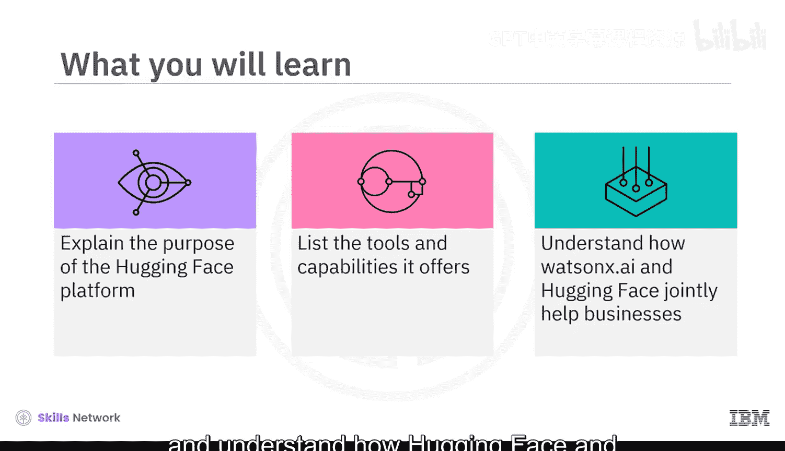
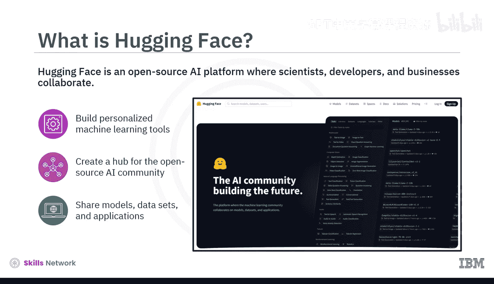
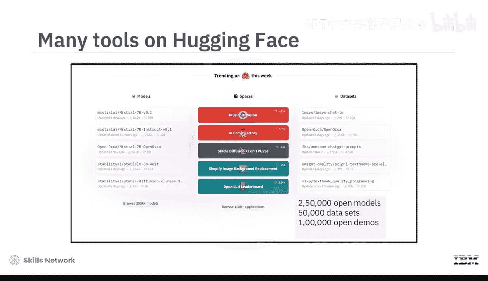
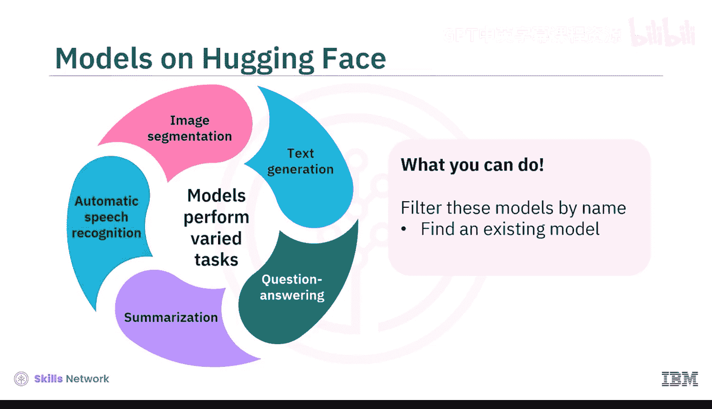
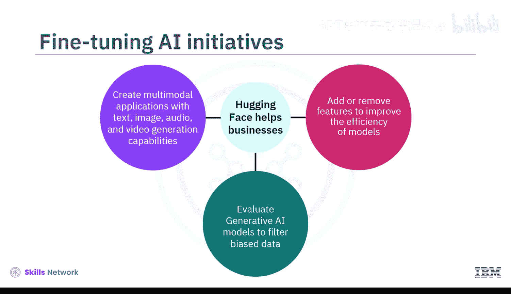
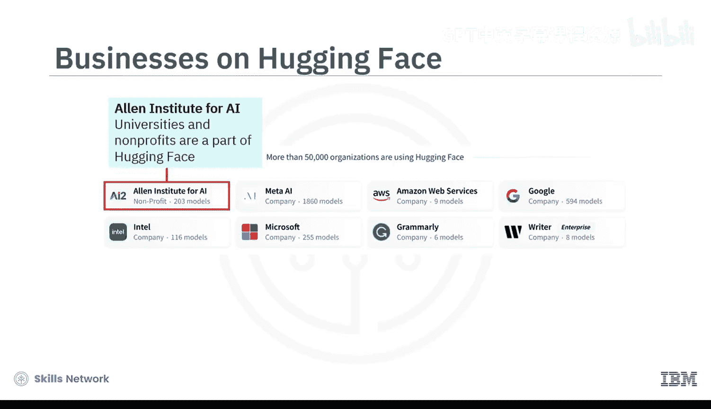
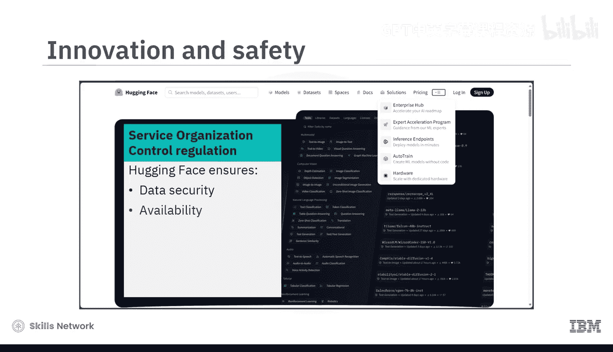
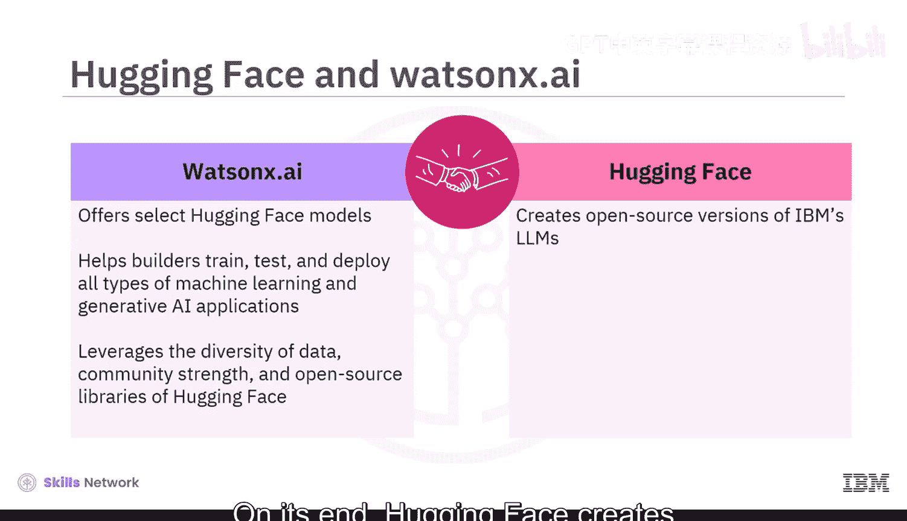
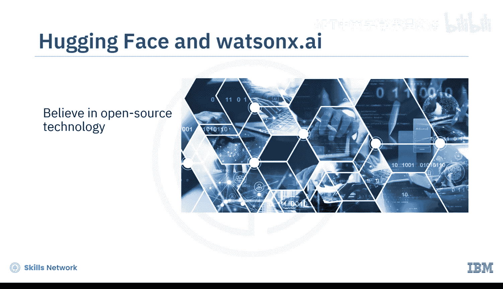
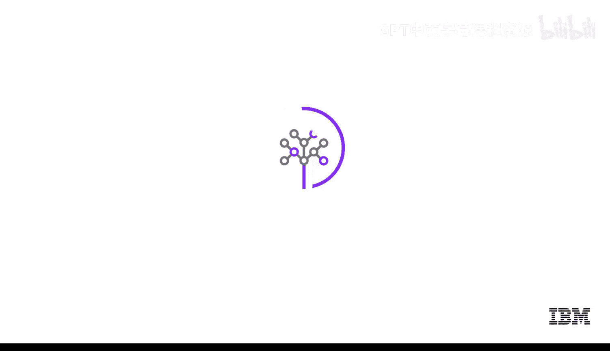

# IBM《生成式AI基础（五课全）｜Generative AI Fundamentals》中英字幕 p41 11_02_06_Hugging Face平台.zh_en [BV11XSYBfEje_p41]

Welcome to Hugingface After watching this video， you'll be able to explain the purpose of the Huging face platform。

 list the tools and capabilities it offers and understand how hugging face and Wats and X AI jointlyhel businesses。

 Huging face is an open source artificial intelligence platform where scientists。

 developers and businesses collaborate to build personalized machine learning tools。

 The platform was built with the purpose of creating a hub for the open source AI community to share models。

 data sets and applications。 This way， AI becomes accessible to all types of users。

 even those who do not have the budget or bandwidth to build machine learning applications independently。

 Huging face is therefore credited with democratizing AI as everyone comes together to benefit from smaller curated models。

 challenging the general one model to rule assumption。 At first。

 the Huging face community focused on creating transformer based models to leverage the capabilities of natural language processing or NLP。

 However， today， the platform offers various machine learning。😊。

Tools for generating text， images， audio and video Currently。

 the Hugingface platform hosts over 250000 open models，50000 dataset sets and 1 million open demos。

 This list keeps growing。 Scientists and developers use Huging face to build。

 train and deploy their AI models。 They have access to the platform's open source transformer library。

 which has over 25000 pretrained models for Pytorch Tensorflow and Google JaX Pytorch is a deep learning library。

 Tensorflow is a machine learning platform， and Google JaX as a machine learning framework。

 The models in the library perform varied tasks such as text generation Que answering summarization。

 automatic speech recognition and image segmentation just to name a few Use can filter these models by name to find an existing model or share their own model with the library。

 Develop can also host demos of generative AI applications on the spaces tab。

 allowing users to interact and validate them。 How do businesses benefit from the platform。😊。

Huggging face offers businesses the enterprise hub from where they can access pretrained models and data sets。

 This allows businesses to leverage existing infrastructure rather than build models from scratch。

 Not only does this reduce their carbon footprint， time and cost to scale。

 It also allows businesses to train the models on proprietary data and relevant use cases。

 Additionally， Huging face helps businesses a add or remove features to improve the efficiency of their models。

 B， evaluate their generative AI models to filter bias data， and C。

 create multimodal applications with text image audio and video generation capabilities。

 More than 50000 large and small companies actively use hugging face。 For example， writer。

 a generative AI solution provider hosts its palm large language models or LLms on Huging face。

 Intel has officially joined Huging face's hardware partner program。

 and is collaborating with Huging face to build state of the art machine learning hardware and end to end machine learning workflows。

😊。

Even universities and nonprofits are part of Huging Face among other services。

 Huging Face offers an expert acceleration program to guide nondevelop on machine learning models Hugging chatt is the first open source alternative to chat GT。

To protect its users， Huging face complies with service organization control type 2 regulation。

 This means ensuring user data security， availability， processing， integrity。

 confidentiality and privacy。 Ta its collaborative efforts one step further。

 Huging face has entered into a unique partnership with Watson X do AI IBm's next generation enterprise studio for AI builders。

 Watson X do AI offers select hugging face models in its studio to help its community of builders train test and deploy all types of machine learning and generative AI applications。

 This way， the studio leverages the diversity of data。

 community strength and open source libraries that Huging face provides On its end。

 Huging face creates open source versions of IBm's LLms and makes them available on its top。

 Both entities believe in open source technology。 both bet on the community to create value in the AI space。

 As proprietary AI models can quickly become obsolete Huging face may develop an edge over the big5 and AI。

 namely Google open。😊。

AI， Me IBM and Microsoft This is because it supports and is supported by the open source AI community that keeps innovating In this video。

 you learned all about hugging face。 This AI platform demonstrates the collaborative power of the open source AI community。

 It creates space for businesses to build customized proprietary models at a reduced cost in an accelerated time frame incurring a lower carbon footprint。

 Or， Uni and nonprofits leverage the platforms， tools and services to benefit from natural language processing。

 In short， you do not have to be a big business to benefit from generative AI。

