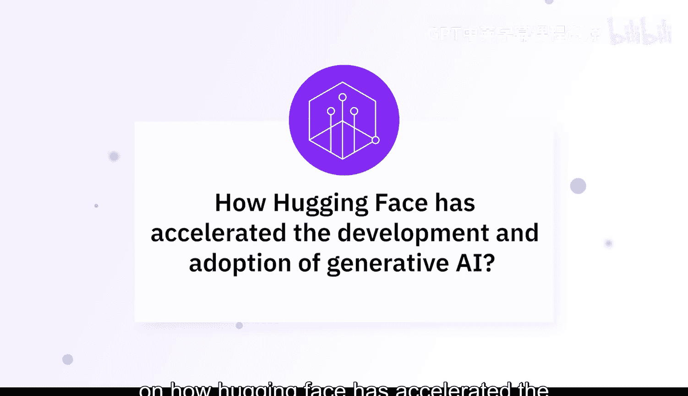
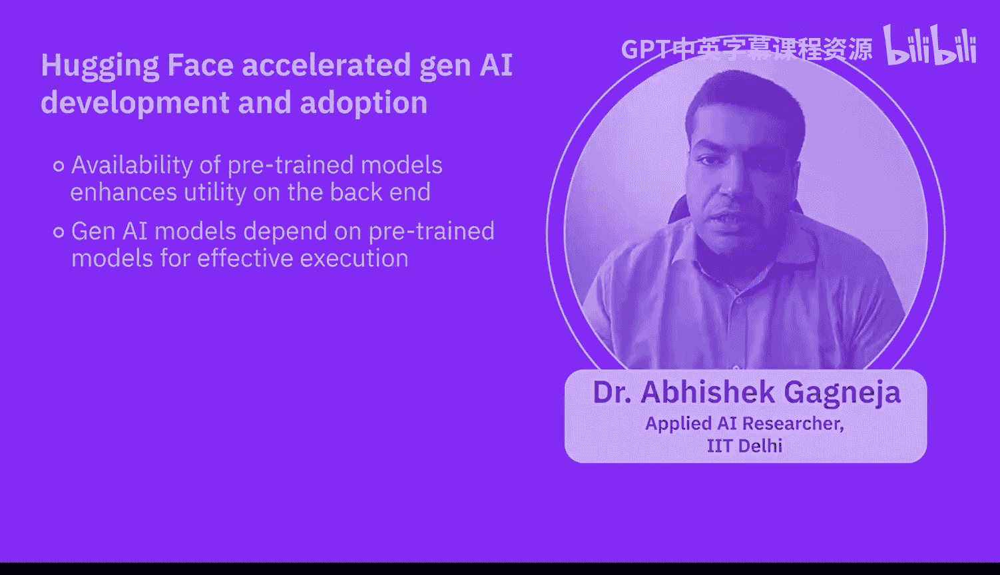
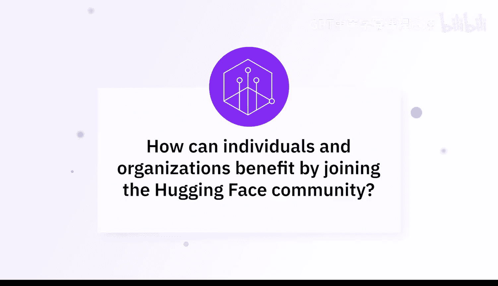
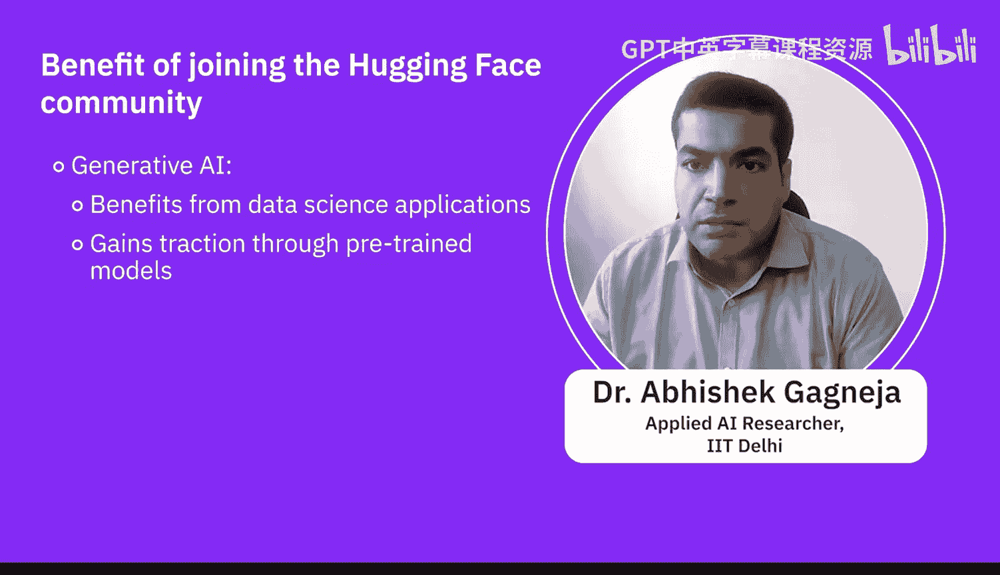

# IBM《生成式AI基础（五课全）｜Generative AI Fundamentals》中英字幕 p42 12_02_07_专家观点：通过Hugging Face促进创新.zh_en [BV11XSYBfEje_p42]

🎼あ。Hello and welcome to this expert viewpoint video。

 Let's hear from experts on how Huging face has accelerated the development and adoption of generative AI。

😊。

HggingPse has definitely a huge role in development and deployment and adoption of generative AI and large language models by having a communitydven approach。

 they have a framework that allows everyone to access the repository of the pretrained large language models and without spending a lot of time and needing a lot of computational power。

 then they can use these models and fine tune them for their own data set and use it for their use cases。

 they also provide a lot of educational and learning material for the community to leverage and use and also they have different deployment options for these large language models so they have support for not only development but also deployment of these large language model by having integration with the well-know cloud platforms and A。

PIs。HuggingF has significantly accelerated the development and of generative AI by providing an accessible platform for sharing deployable state of the art AI models。

 their open source library， transformers simplifies the use of complex models。

 allowing developers to integrate advanced AI capabilities into their applications with ease HugingFace can also offer tools like the model hub。

 where we can use pretrain models and data sets， fostering collaboration and innovation。

The biggest advantage of using hugging pace is the community aspect of it hugging pace has created so many backend models for so many different types of tasks including facial recognition。

 object detection etc， so what has happened is that the availability of these pretrain models directly affect the utility of these models on the backend so gene AI models will rely on such information of such pieces of code and such pieces of pretrain models because they need to execute the GPT models or such are not really capable of doing all the tasks themselves。

Moving on， how can individuals and organizations benefit by joining the hugging face community。

Individuals and organizations benefit from joining the Hugingface community through the access and the wealth of the resource and the expertise。

 the community's collaboration environment enhances knowledge sharing。

 enables users to learn from each other and stay updated on the latest advancements in AI Additionally。

 the platform's user- friendly interfaces and comprehensive documentation。

 make it easier for both learners and experts to experiment and deploy new models。

 ultimately accelerating their projects and reducing development time。

We in IBM also have partnership with Hoging phase， so we believe in the community support and the collaboration phase and it's great that Hoging phase is one of the leaders that provided this platform for the community and everyone to be able to use and leverage this technology。

Hing phase has a very thriving community backbone and you know whatever one is stuck on you have multiple solutions of those available with the people that are a part of that community and of course the knowledge sharing aspect always makes you know the learning great and more productive so yeah generative AI is particularly getting benefited in terms of data science applications generative AI is the getting a lot of traction and benefit。

By such great breed drain models and communities。

