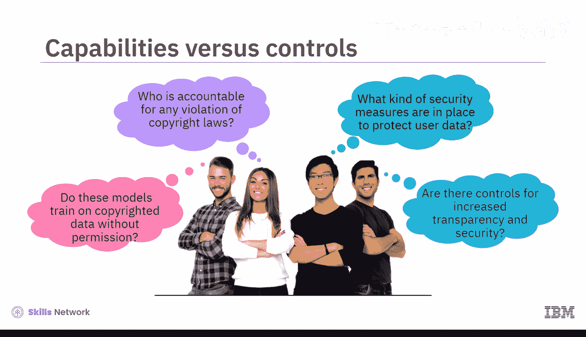
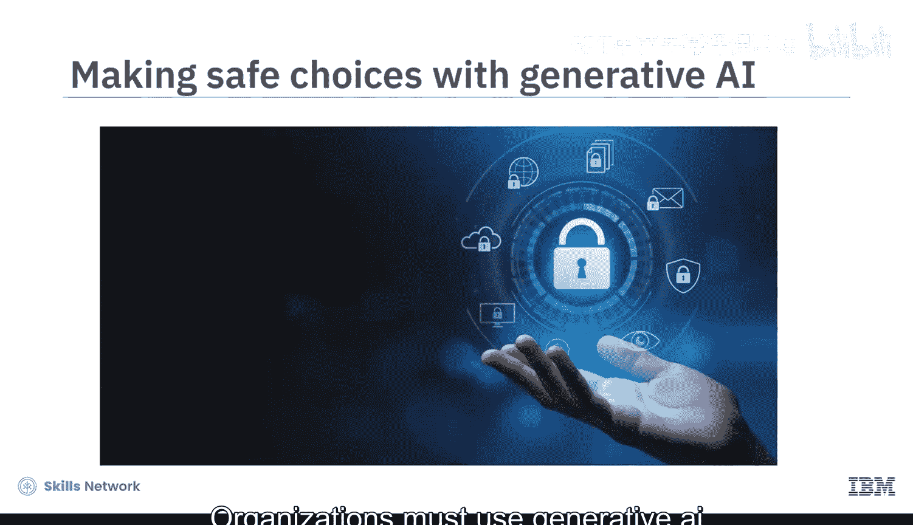
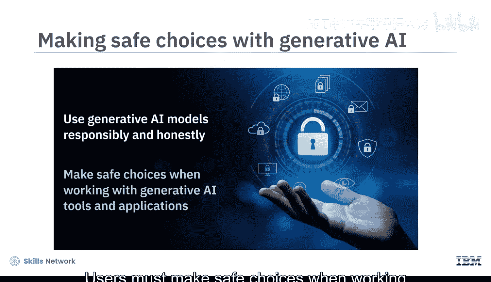
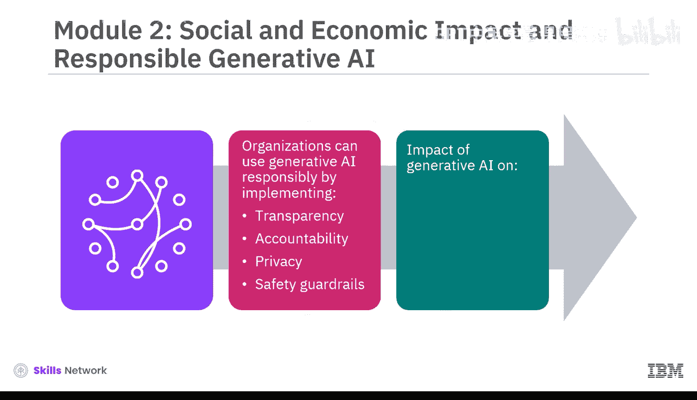
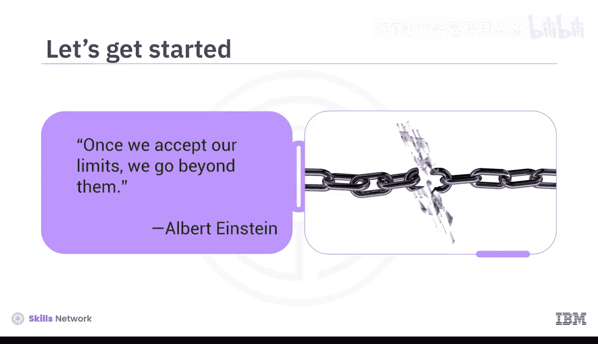

# IBM《生成式AI基础（五课全）｜Generative AI Fundamentals》中英字幕 p43 01_01_01_课程介绍4.zh_en [BV11XSYBfEje_p43]

Welcome to the impact， considerations and ethical issues associated with generative AI video。

 Foundation models are creating an irreversible impact on how we build and share information。

And this is influencing our economic and social development。

 Do these models train on copyrighted data without permission。

 Who is accountable for any violation of copyright laws。

 What kind of security measures are in place to protect user data to enjoy the capabilities that generative AI offers。

 It's critical to put in controls for increased transparency and security among others。😊。

Organizations must use generative AI models responsibly and honestly。

 users must make safe choices when working with generative AI tools and applications。

This course invites all beginners， whether professionals， enthusiasts， practitioners or students。

 if you have a genuine interest in the rapidly developing field of generative AI。

 This course is for you。 a course for everyone， regardless of your background or experience by the end of this course。

 you will be able to describe the limitations of generative AI and the related concerns。

 identify the ethical issues， concerns and misuses associated with generative AI。

 Ex the considerations for the responsible use of generative AI。

 and discuss the economic and social impact of generative AI。

As this is a focused course comprising three modules。

 you're expected to spend one to two hours to complete each module In module 1 of the course。

 you'll explore the various limitations and concerns associated with generative AI such as bias training data and the lack of accuracy。

 explainability and interpretability。 you will identify ethical considerations such as data privacy。

 copyright infringement and hallucination and discover the risks associated with deep fakes in module 2。

 you'll understand how organizations can use generative AI responsibly by implementing measures for transparency。

 accountability， privacy and safety guardrails you'll also take a holistic look at the impact of generative AI on our economic growth and social wellbeing。

 module 3 requests your participation in a final project and presents a graded quiz to test your understanding of course concepts。

 You can also visit the course glossary and receive guidance on the next steps in your learning journey。

 The course is curated with the mix of concept videos and supporting readings Watch all the videos to capture the。

😊。

Full potentialent of the learning material。 You'll work on hands on labs to understand the limitations of generative AI models and participate in a final project in module 3。

 There are practice quizzes at the end of each lesson to help you reinforce your learning。

 At the end of the course， you'll also attempt a graded quiz。

 The course also offers discussion forms to connect with the course staff and interact with your peers。

 Most interestingly， through the expert viewpoint videos。

 you'll hear experienced practitioners talk about the onground realities related to ethical considerations and limitations of generative AI。

 As Albert Einstein said， once we accept our limits。 We go beyond them。 Let's get started。😊。

