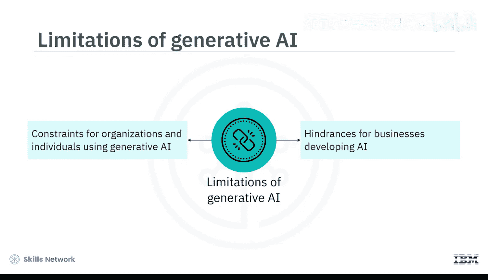
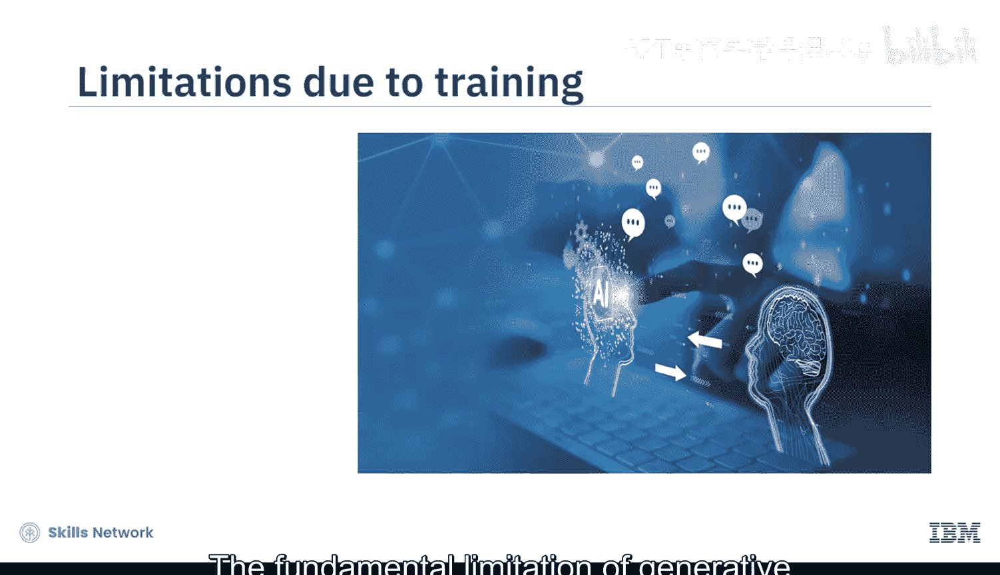
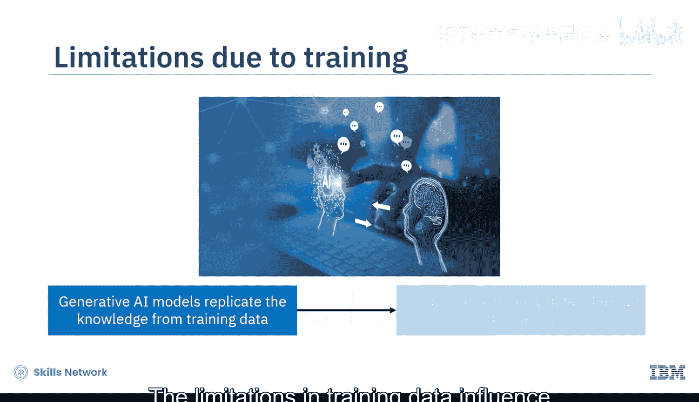
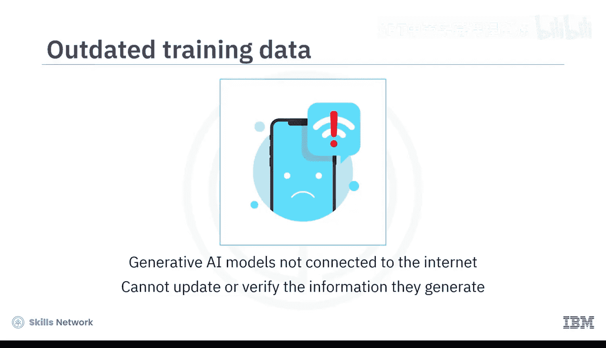
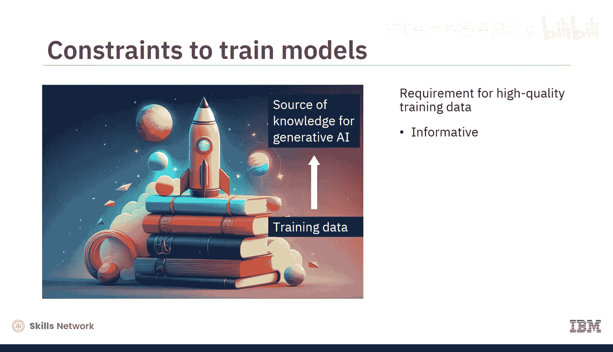

# IBM《生成式AI基础（五课全）｜Generative AI Fundamentals》中英字幕 p44 02_01_01_生成式AI的局限性.zh_en [BV11XSYBfEje_p44]

Welcome to limitations of generative AI After watching this video。

 you'll be able to describe generative AI's limitations regarding training data and identify other significant limitations of generative AI。

 generative AI's capability to generate new， well presented and convincing content has led to its profound use in commercial and social sectors and diverse industries。

 However， before it can be considered a fully functional business utility。

 It's essential to address the prominent limitations of generative AI。

 These limitations can be probable hindrances for businesses developing AI。

 and constraints for organizations and individuals using generative AI。

 Let's explore a few major limitations of generative AI。

 The fundamental limitations of generative AI is related to training data。

 generative AI models are not repositories of information。 Instead。

 they strive to generate and replicate the knowledge based on the data they have been trained on。

 The limitations in training data influence the output produced by the models。 For example。

 if the training data set for an image generating model。

is limited in scope。 The generated images will also be limited in terms of scope。 For instance。

 if you ask the model to generate a picture of a cat。

 it might produce a generic looking cat without the distinctive features of a particular breed or individual cat。

 Many generative AI models are trained on data with cutoff dates。

 resulting in outdated or incorrect information。 This leads to the inability of the models to provide answers about current information and events。

 For example， G 3。5 is trained on data until January 2022， According。

 when prompted to generate information based on a fact or an event that occurred after January 2022。

 the model does not provide the response or generate an inaccurate or fictitious response。

 In such cases， the AI models are expected to clearly specify the cutoff date on which its responses based。

 In addition， many generative AI models are not connected to the Internet and cannot update or verify the information they generate。

 with training data as the main source of the generative AI models knowledge。

 there is a requirement for high quality training data。

The training data is expected to be rich in information updated， accurate and free from biases。

 The extensive data sets required for training may not always be readily available or very costly。

 For example， for specific domains like rare medical conditions or diseases。

 obtaining sufficient data may be difficult and costly due to various reasons。

 such as scarcity of cases， considerations for patient privacy and requirements for specialized medical expertise。

 generative AI models require substantial cost， computational resources and training time。

 This can be a concern for businesses developing and training AI models。

 to mitigate the difficulties regarding data reliance。

 researchers are working on data augmentation techniques aimed at generating additional training data from limited samples。

 generative AI excels at analyzing data to identify patterns and trends。

 using them to generate new content。 However， it has limitations in understanding the context when presented with new data information or solutions beyond the scope of its training parameters。

 For example。

Consider a generative AI model trained to assist in legal document review。

 It's been trained on extensive legal documents and excs at identifying common legal clauses and providing relevant suggestions。

 However， if you present a novel， complex legal case。

 The model may struggle to offer insightful analysis as it lacks the context and training for such unique and unprecedented legal scenarios。

 generative AI cannot completely replace human creativity or critical thinking。

 It can be creative only within the boundaries of its training data。

 It does not possess the ability to invent an entirely new idea。 It cannot think outside the box。

 An example to consider is that it can produce information on an idea or debate cannot evaluate which side has more depth or credibility。

 It cannot recognize abstract concepts such as humor or sarcasm。

 All things that require a human touch。 from the user's perspective。

 a significant limitation of generative AI is its lack of explainability and interpretability。

 generative AI models are often considered to be complex and opaque。 It may be challenging for user。

To comprehend how models generate content make predictions or arrive at specific decisions。

 This lack of transparency and predictability raises concerns about the accountability and reliability of AI generated outputs。

 In this video， you learned about the limitations of generative AI that can be constraints for its wide adoption。

 The fundamental limitations of generative AI is related to training data。

 The extensive of data sets required for training may not always be available or may be outdated or inaccurate。

 The limitations in training data influence the output produced by the models。

 generative AI's understanding and creativity are limited to its training data。

 generative AI cannot completely replace human creativity or critical thinking。

 generative AI lacks explainability at interpretability。

 This lack of transparency and predictability raises concerns about the accountability and reliability of generative AI。

