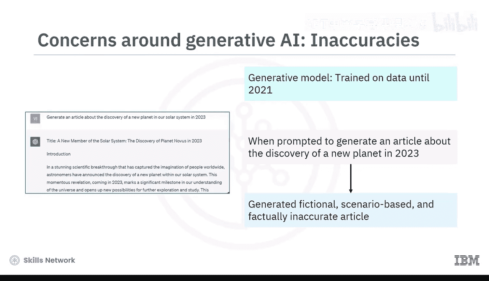
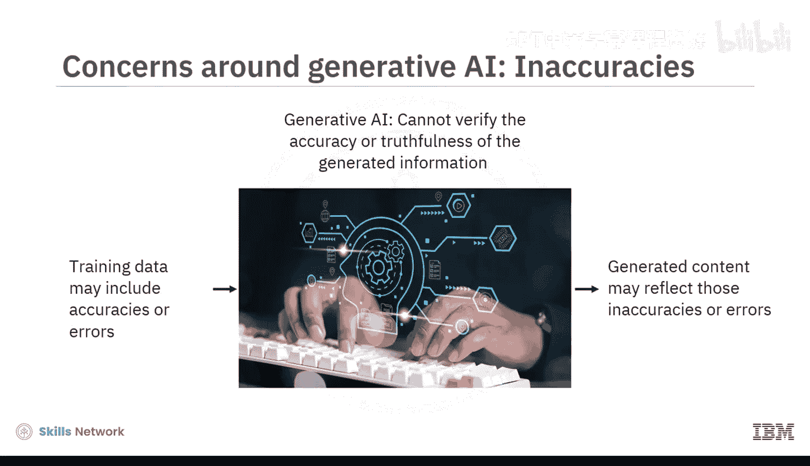
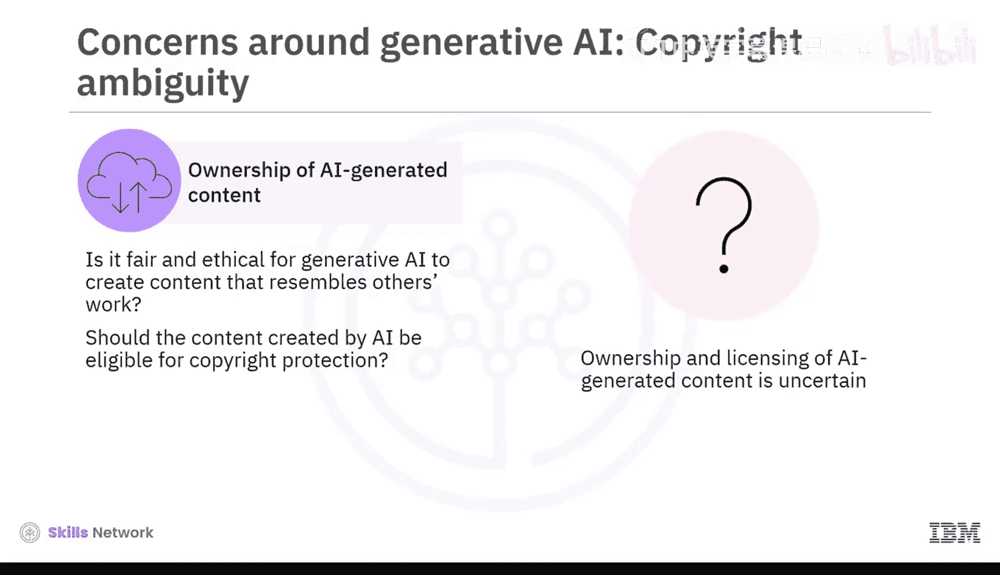
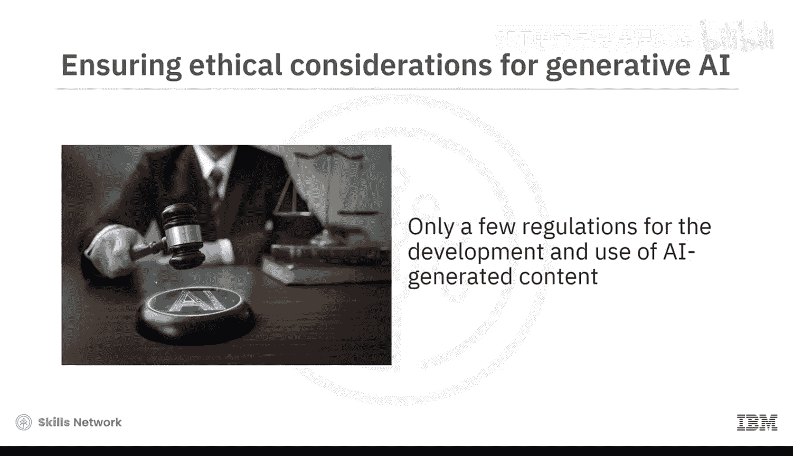
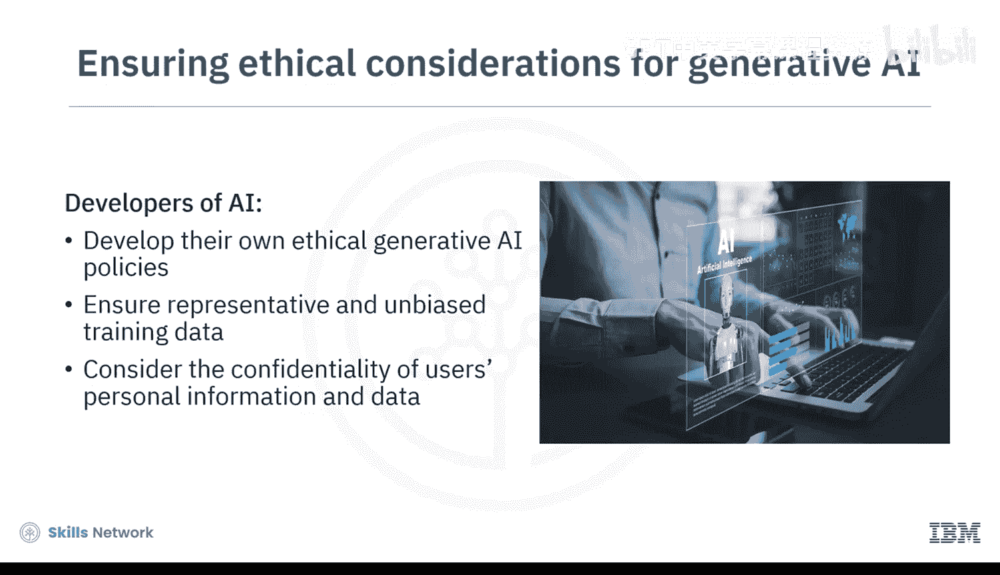
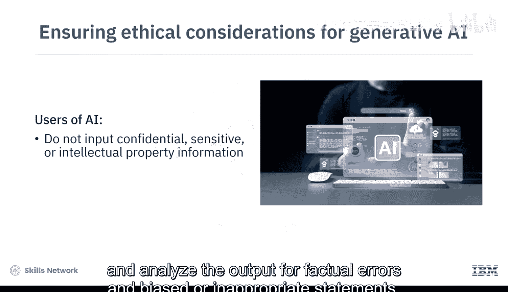
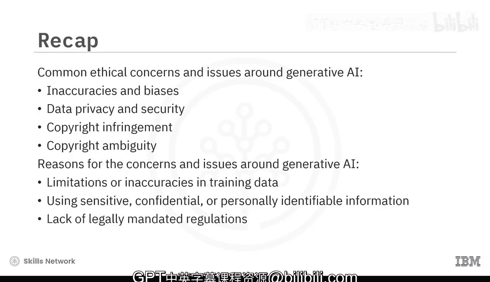

# IBM《生成式AI基础（五课全）｜Generative AI Fundamentals》中英字幕 p45 03_01_02_生成式AI的问题与关切.zh_en [BV11XSYBfEje_p45]

Welcome to issues and concerns about generative AI After watching this video。

 you'll be able to explain the common issues and ethical concerns around generative AI。

 identify the reasons for the generic issues and concerns around the use of generative AI Research conducted by advisory organizations points to the growing impact of generative AI across diverse sectors and industries Gartner predicts that pregenrative AI will account for 10% of all data produced by 2025 This largescale adoption of generative AI is the result of the diverse and groundbreaking capabilities of generative AI。

 including natural language understanding， content creation， image synthesis and problem solving。

 However， the accelerated capabilities and resulting adoption of generative AI give rise to some critical issues in ethical concerns The most prevalent concerns include inaccuracies and biases。

 data privacy and security copyright infringement and copyright ambiguity Let's discuss these concerns。

Let's say we have a generative model trained on a large data set of articles until 2021。

 when prompted to generate an article about the discovery of a new planet in our solar system in 2023。

 the model generated a fictional scenario based and factually inaccurate article based on its understanding of astronomy and scientific discoveries。

The limitation here is that generative AI lacks the ability to verify the accuracy of truthfulness of the information it generates。

 if the training data contains inaccuracies the content generated by the model will reflect those errors。

Also， most generative AI models are pretrained on vast amounts of data。

 but are not dynamic in terms of keeping up with the latest facts or new information。

 Apart from in acuracies， training data can also be subject to biases。

 biases may occur when the training data is poorly sampled and does not accurately reflect the real world。

 a common pattern of biases that can be visible in a generative AI model is negative or outdated stereotypes and discrimination。

 For example， an imagegenative AI tool may generate images of a middle- ad white man when prompted to generate an image of a CEO。

 stereotypes related to gender， race， religion or other demographics， political bias。

 cultural and language biases and historical beliefs or practices have also been noted to avoid or reduce these biases。

 it's important to ensure that the training data is diverse and representative。

 developers and users must work to address this through careful data selection and fine tuning and evaluation and improvement processes。

 Next， let's focus on data privacy and security aspects related to generative。

IAny data or queries you prompt into open source AI models can be used as training data This data may include sensitive information。

 including personally identifiable information or P or confidential information of an organization As a result。

 a generative AI model may reveal a user' personal or an organization's confidential data both by mistaken by design as part of its output and make it public。

 The data privacy and security concerns can be extended to copyrighted legal exposure。

 The generative AI models can reveal the original data and content of creators or organization as part of their output which can be used and explored by other users and organizations According。

 a model can infringe upon the copyrights and intellectual property rights or IRs of users or other companies In addition。

 generative AI models may generate content that includes copyright elements such as logos。

 trademarks or copyrighted images using such content for commercial purposes without permission can result in legal action another related。

cern is copyright ambiguity。 That is the ownership of AI generated content。

 This determines who has the authorship of the content and creative works generated through AI models。

 There are a few primary questions to consider。 Firstly。

 who would have ownership of the created content。 For example。

 consider an AI generated image based on or similar to the famous painting of Mona Lisa by Leonardo da Vinci。

 So who owns the ownership entitled for such generated creative work。

 the artist of the original image， the organization that owns and trains the AI model that generated this image or the user who prompted the model to generate such image。

 Moreover， is it even fair and ethical for generative AI to create art or content that closely resembles others' work。

 or another question to consider is should the content created by AI be eligible for copyright protection。

 You could say that it's not because it's not the output of human creativity。However。

 one could also argue that it is because it is the output of algorithms and programming together with human input。

 determining the ownership and licensing of AI generated content is currently a questionable topic。

 Currently there are only a few legally mandated regulations regarding the development or use of AI generated content。

 According， AI developers should take the lead and develop their own ethical generative AI policies to protect themselves and their customers。

 For example， they must ensure that the training data is representative and unbiased。

 Conity of users' personal information and their data must be respected during the training development and deployment of generative AI models。

 As a user it's challenging to ensure that your using generative AI ethically。 However。

 a few considerations can be considered while using a generative AI tool。 For example。

 don't input information that is confidential， sensitive or constitutes intellectual property violation and analyze the output for factual errors and biased or inappropriate statements。

In this video you learn about some of the common ethical concerns and issues around generative AI These concerns include inaccuracies and biases。

 data privacy and security， copyright infringement and copyright ambiguity。

 a few reasons for these issues include the limitations or inaccuracies and training data。

 the use of sensitive confidential or personally identifiable information for training the model and the lack of legally mandated regulations regarding the development or use of AI generatedrated content。

