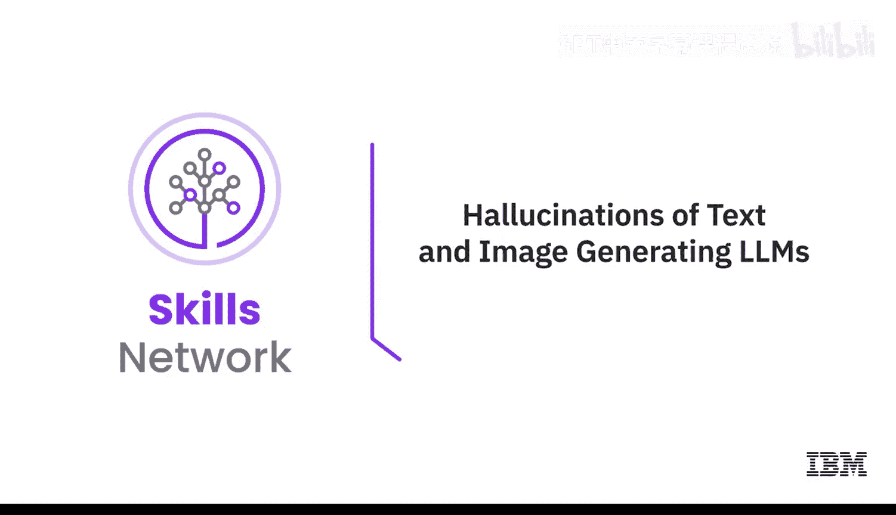
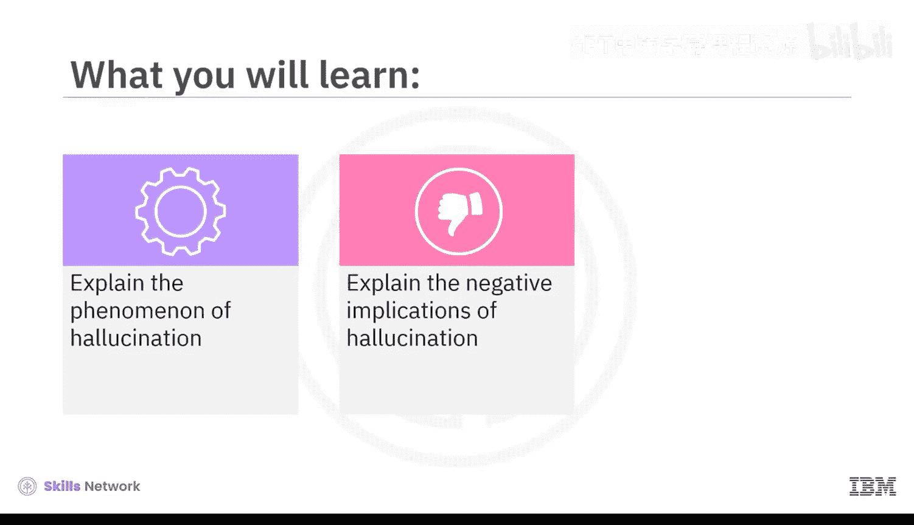
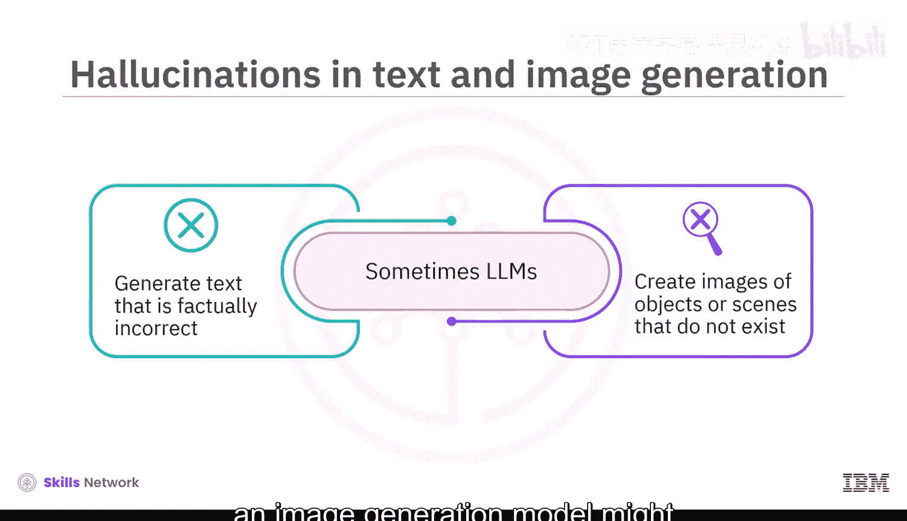
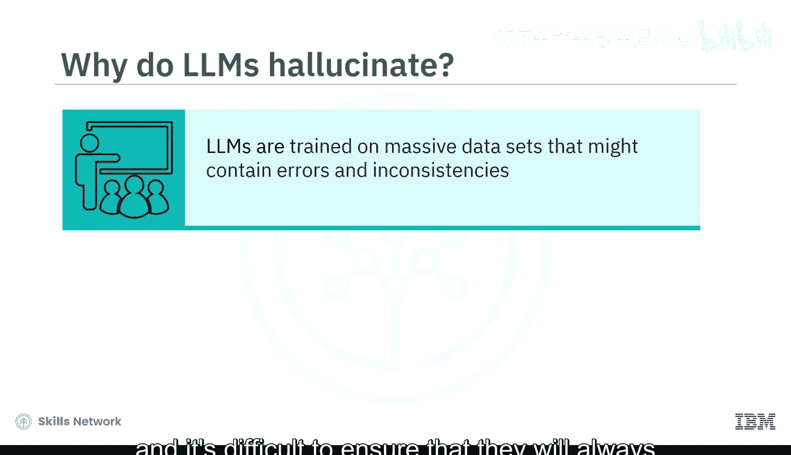
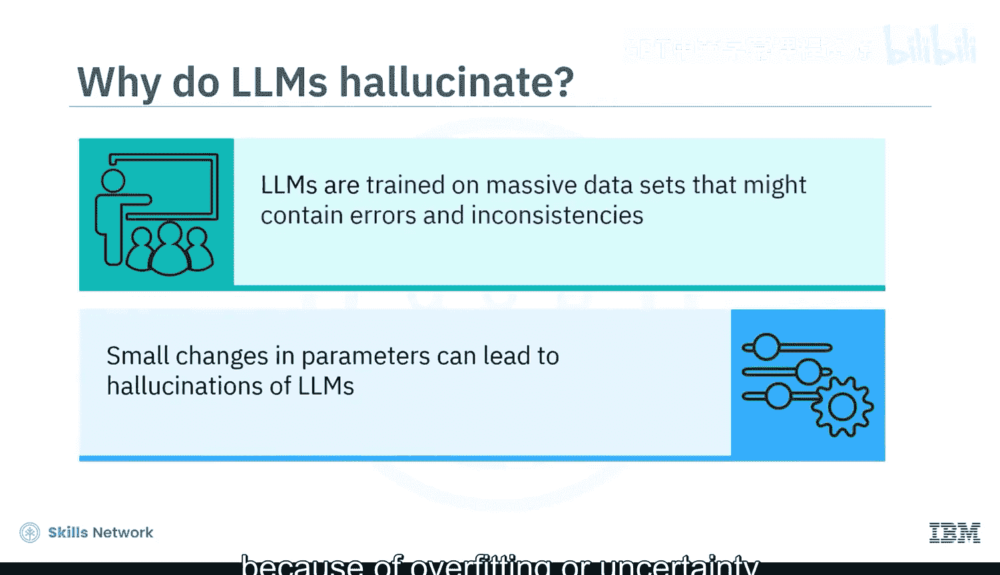
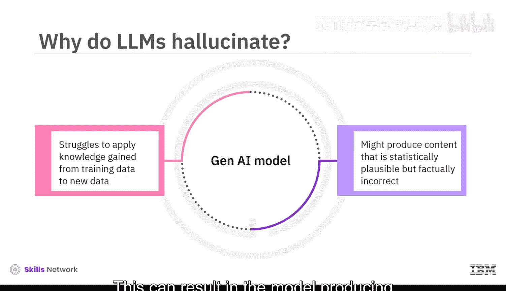
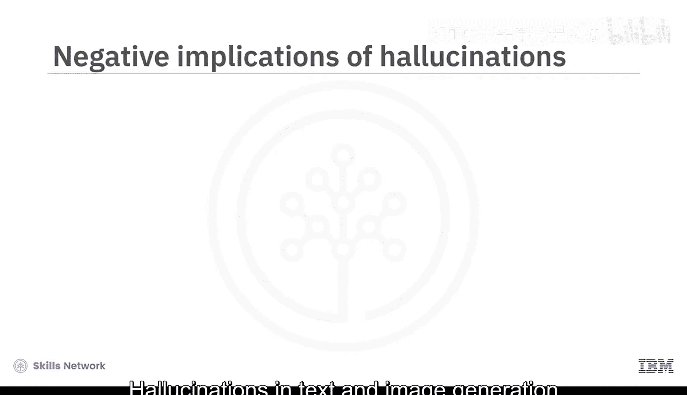
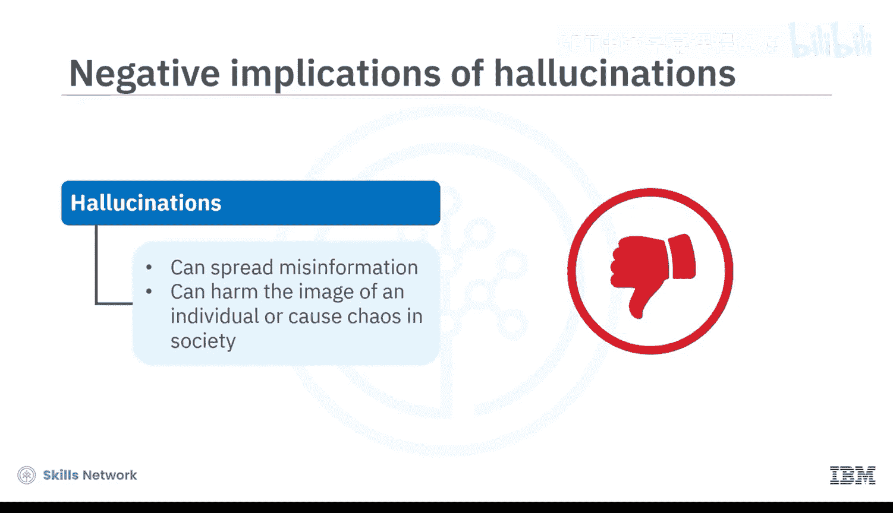
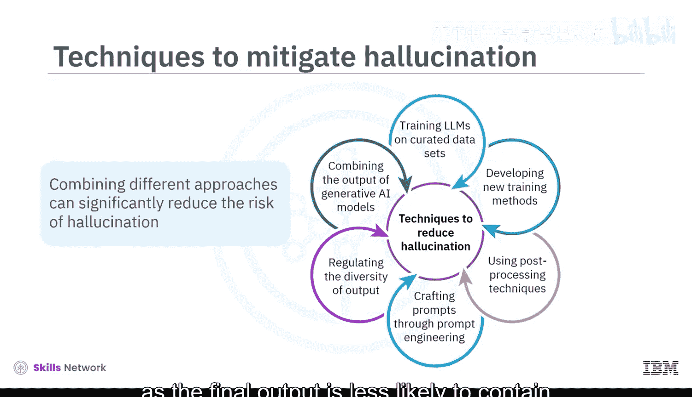
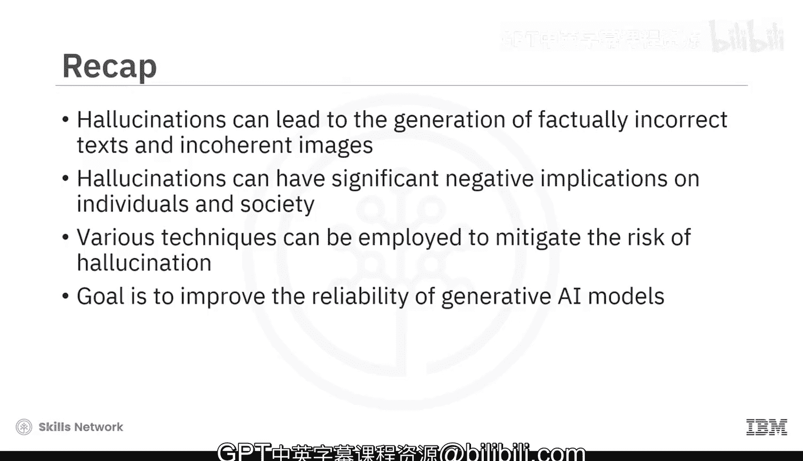

# IBM《生成式AI基础（五课全）｜Generative AI Fundamentals》中英字幕 p46 04_01_03_文本和图像生成大语言模型的幻觉现象.zh_en [BV11XSYBfEje_p46]

Welcome to hallucinations of text and imagegene LLMs After watching this video you'll be able to explain the phenomenon of hallucination in text and image generation by LLMs and its negative implications for individuals and society you'll also learn about the various techniques employed to reduce the risk of hallucination in text and image generation hallucinations occur when generative AI models produce content that lacks a basis Sometimes large language models or LLMs generate text that is factually inaccurate or lax coherence。

 For example， a language model might generate a news article that contains fabricated information or a poem that uses words in a meaningless manner It might even create images containing objects or scenes that do not exist。

 For example， an image generation model might generate a picture of a cat with wings or a landscape with floating mountains。

 Now let's understand why text or imagegene LLM's hallucininate。

L L Ms are trained on massive data sets of texts and images。

 which are likely to contain errors and inconsistencies。

 Since L L Ms are trained to maximize the likelihood。

 there's a greater chance that they generate text or images similar to the data they were trained on。

 Even if that data is inaccurate or unrealistic。 Finally。

 L L Ms are complex systems with various parameters。

 and it's difficult to ensure that they will always generate accurate and realistic content。

Even small changes in these parameters can lead to hallucinations because of overfitting or uncertainty in the correctness of the content。

 let's understand this in detail， overfitting occurs when a model becomes excessively proficient at learning from the training data。

 but struggles to apply this knowledge to new data。

 potentially causing the model to generate novel content that was not a part of the training data set。

Generative AI models are frequently trained with the objective of optimizing the content they generate。

This can result in the model producing content that may be statistically plausible。

 but factually incorrect。 hallucinations in text and image generation can also have negative implications。

 For example， hallucinations can spread misinformation。

 which can be used to create harmful and offensive content。

 This can make it difficult to trust the output of generative AI models。

 limiting their usefulness in realwor applications。

 hallucinations can harm the image of an individual or cause chaos in society as it can lead to the creation of fake news articles or images that can be used to bully or harass someone or spread propaganda。

 There's no single solution to the problem of hallucination in text and image generation， However。

 by combining different approaches， it is possible to significantly reduce the risk of hallucination。

 and improve the reliability of generative AI models。 Let's discuss these techniques individually。

 Tra LLms on curated data sets。 The Allen Institute for AI has developed a carefully curated data set known as common sense open-ended plausible answers or Copa。

 which serves the purpose of training LLms to。

ngage in common reasoning and preventing the generation of factually inaccurate statements。

Develop new training methods， researchers at Google AI have pioneered a novel training approach named contrastive learning that can be employed to instruct LLms and generating output that is more accurate and coherent using postproces techniques。

 the Facebook AI research or fair team has introduced a postprocesing method known as factche net。

 which serves the purpose of detecting inaccuracies and generated texts。

 Cring prompts through prompt engineering Pro engineering is the process of crafting effective prompts that are used as inputs for generative AI models。

 Precision in constructing these prompts can minimize the likelihood of the model generating hallucinating output。

 Reggulating the diversity of output。 T sampling is a method employed to regulate the diversity of output produced by generative AI models when the temperature is raised。

 the model is more likely to produce a wider range of output。

 but this also increases the risk of generating hallucinatory information Conversely lowering the temperature。

Reduces the likelihood of hallucination， but limits the diversity of output combining the output of generative AI model Ensemble generation is a technique where output from multiple generative AI models is combined to produce the final result This can help reduce the risks of hallucination as the final output is less likely to contain hallucinations from all the models In this video you explore the phenomenon of hallucinations in text and image generation by LLms hallucinations occur when generative AI models produce content that lacks a basis which can lead to the generation of factually incorrect or incoherent text and images these hallucinations have significant implications including the spread of misinformation and potential harm to individuals in society to mitigate these negative implications various techniques are employed including training on curated datas。

 novel training methods， postproces techniques prompt engineering and regulating the diversity of output The goal is to improve the reliability of geneative AI models and reduce the risk of hallucination enhancing their use。

Usefulness in real world applications。

