# IBM《生成式AI基础（五课全）｜Generative AI Fundamentals》中英字幕 p47 05_01_04_代码生成大语言模型的幻觉现象.zh_en [BV11XSYBfEje_p47]

Welcome to hallucinations of code generating LLms。 After watching this video。

 you'll be able to describe hallucinations of code generating LLms and explain why they occur。

 You'll also be able to discuss their implications for developers and users and what measures can be taken to prevent their occurrence。

 code generatingrating large language models where LLms have become increasingly popular with developers because of several benefits such as speed。

 automation， debugging and so on。 However， one must also consider the potential challenges and risks associated。

 In this video， you'll specifically explore one such critical risk。

 The phenomenon of hallucinations of code generating LLms。

 hallucinations in co generating LLms refer to the generation of code that is incorrect。

 nonsensical or irrelevant to the given prompt。 Why do they occur。 Let's try to understand First。

 because of ambiguity and natural language In for creating code are sometimes vague。

 LLms become confused by ambiguous language， resulting in incorrect code production。😊。

Here is an example of generating simple Python code through ChadGT。

 a tool based on GT When you enter a text prompt， generate a Python function to check if a number is even Chad GT generates the Python code for it when you test this code in the Python editor。

 you can see here that the code is executed correctly Let's see what happens if you enter the number 12。

2。

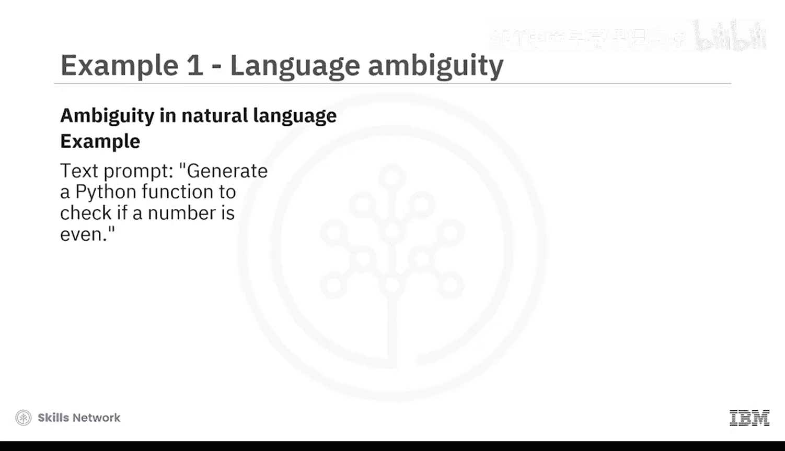

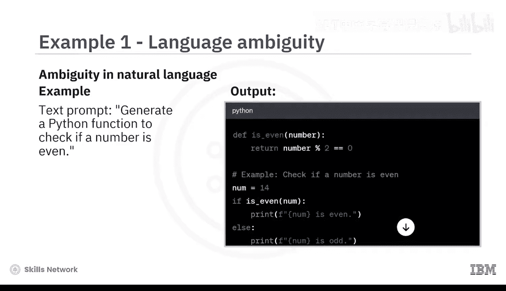

Here， the LLM should ideally generate an exception。 however， it classifies 12。2 as odd。

 The function is incorrect because the LLM has hallucinated that only an integer will be an input。

To generate correct code， you must provide a clear prompt。

 specify the programming language and provide other relevant requirements and constraints。 Second。

 LLms can deal with short termm context， but could have trouble handling long- term dependency。

 As a result， individuals risk losing track of important information during prolonged code generation activities leading to hallucinations。

 For instance， if the task is， write a Python program to calculate the sum of numbers in a list。

 The input is write a program to calculate the sum of numbers in a list。

 The generated output will look like this。

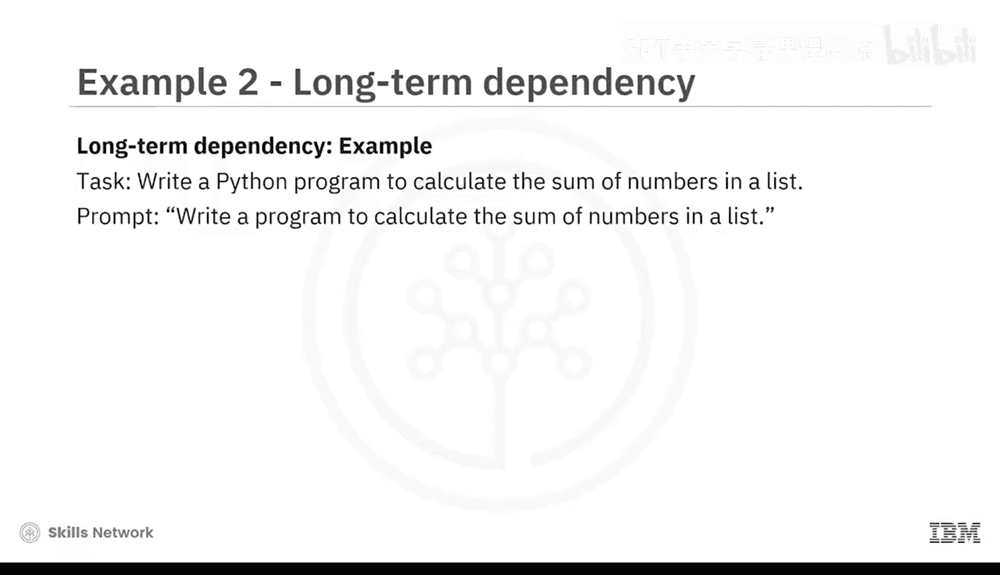

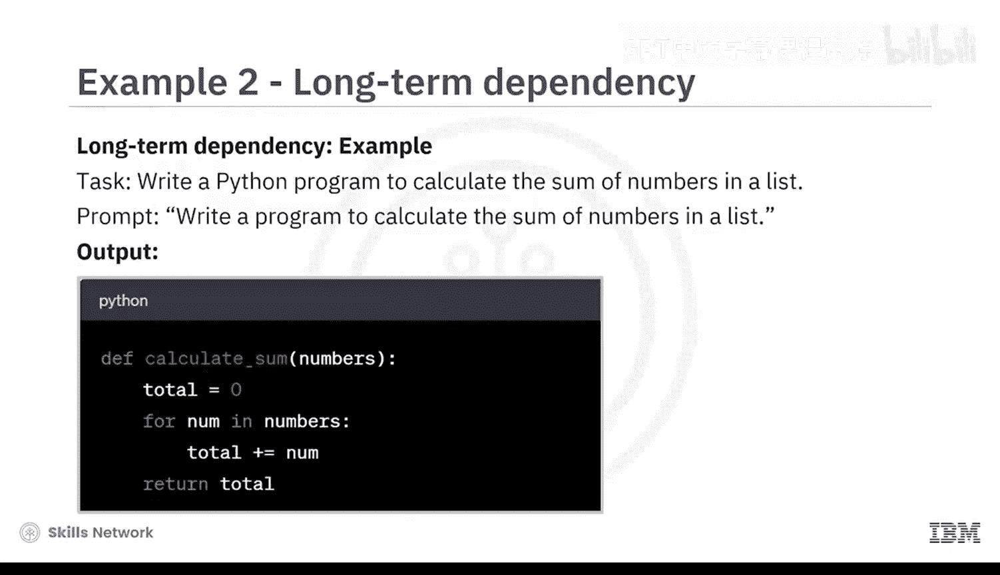

This code is correct for the given task。 However， if the function is called with a very long list of numbers。

 the LL M might be unable to track the total sum。 This could result in the function returning an incorrect result leading to code hallucinations。

 Third programming languages have complex syntax and semantics and L L Ms may misread certain language constructs resulting in hallucinatory code。

 For example， supposeuppose the task is to generate a function that can open a file and read the content。

 The generated output will look like this。

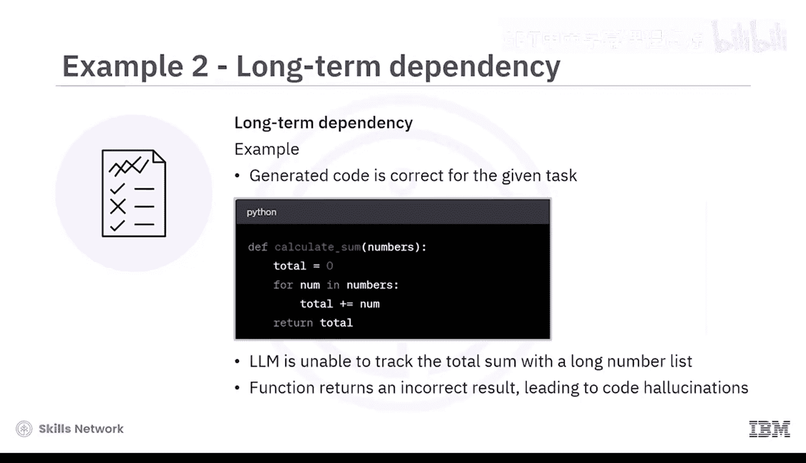

This function looks correct at first， but does not work correctly。

 This is because the LLM does not correctly understand file handling。In this example。

 the model incorrectly generates code that opens the file in write mode W instead of read mode R。

 which results in an empty string being returned because the file is opened for writing and then immediately read。

 resulting in no content being read。

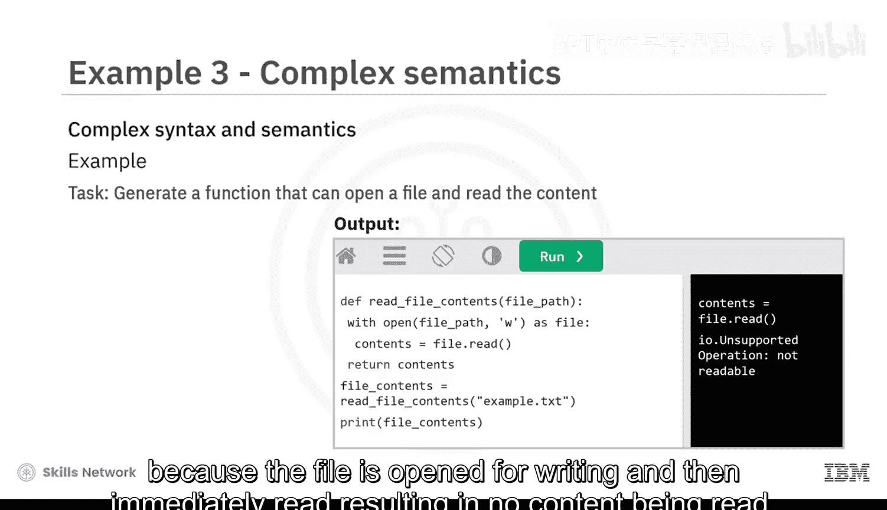

This is a hypothetical example that demonstrates how code hallucination can generate codes that produce incorrect output。

 LLms can generate codes that appears to function， but suffers from issues like unrealistic conversion methods。

 lackck of error handling and limited context understanding。

 What is the impact on developers when code generating LLM start to hallucinate。

 Let's look at the implications to begin with hallucinations can result in the generation of incorrect and unsafe code。

 This poses a risk as it may introduce bugs or vulnerabilities in the software。 For example。

 suppose the task is。Write a Python program to open and write to a file safely。

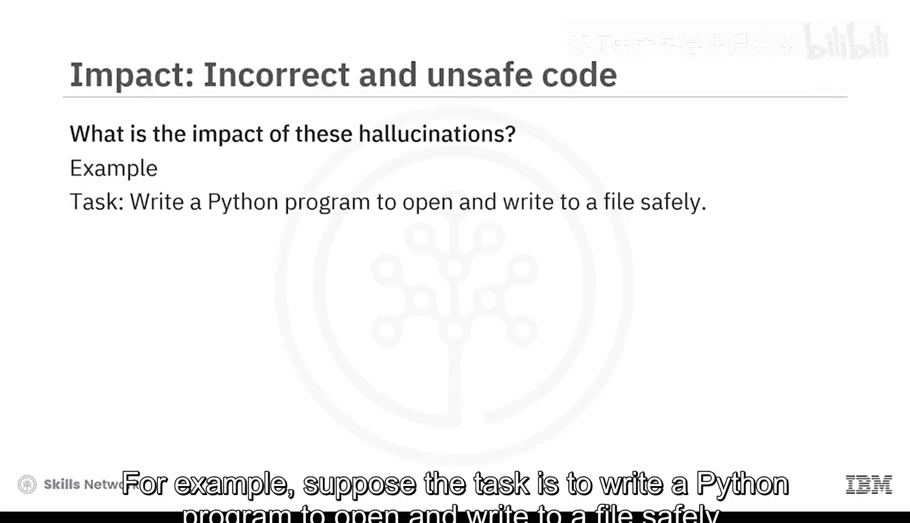

The hallucinatory incorrect and unsafe output is in this example the generated code suggests that opening and writing to a file is a secure operation。

 which is a hallucination， this code may lead to incorrect and unsafe file operations as it doesn't follow best practices for handling errors or issues resulting in data loss or security vulnerabilities。

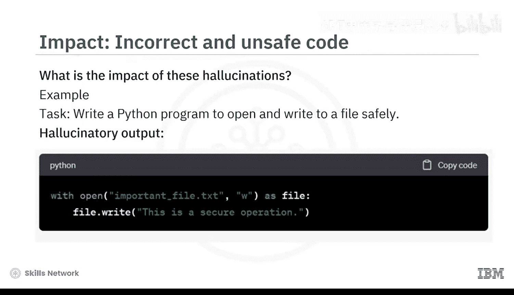

Further if hallucinated code leads to negative outcomes。

 legal and ethical questions could arise about the responsibility of developers and AI model creators imagine a scenario where an AI model hallucininateates code for a medical device the outcome is that the device misinterprets patient data leading to incorrect treatments the possible legal and ethical questions are who is liable for the medical errors caused by the hallucininated code is it the developers who deploy the AI model or the creators of the AI model itself。

 another possible consequence of hallucinations influenced by biased training data is that the code generated could perpetuate existing biases leading to discriminatory practices in software development imagine this an AI model hallucininateates code for a resume screening tool the outcome the tool disproportionately rejects resumes from female candidates the consequence the generated code perpetuates gender bias in the training data leading to discriminatory practices in software development by unfairly disadvantaging female job applicants。

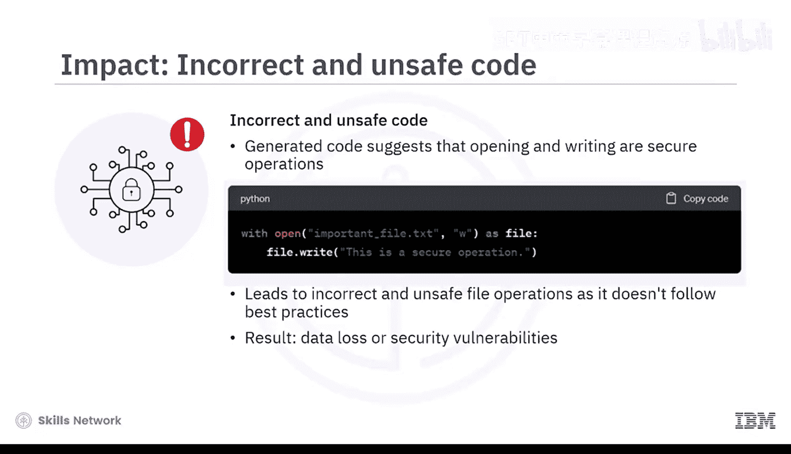

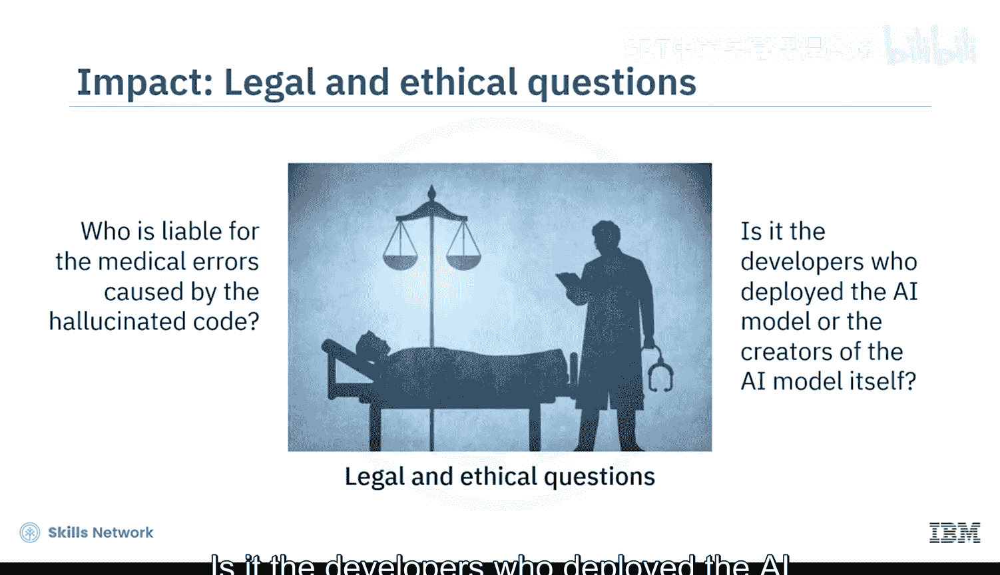

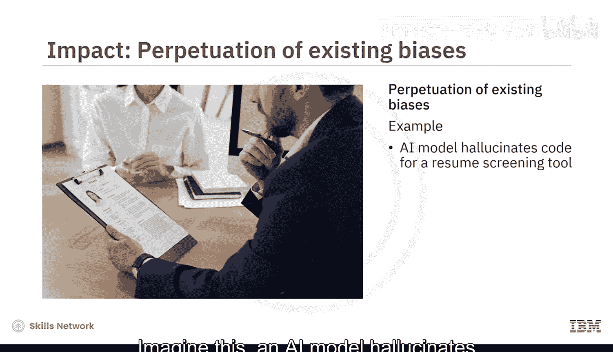

How can we address these risks， Let's seeDevelop can provide users with clear documentation about the limitations of their models。

 including hallucination risks to enable them to make informed decisions。

 Eforts should be made to use prompting techniques that help the LLMs generate code relevant to the given task further。

 minimizing biases and training data and ensuring the generated code adheres to ethical principles is essential。

 LLms should have robust error handling mechanisms to detect and flag potential hallucinations in the output。

 Finally， a close collaboration between LLM developers and software developers can help identify and rectify hallucinations in real worldl applications。

In this video you learned that co generatingrating LLMs can sometimes produce hallucinations。

 which are factually incorrect responses divergent from the intended output you learned that the reasons for these hallucinations could be natural language ambiguity。

 long term dependency and complex semantics。 Finally。

 you learned how to minimize the occurrence of these hallucinations through documentation unbiased training data。

 strong error handling systems and a close partnership between the LLM and software developers。

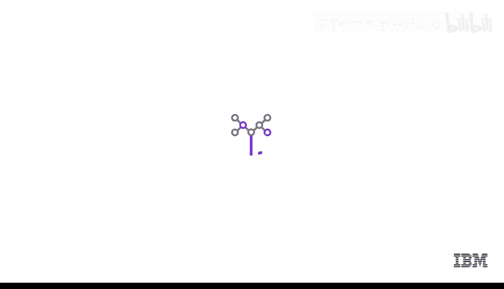