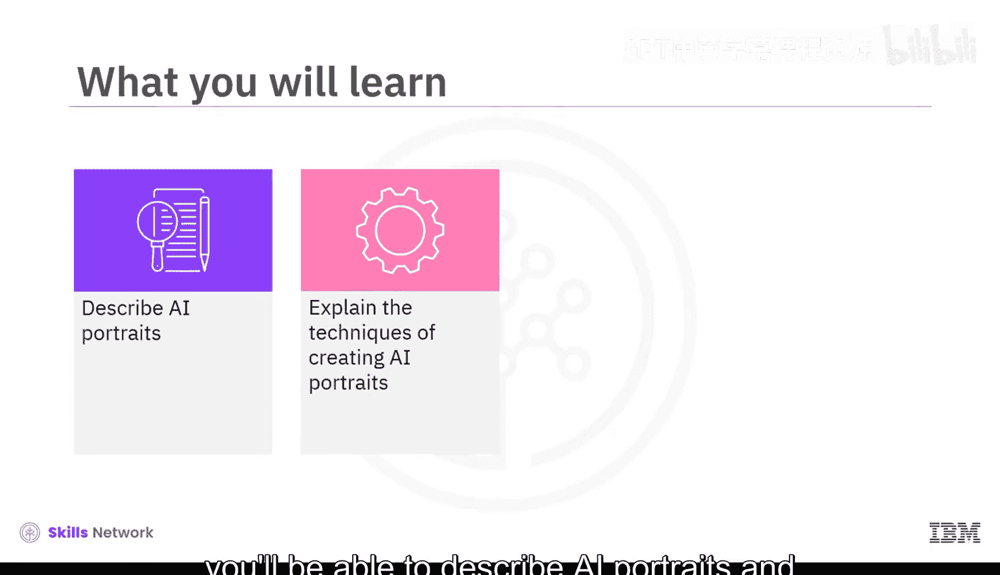
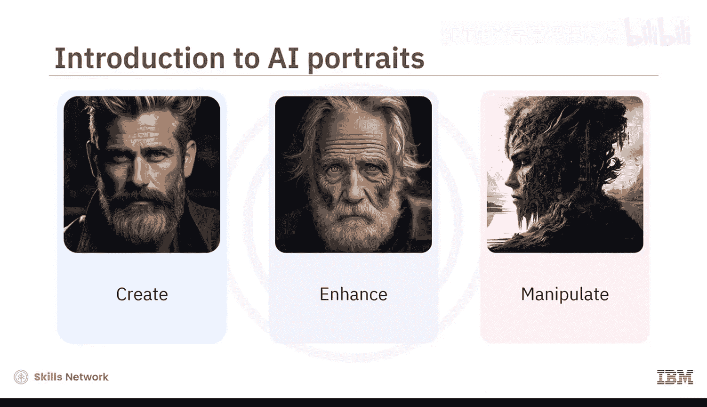
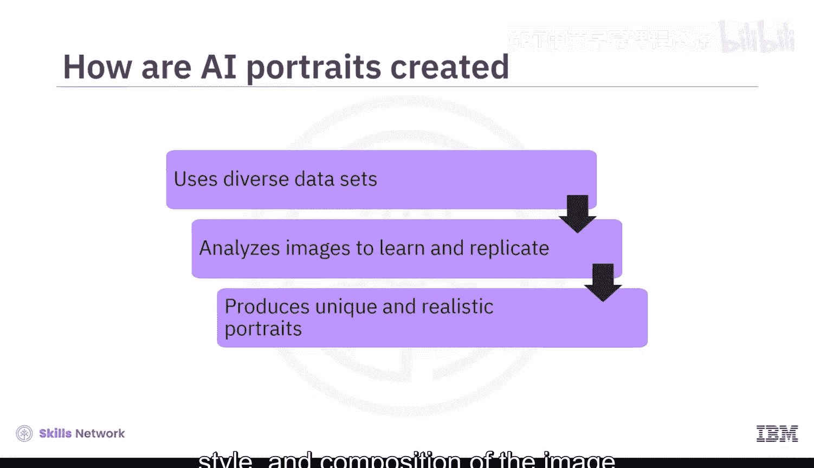
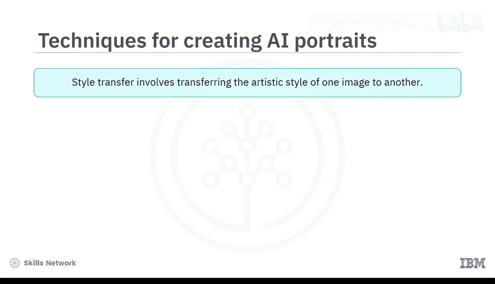
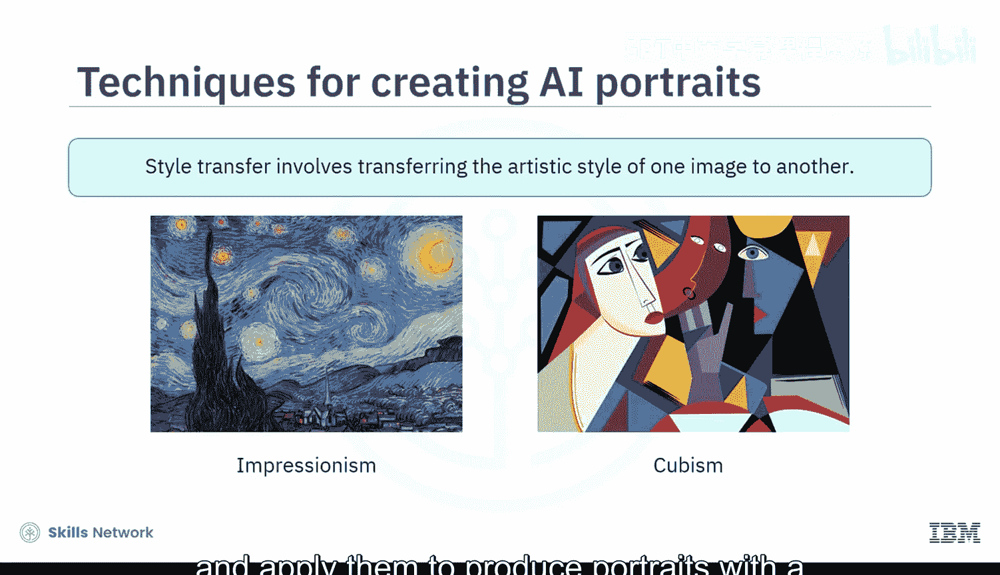
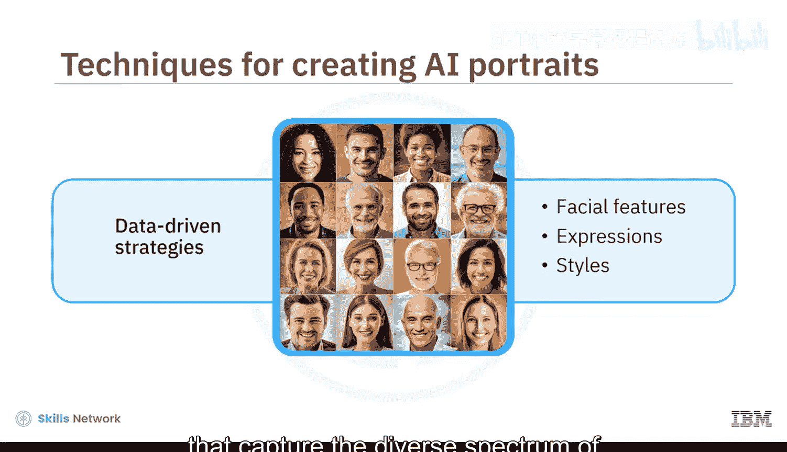
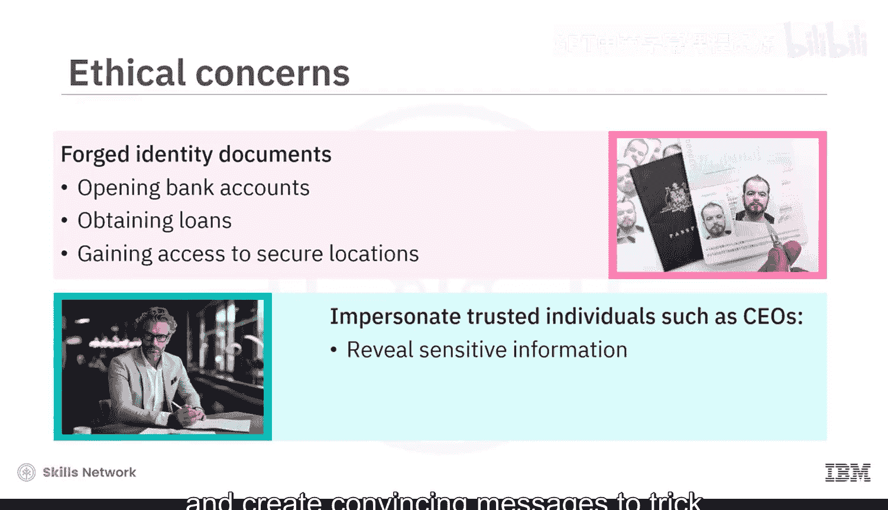
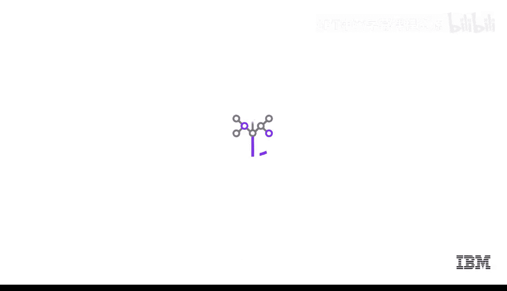

# IBM《生成式AI基础（五课全）｜Generative AI Fundamentals》中英字幕 p48 06_01_05_AI肖像与深度伪造.zh_en [BV11XSYBfEje_p48]

Welcome to AI portraits and Deep fakeakes。 After watching this video。

 you'll be able to describe AI portraits and explain the techniques of creating AI portraits。

 You'll also learn about deep fakes in their potential misuses。

 generative AI has LED to remarkable progress in various fields， including art。

 One such exciting progress is how generative AI models leverage deep learning algorithms to generate realistic portraits of individuals。

 The model can create， enhance or manipulate portraits in various ways。

 like creating entirely new portraits of individuals who do not exist。

 Artificly aging or deging a person's face and photographs and applying the artistic style of famous painters to create unique and artistic effects。

 AI portraits are generated by machine learning algorithms using a diverse data set of artistically curated images。

 The algorithm analyzes these images to learn and replicate human artistic techniques by identifying key elements like facial features。

 colors， textures and brushstrokes With this knowledge。

 the generative AI model can produce unique and realistic portraits， allowing use。😊。

To customize the mood， style and composition of the image generated to match their preferences。

There are various techniques that can be employed to create realistic AI portraits。

 Let's learn about these techniques individually。 Gs or generative adversarial networks consist of two components。

 A generator that creates fake images and a discriminator that attempts to differentiate between real and artificially generated images Throughout its training。

 the discriminator enhances its ability to detect counterfeit photos。

 while the generator refines its skill in crafting authentic portraits。

 The generator and the discriminator thus produce AI portraits that appear indistinguishable from traditional hand drawn or photographed portraits。

 St transfer is another frequently used technique for crafting AI portraits。

 The method involves transferring the artistic style of one image to another。

 resulting in a unique and visually captivating portrait。

 Artists can employ this technique to experiment with various styles from impressionism to cubism and apply them to produce portraits with a fusion of classic art and modern technology。

 Data driven strategies are also helpful in creating AI portraits Through the examination of。😊。

Of data sets of human faces， generative models acquire knowledge about a wide range of facial features。

 expressions and styles。 These data sets play a vital role in instructing the model to create portraits that capture the diverse spectrum of human appearances and emotions。

 surpassing the constraints of traditional artistic methods。

 AI portraits offer exciting possibilities like conserving our cultural heritage by commemorating individuals and their narratives and reconnecting with our history to pay tribute to the numerous aspects of human heritage。

 but it also raises ethical concerns， including misuse and deception。

 generative AI can be misused to create deep fakes， which can have serious consequences。

 Deep fakes are videos， images or audio recordings that have been manipulated using generative AI models to make it appear as if they are real。

 Deep fakes can be very convincing， and they can be used for a variety of bad purposes。

 like creating fake news and propaganda， spreading disinformation。

 harassing or blackmailing people and committing fraud。

 Deep fakes can be used to create forged identity documents or photos for fraud。

purposes such as opening bank accounts， obtaining loans or gaining access to secure locations This can lead to financial fraud and other security breaches Cy criminals can use deep fake videos to impersonate trusted individuals such as CEOs of organizations and create convincing messages to trick employees into revealing sensitive information。

 transferring funds or downloading malicious files。

Another challenge with AI assisted portraits is the lack of creative control。

 As the results produced by the model are based on a dataset set。

 It is difficult to create something that significantly deviates from the pattern established by machine learning algorithms。

 Therefore， in some cases， the output does not align with the creative vision of the artists。

 Moreover， while generative AI models can produce visually stunning images。

 capturing the sole essence of the subject is still an ongoing endeavor。

 as the models are trained via dataset sets， ensuring the AI generated portraits represent diverse individuals and avoid perpetuating biases and gender。

 race and other factors is a crucial area of improvement。 In this video。

 you learn that AI portraits are created using generative AI models。

 which are trained on vast dataset sets of curated images。

 These models can generate realistic portraits of individuals from scratch or by enhancing or manipulating existing photographs。

 AI portraits have the potential to preserve cultural heritage and create new artistic possibilities。

 However， deep fakes or raise ethical concerns such as the potential misuse and。😊。

It's essential to develop ethical guidelines and new technologies to detect deep fakes。

