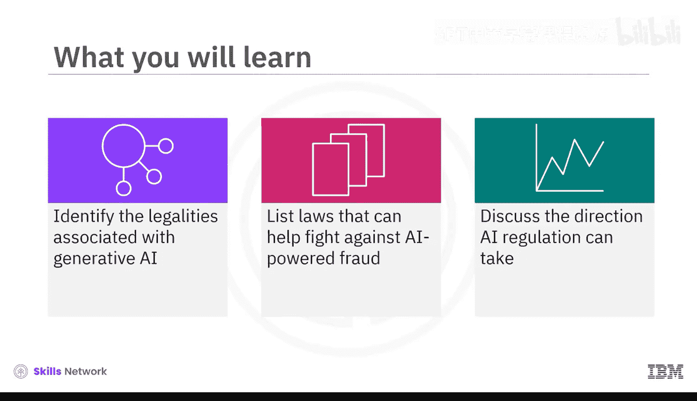
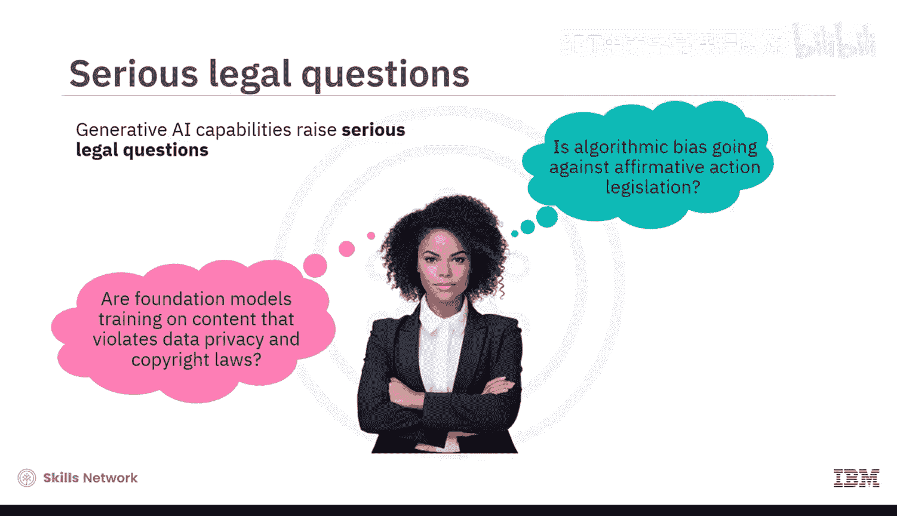
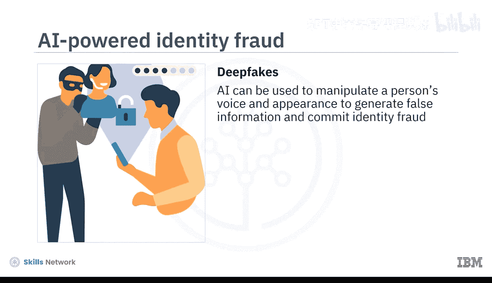
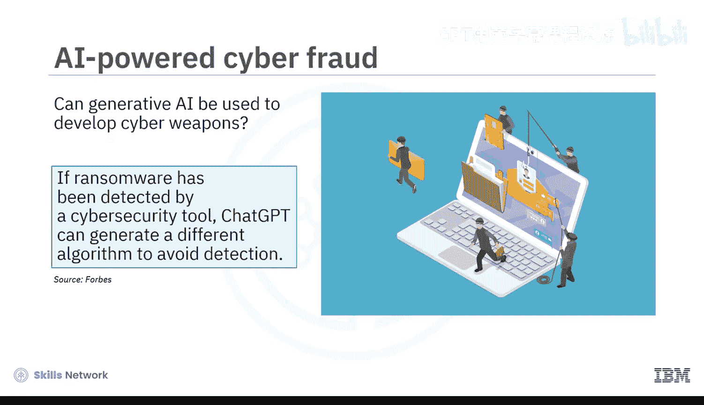
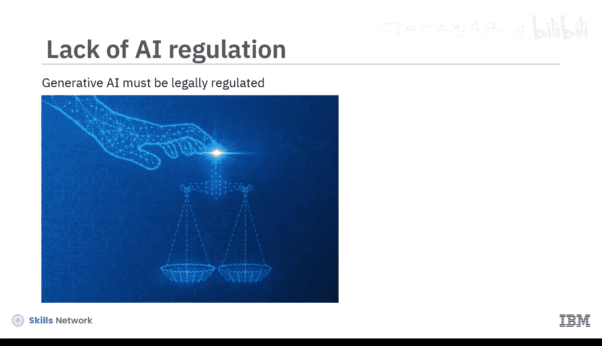
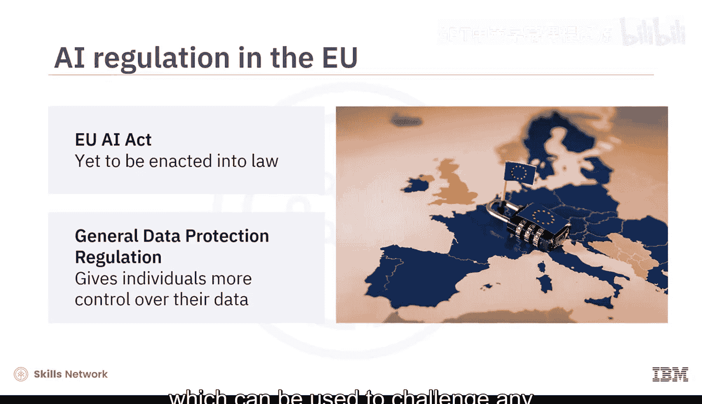
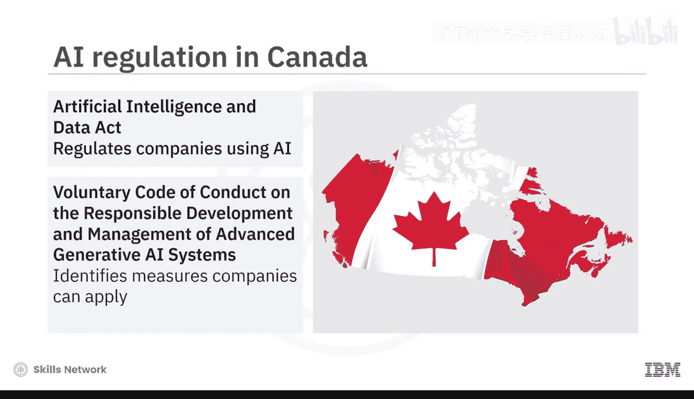
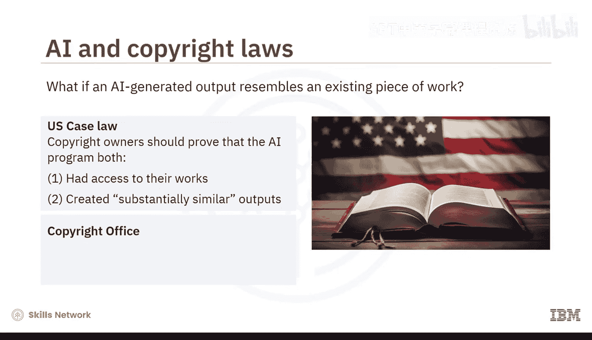
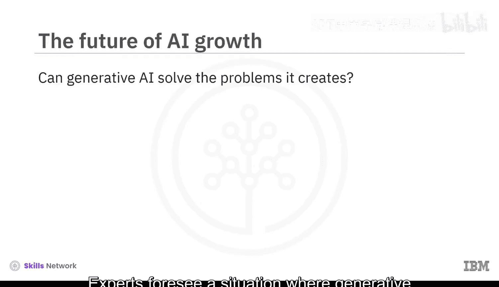
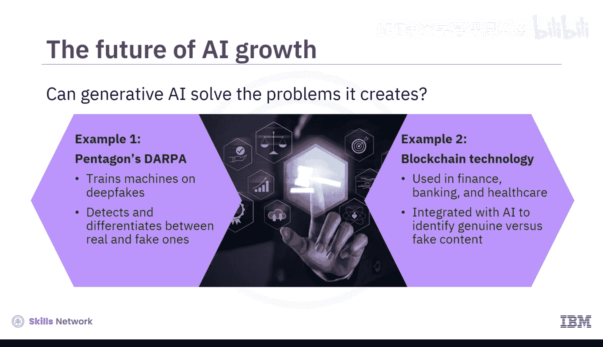

# IBM《生成式AI基础（五课全）｜Generative AI Fundamentals》中英字幕 p50 08_01_07_生成式AI的法律问题与影响.zh_en [BV11XSYBfEje_p50]

Welcome to the legal issues and implications of generative AI video。 After watching this video。

 you'll be able to identify the legalities associated with generative AI list laws that can help fight against AI powered fraud and discuss the direction AI regulation can take。

 generative AI capabilities， even on their best a， or raising some serious legal questions。

 For instance， our foundation models， training on content that violates data privacy and copyright laws is algorithmic bias going against affirmative action legislation。

 who owns the copyright to AI generated text， videos， music and images。 More disturbingly。

 the emergence of deep fakes has shown us that AI can be used to manipulate a person's voice and appearance to generate false information and commit identity fraud。

 Did you know that research has shown that AI powered fraud as the top reason for all identity fraud committed。

 There's always the added danger that generative AI can be used to develop cyber weapons。

 According to Forbes of ransomware has been detected by a cybersecurity tool。

 Chat GT can generate a different algorithm to avoid detection。 Therefore， a lot of what。😊。

Foundation models can accomplish must be legally regulated to guard against identity fraud。

 misinformation， copyright infringement， data privacy violations。

 cyber warfare and discriminatory practices。 This brings us to a critical question。

 What are governments worldwide doing to regulate the use of foundation models and generative AI。

 The first AI legislation in the world as the European Union's AI Act。

 which is yet to be enacted into law。 However， the Eu's general data protection regulation gives individuals more control over their data。

 which can be used to challenge any unauthorized legal use of private data。

 Canada's artificial intelligence and data Act helps regulate companies using AI。

 Canada's voluntary code of conduct on the responsible development and management of advanced generative AI systems。

 identifies measures companies can apply。 What does the law have to say when an AI generated output resembles an existing piece of work。

 US case law states that copyright owners may be able to prove that such outputs infringe their copyrights。

 if the AI program both one had access to their works and two created substantially similar outputs。

However， when a US citizen tried to copyright a visual artwork that was authored autonomously by an AI program。

 the Co Office denied his application， saying that human authorship is an essential part of a valid copyright claim。

 Deep fakes are unethical but not illegal。 One can use the provisions in the cyber stocking law。

 but it cannot be easy to trace the origins of the deep fake。 Plus。

 the victim has to prove that the creator of the Deep fake intended to harm。

 That's why the Pentagon is working with research institutions under its defense advancedanced Research projects agency。

 or DARPpa to develop tech that can detect deep fake videos。 In England and Wales。

 there is no legislation that governs AI directly。 However。

 the online harms bills seeks to make sharing deep fake pornography。 a criminal offense in the UK。

 Citizens are encouraged to use existing laws for defamation。 data protection。

 privacy and harassment to counter AI induced crime。 in India。

 the Ministry of Eronics and information technology regulates AI。

 While there is no legislation against deep fakes of victim of a malicious deep fake can file a complaint using the provisions in existing laws。

 under section 60。

E of the I T Act， capturing publishing or transmitting a person's image in mass media without their consent is punishable。

 The Digital Personal Data Protection Act also protects the unauthorized distribution of sensitive personal data that can identify an individual。

 If you're wondering why governments are not doing more to regulate AI。

 Then there are two possible answers。 First， the generative AI space is so dynamic that it's difficult to qualify and quantify with certainty and speed。

 how the technology is being used to commit crime and then establish who is accountable for the crime。

Second， societies must find a balance between generative AI innovation and generative AI regulation。

 Too much regulation can increase business costs and stop citizens from enjoying benefits。

 such as professional upskilling。 service efficiency，  customized products and ease of creation。

 Exps foresee a situation where generative AI might solve the problems it create two examples to consider。

 First， the Pentagon's defense advanced research projects Agency trains machines on deep fake so they can detect and differentiate between real and fake ones。

 Blockcha technology popularly used in the finance banking and health care industries can be integrated with AI to identify genuine versus fake content。

 Organs like AI firms， social media companies and technology giants should dialogue closely with government bodies。

 and citizen groups to create thoughtful and progressive AI legislation for their country。

In this video， you explored the legal issues and implications of generative AI。

 Foundation models can be used to commit identity fraud， spread misinformation， infringe copyright。

 violate data privacy， La cyber warfare and worsen discriminatory practices。

 Very few laws directly govern the use of generative AI， as this is a dynamic field。

 Governments and industry must balance innovation with regulation of generative AI。

