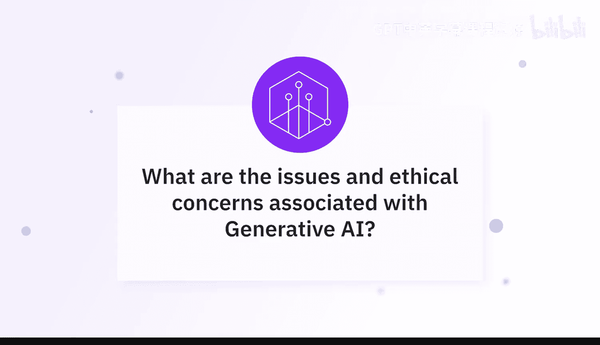
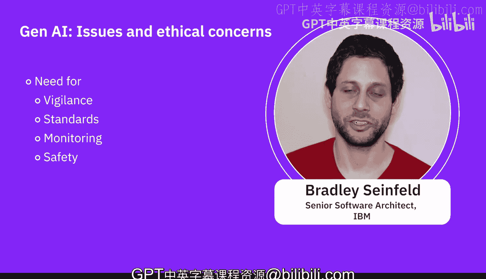
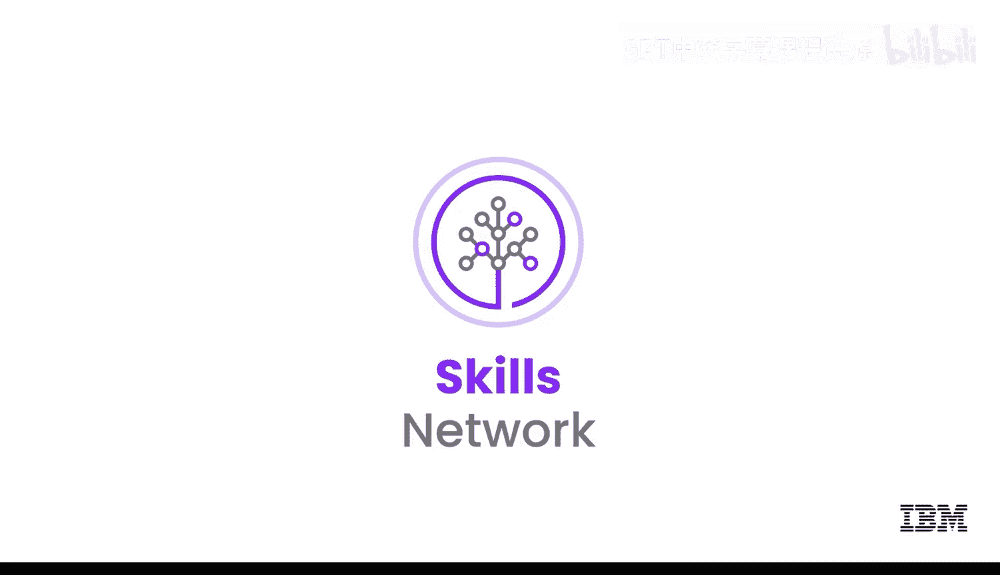

# IBM《生成式AI基础（五课全）｜Generative AI Fundamentals》中英字幕 p51 09_01_08_专家观点：生成式AI相关的问题与伦理关切.zh_en [BV11XSYBfEje_p51]

Hello and welcome to this expert viewpoints video。 Let's listen to what AI experts have to say about the issues and ethical concerns associated with generative AI。

😊。

I think it's extremely important to keep an eye on generative AI。

 I think there are quite a lot of ethical concerns and things to be worried about。

The two things I think about constantly are one。Is that anyone。

 everyone is able to do things that they weren't able to do a year ago， whether it's creating images。

 videos， transcripts， text。Anything， it becomes a double edge sword， super valuable， super amazing。

 but at the same time， if you're a bad actor， you can create misinformation and a whole variety of things which hurt。

 hurt people， hurt companies， hurt government， so on and so forth。

Some of the issues that we see that her ethical and associated around generative AI are things like bias and fairness。

 I had a friend call me almost right after Cha Etp came out and she said Cha Etp is bias。 Of course。

 D know，s very successful。 very smart woman and asked it a question about a doctor I proceeded to just respond to her assuming that the doctor was a male and the doctor had money。

 but theres something with the way she was asking the question And so what you want to do is you want to make sure that yourre formulating your questions and weeding out any biases。

 if you see biases， you can tweak your prompt to tell to not have bias。Well。

 there are aspects of generative AI having issues with respect to you know。

 replacing the human effort， but those are a little distant still。

Other ethical aspects are broadly related to the biasness and the fairness of the material that they generate if the model has been you know trained on bias material or one sided material what is going to happen is that the model is going to have the response which is generated as a bias response now that biasness may be in terms of。

Any different aspects of training， so that is why these models are usually trained very heavily and very descriptively on a lot of information。

The language model， when it comes back， the answers are so definitive and so clear and very well written that you just assume they're right。

 And that's not necessarily the case。 Sometimes it'll come back and it'll completely make up an answer。

 And it'll even say works that And so what you have to do is you really need to go through and validate and verify。

 especially if you're doing something that is based on factual information。

 like you're trying to validate drug side effects and things like that。

 You should really follow up and make sure that you're consistently getting a right answer。Secondly。

 the aspect is of privacy and security in terms of that whatever information is being given to such models can be susceptible to data leakage and what happens is that when such data is deep on if you're giving sensitive information to a generated AI monitor robust patterns and stuff。

 what happens is that you might face data leakage issues， privacy issues。

 security concerns and such issues are also of great concern。嗯。Of course。

 there is an aspect of job security in the you in the world today， but again。

The aspect of using generative AI should have to be in terms of the ethical consideration of generating more creative jobs in terms of how to use these models more effectively and how to make them more usable in terms of human effort。

The other thing to say there here's a possibility of plagiarism。

 Usually what I do a kind of writing with it。 I do use a plagiarism checker。

 And the other thing you can do is if you ask the model to vary the likes of the sentences because when people write。

 we write in different life sentences。 sometimes have eight words sometimes 12。

 tell the the model in your prompt that you'd like to use varying likes of sentences And what this will do is and it'll sound a little bit more human。

 But the key things is that you should always be ethical what you're doing。

 If you use a large language model to help you write something and somebody asked be open and honest with them。

 it's not that it's doing all of your work。 somebody asked me about my book and use a large language model or chat Ep and said do you feel like that was cheating。

 and I'm like no， these are still my ideas。 It helped me get through writer's block。

 but it didn't write the whole book for me。So the fact is， is that too。

 where it's going to be a whole lot more content out there。

 which we don't know is real or not if you see a picture of somebody doing something。A year ago。

It would be true and now you don't just need Photoshop and skill to create that image。

 you just need five seconds in the right prompt， we got to be vigilant and really make sure that generative AI is held to the right standards。

 monitored and you know， keeping us safe。

。

